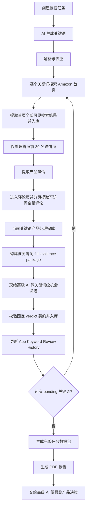

# Amazon 产品挖掘流程方案

> 文件用途：本文件只定义 **Amazon 产品挖掘技能** 的流程步骤与每一步注意事项。  
> 文件边界：本文件不写法案、不写施工图、不写数据库设计、不写代码实现、不写选品决策逻辑。  
> 核心原则：Agent 负责挖掘、提取、入库、打包，以及关键词级机会筛选研判的投喂、校验、入库与展示；高级 AI 只在关键词级判断“这个 keyword product pool 是否值得继续研究”，最终产品决策仍然只能基于完整任务数据包进行。

---

# 第一部分：人类阅读区

## 0. 流程总目标

Amazon 产品挖掘技能的目标是：

> 在用户选择的 Amazon 市场与站点中，通过 AI 生成关键词，逐个关键词搜索 Amazon 首页产品，提取搜索结果页产品信息；对首页排名前 30 名的产品逐个打开详情页并提取完整产品信息与当前可访问的全量评论；当单个关键词完成后，先构建该关键词 full evidence package 并交给高级 AI 做关键词级机会筛选，再继续下一个关键词；所有关键词完成后，再形成完整任务数据包，供高级 AI 做最终产品决策。

该技能不负责判断“这个产品一定能赚钱”，也不负责采购、定价、利润核算、库存管理或 ERP 工作。
关键词级机会筛选是人工找产品、对比产品和后续核算之前的闸门：AI 承认的 keyword product pool 才进入人工候选池；当前证据下明显不值得人工继续投入的关键词池必须被标为 `REJECT` 并保留证据供复核。

## 0.1 权威流程图



---

## 1. 用户创建挖掘任务

### 流程说明

用户先创建一个 Amazon 产品挖掘任务，并选择本次要挖掘的市场、站点和方向。

最少需要确认：

1. Amazon 站点，例如 `amazon.ae`、`amazon.sa`、`amazon.com`。
2. 目标市场，例如 UAE、Saudi、USA。
3. 挖掘方向，例如浴室用品、家居改善、水过滤、厨房用品等。
4. 本次希望挖掘的关键词数量。
5. 关键词历史策略：默认只挖掘新关键词；如需持续更新市场行情，可显式选择刷新历史关键词行情。
6. 是否限制语言，例如 English、Arabic、Japanese。
7. 是否只挖掘首页搜索结果。
8. 任务运行中的暂停、继续、终止控制，以及系统重启后的断点续跑规则。

### 注意事项

1. 站点和市场必须明确，不能让 Agent 自己猜。
2. 本流程默认只挖掘 Amazon 搜索结果首页。
3. 开始任务前必须读取历史已挖掘关键词；默认避免重复挖掘，刷新模式则把历史命中标记为 `historical_refresh` 后重新采集行情。
4. 每次任务必须生成唯一任务编号，方便后续追踪。
5. 如果用户没有选择市场或站点，任务不得开始。
6. 任务一旦创建，必须持久化断点；系统重启后，非终态任务必须自动继续。
7. 操作界面不得提供暂停、继续、终止等要求人工介入的 Amazon Product Mining 控制按钮。

## 1.1 断点续跑与任务控制

### 流程说明

任务执行期间，Agent 必须在每个关键词、每个产品、评论分页和打包前检查持久化任务状态。

状态规则：

1. `created`、`keyword_generating`、`keyword_ready`、`mining`、`packaging`：系统重启后自动继续。
2. `package_completed`、`failed`：终态，不自动重跑。
3. `created`、`keyword_generating`、`keyword_ready`、`mining`、`packaging`：非终态，系统启动后自动续跑同一生产 flow。

### 注意事项

1. 继续任务必须复用同一个 `taskId` 与同一套已入库证据。
2. 已完成的搜索结果、产品详情、评论页和关键词级 AI 研判不得重复覆盖。
3. 同一任务不得同时存在两个活动执行。
4. 暂停和终止必须写入后端持久化状态，不能只是前端按钮状态。

---

## 2. 向 AI 请求关键词

### 流程说明

Agent 将用户选择的市场、站点、挖掘方向、历史已挖掘关键词发送给 AI，让 AI 生成一批新的 Amazon 搜索关键词。

发送给 AI 的信息必须包含：

1. 用户选择的 Amazon 站点。
2. 用户选择的目标市场。
3. 用户选择的产品方向。
4. 历史已经挖掘过的关键词。
5. 本次关键词历史策略：`new_keywords_only` 或 `refresh_historical_keywords`。
6. 本次希望生成的新关键词数量。
7. 输出格式要求。

### 注意事项

1. 必须投喂历史已挖掘关键词；默认避免 AI 重复给出旧关键词，刷新模式允许历史关键词进入行情刷新队列。
2. AI 返回内容必须是结构化关键词列表，不能只返回一段自然语言。
3. 如果 AI 返回的关键词为空、重复过多或格式错误，需要重新请求或进入失败流程。
4. AI 只负责提供候选关键词，不负责最终选品判断。
5. 关键词应尽量贴近用户选择的市场与站点，而不是泛泛给全球关键词。

---

## 3. 解析 AI 返回的关键词

### 流程说明

Agent 接收 AI 返回结果后，解析出本次最新关键词。

解析动作包括：

1. 提取关键词文本。
2. 清理空格、重复符号和无效字符。
3. 统一大小写规则。
4. 过滤空关键词。
5. 与历史已挖掘关键词比对。
6. 按任务策略执行历史去重或写入 `historical_refresh` 标记。
7. 与本次任务内关键词比对。
8. 去除本任务内重复关键词。
9. 保存为本次任务的待挖掘关键词队列。

### 注意事项

1. 默认模式去重必须同时覆盖历史关键词和本次任务内关键词。
2. 刷新历史关键词行情模式必须保留历史关键词记录，并把本次队列中的历史命中标记为 `historical_refresh`。
3. 不能因为 AI 没有给足数量就自行编造关键词。
4. 默认模式下如果全部关键词都已被挖掘过，应结束任务并输出“无新增关键词”结果。
5. 每个关键词都要记录来源：由哪一次 AI 请求生成。
6. 关键词状态初始应为 `pending`。

---

## 4. 关键词队列开始执行

### 流程说明

Agent 从待挖掘关键词队列中取出第一个关键词，进入 Amazon 搜索流程。

每个关键词按顺序处理：

1. 取出一个状态为 `pending` 的关键词。
2. 标记为 `searching`。
3. 打开用户选择的 Amazon 站点。
4. 在 Amazon 搜索框输入该关键词。
5. 进入搜索结果页。
6. 等待页面加载稳定。
7. 记录搜索页面 URL、时间和页面状态。

### 注意事项

1. 必须按关键词队列逐个执行，不能跳着执行。
2. 每个关键词都要有独立搜索记录。
3. 如果页面打不开、加载失败、出现验证码或风控页面，应标记该关键词为异常状态。
4. 遇到异常时不得绕过验证码、登录限制或平台风控。
5. 异常关键词进入 `failed` 状态，之后继续下一个关键词；不得要求人工接管。

---

## 5. 提取搜索结果首页产品信息

### 流程说明

进入某个关键词的 Amazon 搜索结果页后，Agent 只提取首页中所有可见产品信息。

需要提取的信息包括：

1. 搜索关键词。
2. 搜索结果页 URL。
3. 产品在当前搜索页中的位置。
4. 是否为广告产品。
5. 产品标题。
6. 产品 URL。
7. ASIN，如果页面可见或可解析。
8. 主图 URL。
9. 价格。
10. 原价或折扣信息，如果页面可见。
11. 评分。
12. 评论数量。
13. Prime / FBA / 配送标识，如果页面可见。
14. 优惠券信息，如果页面可见。
15. 配送文案，如果页面可见。
16. 页面原始可见文本快照。

### 注意事项

1. 必须提取首页所有可见产品，不只提取看起来好的产品。
2. 必须保留搜索位置，因为位置代表该关键词下的曝光结构。
3. 必须区分广告产品和自然产品。
4. 如果同一个 ASIN 在同一关键词下重复出现，只保留一条主记录，同时保留重复出现证据。
5. 如果 ASIN 暂时无法解析，先保存产品 URL 和标题，不得直接丢弃。
6. 搜索结果页提取完成后，关键词状态不能直接完成，还需要继续进入产品详情页挖掘。
7. 搜索结果页的完整提取范围是首页全部可见产品；后续详情页和评论页只处理首页排名前 30 名。
8. 排名 31 及之后的产品不得静默删除，必须保留搜索结果证据，但不继续进入详情页和评论页。

---

## 6. 搜索结果页产品入库

### 流程说明

搜索结果首页提取完成后，Agent 将该关键词下的所有产品列表保存到系统中。

入库内容至少包括：

1. 任务编号。
2. 关键词。
3. Amazon 站点。
4. 搜索时间。
5. 搜索页 URL。
6. 产品搜索位置。
7. 产品基础信息。
8. 产品 URL。
9. 原始页面快照或原始可见文本。
10. 当前产品详情挖掘状态。

### 注意事项

1. 搜索结果必须先入库，再进入详情页挖掘。
2. 入库时要明确后续处理边界：首页前 30 名进入 `pending_detail`；排名 31 及之后只保留搜索结果证据，不继续进入详情页和评论页。
3. 入库过程失败时，不得继续打开详情页。
4. 同一产品可能来自多个关键词，不能简单覆盖旧记录，需要保留“关键词来源关系”。
5. 搜索结果页数据和产品详情页数据要分开保存，避免混在一起。

---

## 7. 打开当前关键词首页前 30 名中的第一个产品详情页

### 流程说明

搜索结果页产品入库后，Agent 只从该关键词首页排名前 30 名的产品中，按顺序逐个打开产品详情页。

处理顺序：

1. 找到当前关键词下首页前 30 名范围内第一个 `pending_detail` 产品。
2. 打开产品 URL。
3. 等待详情页加载稳定。
4. 判断页面是否为正常产品详情页。
5. 标记产品状态为 `detail_extracting`。
6. 开始提取详情页完整信息。

### 注意事项

1. 必须按搜索结果页顺序处理产品，且只处理首页前 30 名。
2. 每个产品都要独立记录打开时间和详情页 URL。
3. 如果产品页面失效、跳转、缺货或无法访问，要记录异常原因。
4. 如果页面出现验证码、登录限制或风控，不得绕过，应进入异常状态。
5. 一个产品失败后，应继续处理下一个产品，不应导致整个任务中断。
6. 排名 31 及之后的产品不进入详情页流程，只保留搜索结果证据。

---

## 8. 提取产品详情页完整信息

### 流程说明

进入产品详情页后，Agent 需要提取当前页面能显示的完整产品信息。

需要提取的信息包括：

1. ASIN。
2. 标题。
3. 品牌。
4. 店铺或卖家信息，如果页面可见。
5. 当前售价。
6. 原价、折扣、优惠券，如果页面可见。
7. 主图。
8. 所有可见图片。
9. 视频信息，如果页面可见。
10. 五点描述。
11. About this item。
12. Product Description。
13. A+ 页面内容，如果页面可见。
14. 商品变体信息。
15. 颜色、尺寸、款式等选项。
16. Product information。
17. Technical details。
18. Additional information。
19. Best Sellers Rank，如果页面可见。
20. 类目路径，如果页面可见。
21. 评分。
22. 评论数量。
23. 星级分布。
24. Q&A 内容，如果页面可见。
25. Frequently bought together，如果页面可见。
26. Customers also bought，如果页面可见。
27. Compare with similar items，如果页面可见。
28. 配送信息。
29. 退货信息。
30. 页面所有其他可见的重要产品参数。
31. 原始页面快照或原始可见文本。

### 注意事项

1. “完整信息”指当前详情页中能正常显示和读取的信息。
2. 不同 Amazon 站点和不同商品页面结构可能不同，字段不存在时应记录为空，不应报错中断。
3. 图片、视频、A+、变体、参数表、Q&A 都应尽量提取。
4. 不允许只提取标题、价格、评分这类浅层信息。
5. 原始页面可见文本必须保存，方便后续复查。
6. 产品详情提取完成后，状态进入 `detail_completed`，然后进入评论提取流程。

---

## 9. 进入评论页面

### 流程说明

产品详情页提取完成后，Agent 进入该产品的评论页面，开始提取评论。

处理顺序：

1. 找到产品详情页中的评论入口。
2. 打开全部评论页面。
3. 确认当前 ASIN 与产品对应。
4. 记录评论页面 URL。
5. 标记产品状态为 `review_extracting`。
6. 从评论第一页开始提取。

### 注意事项

1. 评论页面必须与当前产品对应，不能串到其他变体或其他商品。
2. 如果 Amazon 自动切换语言或地区，需要记录页面实际语言和地区。
3. 如果评论入口不存在、评论数为 0 或页面无法访问，应记录原因。
4. 如果评论页面出现限制，不得绕过，应进入异常状态。
5. 评论提取失败不应删除已经完成的产品详情数据。

---

## 10. 全量提取当前可访问评论

### 流程说明

Agent 需要从评论第一页开始，分页提取当前环境下可访问的全部评论。

每条评论至少提取：

1. 评论 ID，如果页面可见或可解析。
2. 评论人名称。
3. 评论星级。
4. 评论标题。
5. 评论正文。
6. 评论日期。
7. 是否 Verified Purchase。
8. 评论对应变体。
9. Helpful 数量，如果页面可见。
10. 评论图片，如果页面可见。
11. 评论视频，如果页面可见。
12. 评论语言。
13. 评论所在地区，如果页面可见。
14. 原始评论文本快照。

分页流程：

1. 提取当前评论页所有评论。
2. 保存当前页评论。
3. 判断是否存在下一页。
4. 如果存在下一页，进入下一页继续提取。
5. 如果不存在下一页，评论提取结束。
6. 标记该产品为 `completed`。

### 注意事项

1. “全量评论”指当前页面环境、当前账号状态、当前地区和当前排序条件下可访问的所有评论。
2. 不得绕过 Amazon 的验证码、登录限制、地域限制或风控限制。
3. 评论分页必须逐页保存，避免中途失败导致全部丢失。
4. 每条评论都要关联 ASIN 和产品记录。
5. 评论原文必须保存，不能只保存 AI 摘要。
6. 如果评论很多，允许分批保存，但不能跳页。
7. 如果中途失败，应记录已完成页数和失败页数，方便断点续跑。

---

## 11. 当前产品入库完成并进入下一条

### 流程说明

当一个产品的详情页和评论都提取完成后，Agent 将该产品标记为完成，并继续处理当前关键词下的下一个产品。

处理顺序：

1. 保存产品详情信息。
2. 保存评论信息。
3. 保存页面快照索引。
4. 标记产品状态为 `completed`。
5. 查找当前关键词下首页前 30 名中的下一个 `pending_detail` 产品。
6. 重复执行产品详情和评论提取流程。
7. 直到当前关键词首页前 30 名产品都处理完成。

### 注意事项

1. 一个产品完成后才能进入下一个产品。
2. 一个产品失败后应记录失败原因，并继续下一个产品。
3. 不能因为单个产品失败而终止整个关键词。
4. 同一 ASIN 如果已经被其他关键词完整挖掘过，可以复用产品详情数据，但必须新增当前关键词来源关系。
5. 复用时需要确认详情数据是否仍然有效，必要时允许刷新。

---

## 12. 当前关键词完成并进入关键词级完整资料包阶段

### 流程说明

当当前关键词下允许进入详情页与评论页的产品都处理完后，Agent 不能直接进入下一个关键词，而是先完成该关键词的执行摘要与关键词级完整资料包，为后续关键词级机会研判准备充分输入。

处理顺序：

1. 检查当前关键词下首页前 30 名产品状态，以及搜索结果页证据是否已经完整保存。
2. 统计成功、失败、待人工处理的产品数量。
3. 标记关键词状态为 `completed` 或 `completed_with_errors`。
4. 生成该关键词的 full evidence package，汇总 search results、linked product details、full accessible reviews、image refs、completeness、exceptions、AI reading contract 和 handoff prompt。
5. 生成 package integrity report；未通过时不得进入 AI 研判。
6. 将该关键词送入关键词级机会研判阶段。

### 注意事项

1. 关键词完成状态必须基于其下产品处理结果与搜索结果证据完整度。
2. 如果部分产品失败，关键词不能简单标记为完全成功。
3. 每个关键词必须保留执行摘要与关键词级完整资料包。
4. 关键词完成后不得直接跳到下一个关键词，必须先完成关键词级机会研判。
5. 如果所有关键词均失败，应输出失败数据包，而不是静默结束。
6. inline evidence slice 只能作为快速目录和导航，不得作为高级 AI 深度研判唯一资料源。

---

## 13. 执行关键词级高级 AI 机会筛选并写入历史

### 流程说明

当单个关键词的 full evidence package 生成并通过 integrity 后，Agent 将该关键词完整资料包交给高级 AI，执行一次 `keywordId` 级机会筛选。

处理顺序：

1. 将该关键词的 full evidence package、AI reading contract、keyword opportunity review prompt 准备为 GPT Web Chat 输入。
2. 将完整 package 通过 transport zip 交给高级 AI；zip 只作为运输壳，目录内 full package 文件仍是唯一证据真相源；inline slice 只能作为导航。
3. 只接受固定结构化 verdict：`PASS / WATCH / REJECT / INSUFFICIENT_DATA`。
4. 校验六个固定维度与 `humanNextStep` 枚举值。
5. 保存 prompt、raw response、structured verdict、evidence refs、missing evidence、risk points。
6. 将 keyword review 记录入库，并更新 App 的 Keyword Opportunity Review History。
7. 然后才进入下一个 `pending` 关键词；直到所有关键词都处理完成。

### 注意事项

1. 这一步是 `keywordId` 级垃圾过滤，不是最终选品。
2. 这一步只能判断“该 keyword product pool 是否值得继续研究”，不能输出采购、打样、下单、上架、广告投放或最终产品选择建议。
3. 每个关键词都必须独立生成一条 keyword opportunity review 记录，不能把某个关键词 verdict 扩大为整个任务的全局结论。
4. 如果高级 AI 不可用、返回不合规或无法结构化校验，review 必须在同一 GPT Web Chat 链路内有界重试；重试耗尽后只能进入 `failed`，不得伪装为完成。
5. App 历史表只能读取已持久化的 keyword review 记录，不能用本地缓存、demo row 或扫描资料包代替。
6. 如果 package transport zip 上传能力不可用，review 必须进入 `failed`，不得自动降级成 inline-only verdict，不得要求人工导入。
7. 如果 AI 只读取了 slice，没有读取 full package，verdict 不得作为最终 keyword review。
8. 如果 AI 返回 `REJECT`，只能标记该关键词不进入候选名单，不能物理删除该关键词 evidence。

---

## 14. 生成完整数据包

### 流程说明

所有关键词处理完成且关键词级机会研判记录已持久化后，Agent 才生成一个完整的 Amazon 产品挖掘数据包。

数据包应包含：

1. 任务基本信息。
2. 用户选择的市场与站点。
3. 本次 AI 请求关键词记录。
4. 历史关键词去重说明。
5. 本次实际挖掘关键词列表。
6. 每个关键词的搜索结果摘要。
7. 每个关键词首页产品列表。
8. 每个产品的完整详情信息。
9. 每个产品的全量评论数据。
10. 每个产品的页面快照索引。
11. 每个关键词的 keyword opportunity review 记录、结构化 verdict 与引用信息。
12. 失败、异常、待人工处理记录。
13. 数据完整性统计。
14. 可供高级 AI 决策读取的索引结构。

### 注意事项

1. 数据包只提供证据，不输出最终选品结论。
2. 数据包必须能追溯每个产品来自哪个关键词。
3. 数据包必须能追溯每条评论属于哪个产品。
4. 数据包必须明确哪些数据成功、哪些失败、哪些受页面限制。
5. 数据包必须保留原始证据索引，方便后续复查。
6. 数据包生成后，任务进入任务级打包与交接准备阶段，此时还不等于 `package_completed`。
7. 每个关键词的 keyword opportunity review 状态必须汇总到 master package 的 keyword 列表与 review 列表中，不能只存在于单独 response 文件或数据库表。
8. `failed` keyword opportunity review 必须进入异常摘要、完整性统计和 handoff readiness 账本。

---

## 15. 生成 PDF 文件

### 流程说明

完整数据包生成后，Agent 将核心内容整理为 PDF 文件，供最终任务级高级 AI 上传、阅读和决策。

PDF 应包含：

1. 封面。
2. 任务信息。
3. 市场与站点信息。
4. 关键词列表。
5. 关键词搜索结果摘要。
6. 产品总览表。
7. 每个产品的详情页信息。
8. 评论数据摘要。
9. 全量评论附录或评论索引。
10. 异常与失败记录。
11. 原始证据索引。
12. 关键词级机会研判摘要或其引用索引。

### 注意事项

1. PDF 面向高级 AI 决策，不面向普通营销展示。
2. PDF 应以信息完整、结构清晰、可追溯为优先。
3. 如果评论数量过大，可以在 PDF 中放评论摘要和索引，同时保留完整评论数据文件。
4. PDF 不能丢失关键词、ASIN、URL、抓取时间等核心追溯字段。
5. PDF 生成完成后，应与原始结构化数据包一起保存，但流程仍未结束。

---

## 16. 上传完整任务数据给高级 AI 做最终产品决策

### 流程说明

PDF 和结构化数据包生成完成后，Agent 将其作为完整任务输入材料交给高级 AI，执行最终产品决策阶段。

高级 AI 的输入应包括：

1. PDF 报告。
2. 结构化数据包。
3. 原始证据索引。
4. 失败与异常说明。
5. 本次任务范围说明。
6. 每个关键词的 keyword opportunity review 记录或摘要引用。

### 注意事项

1. 最终高级 AI 只基于完整任务数据包做决策，不应凭空补充不存在的数据。
2. Agent 不在本流程中输出最终选品建议；关键词级机会筛选也不等于最终选品。
3. 如果数据包不完整，高级 AI 必须能看到不完整原因。
4. PDF 与结构化数据包生成不等于可交接；只有 `failureReasons=[]`、`manualRequiredReasons=[]`、无 failed keyword opportunity review 且 package integrity pass 时，handoff 才能进入 `ready`；否则必须 `failed`。
5. 如果 task 已 failed 或 keyword review failed，handoff record 必须明确 not handoff-ready，不得因为文件已生成而标记 `ready`。
6. 后续选品评分、打样建议、产品矩阵判断属于下一阶段流程，不属于本文件范围。

---

# 第二部分：AI 机器阅读区

```yaml
document_type: "amazon_product_mining_process"
document_scope: "process_only"
language: "zh-CN"
skill_name: "Amazon 产品挖掘"
skill_id: "amazon_product_mining"

boundaries:
  includes:
    - "keyword_generation_request"
    - "keyword_parsing"
    - "amazon_search_page_mining"
    - "search_result_storage"
    - "product_detail_page_mining"
    - "full_accessible_review_mining"
    - "keyword_package_slice_build"
    - "keyword_opportunity_review"
    - "keyword_review_persistence"
    - "keyword_review_history_update"
    - "data_package_generation"
    - "pdf_generation"
    - "handoff_to_advanced_ai"
  excludes:
    - "final_product_decision"
    - "keyword_review_as_final_product_decision"
    - "profit_calculation"
    - "purchase_decision"
    - "procurement_or_launch_guidance"
    - "pricing_strategy"
    - "inventory_management"
    - "erp_functions"
    - "law_design"
    - "implementation_blueprint"
    - "code_design"

core_principle:
  agent_role: "mine_extract_store_package_and_persist_keyword_review"
  keyword_review_ai_role: "screen_keyword_pool_for_next_research_stage_only"
  advanced_ai_final_role: "decide_based_on_full_task_evidence_package"
  no_decision_without_evidence: true
  no_bypass_platform_restrictions: true

flow:
  - step_id: "S01"
    name: "create_mining_task"
    actor: "user_agent"
    input_required:
      - "amazon_marketplace"
      - "target_country_or_market"
      - "product_direction"
      - "keyword_count"
      - "use_existing_keyword_deduplication"
    output:
      - "task_id"
      - "task_scope"
      - "task_status: created"
    cautions:
      - "marketplace_must_be_explicit"
      - "target_market_must_be_explicit"
      - "do_not_start_without_marketplace"
      - "load_existing_mined_keywords_before_keyword_generation"

  - step_id: "S02"
    name: "request_keywords_from_ai"
    actor: "agent_to_ai"
    input_required:
      - "amazon_marketplace"
      - "target_market"
      - "product_direction"
      - "existing_mined_keywords"
      - "requested_new_keyword_count"
      - "structured_output_requirement"
    output:
      - "ai_keyword_response"
    cautions:
      - "must_include_existing_mined_keywords"
      - "must_request_non_duplicate_keywords"
      - "ai_response_must_be_structured"
      - "ai_only_generates_keywords_not_product_decisions"

  - step_id: "S03"
    name: "parse_and_deduplicate_keywords"
    actor: "agent"
    actions:
      - "extract_keyword_text"
      - "normalize_keyword"
      - "remove_empty_keywords"
      - "deduplicate_against_history"
      - "deduplicate_within_current_task"
      - "create_keyword_queue"
    output:
      - "keyword_queue"
      - "keyword_status: pending"
    cautions:
      - "do_not_fabricate_keywords"
      - "if_no_new_keywords_then_finish_with_empty_result"
      - "record_ai_source_for_each_keyword"

  - step_id: "S04"
    name: "process_keyword_queue"
    actor: "agent"
    loop: "for_each_pending_keyword"
    actions:
      - "mark_keyword_searching"
      - "open_selected_amazon_marketplace"
      - "search_keyword"
      - "wait_until_search_page_stable"
      - "record_search_url_and_time"
    output:
      - "keyword_search_run"
    cautions:
      - "process_keywords_in_queue_order"
      - "one_search_record_per_keyword"
      - "if_captcha_or_restriction_then_mark_manual_required_or_failed"
      - "do_not_bypass_captcha_login_or_risk_controls"

  - step_id: "S05"
    name: "extract_search_result_first_page"
    actor: "agent"
    page_scope: "first_page_only"
    extract_fields:
      - "keyword"
      - "search_url"
      - "rank_position"
      - "is_sponsored"
      - "title"
      - "product_url"
      - "asin_if_available"
      - "main_image_url"
      - "price"
      - "original_price_or_discount_if_visible"
      - "rating"
      - "review_count"
      - "prime_or_fba_flag_if_visible"
      - "coupon_text_if_visible"
      - "delivery_text_if_visible"
      - "raw_visible_text_snapshot"
    output:
      - "search_result_items"
    cautions:
      - "extract_all_visible_products_on_first_page"
      - "preserve_rank_position"
      - "distinguish_sponsored_and_organic"
      - "do_not_drop_item_when_asin_missing_if_url_exists"

  - step_id: "S06"
    name: "store_search_result_items"
    actor: "agent"
    actions:
      - "save_keyword_search_run"
      - "save_each_search_result_item"
      - "create_keyword_product_relation"
      - "set_product_detail_status_pending_detail"
    output:
      - "stored_search_results"
    cautions:
      - "store_search_results_before_opening_detail_pages"
      - "do_not_continue_to_detail_if_storage_fails"
      - "same_asin_from_multiple_keywords_must_preserve_each_keyword_relation"
      - "search_result_data_and_detail_data_must_remain_separate"

  - step_id: "S07"
    name: "open_product_detail_page"
    actor: "agent"
    loop: "for_each_first_page_top30_item_in_rank_order"
    actions:
      - "select_first_or_next_pending_detail_product"
      - "open_product_url"
      - "wait_until_detail_page_stable"
      - "validate_product_detail_page"
      - "mark_product_detail_extracting"
    output:
      - "product_detail_page_context"
    cautions:
      - "only_first_page_top30_may_enter_detail_and_review_flows"
      - "process_products_in_search_rank_order"
      - "record_open_time_and_final_url"
      - "if_unavailable_redirected_or_restricted_then_record_failure"
      - "continue_next_product_after_failure"

  - step_id: "S08"
    name: "extract_product_detail_full_visible_information"
    actor: "agent"
    extract_fields:
      - "asin"
      - "title"
      - "brand"
      - "seller_or_store_if_visible"
      - "current_price"
      - "original_price_discount_coupon_if_visible"
      - "main_image"
      - "all_visible_images"
      - "visible_video_info"
      - "bullet_points"
      - "about_this_item"
      - "product_description"
      - "a_plus_content_if_visible"
      - "variation_options"
      - "color_size_style_options"
      - "product_information"
      - "technical_details"
      - "additional_information"
      - "best_sellers_rank_if_visible"
      - "category_path_if_visible"
      - "rating"
      - "review_count"
      - "star_distribution"
      - "qa_content_if_visible"
      - "frequently_bought_together_if_visible"
      - "customers_also_bought_if_visible"
      - "compare_with_similar_items_if_visible"
      - "delivery_information"
      - "return_information"
      - "all_other_visible_product_parameters"
      - "raw_visible_text_snapshot"
    output:
      - "product_detail_record"
      - "product_detail_status: detail_completed"
    cautions:
      - "complete_means_all_currently_visible_and_accessible_information"
      - "missing_fields_should_be_null_not_crash"
      - "do_not_only_extract_shallow_fields"
      - "raw_visible_text_must_be_preserved"

  - step_id: "S09"
    name: "open_review_page"
    actor: "agent"
    actions:
      - "locate_review_entry"
      - "open_all_reviews_page"
      - "validate_review_page_matches_product"
      - "record_review_url"
      - "mark_product_review_extracting"
    output:
      - "review_page_context"
    cautions:
      - "review_page_must_match_current_product_or_asin"
      - "record_actual_language_and_region"
      - "if_reviews_unavailable_then_record_reason"
      - "review_failure_must_not_delete_detail_data"

  - step_id: "S10"
    name: "extract_all_currently_accessible_reviews"
    actor: "agent"
    loop: "paginate_until_no_next_page_or_restriction"
    extract_fields_per_review:
      - "review_id_if_available"
      - "reviewer_name"
      - "rating"
      - "review_title"
      - "review_body"
      - "review_date"
      - "verified_purchase"
      - "variant"
      - "helpful_count_if_visible"
      - "review_images_if_visible"
      - "review_videos_if_visible"
      - "review_language"
      - "review_region_if_visible"
      - "raw_review_text_snapshot"
    actions:
      - "extract_current_page_reviews"
      - "save_current_page_reviews"
      - "detect_next_page"
      - "open_next_page_if_available"
      - "stop_when_no_next_page"
    output:
      - "review_records"
      - "review_extraction_status"
    cautions:
      - "full_reviews_means_all_reviews_accessible_under_current_page_environment_account_region_and_sorting"
      - "do_not_bypass_captcha_login_region_or_risk_controls"
      - "save_page_by_page"
      - "do_not_skip_pages"
      - "record_completed_pages_and_failed_pages_for_resume"

  - step_id: "S11"
    name: "complete_current_product_and_continue"
    actor: "agent"
    actions:
      - "save_product_detail"
      - "save_reviews"
      - "save_snapshot_index"
      - "mark_product_completed_or_failed"
      - "select_next_product"
    loop_condition: "until_all_first_page_top30_products_under_current_keyword_processed"
    output:
      - "product_status_summary"
    cautions:
      - "one_product_should_complete_or_fail_before_next_product"
      - "single_product_failure_must_not_stop_keyword"
      - "reuse_existing_detail_data_for_same_asin_only_when_valid"
      - "rank_31_and_beyond_must_remain_search_evidence_only"
      - "preserve_current_keyword_source_relation_even_when_reusing_product_data"

  - step_id: "S12"
    name: "complete_current_keyword_and_build_full_package"
    actor: "agent"
    actions:
      - "check_all_products_under_keyword"
      - "count_completed_failed_manual_required"
      - "mark_keyword_completed_or_completed_with_errors"
      - "build_keyword_full_evidence_package"
      - "verify_keyword_package_integrity"
    output:
      - "keyword_execution_summary"
      - "keyword_full_evidence_package"
      - "keyword_package_integrity_report"
    cautions:
      - "keyword_completion_must_reflect_product_results"
      - "partial_failure_should_be_completed_with_errors"
      - "do_not_skip_keyword_full_package_before_keyword_review"
      - "inline_slice_is_navigation_only_not_final_review_evidence"
      - "every_keyword_must_have_execution_summary"

  - step_id: "S13"
    name: "run_keyword_opportunity_review"
    actor: "agent_to_ai"
    inputs:
      - "keyword_full_evidence_package"
      - "ai_reading_contract"
      - "keyword_opportunity_review_prompt"
      - "inline_evidence_navigation"
      - "search_results"
      - "linked_product_details"
      - "linked_reviews"
      - "image_refs"
      - "completeness"
      - "exceptions"
    output:
      - "keyword_review_record"
      - "keyword_review_status"
      - "app_history_updated"
    cautions:
      - "keyword_review_is_keywordId_scoped_not_final_product_decision"
      - "full_package_must_be_uploaded_when_file_upload_available"
      - "if_file_upload_unavailable_then_mark_manual_required"
      - "if_package_integrity_failed_then_do_not_enter_ai_review"
      - "if_ai_only_reads_inline_slice_then_verdict_is_not_final_keyword_review"
      - "decision_must_be_one_of_pass_watch_reject_insufficient_data"
      - "human_next_step_must_use_fixed_enum"
      - "if_ai_unavailable_or_invalid_then_mark_manual_required_or_failed"
      - "do_not_output_procurement_sampling_listing_ads_or_final_selection_guidance"
      - "reject_must_retain_reviewable_evidence_chain_not_physically_purge_keyword_evidence"

  - step_id: "S14"
    name: "generate_complete_data_package"
    actor: "agent"
    package_contents:
      - "task_information"
      - "marketplace_and_market"
      - "ai_keyword_request_records"
      - "historical_keyword_deduplication_notes"
      - "actual_mined_keyword_list"
      - "keyword_search_summaries"
      - "first_page_product_lists"
      - "complete_product_detail_records"
      - "full_accessible_review_records"
      - "keyword_opportunity_review_records"
      - "keyword_review_status_on_each_master_keyword"
      - "page_snapshot_indexes"
      - "failure_exception_manual_required_records"
      - "data_completeness_statistics"
      - "advanced_ai_readable_index"
    output:
      - "amazon_product_mining_data_package"
      - "task_status: packaging"
    cautions:
      - "data_package_provides_evidence_not_final_product_decision"
      - "must_trace_product_to_keyword"
      - "must_trace_review_to_product"
      - "must_trace_keyword_review_to_keywordId"
      - "must_disclose_failed_or_restricted_data"
      - "failed_or_manual_required_keyword_reviews_must_enter_exception_and_completeness_ledgers"
      - "must_preserve_raw_evidence_index"

  - step_id: "S15"
    name: "generate_pdf_report"
    actor: "agent"
    pdf_contents:
      - "cover"
      - "task_information"
      - "marketplace_and_site_information"
      - "keyword_list"
      - "keyword_opportunity_review_summary"
      - "keyword_search_result_summaries"
      - "product_overview_table"
      - "product_detail_sections"
      - "review_data_summary"
      - "full_review_appendix_or_review_index"
      - "exceptions_and_failures"
      - "raw_evidence_index"
    output:
      - "pdf_report"
    cautions:
      - "pdf_is_for_advanced_ai_decision_not_marketing"
      - "clarity_traceability_and_completeness_first"
      - "if_reviews_too_large_pdf_may_include_summary_and_index_but_full_review_data_must_remain_in_structured_package"
      - "do_not_drop_keyword_asin_url_or_extraction_time"

  - step_id: "S16"
    name: "handoff_full_task_package_to_advanced_ai"
    actor: "agent_to_advanced_ai"
    inputs:
      - "pdf_report"
      - "structured_data_package"
      - "raw_evidence_index"
      - "exception_and_failure_summary"
      - "task_scope"
      - "keyword_review_summary"
    output:
      - "task_handoff_completed"
      - "task_status: package_completed"
    cautions:
      - "advanced_ai_must_decide_only_based_on_full_task_data_package"
      - "agent_must_not_output_final_product_selection_in_this_process"
      - "incomplete_data_must_be_visible_to_advanced_ai"
      - "generated_pdf_or_package_files_do_not_make_handoff_ready_when_failureReasons_or_keyword_review_issues_exist"
      - "after_handoff_this_process_ends"

status_values:
  keyword_status:
    - "pending"
    - "searching"
    - "search_completed"
    - "completed"
    - "completed_with_errors"
    - "failed"
    - "manual_required"
  product_status:
    - "pending_detail"
    - "detail_extracting"
    - "detail_completed"
    - "review_extracting"
    - "completed"
    - "failed"
    - "manual_required"
  keyword_review_status:
    - "completed"
    - "manual_required"
    - "failed"
  keyword_review_decision:
    - "PASS"
    - "WATCH"
    - "REJECT"
    - "INSUFFICIENT_DATA"
  keyword_review_human_next_step:
    - "enter_next_validation"
    - "mine_related_keywords"
    - "reject"
    - "rerun_or_collect_more_data"
  task_status:
    - "created"
    - "keyword_generating"
    - "keyword_ready"
    - "mining"
    - "packaging"
    - "package_completed"
    - "failed"
    - "manual_required"

end_condition:
  success:
    - "all_keywords_processed"
    - "all_keyword_reviews_persisted"
    - "data_package_generated"
    - "pdf_generated"
    - "task_handoff_completed"
  partial_success:
    - "some_keywords_or_products_failed"
    - "some_keyword_reviews_manual_required_or_failed"
    - "package_generated_with_exception_summary"
  failure:
    - "no_marketplace"
    - "no_valid_keywords"
    - "all_keywords_failed"
    - "keyword_review_stage_failed_without_persisted_reason"
    - "package_generation_failed"
```
