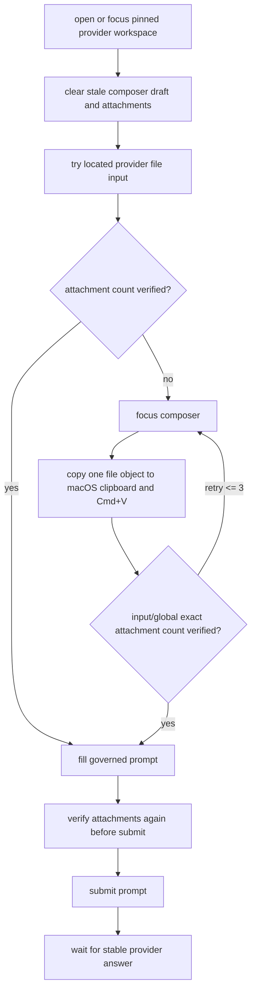

# GrassEye AI 投喂能立组施工图 V1

版本：2026-05-21  
状态：active
最近校准：2026-05-22，参考 `/Users/nexgen/Documents/translate-films` 的 Gemini 文件投喂稳定链路

## 1. 当前定位

AI Input Gateway 只负责一件事：

```txt
把有限选项问题投递给外部 provider，拿回结构化 choice 结果。
```

它不是 AI 大脑，不是流程拥有者，不是浏览器控制器。

## 2. 标准问题包

```ts
type AiChoiceQuestion = {
  questionId: string;
  taskContext: string;
  facts: Record<string, unknown>;
  options: Array<{
    id: "A" | "B" | "C" | "D";
    label: string;
    meaning: string;
  }>;
  requiredOutput: {
    selectedOptionId: "A" | "B" | "C" | "D";
    confidence: number;
    reason: string;
  };
};
```

## 3. 返回格式

只允许：

- `selectedOptionId`
- `confidence`
- `reason`

## 4. 调用链

```txt
flow script
  -> AI choice surface
      -> AI input gateway
          -> provider adapter
```

## 5. 需要记录的证明

- provider kind
- prompt identity
- parse status
- raw output ref
- schema validation result

## 6. 明确禁止

- `nextAction`
- action plan
- 浏览器命令
- DOM selector
- 坐标
- 文件路径
- 自动生成业务数据
- 付款、退款、删除、提交等敏感最终动作判断

## 7. 当前主线中的角色

在 Amazon 主线里，AI 只用于有限状态判断或人工接管判定。  
如果 DOM 与显式规则已足够，主线可以完全不调用 AI。

## 8. Web Chat 文件投喂稳定链路

当前 Facebook 种草视频依赖 web-chat provider 上传视频 artifact。稳定链路必须按下面顺序执行：



技术要点：

- 不以“本地文件名出现在页面文本里”作为唯一上传完成条件；ChatGPT/Gemini 可能隐藏、截断或异步改写文件 chip。
- 上传验收以当前 composer 附件数量为主，input scope 为准；只有 global count 与期望数精确相等时才作为诊断性通过。
- 剪贴板上传必须先聚焦 composer，再确认焦点，再复制 POSIX file 到 macOS clipboard，再执行 `Cmd+V`。
- 剪贴板上传逐个文件执行，最多 3 次重试；AppleScript 单步必须有短超时，不能无限阻塞 mission。
- prompt 发送前必须再次验证附件数量，防止“上传看似成功但发送时附件丢失”。
- 回复读取必须等待稳定回答，避免把旧会话最后一条回复当作当前视频判断。
- Web Chat provider 在 upload、prompt paste、submit、response capture 前必须证明当前前台标签仍是 provider host；如果前台已经漂移到 APP 或其他页面，必须 `review_required`，不得继续 paste / submit / capture。
- prompt paste 前必须验证 composer 焦点真实保留；`focus()` 调用本身不等于授权成功，`inputFocused=false` 不得进入 paste。
- prompt 文本粘贴后必须先做提交前鉴权：`composerText` 包含受治理的 `expectedPrefix`，或 ChatGPT `pasted text card` 已 ready，二者至少满足其一；两者都不满足时必须重新 focus -> clear -> paste -> verify，最多 3 次，仍失败则 `review_required`。
- 提交前鉴权只要求 prefix/card-ready 级证明，不要求整段 prompt exact text 全量相等；但在未完成这一步鉴权前，禁止直接按 Return 或点击 send。
- 提交是否成功由新 assistant 回复 / generating / 或“已完成提交前鉴权后 composer 或 pasted text card 清空”证明；未完成提交前鉴权时，空 composer 不是成功证据。
- submit 后必须在 provider 标签内等待新 assistant 回复稳定；在拿到 provider response 并构建 raw output proof 之前，不得自动恢复 source APP 标签，避免中断尚未发送或尚在生成的 provider 对话。
- 回复捕获必须先走主 extractor；如果主 extractor 没拿到 answerText，但页面上存在肉眼可见的最新 assistant message container，则必须走 visible assistant text fallback，不能直接把这次对话判成 timeout。
- waitForStableAnswer 必须按活动续等：assistant count 增加、answerText 变化、generating/progress 仍在继续时都要延长 idle timeout；固定 wall-clock timeout 只能作为最后保险丝。
- Web Chat transport 只负责 raw response proof，不得因为业务层期望 JSON 就把非 JSON 但非空的 provider reply 在 transport 层废掉；raw capture 成功后必须把 reply 交回业务 parser 决定 JSON、text fallback 或 review_required。
- Deep Research 使用 GPT web-chat 时，每一次 prompt exchange 必须先 fresh open 一个 provider tab，再在粘贴前点击 ChatGPT 页面“新聊天”；实测证明同一会话会记住上一个随机 marker，而点击新聊天后只返回 UNKNOWN，因此“新聊天”是当前最小可用会话隔离动作。
- 只有内部 `providerContinuationRef` 明确存在且通过 prior response hash 校验时，GPT web-chat 才允许恢复该 ref 指向的精确历史会话并跳过“新聊天”；普通请求仍必须 fresh conversation。continuation URL 只能来自受治理任务存储，不得来自业务网站请求。
- Deep Research 的 `business-report.html` 产物捕获只能走真实 ChatGPT 文件产物链。优先点击 assistant 正文中的 `下载 business-report.html` 文件入口并读取打开的 HTML 文档或下载目录新增文件；只有该入口未出现或未产出有效 HTML 时，才点击预览框右上角 `下载代码文件`。禁止恢复从回复正文、代码 fence、摘要文本中猜测 HTML 的旧链路。
- Deep Research 使用 GPT web-chat 时，在拿到 provider response 并构建 raw output proof 后，必须立即通过 `Command+W` 关闭当前 provider 标签页，再恢复 source APP 标签；关闭失败必须 `review_required`。
