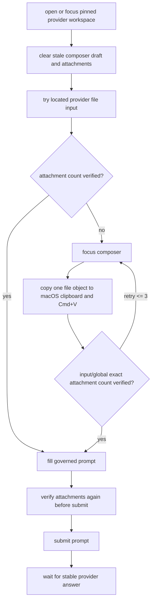

# GrassEye AI 投喂能立组施工图 V1

版本：2026-05-21  
状态：active
最近校准：2026-05-22，参考 `/Users/nexgen/Documents/translate-films` 的 Gemini 文件投喂稳定链路

## 1. 当前定位

AI Input Gateway 只负责一件事：

```txt
把有限选项问题投递给外部 provider，拿回结构化 choice 结果。
```

它不是 AI 大脑，不是流程拥有者，不是浏览器控制器。

## 2. 标准问题包

```ts
type AiChoiceQuestion = {
  questionId: string;
  taskContext: string;
  facts: Record<string, unknown>;
  options: Array<{
    id: "A" | "B" | "C" | "D";
    label: string;
    meaning: string;
  }>;
  requiredOutput: {
    selectedOptionId: "A" | "B" | "C" | "D";
    confidence: number;
    reason: string;
  };
};
```

## 3. 返回格式

只允许：

- `selectedOptionId`
- `confidence`
- `reason`

## 4. 调用链

```txt
flow script
  -> AI choice surface
      -> AI input gateway
          -> provider adapter
```

## 5. 需要记录的证明

- provider kind
- prompt identity
- parse status
- raw output ref
- schema validation result

## 6. 明确禁止

- `nextAction`
- action plan
- 浏览器命令
- DOM selector
- 坐标
- 文件路径
- 自动生成业务数据
- 付款、退款、删除、提交等敏感最终动作判断

## 7. 当前主线中的角色

在 Amazon 主线里，AI 只用于有限状态判断或人工接管判定。  
如果 DOM 与显式规则已足够，主线可以完全不调用 AI。

## 8. Web Chat 文件投喂稳定链路

当前 Facebook 种草视频依赖 web-chat provider 上传视频 artifact。稳定链路必须按下面顺序执行：



技术要点：

- 不以“本地文件名出现在页面文本里”作为唯一上传完成条件；ChatGPT/Gemini 可能隐藏、截断或异步改写文件 chip。
- 上传验收以当前 composer 附件数量为主，input scope 为准；只有 global count 与期望数精确相等时才作为诊断性通过。
- 剪贴板上传必须先聚焦 composer，再确认焦点，再复制 POSIX file 到 macOS clipboard，再执行 `Cmd+V`。
- 剪贴板上传逐个文件执行，最多 3 次重试；AppleScript 单步必须有短超时，不能无限阻塞 mission。
- prompt 发送前必须再次验证附件数量，防止“上传看似成功但发送时附件丢失”。
- 回复读取必须等待稳定回答，避免把旧会话最后一条回复当作当前视频判断。
