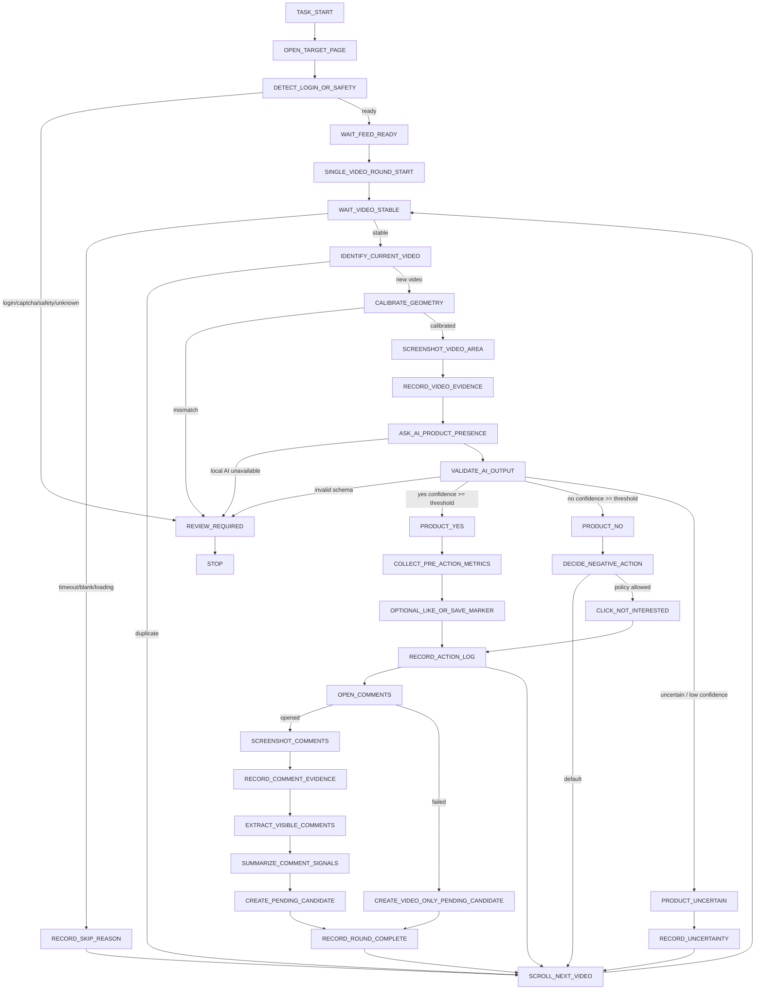

# GrassEye Agent 浏览决策树与AI询问契约施工图

## 1. Agent 定位

GrassEye Agent is a product-video discovery, operation, evidence collection, and data-feeding agent.

中文定位：GrassEye Agent 不是选品分析师，而是产品视频发现、操作、证据采集、资料投喂 Agent。

Agent 的价值不是判断产品是否值得做，而是稳定、原子化、可追溯地为后期高级 AI 或人工采集产品视频证据和评论资料。

当前阶段为 Visual-Only Runtime。
所有网页理解来自截图、OCR 与视觉 AI，不得通过 DOM/BOM 读取页面内容。

## 2. 非目标

当前阶段不允许 Agent 做以下结论：

- 采购判断
- 利润判断
- 广告判断
- 供应链判断
- 爆款判断
- 最终选品结论

## 3. 单条视频生命周期

GrassEye 必须把单条视频处理固化为一个独立 round。标准生命周期如下：

1. TASK_START
2. OPEN_TARGET_PAGE
3. DETECT_LOGIN_OR_SAFETY
4. WAIT_FEED_READY
5. SINGLE_VIDEO_ROUND_START
6. WAIT_VIDEO_STABLE
7. IDENTIFY_CURRENT_VIDEO
8. CALIBRATE_GEOMETRY
9. SAMPLE_VIDEO_FRAMES
10. CAPTURE_FRAME_3S
11. CAPTURE_FRAME_6S
12. CAPTURE_FRAME_10S
13. CREATE_MULTI_FRAME_EVIDENCE_SET
14. CREATE_PRODUCT_PRESENCE_CONTACT_SHEET
15. ASK_AI_PRODUCT_PRESENCE_MULTI_FRAME
16. VALIDATE_AI_OUTPUT
17. BRANCH
18. RECORD_ACTION_LOG
19. RECORD_ROUND_COMPLETE
20. SCROLL_NEXT_VIDEO
21. NEXT ROUND

强制约束：

- OPEN_TARGET_PAGE 只发生在任务开始或页面异常恢复时。
- SCROLL_NEXT_VIDEO 后必须回到 WAIT_VIDEO_STABLE，而不是回到 OPEN_TARGET_PAGE。
- 每条视频都必须识别当前 videoVisitId，避免重复截图、重复提问、重复点赞、重复评论采集、重复 candidate。
- 每个 round 在进入 SCROLL_NEXT_VIDEO 前都必须 finalize 成以下之一：
- Product Discovery Evidence Packet：仅用于 product_yes、operator-marked uncertain、review-required 取证场景。
- Lightweight Browse Ledger Entry：用于 product_no_high_confidence、duplicate、普通 skip。
- Explicit Failed Packet：用于需要保留审计证据的失败场景。

## 4. 原子动作表

| Atomic Action | Purpose | Input | Output | Allowed Next Step | Failure Next Step | Evidence / Action Log |
| --- | --- | --- | --- | --- | --- | --- |
| open_target_page | 打开目标推荐流 | targetUrl | page session | detect_login_or_safety | review_required | action log required |
| detect_login_or_safety | 检查登录墙 / 验证码 / 安全页 / 未知 UI | page state or screenshot | ready or blocked reason | wait_feed_ready | review_required | evidence required on failure |
| wait_feed_ready | 确认推荐流已进入可浏览状态 | runtime page state | ready or timeout | single_video_round_start | review_required | action log on failure |
| wait_video_stable | 等待视频不再黑屏、加载中或空白 | page state | stable / unstable | identify_current_video | record_skip_reason | evidence or skip reason required |
| identify_current_video | 确认当前视频身份，避免重复处理 | currentUrl + screenshotHash + page hint | videoVisitId + duplicate flag | calibrate_geometry | scroll_next_video | record reason required |
| calibrate_geometry | 确认视口、坐标和 geometry guard 可用 | viewport + screenshot | calibrated / mismatch | sample_video_frames | review_required | action log required |
| sample_video_frames | 规划第一问产品判断所需的多帧采样 | video stability + runtime timing | sampling strategy | capture_frame_3s | record_skip_reason | action log required |
| capture_frame_3s | 捕获第一张稳定视频帧 | video region | frameEvidenceId | capture_frame_6s | capture_frame_6s | evidence or unavailable reason required |
| capture_frame_6s | 捕获第二张稳定视频帧 | video region | frameEvidenceId | capture_frame_10s | capture_frame_10s | evidence or unavailable reason required |
| capture_frame_10s | 捕获第三张稳定视频帧 | video region | frameEvidenceId | create_multi_frame_evidence_set | create_multi_frame_evidence_set | evidence or unavailable reason required |
| create_multi_frame_evidence_set | 把多帧截图绑定到同一个 roundId / videoVisitId | frame evidence refs | multiFrameEvidenceSetId | create_product_presence_contact_sheet | record_skip_reason | evidence required |
| create_product_presence_contact_sheet | 生成 3-panel contact sheet 或 governed multi-image input | frame evidence set | contactSheetEvidenceId or multi-image bundle | ask_ai_product_presence_multi_frame | review_required | evidence required |
| ask_ai_product_presence_multi_frame | 第一问 AI，只判断整段视频是否是产品视频 | multiFrameEvidenceSetId + contact sheet | AI structured result | validate_ai_output | review_required | ai result evidence required |
| validate_ai_output | 校验 AI schema、版本、动作建议 | AI JSON | valid / invalid | branch | review_required | reason required |
| collect_pre_action_metrics | 记录点赞数、评论数等原始指标 | screenshot + OCR / visual extraction | preActionMetrics | like_or_save_marker / open_comments | open_comments / record_skip_reason | metrics evidence or unavailable reason |
| like_or_save_marker | 低频推荐流调教动作 | product_yes + policy allow | actionLogId | open_comments | open_comments | action log required |
| open_comments | 打开评论区 | visual target | opened / failed | screenshot_comments / create_video_only_pending_candidate | create_video_only_pending_candidate | action log required |
| screenshot_comments | 截评论区首屏或受限采样窗口 | comment screenshot region | commentEvidenceId | extract_visible_comments | create_video_only_pending_candidate | evidence required |
| extract_visible_comments | 从首屏评论证据中抽取可见评论 | comment screenshot + OCR | visible comments | summarize_comment_signals | create_video_only_pending_candidate | evidence required |
| summarize_comment_signals | 只提炼需求、质疑、想买等信号 | visible comments | commentSignal | create_pending_candidate | create_video_only_pending_candidate | ai result required |
| create_pending_candidate | 生成 richer pending candidate | video evidence + comment evidence | candidateId | record_round_complete | review_required | candidate evidence required |
| create_video_only_pending_candidate | 评论不可用时保留 video-only 候选 | video evidence + preActionMetrics | candidateId | record_round_complete | record_skip_reason | candidate evidence required |
| decide_negative_action | 选择 scroll next 或受治理 not interested | product_no + policy | governed negative action | click_not_interested / scroll_next_video | scroll_next_video | decision reason required |
| click_not_interested | 减少非产品视频推荐 | product_no + explicit UI target | actionLogId | scroll_next_video | scroll_next_video | action log required |
| scroll_next_video | 切到下一条视频 | visual scroll action + screenshotHash/videoVisitId verification | next video visible | wait_video_stable | review_required | action log required |
| record_skip_reason | 记录为什么跳过 | uncertainty or failure reason | skip log | scroll_next_video / review_required | review_required | action log required |
| record_round_complete | 固化 round 完结结果 | round outcome + refs | persisted round outcome | scroll_next_video / stop | review_required | action log required |
| review_required | 进入人工复核 | blocked reason | review state | stop | stop | reason required |

## 5. Multi-frame Product Presence Sampling Policy

第一问 AI 默认不再使用单帧。

从单帧判断升级为三帧判断，可以大幅降低开场特效、黑屏、字幕、转场、未露出产品导致的误判。

默认采样：

- 3s
- 6s
- 10s

三帧必须属于：

- 同一个 roundId
- 同一个 videoVisitId
- 同一个 MultiFrameVideoEvidenceSet

推荐输入方式：

- 3-panel contact sheet
- 或 governed multi-image input

强制约束：

- 第一问 AI 默认使用 multi-frame evidence，不默认使用 opening screenshot。
- Contact sheet 是优先默认策略，避免本地 AI 压力变成 3 倍。
- 不允许默认变成 3 次独立 AI 调用。
- 如果视频短于 10 秒，使用 adaptive sampling：
  - first stable frame
  - midpoint
  - late frame
- 如果某个时间点截图失败，必须记录 frameUnavailableReason。
- 至少 2 张有效帧才可以正常进入 AI product presence。
- 只有 1 张有效帧时，必须进入 single_frame_fallback，并降低 confidence ceiling 或进入 review/skip。
- 0 张有效帧时，必须进入 skipped_unstable_video 或 review_required。
- product_no 默认不长期保存完整三帧，只保留必要 ledger / hash / summary。
- product_yes、operator-marked uncertain、review_required 才把 multi-frame evidence 纳入 Evidence Packet。

## 6. 第一问 AI Prompt Contract

第一问必须固定为：

Review the three sampled frames from the same video. Decide whether the video, as a whole, is demonstrating, featuring, using, unboxing, comparing, or clearly presenting a concrete product.

Prompt 必须要求：

- 分别观察 frame_3s / frame_6s / frame_10s
- 如果只有部分帧有效，说明不确定性
- 不要基于单个字幕 / 特效判断
- 不要判断产品商业价值
- 只返回结构化 JSON

禁止询问：

- Is this product good?
- Is this profitable?
- Should we source it?
- Should we buy it?
- Should we run ads?
- Is it a winning product?

## 7. AI Output Schema

第一问 AI 输出必须是结构化结果，至少包含：

- taskType
- promptId
- promptVersion
- schemaVersion
- inputMode
- multiFrameEvidenceSetId
- contactSheetEvidenceId
- frameEvidenceIds
- screenshotEvidenceId
- sampledFrameCount
- validFrameCount
- isProductVideo: true | false | null
- confidence: 0 to 1
- visibleProductTypes: string[]
- evidenceObservations: string[]
- reason: string
- frameLevelObservations
- aggregateReason
- suggestedNextAction
- uncertainty: string[]
- mustReview: boolean

## 8. Product Presence Decision Rules

固定规则：

- isProductVideo === true && confidence >= 0.75
  - product_yes_high_confidence
  - collect_pre_action_metrics
  - optional like/save marker
  - open_comments
- isProductVideo === false && confidence >= 0.75
  - product_no_high_confidence
  - default scroll_next
  - optional click_not_interested if policy allows
- isProductVideo === null or confidence < 0.75
  - product_uncertain
  - record uncertainty
  - skip or review
- validFrameCount === 1
  - single_frame_fallback
  - lower confidence ceiling or skip / review
- validFrameCount === 0
  - skipped_unstable_video or review_required
- invalid schema
  - review_required
- local AI unavailable
  - review_required or skip, but never fake success
- login / captcha / safety / unknown UI
  - review_required
- geometry mismatch
  - review_required

## 9. Like / Save Marker Policy

like/save 不是商业判断；它是 recommendation tuning marker。

用途：

- 让平台后续更可能推送类似产品视频
- 帮助 Agent 找到更多产品视频

红线：

- 只能在 product_yes_high_confidence 后执行
- 必须先 collect_pre_action_metrics，再 like/save
- 必须确认 UI target 明确
- 必须 rate-limited
- 必须写 action log
- 失败不能伪装成功
- 失败默认不能阻断评论采集，除非 UI 状态异常
- 不能批量刷赞
- 不能作为互动增长动作

## 10. Metrics Collection Policy

必须定义 pre_action metrics：

- likeCount if visible
- commentCount if visible
- shareCount if visible
- saveCount if visible
- sourceUrl
- captureTime
- metricCaptureStage: pre_action or post_action

第一阶段至少要求 pre_action metrics。

如果不可见，必须记录 unavailable reason，不允许伪造。

metrics 走视觉/OCR，不走 DOM。

## 11. Comment Sampling Policy

评论采样必须有边界：

- 只有 product_yes_high_confidence 进入评论链
- 默认只采评论区首屏
- maxCommentScreenshots = 3
- maxVisibleComments = 20
- 不进入评论者主页
- 不追踪个人身份
- 不读取私信
- 不读取非公开内容
- 不无限滚动
- 评论不可打开时必须记录 reason

comment extraction 走截图/OCR，不走 DOM。

button locating 走 visual target，不走 selector。

next video 判断走 screenshotHash/videoVisitId/visual difference，不走 DOM。

如果视觉失败，进入 skip/review，不 DOM fallback。

Comment AI 只允许总结：

- where_to_buy_questions
- price_questions
- purchase_intent
- quality_concerns
- problem_complaints
- repeated_demand_terms

Comment AI 不允许输出最终商业结论。

## 12. Candidate Creation Policy

固定规则：

- product_yes + video evidence -> 可创建 video-only pending candidate
- product_yes + comment evidence -> 创建 richer pending candidate
- product_no -> 不创建 candidate
- uncertain -> 默认不创建 candidate，除非 operator 手动标记

candidate 状态只能是：

- pending_analysis

补充约束：

- Candidate 只是 Evidence Packet 内的索引对象。
- 高级 AI 的主要输入是 Evidence Packet，不是孤立 candidate。

禁止：

- approved
- winning
- profitable
- recommended_to_buy
- procurement_ready
- ads_ready

## 13. Negative Action Policy

固定规则：

- product_no 默认 scroll_next
- click_not_interested 是 optional governed action
- click_not_interested 只能在 UI target 明确、policy allow、rate limit allow 时执行
- 不允许对 uncertain 视频执行 not interested
- UI 未识别时不得盲点 not interested

## 14. Round Completion Contract

每条视频结束必须产生一个 round outcome：

- candidate_created
- video_only_candidate_created
- skipped_non_product
- skipped_uncertain
- skipped_duplicate
- skipped_unstable_video
- review_required
- failed_with_reason

## 14. Browse Ledger Contract

Browse Ledger 是轻量浏览统计，不是高级 AI 投喂材料。

用于记录：

- sessionId
- totalSeenCount
- productYesCount
- productNoCount
- uncertainCount
- duplicateCount
- skippedUnstableCount
- blockedCount
- evidencePacketCount
- startedAt
- endedAt

product_no_high_confidence 默认只进入 Browse Ledger，不生成 Evidence Packet。

## 15. Export Boundary

高级 AI 只接收 Evidence Packet export set。

不接收 browse ledger 中的非产品视频流水。

导出 summary 只包含：

- totalSeenCount
- productPacketCount
- skippedNonProductCount
- uncertainCount
- duplicateCount
- blockedCount
- exportPacketCount

每个 round 必须固化：

- roundId
- videoVisitId
- packetId
- startTime
- endTime
- outcome
- evidenceRefs
- actionLogRefs
- decisionReason
- nextStep

不允许空跑。

## 16. Mermaid 流程图

