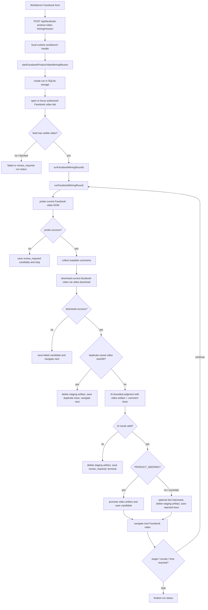

# GrassEye Facebook 种草视频技能流程与使用说明

版本：2026-05-22
状态：active-supporting-blueprint
依据：当前代码实践 + active law

## 0. 文档定位

本文是 `facebook-product-video-mining` 的辅助施工与使用说明，不是 active law。

最高约束仍来自：

- `.github/instructions/agent-rules/modules/module-facebook-product-video-mining.instructions.md`
- `.github/instructions/agent-rules/GRASSEYE-KERNEL.instructions.md`
- DOM、Video Download、AI Input Gateway、Local App Shell、Evidence、Runtime Log 相关 active law

本文只解释当前代码已经形成的流程、入口、数据合同与技术要点；不得用来授权第二流程、fallback、bridge、AI planner、通用 mission loop 或绕过平台安全限制。

## 1. 技能目标

Facebook 种草视频技能的目标是：

```txt
在用户已授权的 Facebook 本地浏览器会话中，
按轮扫描当前视频，
下载完整视频 artifact，
收集页面与评论信号，
交给外部 AI 做有限选项判断，
把真正的种草视频保存为结构化候选记录和最终视频 artifact。
```

它不是：

- 通用 Facebook 自动化机器人。
- AI 规划浏览器下一步。
- 单靠截图或文本判断的假种草检测。
- 直接读取 cookie、token、localStorage、sessionStorage 的抓取器。
- 视频下载能力组的替代实现。

## 2. 当前代码入口

当前主入口分三层：

| 层级 | 当前文件 | 职责 |
|---|---|---|
| Workbench 页面 | `src/app/workbench-home-page.ts` / `src/app/workbench-home-client.ts` | 展示独立 Facebook job card，收集结构化 mission input |
| HTTP surface | `src/app/workbench-facebook-routes.ts` | 只暴露 mission / run / latest 三个 API |
| Local runtime handle | `src/lib/local-runtime/workbench.ts` | 装配能力组并调用插件公开接口 |
| Job flow owner | `src/plugins/facebook-product-video-mining/facebook-product-video-mining.flow.ts` | 拥有 mission 生命周期、轮次循环和终态 |
| Round owner | `src/plugins/facebook-product-video-mining/facebook-product-video-mining.round.ts` | 拥有单轮 probe、评论、下载、AI 判断、保存/拒绝 |

Workbench 和 local runtime 只接收输入、启动任务、查询状态；业务顺序只属于 `src/plugins/facebook-product-video-mining/**`。

## 3. 使用说明

### 3.1 前置条件

使用前需要满足：

- 本地 Workbench 已启动。
- 浏览器会话已经由用户授权并能访问 Facebook。
- Facebook feed URL 指向 `facebook.com` / `www.facebook.com` / `m.facebook.com`。
- AI provider 使用当前 schema 允许的 `gemini-web-chat` 或 `gpt-web-chat`。
- 目标视频可在当前授权页面中播放；登录墙、验证码、2FA、风控、私密视频和 DRM 必须诚实进入 `review_required` 或 `failed`。

### 3.2 Workbench 输入项

当前页面只收集一个业务字段：

| 字段 | 说明 |
|---|---|
| `targetProductCount` | 希望保存的种草视频数量 |

点击 Start 后，页面提交的 mission payload 只包含 `targetProductCount`。
其余参数由程序默认策略补齐：

| 字段 | 默认行为 |
|---|---|
| `feedEntryUrl` | 默认 `https://www.facebook.com/reels/`；flow 会优先尝试聚焦已有 Facebook 视频 tab |
| `providerKind` | 默认 `gpt-web-chat` |
| `modelName` | 默认 `null`，走 provider 配置 |
| `maxRounds` | 默认按目标数量自动放大，至少覆盖目标数量 |
| `maxMinutes` | 默认 `20` |
| `maxCommentScrolls` | 默认 `80` |
| `maxCommentWaitMs` | 默认 `12000` |
| `preferredQuality` | 默认 `best_available` |
| `maxVideoBytes` | 默认 `200_000_000`，上限 `500_000_000` |
| `notInterestedEnabled` | 默认关闭，避免默认污染操作者 Facebook 推荐流；只有显式自动化输入才可开启 |
| `saveRejectedTrace` | 默认保存拒绝 trace |

### 3.3 API surface

当前合法 HTTP surface：

```txt
POST /api/facebook-product-video-mining/mission
GET  /api/facebook-product-video-mining/run?runId=<runId>
GET  /api/facebook-product-video-mining/latest
GET  /api/facebook-product-video-mining/results?runId=<runId>
GET  /api/facebook-product-video-mining/export?runId=<runId>
```

这些 API 只能启动 mission、查询指定 run、查询最新 run、读取 saved product records、导出选品资料；不能下发 DOM 操作、不能指定下一步、不能携带 AI action plan。

页面在 Start 后会轮询当前 run，显示：

- saved product count / target product count。
- 当前 saved `PRODUCT_SEEDING` records。
- Export 按钮输出 `facebook-product-video-mining.selection.v1` JSON。

导出资料只包含 `status=saved` 且 `aiSelectedOptionId=PRODUCT_SEEDING` 的候选，用于后续高级 AI 选品；不得把 rejected、uncertain、review_required 或 failed 记录混入成功导出。

## 4. 总流程图



## 5. 单轮执行顺序

单轮由 `facebook-product-video-mining.round.ts` 和 `facebook-product-video-mining.round-runtime.ts` 共同表达，顺序是固定的：

1. `probeCurrentFacebookVideo`
   - 执行 Facebook 专属 DOM probe script。
   - 识别当前 URL、页面标题、视频元素、视频 ID、评论入口、更多菜单、下一条按钮、指标文本、登录/验证码/风控 blocker。
   - 输出 `FacebookVideoDomProbeResult`，由 zod schema 校验。

2. `collectAllLoadableComments`
   - 打开评论面板。
   - 在 `maxCommentScrolls` 和 `maxCommentWaitMs` 范围内尽可能展开评论。
   - 去重、过滤明显非评论文本，保存 `FacebookCommentRecord`。

3. `downloadCurrentFacebookVideo`
   - 通过 `VideoDownloadAbilityGroup.execute` 调用 `download-facebook-video-once`。
   - artifact 初始状态是 `staging`。
   - 下载失败不允许伪装成功。

4. duplicate 检查
   - 对比已保存候选的 `videoSha256`。
   - 如果重复，删除 staging artifact，保存 duplicate trace，并进入下一条。

5. `judgeFacebookProductVideo`
   - 构建固定 prompt contract：`facebook-product-video-mining.video-judge.v1`。
   - 输入包括视频文件 ref、页面事实、评论样本。
   - 通过 AI Input Gateway 投递给 web-chat provider。
   - AI feed 有硬超时与 abort signal；超时返回 `review_required` / `UNCERTAIN`，不能让 run 长期停在 `running`。
   - AI 必须返回 JSON 判断，不得返回工作流、选择器、坐标或浏览器动作。

6. 决策落库
   - `PRODUCT_SEEDING`：promote video artifact 到 Facebook mining video 目录，保存 candidate、comments、AI judgment、probe JSON。
   - `NOT_PRODUCT_SEEDING` 或 `UNCERTAIN`：默认不点击 Not Interested，删除 staging artifact，保存 rejected/uncertain trace。
   - AI feed 失败、超时或 JSON 无效：删除 staging artifact，保存 `review_required`，mission 进入终止复核。

7. 下一条导航
   - round 完成后调用 `navigateToNextFacebookVideo`。
   - 如果无法继续，返回 terminal reason。

## 6. 数据与状态合同

### 6.1 mission input

核心 schema 位于：

```txt
src/plugins/facebook-product-video-mining/facebook-product-video-mining.schema.ts
```

关键约束：

- APP 页面只要求 `targetProductCount`。
- `feedEntryUrl` 如由 API 显式传入，必须是 Facebook host；页面不展示该字段。
- `providerKind` 如由 API 显式传入，只能是 `gpt-web-chat` 或 `gemini-web-chat`；页面不展示该字段。
- `maxRounds >= targetProductCount`。
- `maxVideoBytes` 不能超过 schema 上限。
- 外部输入必须先经 schema 校验。

### 6.2 run status

当前 run 状态：

```txt
queued
running
completed
max_rounds_reached
max_minutes_reached
review_required
failed
```

终态由 `resolveTerminalRunStatus` 按保存数量、时间、轮数、复核原因和失败状态计算。Workbench 只显示状态，不决定状态。

### 6.3 round / candidate status

当前 round / candidate 状态：

```txt
running
saved
rejected
uncertain
review_required
failed
```

候选记录保存：

- 页面与视频身份：`sourcePageUrl`、`facebookVideoId`、`pageTitle`
- 作者/文案/互动指标：`authorText`、`captionText`、`likeCount`、`commentCountDisplayed`
- 评论加载情况：`commentsLoadedCount`、`commentsComplete`、`commentStopReason`
- AI 判断：`aiSelectedOptionId`、`aiConfidence`、`aiReason`
- 视频证据：`videoArtifactRef`、`videoFilePath`、`videoSha256`、`videoByteSize`、`videoContentType`
- 动作结果：`notInterestedStatus`

### 6.4 selection export

当前导出合同：

```txt
facebook-product-video-mining.selection.v1
```

核心字段：

- run：当前 run 状态与目标数量。
- savedProductCount / targetProductCount。
- records：按保存时间排序的成功候选。
- 每条 record 包含 source URL、Facebook video id、作者/文案/互动、AI confidence/reason、visible product、category、selling intent signals、video artifact ref/file path/sha256。

导出不包含 cookies、tokens、localStorage、sessionStorage、完整 HTML 或浏览器 profile 数据。

### 6.5 存储位置

当前存储 owner：

```txt
src/plugins/facebook-product-video-mining/facebook-product-video-mining.storage.ts
```

它使用 SQLite 保存 run、candidate、comments、AI judgment。视频文件由 Video Download 能力组写入 staging artifact；只有被接受的种草视频才会 promote 到 Facebook mining 目标目录。

## 7. 技术要点

### 7.1 插件拥有业务顺序

`facebook-product-video-mining.flow.ts` 拥有 mission 生命周期：

```txt
create storage -> mark running -> open/focus feed -> loop rounds -> finalize run
```

`facebook-product-video-mining.round.ts` 拥有单轮业务顺序：

```txt
probe -> comments -> download -> duplicate check -> AI judgment -> accept/reject -> next video
```

禁止把这些顺序移入 `src/app`、`src/lib/local-runtime`、DOM Automation、Video Download 或 AI Input Gateway。

### 7.2 DOM probe 是 Facebook 插件内的业务探针

当前 Facebook DOM probe 不放在 DOM Automation 能力组里，因为它识别的是 Facebook 业务页面信号：

- 当前可见视频。
- 评论入口。
- 更多菜单。
- Not Interested。
- 下一条视频。
- 点赞/评论/分享计数。
- 登录、验证码、风控 blocker。

DOM Automation 仍是通用页面动作能力组；Facebook 业务语义属于插件 owner。

### 7.3 Video Download 只负责视频 artifact

当前下载调用固定走：

```txt
VideoDownloadAbilityGroup.execute
  childCapabilityId: download-facebook-video-once
  artifactDisposition: staging
```

它只输出下载事实、artifact ref、sha256、文件路径、失败/复核原因。它不判断是否种草，不保存 candidate，不决定下一条。

被接受的视频通过 `promoteArtifact` 变成最终 artifact；被拒绝、重复或 AI 失败的视频通过 `deleteArtifact` 删除 staging artifact。

### 7.4 AI 只做有限判断

当前 AI 判断入口：

```txt
judgeFacebookProductVideo
  -> executeAiFeedWithHardTimeout
  -> aiInputGateway.execute(..., { signal })
```

prompt contract 是：

```txt
facebook-product-video-mining.video-judge.v1
```

允许输出：

```txt
PRODUCT_SEEDING
NOT_PRODUCT_SEEDING
UNCERTAIN
confidence
reason
visibleProduct
productCategory
sellingIntentSignals
evidenceFromVideo
```

禁止输出或依赖：

- nextAction
- actionPlan
- browser command
- DOM selector
- coordinate
- file path
- provider 直连业务判断

### 7.5 失败必须诚实

当前失败路径包括：

| 阶段 | 失败/复核行为 |
|---|---|
| open feed | run 标记 `failed` |
| wait video | run 标记 `failed` |
| probe blocker | candidate 标记 `review_required`，mission 终止 |
| download failure | candidate 标记 `failed`，尝试进入下一条 |
| duplicate video | 删除 staging artifact，保存 failed trace，进入下一条 |
| AI review/failed/invalid JSON | 删除 staging artifact，candidate 标记 `review_required`，mission 终止 |
| rejected / uncertain | 删除 staging artifact，保存 rejected/uncertain trace |

禁止把 warning、partial pass、soft pass、空记录、截图、HTML 或 AI 文本冒充成功保存。

### 7.6 日志只是可见性

`facebook-product-video-mining.logging.ts` 使用 Runtime Log Spine 记录 mission / round 进度。日志包含 step、status、reason、refs，但不替代 SQLite run/candidate 记录，也不替代视频 artifact 证据。

日志不得写入 cookie、token、密码、provider secrets 或敏感完整 URL。

## 8. 技能边界

### 8.1 允许

- 从 Workbench 结构化启动 Facebook mining mission。
- 使用用户已授权的本地浏览器页面。
- 读取当前页面可见 DOM 结构和可播放视频信息。
- 下载当前授权页面可访问的视频 artifact。
- 把视频 artifact 和有限页面事实投喂给批准的 AI provider。
- 保存 run、candidate、comments、AI judgment 和最终视频 artifact。

### 8.2 禁止

- 读取、导出、记录、重放 cookie、token、localStorage、sessionStorage、密码。
- 绕过登录墙、验证码、2FA、风控、私密视频、DRM。
- 使用第三方 downloader 网站作为默认路径。
- 让 AI 决定下一步浏览器动作。
- 在 app shell 增加 DOM 控制按钮或通用任务框。
- 在 Video Download 内加入种草判断。
- 在 AI Input Gateway 内加入 Facebook 业务判断。
- 新增第二套 Facebook mining flow。
- 新增 compatibility / bridge / fallback / shadow downloader 或 shadow AI chain。

## 9. 当前验收与质检入口

当前 package scripts：

```bash
npm run acceptance:facebook-product-video-mining
npm run audit:facebook-product-video-mining
npm run ci:full
```

完整质检只能使用：

```bash
npm run ci:full
```

`ci:full` 已先运行：

```bash
npm run codex:entry-gate
```

当前 Facebook domain owner inspector 检查：

- 必要插件文件存在。
- 必要 acceptance 文件存在。
- local workbench re-export start / run / latest surface。
- workbench handle 暴露 start / run / latest。
- app shell 暴露 mission / run / latest routes。
- Facebook workbench 输入面只暴露 `targetProductCount`，不得回归 feed URL / provider / model / max rounds / max minutes 参数表单。
- Facebook client mission payload 只提交 `targetProductCount`。
- Facebook schema 能从最小 mission input 自动补齐默认参数。
- package scripts 包含 Facebook acceptance 和 audit。

当前 acceptance 覆盖：

- storage schema 与 run 记录基础行为。
- AI upload 必须使用视频文件 input refs，不能直接 import provider adapter。
- flow 必须包含 round、download、AI judgment、Not Interested、storage、artifact staging/promote/delete。
- live DOM probe 脚本必须能写出 probe debug artifact。

## 10. 后续施工提示

后续继续实现或增强该技能时，优先沿当前 owner 拆分：

```txt
src/plugins/facebook-product-video-mining/
  flow: mission 生命周期
  round: 单轮业务顺序
  dom-probe / comments / navigation / not-interested: Facebook 页面业务动作
  video: video-download 能力组调用与 artifact promotion/deletion
  ai-judge: bounded AI judgment prompt + result normalization
  storage-*: SQLite run/candidate/comment/judgment persistence
```

如果新增字段、状态、动作或验收项，必须同步检查：

- schema 是否先定义外部输入和记录合同。
- flow / round 是否仍是一条显式业务链。
- app shell 是否仍只提交结构化 input 和显示状态。
- 能力组是否仍只做同类原子能力。
- storage 是否记录 success、failure、review_required 的足够证据。
- acceptance 和 owner inspector 是否覆盖新增 lawful surface。
- generated artifacts 是否通过 audit build 链生成，不能手工编辑。

任何需要新增 active law、扩大 ability group 白名单、改变 AI 边界或新增第二链的需求，必须先进入 LAW-GAP / 用户裁决，而不是在施工图中自行补法。
