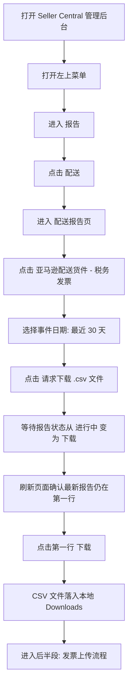

# Amazon invoice upload 流程与 DOM 施工图草案

> 文件用途：本文件只定义 **Amazon invoice upload** 技能的流程步骤、DOM 观察信息与每一步注意事项。  
> 文件边界：本文件不写 active law、不写数据库设计、不写代码实现、不写 CI 真相。  
> 核心原则：流程顺序归 Amazon invoice upload job flow owner；DOM Automation 只提供中性 snapshot / locate / click / upload / wait / verify 子能力；Chrome 实走信息只能作为实现地图，不高于 active law。

---

# 第一部分：人类阅读区

## 0. 流程总目标

Amazon invoice upload 技能分为两段：

1. 从 Seller Central 下载 `亚马逊配送货件 – 税务发票` 最近 30 天 CSV 报告。
2. 基于报告与本地批准发票文件，继续进入订单/发票上传流程。

本次实走完成的是第一段：打开 Seller Central、进入配送报告、请求最近 30 天 CSV、等待报告生成、点击最新报告下载。

## 0.1 权威流程图草案



---

## 1. 打开 Amazon Seller Central 管理后台

### 流程说明

入口示例：

```txt
https://sellercentral.amazon.ae/home
```

实走账号语言为中文简体，站点为 `sellercentral.amazon.ae`。

### DOM 观察

页面稳定后可观察到：

- title: `亚马逊`
- header logo link: `a[aria-label="Amazon"][href="/home"]`
- 顶部搜索框：`input[name="query"][placeholder="搜索"]`
- 左上菜单按钮：可见 DOM 中表现为无文本 `div[role="button"]`，视觉位置在左上角。
- 店铺/市场文本：`NEXGEN 阿拉伯联合酋长国`

### 注意事项

1. 如果出现登录、2FA、验证码、风险验证，应进入 `manual_required`，不得绕过。
2. 不读取 cookies、localStorage、sessionStorage 或密码字段。
3. 页面语言可能变化；实现应优先用 href / aria-label / visible text 组合定位。

---

## 2. 点击菜单栏

### 流程说明

点击左上角菜单按钮，打开 Seller Central 全局菜单。

### DOM 观察

菜单打开后会出现覆盖层，包含一级分类：

```txt
目录
库存
确定价格
订单
广告
品牌旗舰店
增长
报告
付款
绩效
应用程序和服务
B2B
品牌
学习
```

一级菜单项视觉上在左侧，悬停或点击后右侧显示二级菜单。

### 注意事项

1. 菜单打开后页面主体会被半透明遮罩覆盖，这是正常状态。
2. DOM node_id 是运行时临时值，不得写成长期 selector。

---

## 3. 点击报告

### 流程说明

在左侧菜单点击或悬停 `报告`，展开报告二级菜单。

### DOM 观察

二级菜单包含：

```txt
业务报告
定制分析
配送
广告
自定义报告
库存报告
Tax Document Library
管理税费
销售成本和费用
SKU 成本报告
```

稳定定位候选：

```txt
a[aria-label="配送"][href="/reportcentral/ref=xx_fbareports_dnav_xx"]
visible text: 配送
```

### 注意事项

1. `配送` 位于 `报告` 分类下，不是 `库存` 分类下的 `货件`。
2. 如果只打开了 `库存` 子菜单，说明 hover/click 停在错误一级分类，应重新定位 `报告`。

---

## 4. 点击配送

### 流程说明

点击 `报告 -> 配送`，进入配送报告页。

### DOM 观察

进入后的 URL：

```txt
https://sellercentral.amazon.ae/reportcentral/WelcomePage
```

页面 title：

```txt
配送报告
```

页面主标题：

```txt
亚马逊配送报告
```

报告列表中可见目标报告：

```txt
亚马逊配送货件 – 税务发票
```

稳定链接候选：

```txt
a[href="/reportcentral/AFNShipmentInvoicingReport/1"]
visible text: 亚马逊配送货件 – 税务发票
```

### 注意事项

1. 同一目标报告可能在收藏、库存/销量分组、最近查看中出现多次。
2. 实现应接受多个相同 href 候选，但点击任意一个前必须确认 visible text 与 href 都匹配。

---

## 5. 点击亚马逊配送货件 - 税务发票

### 流程说明

点击 `亚马逊配送货件 – 税务发票`，进入目标报告下载页。

### DOM 观察

目标 URL：

```txt
https://sellercentral.amazon.ae/reportcentral/AFNShipmentInvoicingReport/1
```

页面主标题：

```txt
亚马逊配送货件 – 税务发票
```

说明文本：

```txt
有关已配送的亚马逊物流买家订单的全面详情
```

下载页控件：

```txt
kat-dropdown[label="事件日期"]
button[value="CSV"] text: 请求下载 .csv 文件
button[value="TSV"] text: 请求 .txt 下载
kat-table role="table"
```

报告表头：

```txt
报告类型
涵盖的日期范围
请求日期
文件格式
报告状态
```

### 注意事项

1. 目标页默认为 `今天（到目前为止）`。
2. 左侧导航也会高亮 `亚马逊配送货件 – 税务发票`，但流程真相应以主内容区下载控件和 URL 为准。

---

## 6. 选择事件日期：最近 30 天

### 流程说明

打开 `事件日期` 下拉框，选择 `最近 30 天`。

### DOM 观察

下拉组件：

```txt
kat-dropdown[label="事件日期"]
```

实走时组件属性：

```txt
value="0"  -> 今天（到目前为止）
value="30" -> 最近 30 天
```

选项列表：

```txt
kat-option[value="0"]  今天（到目前为止）
kat-option[value="1"]  前一天（昨天）
kat-option[value="3"]  最近 3 天
kat-option[value="7"]  最近 7 天
kat-option[value="14"] 最近 14 天
kat-option[value="30"] 最近 30 天
kat-option[value="-1"] 确切日期
```

选择成功后的可见信号：

```txt
div[title="最近 30 天"]
kat-dropdown[label="事件日期"][value="30"]
```

### 注意事项

1. 这是 Amazon Katal 组件，不是原生 `select`。
2. 自动化应等待 value 变为 `30` 或可见标题变为 `最近 30 天` 后再点击 CSV 请求按钮。

---

## 7. 点击请求下载 .csv 文件

### 流程说明

点击：

```txt
请求下载 .csv 文件
```

### DOM 观察

按钮稳定候选：

```txt
button[type="button"][value="CSV"]
visible text: 请求下载 .csv 文件
```

点击后，报告表第一行新增最近 30 天报告，实走结果：

```txt
报告类型: 亚马逊配送货件 – 税务发票
涵盖的日期范围: 26/4/28 00:00 - 26/5/27 23:59
请求日期: 2026年5月28日
文件格式: .csv
报告状态: 进行中
```

进行中状态的右侧动作：

```txt
button text: 取消
```

### 注意事项

1. 请求成功的第一验证不是 toast，而是表格第一行出现当前请求。
2. 进行中时不得点击 `取消`。
3. 如果第一行没有新增当前日期请求，应进入失败或复核状态。

---

## 8. 等候并刷新页面

### 流程说明

原计划等待 180 秒后刷新页面。实走发现报告在 90 秒前已经从 `进行中` 变为可下载。

推荐实现：

```txt
最多等待 180 秒
每 15-30 秒检查一次第一行状态
如果第一行出现 下载 按钮，立即进入下载步骤
否则 180 秒到达后刷新页面再检查
```

### DOM 观察

可下载状态第一行：

```txt
kat-table-row role="row"
  kat-table-cell: 亚马逊配送货件 – 税务发票
  kat-table-cell: 26/4/28 00:00 - 26/5/27 23:59
  kat-table-cell: 2026年5月28日
  kat-table-cell: .csv
  kat-table-cell:
    kat-button[label="下载"][variant="secondary"][size="small"][type="button"]
```

在 DOM CUA 可见文本中，第一行会显示：

```txt
亚马逊配送货件 – 税务发票 ... 2026年5月28日 .csv 下载
```

### 注意事项

1. `180 秒` 是最大等待/刷新兜底，不是必须等满。
2. 一旦第一行已可下载，应立即点击下载。
3. 刷新后日期下拉会恢复默认 `今天（到目前为止）`，但历史报告表仍保留最新 30 天请求；下载步骤应基于表格第一行，而不是重新请求。

---

## 9. 点击最近报告下载

### 流程说明

点击报告表第一行的 `下载` 按钮。

### DOM 观察

可下载按钮：

```txt
kat-table-row[0] kat-button[label="下载"][type="button"]
DOM CUA 暴露为 button text: 下载
```

点击后浏览器进入 Amazon 下载端点：

```txt
/listing/downloadfile?_encoding=UTF8&contentType=text%2Fcsv&documentId=...&documentName=...
```

本次 Chrome 下载目录最新文件：

```txt
/Users/nexgen/Downloads/粘贴的文本 (1)(253).txt
```

说明：

- 请求按钮是 `.csv`。
- 下载端点 `contentType=text/csv`。
- 本地落地文件名可能由 Amazon `documentName` 决定，不一定以 `.csv` 结尾。

### 注意事项

1. 不要把完整 `documentId` 写入日志或流程记录。
2. 不读取下载文件内容到日志，文件可能包含订单/发票敏感数据。
3. 下载完成证明可记录为本地文件路径、文件大小、mtime 与下载动作证据引用。

---

## 10. 前半段完成条件

前半段完成必须同时满足：

1. 已进入 `AFNShipmentInvoicingReport/1`。
2. `事件日期` 曾选择 `value="30"`。
3. 已点击 `button[value="CSV"]`。
4. 表格第一行报告类型为 `亚马逊配送货件 – 税务发票`。
5. 表格第一行文件格式为 `.csv`。
6. 表格第一行状态从 `进行中` 进入 `下载`。
7. 已点击第一行 `下载`。
8. 本地 Downloads 出现新的下载文件。

---

## 11. 后半段占位：上传发票

后半段仍归 Amazon invoice upload job flow owner，当前代码实践已存在以下 owner 文件作为参照：

```txt
src/plugins/amazon-invoice-upload/amazon-invoice-upload.flow.ts
src/plugins/amazon-invoice-upload/amazon-invoice-upload-steps.ts
src/plugins/amazon-invoice-upload/amazon-invoice-upload-file-attachment.ts
src/plugins/amazon-invoice-upload/amazon-invoice-upload-verify.ts
src/plugins/amazon-invoice-upload/amazon-dom-hints.ts
```

后半段应继续遵守：

1. 只上传调用方批准的 invoice PDF。
2. 敏感最终提交可由 `requireHumanFinalSubmit` 要求人类确认。
3. DOM hints 属于 plugin job flow，不得放进 DOM Automation ability group。
4. 订单号、发票号、上传成功文案属于 Amazon invoice upload 业务语义。
5. 每一步必须有 DOM step trace / evidence ref / failure reason。
6. 打开订单详情 URL 后必须刷新同一 URL 一次，刷新后随机等待 3-6 秒，再开始定位并点击上传发票入口。
7. 上传后半段关键步骤失败时最多额外递归重试 2 次，用于抵御 Seller Central DOM 闪烁、弹窗延迟、file input 延迟暴露。
8. 登录、2FA、验证码、人工最终提交、最终成功验证等敏感终态不得通过重试伪造成自动成功。
9. 刷新与重试必须写入现有 `recordAmazonDomStepTrace`，只记录结构化摘要，不记录 PDF 内容、cookie、documentId 或订单敏感正文。

防复发要求：

```txt
唯一固化点: scripts/audit/domains/amazon-invoice-upload/inspector.ts
禁止新增第二 inspector / 第二 runner / 第二 flow。
禁止用 acceptance 文件替代执法脚本固化。
执法脚本必须能在故意破坏生产刷新/重试守卫时 FAIL。
```

---

# 第二部分：DOM 实走记录摘要

## 实走环境

```txt
日期: 2026-05-28
站点: sellercentral.amazon.ae
语言: 中文简体
入口: https://sellercentral.amazon.ae/home
目标报告: 亚马逊配送货件 – 税务发票
目标 URL: /reportcentral/AFNShipmentInvoicingReport/1
```

## 核心 selector / locator 候选

```txt
菜单按钮:
  top-left visible role=button, no stable aria label observed

报告 -> 配送:
  a[aria-label="配送"][href="/reportcentral/ref=xx_fbareports_dnav_xx"]

税务发票报告:
  a[href="/reportcentral/AFNShipmentInvoicingReport/1"]
  visible text: 亚马逊配送货件 – 税务发票

事件日期:
  kat-dropdown[label="事件日期"]
  selected value: 30
  visible title: 最近 30 天

最近 30 天 option:
  kat-option[value="30"]
  visible text: 最近 30 天

请求 CSV:
  button[type="button"][value="CSV"]
  visible text: 请求下载 .csv 文件

报告表:
  kat-table[role="table"]
  kat-table-row[role="row"]
  kat-table-cell[role="cell"]

最新报告下载:
  first data row kat-button[label="下载"][type="button"]
```

## 状态文本

```txt
生成中:
  进行中
  取消

可下载:
  下载
```

## 本次实走时间观察

```txt
点击 CSV 请求后约 3 秒:
  第一行出现新报告，状态为 进行中

约 90 秒前:
  第一行状态已变为可下载

180 秒刷新后:
  第一行仍为最新 30 天报告，状态为 下载
```

## 实走结论

实现不应机械等满 180 秒。正确策略是：

```txt
请求 CSV
-> 周期检查第一行
-> 第一行出现 下载 即点击
-> 180 秒只作为最大等待与刷新兜底
```

---

# 第三部分：禁止事项

1. 禁止把本文件当成 active law。
2. 禁止手工编辑 generated audit artifacts 作为源真相。
3. 禁止在 DOM Automation 中写 Seller Central 业务顺序。
4. 禁止新增第二套 invoice upload flow。
5. 禁止记录完整下载 URL 的 `documentId`。
6. 禁止读取或公开 CSV 中的订单/发票数据。
7. 禁止绕过登录、2FA、验证码或风控。
