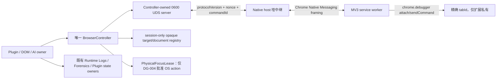
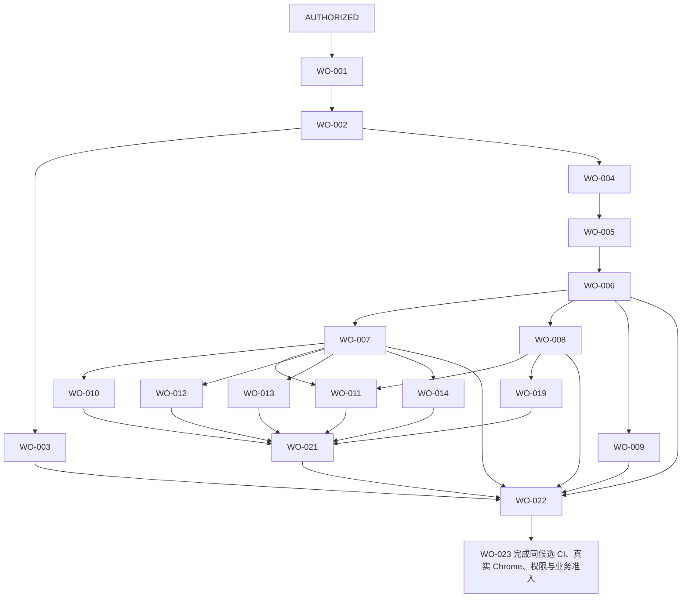

# GrassEye 精确标签页浏览器控制与 Chrome 扩展驱动重构方案项目实现方案

## 1. 一句话结论

本项目有必要建设且架构可行；当前方案已编译为 19 张可独立验收工作单、305 项精确文件/系统操作和 41 条逐单验收。用户已经一次性授权法案、施工图、代码和质检系统建设，施工授权状态为 `AUTHORIZED`；提交、推送、部署和生产发布仍不在授权内。

## 2. 项目目标和当前问题

目标是保持唯一 BrowserController，通过 Browser owner 私有的 MV3、Native Messaging 和 chrome.debugger，把页面操作从“谁在前台就操作谁”改为“只操作 Controller 签发的目标标签页与文档代次”。普通页面动作不激活 Chrome、不切换用户标签；仅文件选择器等获准 OS action 使用短时 PhysicalFocusLease。

当前 BrowserController 没有 target/document identity；普通 evaluate/click/scroll/input/screenshot 依赖 active/front window；raw 9222 file-input 存在 URL-first、first-page 和 native fallback；AI 与 Video Download 还有 direct JXA/AppleScript 旁路。结果是 Agent 运行时用户电脑几乎不可用，发现问题也难以及时 pause、cancel 或 takeover。

## 3. 必要性分析

- 受影响者是同时使用电脑和运行 GrassEye 的操作者；高频浏览器任务会争夺键盘、鼠标和前台标签。
- 不建设的代价是持续的整机占用、串页风险、错误上传/关闭风险、无法及时接管和低并发效率。
- 培训或“不要碰电脑”不能消除 active-tab identity 缺口；增加更多窗口脚本只会扩大第二链。
- 明确缺口是 exact target/document capability、后台 page action、焦点租约、逐插件干预和机器治理。
- 收益由 ACC-023B 的零抢焦/双同源矩阵与 ACC-023D 的真实工作日数据验证。
- 当前证据足够进入完整方案设计，结论为 `NECESSITY_PROCEED`，不等于批准建设。

## 4. 建设与不建设边界

- MUST_BUILD：唯一 BrowserController 私有 MV3/Native Messaging/chrome.debugger transport；opaque BrowserTargetRef/BrowserDocumentRef；target+origin+generation fail-close；普通 navigation/evaluate/click/fill/scroll/screenshot/DOM file-input 零焦点；PhysicalFocusLease 仅批准 OS action；逐插件干预；原子 cutover。
- MUST_NOT_BUILD：第二 Controller、公开 transport、raw Chrome ID、ChatGPT tab pool、通用 dispatcher/route bus/task store、secret/cookie/storage 读取、headless、compatibility/fallback/shadow/dual chain。
- REUSE_EXISTING：src/lib/browser owner 与唯一 assembly；DOM semantics；AI 单 provider-tab scheduler/checkpoints；各 plugin 业务状态；Runtime Log Spine；forensics；audit builder/generated runner/ci:full。
- REPORT_ONLY：Startup Chrome 激活现状、与本目标无关的 DOM 文档债、历史 CI/Chrome receipts。
- RETIRED_IF_AUTHORIZED：evaluateActiveTab/closeActiveTab、raw 9222 URL/first-page selection、普通 front-window/screencapture/OS input、AI/Video direct JXA/AppleScript、同动作 native fallback。
- STOP_BOUNDARY：无独立授权、identity 不能 fail-close、权限拒绝、普通动作仍需焦点、插件无安全点、raw ID/secret/第二链出现、旧路径非零、candidate_scope 漂移。

## 5. 100 分建设表决

| 维度 | 得分 | 满分 | 结论 |
|---|---:|---:|---|
| 必要性 | 29 | 30 | 当前问题可复核 |
| 边界 | 18 | 20 | 五类决定已进入 DG，不留未建模阻断 |
| 复用与缺口 | 13 | 15 | 复用唯一 owner，替换旧 transport |
| 预期收益 | 12 | 15 | 需真实 Chrome 与业务工作日证明 |
| 可行性 | 8 | 10 | 平台可行，安装与 provider 仍需实证 |
| 风险控制 | 8 | 10 | fail-close、原子 cutover 与分层证据可控 |
| 总分 | 88 | 100 | `VOTE_PASS_80` |

```scorecard-evidence
{
  "dimensions": [
    {
      "field": "score_necessity",
      "base_score": 30,
      "evidence_level": "E3_VERIFIED",
      "evidence_cap": 30,
      "final_score": 29,
      "deduction_reason": "扣 1 分：工作日效率改善尚无真实业务基线。",
      "evidence_locations": [
        "BrowserController active-tab contract",
        "98 个 BrowserController source consumers",
        "用户电脑被持续占用的当前问题"
      ]
    },
    {
      "field": "score_boundary",
      "base_score": 20,
      "evidence_level": "E3_VERIFIED",
      "evidence_cap": 20,
      "final_score": 18,
      "deduction_reason": "扣 2 分：唯一 governance domain 与逐插件干预范围必须由 DG-002/DG-005 闭合。",
      "evidence_locations": [
        "AGENTS.md owner map",
        "A authority report",
        "DG-002",
        "DG-005"
      ]
    },
    {
      "field": "score_reuse_gap",
      "base_score": 15,
      "evidence_level": "E3_VERIFIED",
      "evidence_cap": 15,
      "final_score": 13,
      "deduction_reason": "扣 2 分：现有 Browser owner 可复用，但 target identity、transport、focus lease 与 audit owner 均缺失。",
      "evidence_locations": [
        "Workbench single controller assembly",
        "generated law registry/matrix",
        "B current evidence inventory"
      ]
    },
    {
      "field": "score_expected_benefit",
      "base_score": 15,
      "evidence_level": "E2_SUPPORTED",
      "evidence_cap": 13,
      "final_score": 12,
      "deduction_reason": "扣 1 分：零抢焦收益合理，但 provider compatibility 和工作日数据尚待 ACC-023B/ACC-023D。",
      "evidence_locations": [
        "用户目标",
        "Chrome debugger platform capability",
        "ACC-023B",
        "ACC-023D"
      ]
    },
    {
      "field": "score_feasibility",
      "base_score": 10,
      "evidence_level": "E2_SUPPORTED",
      "evidence_cap": 9,
      "final_score": 8,
      "deduction_reason": "扣 1 分：extension ID、Native host 安装和 DevTools 争用尚待 DG-003 与真实验证。",
      "evidence_locations": [
        "Chrome debugger/native messaging docs",
        "DG-003",
        "WO-005"
      ]
    },
    {
      "field": "score_risk_control",
      "base_score": 10,
      "evidence_level": "E2_SUPPORTED",
      "evidence_cap": 9,
      "final_score": 8,
      "deduction_reason": "扣 1 分：mutation outcome unknown、用户打断和逐插件安全点必须施工后验证。",
      "evidence_locations": [
        "B quality stop conditions",
        "WO-006",
        "WO-010,WO-011,WO-017,WO-019",
        "ACC-023B"
      ]
    }
  ]
}
```

总分：88/100。80 分是继续完整方案设计的治理阈值，不是项目成功率、收益保证或施工许可。

## 6. 权威、法案和施工图分析

权威顺序固定为：用户明确要求 → AGENTS.md → Kernel → Index → 命中域 active law → generated truth/inspector/acceptance → 施工图 → current source → 官方 Chrome 平台文档 → 本方案。

A/B/C 共同确认三个事实：第一，src/lib/browser 和唯一 Workbench assembly 已经是 Browser owner；第二，local-browser-session 当前仍是“当前活动物理标签页”文本，且没有 generated owner binding；第三，DOM/AI 的 blueprint 与 inspector 仍编码旧 active-tab/焦点假设。正式施工必须先完成 WO-001、WO-002、WO-003。Chrome 官方文档只证明 API 能力，不授予 GrassEye owner 或生产准入。

## 7. 质检和证据系统方案

证据按层分开，禁止互相冒充：

| 层 | 入口 | 证明上限 |
|---|---|---|
| Static authority/audit | ACC-002、ACC-003、ACC-022 | owner、law binding、AST/symbol old-path-zero |
| Deterministic Exam | ACC-004 至 ACC-021 | protocol、identity、action、lease、plugin state machine |
| Full CI | ACC-023A | 同候选唯一 audit/typecheck/acceptance 链 |
| Real Chrome | ACC-023B | 双同源精确命中、零抢焦、故障和 provider 兼容 |
| Manual | ACC-023C | extension/host 安装、权限、版本与卸载 |
| Business | ACC-023D | 用户真实工作日持续使用、干预预算与恢复 |

历史 generated PASS 和 xuanxue real-Chrome 入口只属于 CURRENT inventory，不证明本项目。每张工作单失败时在其 acceptance mapping 指定的 failure_result 停止，不把所有测试推到最后。

## 8. 实现与建设拓扑方案



唯一连接方向与生命周期：

1. Controller 创建 `dataDir/browser-runtime/controller-native.sock`（0600）和 memory-only nonce。
2. MV3 worker 调 `connectNative`，Chrome 启动固定 host，host 主动连接 Controller socket。
3. host 只转换 frame，worker 只执行 allowlist debugger 命令；两者不保存 target、业务、evidence 或日志真相。
4. 每个 `commandId` 恰好一个 terminal response；mutation ACK 不明即 `OUTCOME_UNKNOWN`，永不重放。
5. 任一进程/权限/debugger退出，全 refs 失效；恢复从 owning plugin checkpoint 重新 acquire。
6. WO-005/ACC-005 固定 build、stable ID、host path、安装回读、版本和卸载；Startup 不参与。

## 9. 决策门与施工起始状态

`construction_authorization=GRANTED`。DG-001 至 DG-005 已由用户一次性授权和本地模式裁决闭合：law/construction/delete 授权、唯一 Browser owner/domain、extension/host/权限、PhysicalFocusLease policy、五项现役插件干预矩阵。

用户已经对 DG-005 的关键分支作出唯一选择：`xuanxue-ai-production` 的 pause/cancel/takeover/resume 采用**本地 Workbench 模式**；不得设计 cloud worker 人工干预入口。用户另行物理退役多个产品栏目，现役干预分母收敛为 4 项，退役栏目不得恢复；`video-download` capability 作为通用平台视频下载能力继续保留。

DG-006 已由 No Second Chain Gate 裁决为旧链必须归零；DG-007 已由 Startup law 裁决为 startup 不承担安装或业务激活。任何根决定失败，都不得启动 WO-002 之后的工作单。

## 10. 唯一 ExecutionManifest

```execution-manifest
{
  "schema_version": "2.0",
  "candidate_id": "repo=/Users/nexgen/Documents/AGENT;HEAD=9a9fce81227046f0925ce2176d444a5e2516a3aa;worktree=only-current-plan-untracked;snapshot=2026-08-14T09:05:44Z;AGENTS=f7bb2033b3d8db8be9c2c259acc070af4f294911e969073081f8a9e523325e8e;index=3a657033466664ced14835b52a5c51148c4808f2d1d1b16f3a5e778c2d2af202;kernel=0ad3c027cfea57e93727df2e1d35da6a559533cb5de9f7d208c1095e26da2c9d;local-browser=910f2388a4a07adf364e25346fb2c7693c5ce8220bf1f1fae979a249b2b7ad84;dom=74ab2519864e0a86a7f8643834e99294ca324720997fdafd7c932ce6bf644308;ai=21fcd4d9873c1b8b5fecb1ac0a39830fed77b0fc6308e49caee25ddabe46b492;law-registry=6a5342eb1dcfee500a474b443e2eeb80ad5b3cfe22b5c022a3bcb18f00483f0f;audit-plan=9cc7b922a31253853ed5a32e508cc4e46963af0102b660f6c1aedd81ff604da1;matrix=c91d8908ff836bf9de5397fa9a73c1c3b9d8fc45edb573f013b4da0ea3770c27;current-plan=5ccdc906b60521ea47b3c4afbc6751065e59256ec0895505cd00670580a8f97d;skill=9cfce47449d31b88d80badf42bcc1701dbbebfc0ec47855667a2b94b5c947d6a;gates=f29936ac6dd8a029980823a8c67984ef3d6e9a377c630000d30a09fe3b11831c;agent-contracts=82d4923f59cbabafdd47535f1c2ba50c8796b2a19c16f705998bcce969d802a5;work-order=410ca4c7756b5b0122fa6f444294c7692863d0e66a89c963f49c2bc1c061a048;deliverable=fa704a2c9c6ec433e88e3b1ca530318a7444b66324cfc7fb28cdfd868f011529;execution=ac1e707f64aef003e3652137cf9c1432bf8c2ff00bf26f19bb99ffd7576e8b81;template=cf8bc361550c69160e61cfe9a525a3a31208c99ebce4a9ae8c90dee05251f476;validator=e350fe08ad41251f11f60e1b3f8d12d7bb4fa97f3768022531cd842f5a723025",
  "candidate_scope": [
    "/Users/nexgen/Documents/AGENT/AGENTS.md",
    "/Users/nexgen/Documents/AGENT/.github/instructions/agent-rules/GRASSEYE-KERNEL.instructions.md",
    "/Users/nexgen/Documents/AGENT/.github/instructions/agent-rules/grasseye-index.instructions.md",
    "/Users/nexgen/Documents/AGENT/.github/instructions/agent-rules/modules/module-local-browser-session.instructions.md",
    "/Users/nexgen/Documents/AGENT/.github/instructions/agent-rules/modules/module-dom-automation.instructions.md",
    "/Users/nexgen/Documents/AGENT/.github/instructions/agent-rules/modules/module-ai-input-gateway.instructions.md",
    "/Users/nexgen/Documents/AGENT/scripts/audit/generated/law-registry.generated.json",
    "/Users/nexgen/Documents/AGENT/scripts/audit/generated/audit-plan.generated.json",
    "/Users/nexgen/Documents/AGENT/scripts/audit/generated/enforcement-matrix.generated.json",
    "/Users/nexgen/Documents/AGENT/src/lib/browser",
    "/Users/nexgen/Documents/AGENT/src/capabilities/dom-automation",
    "/Users/nexgen/Documents/AGENT/src/capabilities/ai-input-gateway",
    "/Users/nexgen/Documents/AGENT/src/lib/local-runtime",
    "/Users/nexgen/Documents/AGENT/src/plugins",
    "/Users/nexgen/Documents/AGENT/package.json",
    "/Users/nexgen/Documents/AGENT/docs/GrassEye 精确标签页浏览器控制与 Chrome 扩展驱动重构项目实现方案.md",
    "/Users/nexgen/.codex/skills/design-project-implementation-plan"
  ],
  "excluded_volatile_scope": [
    "/Users/nexgen/Documents/AGENT/node_modules",
    "/Users/nexgen/Documents/AGENT/.grasseye",
    "/Users/nexgen/Documents/AGENT/data",
    "live CI state",
    "Chrome profile and external account state",
    "unrelated generated receipts and worktree changes"
  ],
  "plan_execution_readiness": "WORKORDER_READY",
  "construction_start_state": "AUTHORIZED",
  "first_executable_work_orders": [
    "WO-001"
  ],
  "decision_gates": [
    {
      "decision_gate_id": "DG-001",
      "question": "是否逐项授权 Browser、DOM、AI、Product Mining active law 变更以及后续 construction/delete？",
      "decision_owner": "用户",
      "authority_basis": [
        "AGENTS.md Law Change Gate",
        "当前任务仅授权方案迭代"
      ],
      "required_inputs": [
        "明确 law 文件和 clause 范围",
        "construction/delete 范围",
        "禁止范围"
      ],
      "allowed_options_or_decision_rule": "只有逐项明确批准才可继续；模糊或拒绝即停止。",
      "output_artifact": "/Users/nexgen/Documents/AGENT/docs/GrassEye 精确标签页浏览器控制决策记录.md",
      "blocks_work_orders": [
        "WO-002",
        "WO-003",
        "WO-004",
        "WO-005",
        "WO-006",
        "WO-007",
        "WO-008",
        "WO-009",
        "WO-010",
        "WO-011",
        "WO-012",
        "WO-013",
        "WO-014",
        "WO-017",
        "WO-019",
        "WO-021",
        "WO-022",
        "WO-023"
      ],
      "resolution_work_order_id": "WO-001",
      "acceptance_ids": [
        "ACC-001"
      ],
      "status": "MODELED_AS_FIRST_WORK_ORDER"
    },
    {
      "decision_gate_id": "DG-002",
      "question": "唯一 Browser governance owner、domain 和源码落位是什么？",
      "decision_owner": "用户与 AGENT active authority owner",
      "authority_basis": [
        "Browser 是 src/lib infrastructure owner",
        "禁止第二 Controller/transport"
      ],
      "required_inputs": [
        "ownerDomain 名称",
        "extension/host/exact-target source paths",
        "系统安装对象归属"
      ],
      "allowed_options_or_decision_rule": "只允许一个 Browser infrastructure owner 和一个 BrowserController；不得选择新 capability root 或独立 transport owner。",
      "output_artifact": "/Users/nexgen/Documents/AGENT/docs/GrassEye 精确标签页浏览器控制决策记录.md",
      "blocks_work_orders": [
        "WO-002",
        "WO-003",
        "WO-004",
        "WO-005",
        "WO-006",
        "WO-022",
        "WO-023"
      ],
      "resolution_work_order_id": "WO-001",
      "acceptance_ids": [
        "ACC-001"
      ],
      "status": "MODELED_AS_FIRST_WORK_ORDER"
    },
    {
      "decision_gate_id": "DG-003",
      "question": "是否接受稳定 extension ID、分发方式、debugger/nativeMessaging 权限和 Native host 绝对路径？",
      "decision_owner": "操作者/用户",
      "authority_basis": [
        "Chrome debugger permission warning",
        "Native Messaging fixed allowed_origins"
      ],
      "required_inputs": [
        "extension ID 与签发方式",
        "host manifest 绝对路径",
        "安装升级卸载流程",
        "权限接受"
      ],
      "allowed_options_or_decision_rule": "全部接受才继续；拒绝任一关键权限即停止且不启用旧链 fallback。",
      "output_artifact": "/Users/nexgen/Documents/AGENT/docs/GrassEye 精确标签页浏览器控制决策记录.md",
      "blocks_work_orders": [
        "WO-004",
        "WO-005",
        "WO-006",
        "WO-023"
      ],
      "resolution_work_order_id": "WO-001",
      "acceptance_ids": [
        "ACC-001"
      ],
      "status": "MODELED_AS_FIRST_WORK_ORDER"
    },
    {
      "decision_gate_id": "DG-004",
      "question": "哪些 OS 动作可申请 PhysicalFocusLease，最大时长和用户打断规则是什么？",
      "decision_owner": "操作者/用户",
      "authority_basis": [
        "普通页面动作零焦点目标",
        "AI native picker 安全合同"
      ],
      "required_inputs": [
        "允许 reasonCode 枚举",
        "每次最大时长",
        "焦点预算",
        "用户主动切走判据"
      ],
      "allowed_options_or_decision_rule": "导航、evaluate、click、fill、scroll、screenshot、DOM file input 永不获准焦点；只有逐项批准 OS action 可申请，用户打断后不重抢。",
      "output_artifact": "/Users/nexgen/Documents/AGENT/docs/GrassEye 精确标签页浏览器控制决策记录.md",
      "blocks_work_orders": [
        "WO-002",
        "WO-006",
        "WO-008",
        "WO-023"
      ],
      "resolution_work_order_id": "WO-001",
      "acceptance_ids": [
        "ACC-001"
      ],
      "status": "MODELED_AS_FIRST_WORK_ORDER"
    },
    {
      "decision_gate_id": "DG-005",
      "question": "六项现役命中插件的 pause/cancel/takeover 安全点、响应预算、Product Mining 改法，以及 xuanxue-ai-production 唯一人工干预入口是什么？",
      "decision_owner": "用户与各 plugin law owner",
      "authority_basis": [
        "Plugin owns business state",
        "Product Mining 当前明确禁止人工控制"
      ],
      "required_inputs": [
        "逐 plugin inclusion matrix",
        "safe checkpoints",
        "response budgets",
        "Product Mining law-change 授权",
        "xuanxue-ai-production 人工干预入口模式"
      ],
      "allowed_options_or_decision_rule": "六项现役插件逐一批准安全点和预算；xuanxue-ai-production 已由用户裁决为仅走本地 Workbench，cloud worker 不得新增或保留 pause/cancel/takeover/resume 人工控制入口；任何未闭合插件阻断其工作单及 WO-021，不得中央化；六个退役栏目不得恢复。",
      "output_artifact": "/Users/nexgen/Documents/AGENT/docs/GrassEye 精确标签页浏览器控制决策记录.md",
      "blocks_work_orders": [
        "WO-010",
        "WO-011",
        "WO-012",
        "WO-013",
        "WO-014",
        "WO-017",
        "WO-019",
        "WO-021"
      ],
      "resolution_work_order_id": "WO-001",
      "acceptance_ids": [
        "ACC-001"
      ],
      "status": "MODELED_AS_FIRST_WORK_ORDER"
    },
    {
      "decision_gate_id": "DG-006",
      "question": "旧 active-tab 与旁路是否在同一 cutover 物理归零？",
      "decision_owner": "AGENTS.md No Second Chain Gate",
      "authority_basis": [
        "No Second Chain Gate",
        "MUST_NOT_BUILD 与 RETIRED_IF_AUTHORIZED"
      ],
      "required_inputs": [
        "完整 consumer denominator",
        "每个 consumer migration receipt",
        "old-path-zero acceptance"
      ],
      "allowed_options_or_decision_rule": "已裁决为必须物理归零；不允许 wrapper、bridge、fallback、shadow 或 mode switch。",
      "output_artifact": "WO-022 old-path-zero receipt",
      "blocks_work_orders": [
        "WO-022",
        "WO-023"
      ],
      "resolution_work_order_id": "",
      "acceptance_ids": [
        "ACC-022"
      ],
      "status": "RESOLVED"
    },
    {
      "decision_gate_id": "DG-007",
      "question": "Startup 是否承担 extension 安装、host 注册或 provider 激活？",
      "decision_owner": "Startup active law",
      "authority_basis": [
        "APEX-STARTUP-002-V1"
      ],
      "required_inputs": [
        "现役 Startup law 与 blueprint"
      ],
      "allowed_options_or_decision_rule": "已裁决为否；Startup 保持启动、health 和打开 Workbench，不获得 Browser 业务职责。",
      "output_artifact": "WO-002 startup no-change authority receipt",
      "blocks_work_orders": [
        "WO-002",
        "WO-005"
      ],
      "resolution_work_order_id": "",
      "acceptance_ids": [
        "ACC-002"
      ],
      "status": "RESOLVED"
    }
  ],
  "work_orders": [
    {
      "work_order_id": "WO-001",
      "title": "闭合施工授权与五类根决策",
      "objective": "形成唯一、可复核的授权与决策记录，使后续工作单不再猜测 owner、权限、安装、焦点和插件干预范围。",
      "owner": "project-governance-decision-owner",
      "authorization_required": true,
      "authority_basis": [
        "用户新的明确授权",
        "AGENTS.md Law Change Gate",
        "最新项目方案仅为 DESIGN_ONLY"
      ],
      "decision_gates": [
        "DG-001",
        "DG-002",
        "DG-003",
        "DG-004",
        "DG-005"
      ],
      "depends_on": [],
      "parallel_group": "SERIAL_ROOT",
      "entry_conditions": [
        "当前任务仍为 DESIGN_ONLY",
        "用户以新的明确授权启动本工作单"
      ],
      "read_scope": [
        "/Users/nexgen/Documents/AGENT/AGENTS.md",
        "/Users/nexgen/Documents/AGENT/.github/instructions/agent-rules/modules/module-local-browser-session.instructions.md",
        "/Users/nexgen/Documents/AGENT/.github/instructions/agent-rules/modules/module-amazon-product-mining.instructions.md"
      ],
      "create_scope": [
        "/Users/nexgen/Documents/AGENT/docs/GrassEye 精确标签页浏览器控制决策记录.md"
      ],
      "modify_scope": [],
      "retire_or_delete_scope": [],
      "forbidden_scope": [
        "生产源码",
        "generated audit truth",
        "服务与真实浏览器",
        "兼容链与第二 transport"
      ],
      "inputs": [
        "用户逐项 law-change、construction、delete 授权原文",
        "稳定 extension ID、分发方式、Native host 绝对路径和权限选择",
        "PhysicalFocusLease 允许动作与时间预算",
        "逐插件 pause/cancel/takeover 安全点和响应预算"
      ],
      "actions": [
        "ACT-001"
      ],
      "outputs": [
        "已签署的 DG-001 至 DG-005 决策记录",
        "获准对象清单与拒绝对象清单",
        "后续工作单可读取的安装、权限、焦点和插件矩阵"
      ],
      "consumer_migration": [
        "WO-002 与 WO-004 只读取该决策记录；任何缺项都阻断后续工作单"
      ],
      "acceptance_ids": [
        "ACC-001"
      ],
      "failure_actions": [
        "缺少一项决定就记录阻断原因，不修改 law 或源码"
      ],
      "stop_conditions": [
        "用户拒绝 debugger/nativeMessaging 权限",
        "无法确定唯一 Browser owner",
        "任何插件没有安全干预点"
      ],
      "rollback_or_recovery": [
        "保留未签署草案为失败记录；重新授权时新建修订并重新冻结候选"
      ],
      "handoff_to": [
        "WO-002"
      ],
      "terminal": false
    },
    {
      "work_order_id": "WO-002",
      "title": "对齐 Browser、DOM、AI 与 Product Mining 权威",
      "objective": "把精确 target、普通动作零焦点、PhysicalFocusLease 和逐插件干预写入唯一 active law 与施工图，不新增第二架构链。",
      "owner": "active-law-and-blueprint-owner",
      "authorization_required": true,
      "authority_basis": [
        "用户新的明确施工授权",
        "AGENTS.md 与命中域 active law",
        "WO-001 决策记录"
      ],
      "decision_gates": [
        "DG-001",
        "DG-002",
        "DG-004",
        "DG-005",
        "DG-007"
      ],
      "depends_on": [
        "WO-001"
      ],
      "parallel_group": "SERIAL_GOVERNANCE",
      "entry_conditions": [
        "ACC-001 通过",
        "决策记录明确授权每个 law 与 blueprint 对象"
      ],
      "read_scope": [
        "/Users/nexgen/Documents/AGENT/docs/GrassEye 精确标签页浏览器控制决策记录.md",
        "/Users/nexgen/Documents/AGENT/.github/instructions/agent-rules/GRASSEYE-KERNEL.instructions.md",
        "/Users/nexgen/Documents/AGENT/.github/instructions/agent-rules/grasseye-index.instructions.md"
      ],
      "create_scope": [],
      "modify_scope": [
        "/Users/nexgen/Documents/AGENT/.github/instructions/agent-rules/modules/module-local-browser-session.instructions.md",
        "/Users/nexgen/Documents/AGENT/.github/instructions/agent-rules/modules/module-dom-automation.instructions.md",
        "/Users/nexgen/Documents/AGENT/.github/instructions/agent-rules/modules/module-ai-input-gateway.instructions.md",
        "/Users/nexgen/Documents/AGENT/.github/instructions/agent-rules/modules/module-amazon-product-mining.instructions.md",
        "/Users/nexgen/Documents/AGENT/docs/法案辅助文件/GrassEye 本地真实Chrome会话与登录态持久化施工图.md",
        "/Users/nexgen/Documents/AGENT/docs/法案辅助文件/GrassEye_DOM自动化生产稳定态施工图.md",
        "/Users/nexgen/Documents/AGENT/docs/法案辅助文件/GrassEye AI 投喂能立组施工图 V1.md",
        "/Users/nexgen/Documents/AGENT/docs/法案辅助文件/GrassEye Amazon 产品挖掘施工图.md"
      ],
      "retire_or_delete_scope": [],
      "forbidden_scope": [
        "generated JSON 手工修改",
        "新 capability root",
        "startup 安装或业务激活职责",
        "中央 intervention engine"
      ],
      "inputs": [
        "WO-001 决策记录",
        "当前 Kernel、Index、命中域 active law 和 blueprint"
      ],
      "actions": [
        "ACT-002"
      ],
      "outputs": [
        "一个 Browser infrastructure owner 合同",
        "DOM 与 AI 的 target-bound 消费合同",
        "Product Mining 获准干预法条",
        "startup no-change 条款"
      ],
      "consumer_migration": [
        "WO-003 至 WO-023 只接受本工作单输出的 owner 与边界"
      ],
      "acceptance_ids": [
        "ACC-002"
      ],
      "failure_actions": [
        "任一 law 与 blueprint 语义不一致就停止审计 owner 和源码建设"
      ],
      "stop_conditions": [
        "出现两个 Browser owner",
        "AI provider transport 与 Chrome-control transport 合并",
        "Product Mining 禁令未被明确裁决"
      ],
      "rollback_or_recovery": [
        "逐文件回退本工作单 law/blueprint 候选；不触碰 generated truth"
      ],
      "handoff_to": [
        "WO-003",
        "WO-004"
      ],
      "terminal": false
    },
    {
      "work_order_id": "WO-003",
      "title": "建立 runner-visible 的唯一 Browser 治理 owner",
      "objective": "让现有 builder 和 generated-plan runner 能机械阻断第二 transport、raw ID 外泄、焦点越界和旧链残留。",
      "owner": "audit-system",
      "authorization_required": true,
      "authority_basis": [
        "用户新的明确施工授权",
        "AGENTS.md 与命中域 active law",
        "WO-001 决策记录"
      ],
      "decision_gates": [
        "DG-001",
        "DG-002",
        "DG-006"
      ],
      "depends_on": [
        "WO-002"
      ],
      "parallel_group": "FOUNDATION_PARALLEL",
      "entry_conditions": [
        "ACC-002 通过",
        "每个新 clause 有唯一 lawId、clauseId 和 ownerDomain"
      ],
      "read_scope": [
        "/Users/nexgen/Documents/AGENT/scripts/audit/build-audit-artifacts.ts",
        "/Users/nexgen/Documents/AGENT/scripts/audit/core/run-generated-plan.ts",
        "/Users/nexgen/Documents/AGENT/scripts/audit/domains/dom-automation/manifest.json",
        "/Users/nexgen/Documents/AGENT/scripts/audit/domains/ai-input-gateway/manifest.json"
      ],
      "create_scope": [
        "/Users/nexgen/Documents/AGENT/scripts/audit/domains/local-browser-session/manifest.json",
        "/Users/nexgen/Documents/AGENT/scripts/audit/domains/local-browser-session/inspector.ts",
        "/Users/nexgen/Documents/AGENT/scripts/audit/domains/local-browser-session/inspector-old-path-zero.ts"
      ],
      "modify_scope": [
        "/Users/nexgen/Documents/AGENT/scripts/audit/domains/dom-automation/manifest.json",
        "/Users/nexgen/Documents/AGENT/scripts/audit/domains/ai-input-gateway/manifest.json",
        "/Users/nexgen/Documents/AGENT/package.json",
        "/Users/nexgen/Documents/AGENT/scripts/acceptance/audit-truth-coverage.acceptance.ts",
        "/Users/nexgen/Documents/AGENT/scripts/acceptance/runtime-log-spine-ast-anti-escape.acceptance.ts",
        "/Users/nexgen/Documents/AGENT/scripts/audit/domains/ai-input-gateway/inspector.ts",
        "/Users/nexgen/Documents/AGENT/scripts/audit/domains/ai-input-gateway/paths.ts",
        "/Users/nexgen/Documents/AGENT/scripts/audit/domains/ai-input-gateway/recovery-inspector.ts",
        "/Users/nexgen/Documents/AGENT/scripts/audit/domains/amazon-invoice-upload/inspector-batch.ts",
        "/Users/nexgen/Documents/AGENT/scripts/audit/domains/amazon-invoice-upload/inspector-upload-stability-checks.ts",
        "/Users/nexgen/Documents/AGENT/scripts/audit/domains/amazon-invoice-upload/inspector-upload-stability.ts",
        "/Users/nexgen/Documents/AGENT/scripts/audit/domains/amazon-invoice-upload/inspector.ts",
        "/Users/nexgen/Documents/AGENT/scripts/audit/domains/amazon-product-mining/inspector-production-browser-paths.ts",
        "/Users/nexgen/Documents/AGENT/scripts/audit/domains/amazon-product-mining/inspector-production-paths.ts",
        "/Users/nexgen/Documents/AGENT/scripts/audit/domains/amazon-product-mining/inspector-tab-lifecycle.ts",
        "/Users/nexgen/Documents/AGENT/scripts/audit/domains/amazon-product-sync/inspector-constants.ts",
        "/Users/nexgen/Documents/AGENT/scripts/audit/domains/amazon-product-sync/inspector.ts",
        "/Users/nexgen/Documents/AGENT/scripts/audit/domains/runtime-log-spine/ast/ast-call-resolver.ts",
        "/Users/nexgen/Documents/AGENT/scripts/audit/domains/runtime-log-spine/browser-action-log-contract-inspector.ts"
      ],
      "retire_or_delete_scope": [],
      "forbidden_scope": [
        "第二 audit runner",
        "regex 或 raw string 作为 TypeScript 主裁",
        "generated artifacts 手工写入"
      ],
      "inputs": [
        "WO-002 active law 与 blueprint anchors",
        "当前 owner manifest schema 与 ts-morph inspector 规则",
        "冻结 Browser consumer denominator (16 files)：/Users/nexgen/Documents/AGENT/scripts/acceptance/audit-truth-coverage.acceptance.ts；/Users/nexgen/Documents/AGENT/scripts/acceptance/runtime-log-spine-ast-anti-escape.acceptance.ts；/Users/nexgen/Documents/AGENT/scripts/audit/domains/ai-input-gateway/inspector.ts；/Users/nexgen/Documents/AGENT/scripts/audit/domains/ai-input-gateway/paths.ts；/Users/nexgen/Documents/AGENT/scripts/audit/domains/ai-input-gateway/recovery-inspector.ts；/Users/nexgen/Documents/AGENT/scripts/audit/domains/amazon-invoice-upload/inspector-batch.ts；/Users/nexgen/Documents/AGENT/scripts/audit/domains/amazon-invoice-upload/inspector-upload-stability-checks.ts；/Users/nexgen/Documents/AGENT/scripts/audit/domains/amazon-invoice-upload/inspector-upload-stability.ts；/Users/nexgen/Documents/AGENT/scripts/audit/domains/amazon-invoice-upload/inspector.ts；/Users/nexgen/Documents/AGENT/scripts/audit/domains/amazon-product-mining/inspector-production-browser-paths.ts；/Users/nexgen/Documents/AGENT/scripts/audit/domains/amazon-product-mining/inspector-production-paths.ts；/Users/nexgen/Documents/AGENT/scripts/audit/domains/amazon-product-mining/inspector-tab-lifecycle.ts；/Users/nexgen/Documents/AGENT/scripts/audit/domains/amazon-product-sync/inspector-constants.ts；/Users/nexgen/Documents/AGENT/scripts/audit/domains/amazon-product-sync/inspector.ts；/Users/nexgen/Documents/AGENT/scripts/audit/domains/runtime-log-spine/ast/ast-call-resolver.ts；/Users/nexgen/Documents/AGENT/scripts/audit/domains/runtime-log-spine/browser-action-log-contract-inspector.ts"
      ],
      "actions": [
        "ACT-003"
      ],
      "outputs": [
        "local-browser-session manifest/inspectors",
        "DOM 与 AI 跨 owner 绑定",
        "所有新 acceptance 的命令入口"
      ],
      "consumer_migration": [
        "WO-022 使用本工作单 inspector 证明 old-path-zero；WO-023 通过现有 ci:full 执行唯一 generated plan"
      ],
      "acceptance_ids": [
        "ACC-003"
      ],
      "failure_actions": [
        "builder、runner 或 clause binding 任一不可达就阻断 WO-022"
      ],
      "stop_conditions": [
        "同一 clause 有多个 owner",
        "inspector 修改生产源码",
        "package 命令绕过 ci:full"
      ],
      "rollback_or_recovery": [
        "删除未进入 generated plan 的新 owner 文件并回退 manifest/package 修改；generated JSON 只能重跑 builder"
      ],
      "handoff_to": [
        "WO-022"
      ],
      "terminal": false
    },
    {
      "work_order_id": "WO-004",
      "title": "冻结 opaque target、document 与命令协议",
      "objective": "建立不可伪造、session-bound、origin-bound、generation-bound 的精确目标合同和副作用失败语义。",
      "owner": "browser-infrastructure",
      "authorization_required": true,
      "authority_basis": [
        "用户新的明确施工授权",
        "AGENTS.md 与命中域 active law",
        "WO-001 决策记录"
      ],
      "decision_gates": [
        "DG-001",
        "DG-002",
        "DG-003"
      ],
      "depends_on": [
        "WO-002"
      ],
      "parallel_group": "FOUNDATION_PARALLEL",
      "entry_conditions": [
        "ACC-002 通过",
        "协议版本、消息上限、extension ID 和 host path 已固定"
      ],
      "read_scope": [
        "/Users/nexgen/Documents/AGENT/docs/GrassEye 精确标签页浏览器控制决策记录.md"
      ],
      "create_scope": [
        "/Users/nexgen/Documents/AGENT/src/lib/browser/exact-target/browser-target-ref.ts",
        "/Users/nexgen/Documents/AGENT/src/lib/browser/exact-target/browser-command-contract.ts",
        "/Users/nexgen/Documents/AGENT/src/lib/browser/exact-target/browser-target-registry.ts",
        "/Users/nexgen/Documents/AGENT/scripts/acceptance/local-browser-exact-target-contract.acceptance.ts"
      ],
      "modify_scope": [],
      "retire_or_delete_scope": [],
      "forbidden_scope": [
        "public raw tabId/windowId/targetId/sessionId",
        "URL-first 或 active-tab 猜测",
        "持久化旧 targetRef",
        "自动重放不确定 mutation"
      ],
      "inputs": [
        "WO-002 Browser owner 合同",
        "Chrome debugger/native messaging 平台限制"
      ],
      "actions": [
        "ACT-004"
      ],
      "outputs": [
        "BrowserTargetRef 与 BrowserDocumentRef 类型",
        "command envelope、mutation class 和 terminal error 枚举",
        "identity/protocol deterministic Exam"
      ],
      "consumer_migration": [
        "WO-005 与 WO-006 只实现本工作单冻结的合同"
      ],
      "acceptance_ids": [
        "ACC-004"
      ],
      "failure_actions": [
        "伪造、陈旧、跨 origin、跨 generation、零匹配或多匹配未 fail-closed 就停止"
      ],
      "stop_conditions": [
        "协议要求 storage secret",
        "注册表必须成为第二持久化真相",
        "raw ID 越过 Browser 私有边界"
      ],
      "rollback_or_recovery": [
        "删除未被生产装配消费的 exact-target 合同文件；现役 Controller 保持未接线"
      ],
      "handoff_to": [
        "WO-005"
      ],
      "terminal": false
    },
    {
      "work_order_id": "WO-005",
      "title": "建设私有 MV3、Native Messaging 与 debugger transport",
      "objective": "产出一个版本化、固定来源、命令 allowlist 的哑中继，不拥有业务状态、evidence 或目标真相。",
      "owner": "browser-infrastructure",
      "authorization_required": true,
      "authority_basis": [
        "用户新的明确施工授权",
        "AGENTS.md 与命中域 active law",
        "WO-001 决策记录"
      ],
      "decision_gates": [
        "DG-003"
      ],
      "depends_on": [
        "WO-004"
      ],
      "parallel_group": "SERIAL_TRANSPORT",
      "entry_conditions": [
        "ACC-004 通过",
        "稳定 extension ID、allowed_origins 与 Native host 绝对路径已写入决策记录"
      ],
      "read_scope": [
        "/Users/nexgen/Documents/AGENT/src/lib/browser/exact-target/browser-command-contract.ts",
        "/Users/nexgen/Documents/AGENT/src/lib/browser/exact-target/browser-target-registry.ts"
      ],
      "create_scope": [
        "/Users/nexgen/Documents/AGENT/src/lib/browser/chrome-extension/manifest.json",
        "/Users/nexgen/Documents/AGENT/src/lib/browser/chrome-extension/service-worker.ts",
        "/Users/nexgen/Documents/AGENT/src/lib/browser/chrome-extension/tsconfig.json",
        "/Users/nexgen/Documents/AGENT/src/lib/browser/native-messaging-host/host.mjs",
        "/Users/nexgen/Documents/AGENT/src/lib/browser/native-messaging-host/manifest.template.json",
        "/Users/nexgen/Documents/AGENT/src/lib/browser/native-messaging-host/install.mjs",
        "/Users/nexgen/Documents/AGENT/scripts/acceptance/local-browser-native-transport.acceptance.ts",
        "system:DG-003/installed-extension-and-native-host",
        "/Users/nexgen/Documents/AGENT/src/lib/browser/exact-target/browser-native-transport-server.ts",
        "/Users/nexgen/Documents/AGENT/src/lib/browser/exact-target/browser-native-transport-protocol.ts",
        "/Users/nexgen/Documents/AGENT/src/lib/browser/chrome-extension/protocol.ts",
        "/Users/nexgen/Documents/AGENT/src/lib/browser/chrome-extension/build.mjs",
        "/Users/nexgen/Documents/AGENT/src/lib/browser/native-messaging-host/controller-channel.mjs",
        "system:DG-003/controller-native-transport-socket",
        "system:DG-003/extension-build-directory"
      ],
      "modify_scope": [],
      "retire_or_delete_scope": [],
      "forbidden_scope": [
        "wildcard allowed_origins",
        "第二页面 API transport",
        "extension/host 业务状态库",
        "截图大 payload 无上限",
        "startup 自动安装"
      ],
      "inputs": [
        "WO-004 browser-native-transport-protocol.ts: protocolVersion、commandId、target opaque ref、mutationClass、maxFrameBytes、terminal error enum",
        "DG-003: manifest.key/稳定 extension ID、allowed_origins、Chrome NativeMessagingHosts 绝对 manifest path、unpacked extension 绝对安装目录、debugger/nativeMessaging 权限回执",
        "Controller runtime dataDir；每次进程启动创建 0600 Unix domain socket 与 256-bit memory-only nonce"
      ],
      "actions": [
        "ACT-005"
      ],
      "outputs": [
        "browser-native-transport-server.ts：Controller-owned UDS listener、nonce handshake、commandId correlation 和 session teardown",
        "controller-channel.mjs：host-to-Controller 单连接客户端；service-worker.ts：connectNative+chrome.debugger executor；protocol.ts 两端共享 wire schema",
        "src/lib/browser/chrome-extension/dist：manifest、service-worker module 和 protocol build；安装回执含 extensionId、host path、protocolVersion、source hash、installed hash",
        "ACC-005 覆盖正常四跳、错误 origin/version/nonce/size/command、duplicate/out-of-order、worker/host/controller exit、detach、uninstall"
      ],
      "consumer_migration": [
        "WO-006 通过 Browser 私有接口消费 transport；业务 owner 不得直接 import extension/host"
      ],
      "acceptance_ids": [
        "ACC-005"
      ],
      "failure_actions": [
        "构建 ID、installed ID 或 allowed_origins 不一致即卸载新 host/extension并删除 socket；不启动 Controller consumer",
        "任一 hop 不能在超时内返回 terminal response，关闭整条 channel、invalidate refs；mutation 返回 OUTCOME_UNKNOWN",
        "host/worker 保存业务状态、evidence、cookie/token 或第二 registry 时立即停止"
      ],
      "stop_conditions": [
        "需要第二 transport",
        "Worker 或 host 成为 target truth",
        "操作者拒绝权限警告"
      ],
      "rollback_or_recovery": [
        "install.mjs --uninstall 只删除 DG-003 精确 host manifest 与 extension build目录，先校验 installed hash；Controller socket关闭并 unlink精确路径",
        "恢复只允许整体安装上一套匹配 controller/host/extension protocolVersion并停止当前浏览器任务，不允许运行时 fallback"
      ],
      "handoff_to": [
        "WO-006"
      ],
      "terminal": false
    },
    {
      "work_order_id": "WO-006",
      "title": "将唯一 BrowserController 切为 target-bound 内核",
      "objective": "在一个 Controller 内提供后台 open/navigate/evaluate/click/fill/scroll/capture/file-input/close 与受限 PhysicalFocusLease。",
      "owner": "browser-infrastructure",
      "authorization_required": true,
      "authority_basis": [
        "用户新的明确施工授权",
        "AGENTS.md 与命中域 active law",
        "WO-001 决策记录"
      ],
      "decision_gates": [
        "DG-002",
        "DG-004"
      ],
      "depends_on": [
        "WO-005"
      ],
      "parallel_group": "SERIAL_CONTROLLER",
      "entry_conditions": [
        "ACC-004 与 ACC-005 通过",
        "transport 尚未接入真实业务"
      ],
      "read_scope": [
        "/Users/nexgen/Documents/AGENT/src/lib/browser/exact-target/browser-command-contract.ts"
      ],
      "create_scope": [
        "/Users/nexgen/Documents/AGENT/src/lib/browser/exact-target/browser-command-runtime.ts",
        "/Users/nexgen/Documents/AGENT/src/lib/browser/exact-target/physical-focus-lease.ts",
        "/Users/nexgen/Documents/AGENT/scripts/acceptance/local-browser-target-actions.acceptance.ts",
        "/Users/nexgen/Documents/AGENT/scripts/acceptance/local-browser-focus-lease.acceptance.ts"
      ],
      "modify_scope": [
        "/Users/nexgen/Documents/AGENT/src/lib/browser/browser-controller.ts",
        "/Users/nexgen/Documents/AGENT/src/lib/browser/current-chrome-browser-controller-execution.ts",
        "/Users/nexgen/Documents/AGENT/src/lib/browser/current-chrome-browser-controller-runtime.ts",
        "/Users/nexgen/Documents/AGENT/src/lib/browser/current-chrome-browser-controller.ts",
        "/Users/nexgen/Documents/AGENT/src/lib/browser/current-chrome-native-multi-file-picker.ts",
        "/Users/nexgen/Documents/AGENT/src/lib/local-runtime/workbench-assembly.ts",
        "/Users/nexgen/Documents/AGENT/src/lib/local-runtime/workbench-browser-support.ts"
      ],
      "retire_or_delete_scope": [],
      "forbidden_scope": [
        "Page.bringToFront 普通动作",
        "screencapture 普通截图",
        "同动作 native fallback",
        "全局业务 pause 状态"
      ],
      "inputs": [
        "WO-004 identities/protocol",
        "WO-005 transport",
        "DG-004 lease policy",
        "冻结 Browser consumer denominator (7 files)：/Users/nexgen/Documents/AGENT/src/lib/browser/browser-controller.ts；/Users/nexgen/Documents/AGENT/src/lib/browser/current-chrome-browser-controller-execution.ts；/Users/nexgen/Documents/AGENT/src/lib/browser/current-chrome-browser-controller-runtime.ts；/Users/nexgen/Documents/AGENT/src/lib/browser/current-chrome-browser-controller.ts；/Users/nexgen/Documents/AGENT/src/lib/browser/current-chrome-native-multi-file-picker.ts；/Users/nexgen/Documents/AGENT/src/lib/local-runtime/workbench-assembly.ts；/Users/nexgen/Documents/AGENT/src/lib/local-runtime/workbench-browser-support.ts"
      ],
      "actions": [
        "ACT-006"
      ],
      "outputs": [
        "单一 target-bound BrowserController public contract",
        "identity-bound BrowserActionResult",
        "PhysicalFocusLease receipts"
      ],
      "consumer_migration": [],
      "acceptance_ids": [
        "ACC-006"
      ],
      "failure_actions": [
        "普通动作抢焦、mutation 断连自动重放或用户打断后重抢焦就停止 consumer migration"
      ],
      "stop_conditions": [
        "单 Controller 构造点变成多个",
        "raw ID 出现在 public types/logs/evidence",
        "FocusLease 可由普通 DOM action 调用"
      ],
      "rollback_or_recovery": [
        "在任何 consumer 合入前回退 Controller 接线；consumer 合入后只允许整体候选回退并停止业务"
      ],
      "handoff_to": [
        "WO-007",
        "WO-008",
        "WO-009",
        "WO-022"
      ],
      "terminal": false
    },
    {
      "work_order_id": "WO-007",
      "title": "迁移 DOM Automation 到 document-bound refs",
      "objective": "让七个 DOM child abilities 都携带 target/document identity，并把普通上传固定为 DOM.setFileInputFiles 单路径。",
      "owner": "dom-automation",
      "authorization_required": true,
      "authority_basis": [
        "用户新的明确施工授权",
        "AGENTS.md 与命中域 active law",
        "WO-001 决策记录"
      ],
      "decision_gates": [],
      "depends_on": [
        "WO-006"
      ],
      "parallel_group": "CAPABILITY_PARALLEL",
      "entry_conditions": [
        "ACC-006 通过",
        "BrowserController target/document contract 已冻结"
      ],
      "read_scope": [
        "/Users/nexgen/Documents/AGENT/src/capabilities/dom-automation/index.ts",
        "/Users/nexgen/Documents/AGENT/src/capabilities/dom-automation/schema.ts",
        "/Users/nexgen/Documents/AGENT/src/capabilities/dom-automation/runtime/dom-locator.ts"
      ],
      "create_scope": [
        "/Users/nexgen/Documents/AGENT/scripts/acceptance/dom-automation-exact-target.acceptance.ts"
      ],
      "modify_scope": [
        "/Users/nexgen/Documents/AGENT/src/capabilities/dom-automation/index.ts",
        "/Users/nexgen/Documents/AGENT/src/capabilities/dom-automation/schema.ts",
        "/Users/nexgen/Documents/AGENT/src/capabilities/dom-automation/runtime/dom-locator.ts",
        "/Users/nexgen/Documents/AGENT/src/capabilities/dom-automation/runtime/dom-click.ts",
        "/Users/nexgen/Documents/AGENT/src/capabilities/dom-automation/runtime/dom-evidence.ts",
        "/Users/nexgen/Documents/AGENT/src/capabilities/dom-automation/runtime/dom-fill.ts",
        "/Users/nexgen/Documents/AGENT/src/capabilities/dom-automation/runtime/dom-snapshot.ts",
        "/Users/nexgen/Documents/AGENT/src/capabilities/dom-automation/runtime/dom-upload.ts",
        "/Users/nexgen/Documents/AGENT/src/capabilities/dom-automation/runtime/dom-wait.ts"
      ],
      "retire_or_delete_scope": [],
      "forbidden_scope": [
        "raw Chrome IDs",
        "业务词与业务成功裁决",
        "旧 documentRef 继续使用",
        "普通上传 native fallback"
      ],
      "inputs": [
        "WO-006 BrowserController contract",
        "现有 approved text/file gates",
        "冻结 Browser consumer denominator (6 files)：/Users/nexgen/Documents/AGENT/src/capabilities/dom-automation/runtime/dom-click.ts；/Users/nexgen/Documents/AGENT/src/capabilities/dom-automation/runtime/dom-evidence.ts；/Users/nexgen/Documents/AGENT/src/capabilities/dom-automation/runtime/dom-fill.ts；/Users/nexgen/Documents/AGENT/src/capabilities/dom-automation/runtime/dom-snapshot.ts；/Users/nexgen/Documents/AGENT/src/capabilities/dom-automation/runtime/dom-upload.ts；/Users/nexgen/Documents/AGENT/src/capabilities/dom-automation/runtime/dom-wait.ts"
      ],
      "actions": [
        "ACT-007"
      ],
      "outputs": [
        "document-bound DomElementRef",
        "stale target/document structured errors",
        "七能力 exact-target acceptance"
      ],
      "consumer_migration": [
        "WO-010 至 WO-014 的 browser plugins 通过 DOM public facade 迁移"
      ],
      "acceptance_ids": [
        "ACC-007"
      ],
      "failure_actions": [
        "导航后的旧 elementRef 未拒绝或 upload 存在双 transport 就停止 plugin migration"
      ],
      "stop_conditions": [
        "DOM owner 获得 browser lifecycle",
        "selector/coordinate 进入外部 API",
        "before/after evidence 不同 target"
      ],
      "rollback_or_recovery": [
        "回退 DOM 候选并保持业务停止；不增加 missing-ref compatibility overload"
      ],
      "handoff_to": [
        "WO-010",
        "WO-011",
        "WO-012",
        "WO-013",
        "WO-014",
        "WO-022"
      ],
      "terminal": false
    },
    {
      "work_order_id": "WO-008",
      "title": "迁移 AI Input Gateway 单物理标签链",
      "objective": "保留一个物理 ChatGPT 标签、conversation scheduler 和 checkpoint，同时移除 direct JXA/AppleScript 页面控制。",
      "owner": "ai-input-gateway",
      "authorization_required": true,
      "authority_basis": [
        "用户新的明确施工授权",
        "AGENTS.md 与命中域 active law",
        "WO-001 决策记录"
      ],
      "decision_gates": [
        "DG-004"
      ],
      "depends_on": [
        "WO-006"
      ],
      "parallel_group": "CAPABILITY_PARALLEL",
      "entry_conditions": [
        "ACC-006 通过",
        "AI focus law 已由 WO-002 对齐"
      ],
      "read_scope": [
        "/Users/nexgen/Documents/AGENT/AGENTS.md"
      ],
      "create_scope": [
        "/Users/nexgen/Documents/AGENT/scripts/acceptance/ai-input-gateway-exact-target.acceptance.ts"
      ],
      "modify_scope": [
        "/Users/nexgen/Documents/AGENT/src/capabilities/ai-input-gateway/ability-group.ts",
        "/Users/nexgen/Documents/AGENT/src/capabilities/ai-input-gateway/acceptance/attachment.acceptance.ts",
        "/Users/nexgen/Documents/AGENT/src/capabilities/ai-input-gateway/acceptance/provider-boundary.acceptance.ts",
        "/Users/nexgen/Documents/AGENT/src/capabilities/ai-input-gateway/acceptance/web-chat-rename-patrol.acceptance-helper.ts",
        "/Users/nexgen/Documents/AGENT/src/capabilities/ai-input-gateway/acceptance/web-chat-transient-patrol.acceptance-helper.ts",
        "/Users/nexgen/Documents/AGENT/src/capabilities/ai-input-gateway/children/attach-approved-web-chat-files-once.ts",
        "/Users/nexgen/Documents/AGENT/src/capabilities/ai-input-gateway/contracts/ai-provider-adapter.contract.ts",
        "/Users/nexgen/Documents/AGENT/src/capabilities/ai-input-gateway/providers/web-chat-answer-support.ts",
        "/Users/nexgen/Documents/AGENT/src/capabilities/ai-input-gateway/providers/web-chat-answer.ts",
        "/Users/nexgen/Documents/AGENT/src/capabilities/ai-input-gateway/providers/web-chat-attachment-transport.ts",
        "/Users/nexgen/Documents/AGENT/src/capabilities/ai-input-gateway/providers/web-chat-chat-title.ts",
        "/Users/nexgen/Documents/AGENT/src/capabilities/ai-input-gateway/providers/web-chat-clipboard.ts",
        "/Users/nexgen/Documents/AGENT/src/capabilities/ai-input-gateway/providers/web-chat-continuation.ts",
        "/Users/nexgen/Documents/AGENT/src/capabilities/ai-input-gateway/providers/web-chat-fork.ts",
        "/Users/nexgen/Documents/AGENT/src/capabilities/ai-input-gateway/providers/web-chat-fresh-conversation.ts",
        "/Users/nexgen/Documents/AGENT/src/capabilities/ai-input-gateway/providers/web-chat-generated-image-capture.ts",
        "/Users/nexgen/Documents/AGENT/src/capabilities/ai-input-gateway/providers/web-chat-html-artifact-capture.ts",
        "/Users/nexgen/Documents/AGENT/src/capabilities/ai-input-gateway/providers/web-chat-json-artifact-capture.ts",
        "/Users/nexgen/Documents/AGENT/src/capabilities/ai-input-gateway/providers/web-chat-open.ts",
        "/Users/nexgen/Documents/AGENT/src/capabilities/ai-input-gateway/providers/web-chat-page-actions.ts",
        "/Users/nexgen/Documents/AGENT/src/capabilities/ai-input-gateway/providers/web-chat-pre-submit-state.ts",
        "/Users/nexgen/Documents/AGENT/src/capabilities/ai-input-gateway/providers/web-chat-rate-limit-dialog.ts",
        "/Users/nexgen/Documents/AGENT/src/capabilities/ai-input-gateway/providers/web-chat-recovery.ts",
        "/Users/nexgen/Documents/AGENT/src/capabilities/ai-input-gateway/providers/web-chat-response-artifacts.ts",
        "/Users/nexgen/Documents/AGENT/src/capabilities/ai-input-gateway/providers/web-chat-response-capture.ts",
        "/Users/nexgen/Documents/AGENT/src/capabilities/ai-input-gateway/providers/web-chat-resume.ts",
        "/Users/nexgen/Documents/AGENT/src/capabilities/ai-input-gateway/providers/web-chat-search-dialog-hygiene.ts",
        "/Users/nexgen/Documents/AGENT/src/capabilities/ai-input-gateway/providers/web-chat-shared-support.ts",
        "/Users/nexgen/Documents/AGENT/src/capabilities/ai-input-gateway/providers/web-chat-shared.ts",
        "/Users/nexgen/Documents/AGENT/src/capabilities/ai-input-gateway/providers/web-chat-submission-checkpoint.ts",
        "/Users/nexgen/Documents/AGENT/src/capabilities/ai-input-gateway/providers/web-chat-submit-attachment-verification.ts",
        "/Users/nexgen/Documents/AGENT/src/capabilities/ai-input-gateway/providers/web-chat-submit-page-actions.ts",
        "/Users/nexgen/Documents/AGENT/src/capabilities/ai-input-gateway/providers/web-chat-submit.ts",
        "/Users/nexgen/Documents/AGENT/src/capabilities/ai-input-gateway/providers/web-chat-turn-identity.ts",
        "/Users/nexgen/Documents/AGENT/src/capabilities/ai-input-gateway/providers/web-chat-upload-page-actions.ts",
        "/Users/nexgen/Documents/AGENT/src/capabilities/ai-input-gateway/providers/web-chat-workspace.ts",
        "/Users/nexgen/Documents/AGENT/src/capabilities/ai-input-gateway/runtime/feed-gemini-web-chat-once.ts",
        "/Users/nexgen/Documents/AGENT/src/capabilities/ai-input-gateway/runtime/feed-gpt-web-chat-once.ts",
        "/Users/nexgen/Documents/AGENT/src/capabilities/ai-input-gateway/runtime/feed-provider-once.ts",
        "/Users/nexgen/Documents/AGENT/src/capabilities/ai-input-gateway/runtime/web-chat-managed-execution.ts",
        "/Users/nexgen/Documents/AGENT/src/capabilities/ai-input-gateway/runtime/web-chat-named-conversation-search.ts",
        "/Users/nexgen/Documents/AGENT/src/capabilities/ai-input-gateway/runtime/web-chat-single-tab-browser.ts",
        "/Users/nexgen/Documents/AGENT/src/capabilities/ai-input-gateway/runtime/web-chat-single-tab-routing.ts",
        "/Users/nexgen/Documents/AGENT/src/capabilities/ai-input-gateway/runtime/web-chat-title-housekeeping-worker.ts",
        "/Users/nexgen/Documents/AGENT/src/lib/local-runtime/workbench-ai-gateway-support.ts"
      ],
      "retire_or_delete_scope": [
        "/Users/nexgen/Documents/AGENT/src/capabilities/ai-input-gateway/providers/web-chat-fork-tab-control.ts",
        "/Users/nexgen/Documents/AGENT/src/capabilities/ai-input-gateway/runtime/web-chat-single-provider-tab.ts"
      ],
      "forbidden_scope": [
        "provider tab pool",
        "第二 scheduler",
        "等待模型时持有 browser lease",
        "自动重提未决 turn",
        "普通输入抢焦"
      ],
      "inputs": [
        "WO-006 target-bound Controller",
        "现有 scheduler/marker/checkpoint/attachment proof",
        "冻结 Browser consumer denominator (49 files)：/Users/nexgen/Documents/AGENT/src/capabilities/ai-input-gateway/ability-group.ts；/Users/nexgen/Documents/AGENT/src/capabilities/ai-input-gateway/acceptance/attachment.acceptance.ts；/Users/nexgen/Documents/AGENT/src/capabilities/ai-input-gateway/acceptance/provider-boundary.acceptance.ts；/Users/nexgen/Documents/AGENT/src/capabilities/ai-input-gateway/acceptance/web-chat-rename-patrol.acceptance-helper.ts；/Users/nexgen/Documents/AGENT/src/capabilities/ai-input-gateway/acceptance/web-chat-transient-patrol.acceptance-helper.ts；/Users/nexgen/Documents/AGENT/src/capabilities/ai-input-gateway/children/attach-approved-web-chat-files-once.ts；/Users/nexgen/Documents/AGENT/src/capabilities/ai-input-gateway/contracts/ai-provider-adapter.contract.ts；/Users/nexgen/Documents/AGENT/src/capabilities/ai-input-gateway/providers/web-chat-answer-support.ts；/Users/nexgen/Documents/AGENT/src/capabilities/ai-input-gateway/providers/web-chat-answer.ts；/Users/nexgen/Documents/AGENT/src/capabilities/ai-input-gateway/providers/web-chat-attachment-transport.ts；/Users/nexgen/Documents/AGENT/src/capabilities/ai-input-gateway/providers/web-chat-chat-title.ts；/Users/nexgen/Documents/AGENT/src/capabilities/ai-input-gateway/providers/web-chat-clipboard.ts；/Users/nexgen/Documents/AGENT/src/capabilities/ai-input-gateway/providers/web-chat-continuation.ts；/Users/nexgen/Documents/AGENT/src/capabilities/ai-input-gateway/providers/web-chat-fork-tab-control.ts；/Users/nexgen/Documents/AGENT/src/capabilities/ai-input-gateway/providers/web-chat-fork.ts；/Users/nexgen/Documents/AGENT/src/capabilities/ai-input-gateway/providers/web-chat-fresh-conversation.ts；/Users/nexgen/Documents/AGENT/src/capabilities/ai-input-gateway/providers/web-chat-generated-image-capture.ts；/Users/nexgen/Documents/AGENT/src/capabilities/ai-input-gateway/providers/web-chat-html-artifact-capture.ts；/Users/nexgen/Documents/AGENT/src/capabilities/ai-input-gateway/providers/web-chat-json-artifact-capture.ts；/Users/nexgen/Documents/AGENT/src/capabilities/ai-input-gateway/providers/web-chat-open.ts；/Users/nexgen/Documents/AGENT/src/capabilities/ai-input-gateway/providers/web-chat-page-actions.ts；/Users/nexgen/Documents/AGENT/src/capabilities/ai-input-gateway/providers/web-chat-pre-submit-state.ts；/Users/nexgen/Documents/AGENT/src/capabilities/ai-input-gateway/providers/web-chat-rate-limit-dialog.ts；/Users/nexgen/Documents/AGENT/src/capabilities/ai-input-gateway/providers/web-chat-recovery.ts；/Users/nexgen/Documents/AGENT/src/capabilities/ai-input-gateway/providers/web-chat-response-artifacts.ts；/Users/nexgen/Documents/AGENT/src/capabilities/ai-input-gateway/providers/web-chat-response-capture.ts；/Users/nexgen/Documents/AGENT/src/capabilities/ai-input-gateway/providers/web-chat-resume.ts；/Users/nexgen/Documents/AGENT/src/capabilities/ai-input-gateway/providers/web-chat-search-dialog-hygiene.ts；/Users/nexgen/Documents/AGENT/src/capabilities/ai-input-gateway/providers/web-chat-shared-support.ts；/Users/nexgen/Documents/AGENT/src/capabilities/ai-input-gateway/providers/web-chat-shared.ts；/Users/nexgen/Documents/AGENT/src/capabilities/ai-input-gateway/providers/web-chat-submission-checkpoint.ts；/Users/nexgen/Documents/AGENT/src/capabilities/ai-input-gateway/providers/web-chat-submit-attachment-verification.ts；/Users/nexgen/Documents/AGENT/src/capabilities/ai-input-gateway/providers/web-chat-submit-page-actions.ts；/Users/nexgen/Documents/AGENT/src/capabilities/ai-input-gateway/providers/web-chat-submit.ts；/Users/nexgen/Documents/AGENT/src/capabilities/ai-input-gateway/providers/web-chat-turn-identity.ts；/Users/nexgen/Documents/AGENT/src/capabilities/ai-input-gateway/providers/web-chat-upload-page-actions.ts；/Users/nexgen/Documents/AGENT/src/capabilities/ai-input-gateway/providers/web-chat-workspace.ts；/Users/nexgen/Documents/AGENT/src/capabilities/ai-input-gateway/runtime/feed-gemini-web-chat-once.ts；/Users/nexgen/Documents/AGENT/src/capabilities/ai-input-gateway/runtime/feed-gpt-web-chat-once.ts；/Users/nexgen/Documents/AGENT/src/capabilities/ai-input-gateway/runtime/feed-provider-once.ts；/Users/nexgen/Documents/AGENT/src/capabilities/ai-input-gateway/runtime/web-chat-managed-execution.ts；/Users/nexgen/Documents/AGENT/src/capabilities/ai-input-gateway/runtime/web-chat-named-conversation-search.ts；/Users/nexgen/Documents/AGENT/src/capabilities/ai-input-gateway/runtime/web-chat-single-provider-tab.ts；/Users/nexgen/Documents/AGENT/src/capabilities/ai-input-gateway/runtime/web-chat-single-tab-browser.ts；/Users/nexgen/Documents/AGENT/src/capabilities/ai-input-gateway/runtime/web-chat-single-tab-routing.ts；/Users/nexgen/Documents/AGENT/src/capabilities/ai-input-gateway/runtime/web-chat-title-housekeeping-worker.ts；/Users/nexgen/Documents/AGENT/src/lib/local-runtime/workbench-ai-gateway-support.ts"
      ],
      "actions": [
        "ACT-008"
      ],
      "outputs": [
        "单 provider target runtime",
        "等待生成时释放 mutation lease 的 scheduler",
        "获准 native picker 的 FocusLease 路径"
      ],
      "consumer_migration": [
        "consumer-ai-input-gateway 从 direct helper 迁移到 BrowserController；WO-011、WO-017 至 WO-019 使用新 Gateway"
      ],
      "acceptance_ids": [
        "ACC-008"
      ],
      "failure_actions": [
        "恢复重复提交、标题整理阻塞 checkpoint 或 direct Chrome import 非零就停止"
      ],
      "stop_conditions": [
        "第二物理 provider tab",
        "provider transport 与 Chrome transport 合并",
        "attachment 同动作 fallback"
      ],
      "rollback_or_recovery": [
        "保留 durable checkpoint 和 raw response；整体回退 Gateway 候选，不混装 extension/host"
      ],
      "handoff_to": [
        "WO-011",
        "WO-017",
        "WO-019",
        "WO-022"
      ],
      "terminal": false
    },
    {
      "work_order_id": "WO-009",
      "title": "迁移 Video Download BrowserMediaSourcePort",
      "objective": "用 BrowserController 精确目标替换 Telegram source-page 的 URL 枚举和 AppleScript tab selection。",
      "owner": "video-download-local-runtime-integration",
      "authorization_required": true,
      "authority_basis": [
        "用户新的明确施工授权",
        "AGENTS.md 与命中域 active law",
        "WO-001 决策记录"
      ],
      "decision_gates": [],
      "depends_on": [
        "WO-006"
      ],
      "parallel_group": "CAPABILITY_PARALLEL",
      "entry_conditions": [
        "ACC-006 通过",
        "Video Download public facade 与 artifact lifecycle 保持不变"
      ],
      "read_scope": [
        "/Users/nexgen/Documents/AGENT/AGENTS.md"
      ],
      "create_scope": [
        "/Users/nexgen/Documents/AGENT/scripts/acceptance/video-download-exact-target-source.acceptance.ts"
      ],
      "modify_scope": [
        "/Users/nexgen/Documents/AGENT/scripts/acceptance/video-download-telegram-web.acceptance.ts",
        "/Users/nexgen/Documents/AGENT/src/capabilities/video-download/children/download-facebook-video-once.ts",
        "/Users/nexgen/Documents/AGENT/src/capabilities/video-download/children/download-telegram-web-video-once.ts",
        "/Users/nexgen/Documents/AGENT/src/capabilities/video-download/children/download-tiktok-video-once.ts",
        "/Users/nexgen/Documents/AGENT/src/capabilities/video-download/children/download-web-video-once.ts",
        "/Users/nexgen/Documents/AGENT/src/capabilities/video-download/ports/browser-media-source-port.ts",
        "/Users/nexgen/Documents/AGENT/src/lib/local-runtime/workbench-video-download-support.ts"
      ],
      "retire_or_delete_scope": [],
      "forbidden_scope": [
        "first-host match",
        "direct AppleScript/JXA",
        "raw window/tab selector",
        "第二下载链"
      ],
      "inputs": [
        "WO-006 Controller",
        "现有 source candidate 和 download result contracts",
        "冻结 Browser consumer denominator (7 files)：/Users/nexgen/Documents/AGENT/scripts/acceptance/video-download-telegram-web.acceptance.ts；/Users/nexgen/Documents/AGENT/src/capabilities/video-download/children/download-facebook-video-once.ts；/Users/nexgen/Documents/AGENT/src/capabilities/video-download/children/download-telegram-web-video-once.ts；/Users/nexgen/Documents/AGENT/src/capabilities/video-download/children/download-tiktok-video-once.ts；/Users/nexgen/Documents/AGENT/src/capabilities/video-download/children/download-web-video-once.ts；/Users/nexgen/Documents/AGENT/src/capabilities/video-download/ports/browser-media-source-port.ts；/Users/nexgen/Documents/AGENT/src/lib/local-runtime/workbench-video-download-support.ts"
      ],
      "actions": [
        "ACT-009"
      ],
      "outputs": [
        "opaque source target probe port",
        "document generation-bound async polling",
        "无 private Browser import 的 Local Runtime adapter"
      ],
      "consumer_migration": [],
      "acceptance_ids": [
        "ACC-009"
      ],
      "failure_actions": [
        "同源双标签可串页或 probe 导航后继续用旧 generation 就停止"
      ],
      "stop_conditions": [
        "Local Runtime 拥有业务流程",
        "需要 raw ID",
        "Telegram 登录或 CAPTCHA 被绕过"
      ],
      "rollback_or_recovery": [
        "回退两个 adapter 文件并停止 Telegram browser-source job；保留已下载 artifact"
      ],
      "handoff_to": [
        "WO-022"
      ],
      "terminal": false
    },
    {
      "work_order_id": "WO-010",
      "title": "迁移 amazon-invoice-upload",
      "objective": "发票上传/下载使用精确 target，并在导航、附加和提交前后执行 revisioned pause/cancel/takeover 安全点。",
      "owner": "plugin-amazon-invoice-upload",
      "authorization_required": true,
      "authority_basis": [
        "用户新的明确施工授权",
        "AGENTS.md 与命中域 active law",
        "WO-001 决策记录"
      ],
      "decision_gates": [
        "DG-005"
      ],
      "depends_on": [
        "WO-007"
      ],
      "parallel_group": "PLUGIN_PARALLEL",
      "entry_conditions": [
        "所依赖 capability acceptance 已通过",
        "WO-001 对该插件的安全点与响应预算有明确值"
      ],
      "read_scope": [
        "/Users/nexgen/Documents/AGENT/AGENTS.md"
      ],
      "create_scope": [
        "/Users/nexgen/Documents/AGENT/scripts/acceptance/amazon-invoice-upload-browser-intervention.acceptance.ts"
      ],
      "modify_scope": [
        "/Users/nexgen/Documents/AGENT/src/plugins/amazon-invoice-upload/amazon-invoice-upload-storage.ts",
        "/Users/nexgen/Documents/AGENT/src/plugins/amazon-invoice-upload/index.ts",
        "/Users/nexgen/Documents/AGENT/scripts/acceptance/amazon-invoice-upload-batch.acceptance.ts",
        "/Users/nexgen/Documents/AGENT/scripts/acceptance/amazon-invoice-upload-smoke-support.ts",
        "/Users/nexgen/Documents/AGENT/scripts/acceptance/amazon-invoice-upload-smoke.ts",
        "/Users/nexgen/Documents/AGENT/src/plugins/amazon-invoice-upload/amazon-invoice-upload-amount-check.ts",
        "/Users/nexgen/Documents/AGENT/src/plugins/amazon-invoice-upload/amazon-invoice-upload-existing.ts",
        "/Users/nexgen/Documents/AGENT/src/plugins/amazon-invoice-upload/amazon-invoice-upload-file-attachment.ts",
        "/Users/nexgen/Documents/AGENT/src/plugins/amazon-invoice-upload/amazon-invoice-upload-flow-support.ts",
        "/Users/nexgen/Documents/AGENT/src/plugins/amazon-invoice-upload/amazon-invoice-upload-invoice-number.ts",
        "/Users/nexgen/Documents/AGENT/src/plugins/amazon-invoice-upload/amazon-invoice-upload-order-detail.ts",
        "/Users/nexgen/Documents/AGENT/src/plugins/amazon-invoice-upload/amazon-invoice-upload-steps.ts",
        "/Users/nexgen/Documents/AGENT/src/plugins/amazon-invoice-upload/amazon-invoice-upload-task-service.ts",
        "/Users/nexgen/Documents/AGENT/src/plugins/amazon-invoice-upload/amazon-invoice-upload-verify.ts",
        "/Users/nexgen/Documents/AGENT/src/plugins/amazon-invoice-upload/amazon-invoice-upload.flow.ts",
        "/Users/nexgen/Documents/AGENT/src/plugins/amazon-invoice-upload/amazon-tax-invoice-download-page-state.ts",
        "/Users/nexgen/Documents/AGENT/src/plugins/amazon-invoice-upload/amazon-tax-invoice-download-runtime-helpers.ts",
        "/Users/nexgen/Documents/AGENT/src/plugins/amazon-invoice-upload/amazon-tax-invoice-download.flow.ts",
        "/Users/nexgen/Documents/AGENT/src/plugins/amazon-invoice-upload/amazon-invoice-upload-storage.types.ts",
        "/Users/nexgen/Documents/AGENT/src/plugins/amazon-invoice-upload/amazon-invoice-upload-task-service.types.ts",
        "/Users/nexgen/Documents/AGENT/src/plugins/amazon-invoice-upload/mission.schema.ts"
      ],
      "retire_or_delete_scope": [],
      "forbidden_scope": [
        "中央 intervention dispatcher",
        "第二 task store",
        "raw target ID 持久化",
        "未决 mutation 自动重放"
      ],
      "inputs": [
        "DG-005 对该插件的批准安全点与最大响应预算",
        "现役插件状态/schema/store/flow/public facade 与 owner-specific checkpoint",
        "taskId、expectedRevision、reason；BrowserTargetRef 只保存在当前进程，不持久化 raw Chrome ID",
        "冻结 Browser consumer denominator (16 files)：/Users/nexgen/Documents/AGENT/scripts/acceptance/amazon-invoice-upload-batch.acceptance.ts；/Users/nexgen/Documents/AGENT/scripts/acceptance/amazon-invoice-upload-smoke-support.ts；/Users/nexgen/Documents/AGENT/scripts/acceptance/amazon-invoice-upload-smoke.ts；/Users/nexgen/Documents/AGENT/src/plugins/amazon-invoice-upload/amazon-invoice-upload-amount-check.ts；/Users/nexgen/Documents/AGENT/src/plugins/amazon-invoice-upload/amazon-invoice-upload-existing.ts；/Users/nexgen/Documents/AGENT/src/plugins/amazon-invoice-upload/amazon-invoice-upload-file-attachment.ts；/Users/nexgen/Documents/AGENT/src/plugins/amazon-invoice-upload/amazon-invoice-upload-flow-support.ts；/Users/nexgen/Documents/AGENT/src/plugins/amazon-invoice-upload/amazon-invoice-upload-invoice-number.ts；/Users/nexgen/Documents/AGENT/src/plugins/amazon-invoice-upload/amazon-invoice-upload-order-detail.ts；/Users/nexgen/Documents/AGENT/src/plugins/amazon-invoice-upload/amazon-invoice-upload-steps.ts；/Users/nexgen/Documents/AGENT/src/plugins/amazon-invoice-upload/amazon-invoice-upload-task-service.ts；/Users/nexgen/Documents/AGENT/src/plugins/amazon-invoice-upload/amazon-invoice-upload-verify.ts；/Users/nexgen/Documents/AGENT/src/plugins/amazon-invoice-upload/amazon-invoice-upload.flow.ts；/Users/nexgen/Documents/AGENT/src/plugins/amazon-invoice-upload/amazon-tax-invoice-download-page-state.ts；/Users/nexgen/Documents/AGENT/src/plugins/amazon-invoice-upload/amazon-tax-invoice-download-runtime-helpers.ts；/Users/nexgen/Documents/AGENT/src/plugins/amazon-invoice-upload/amazon-tax-invoice-download.flow.ts"
      ],
      "actions": [
        "ACT-010"
      ],
      "outputs": [
        "owner-specific revisioned intervention contract：received|uploading -> pause_requested|cancel_requested|takeover_requested -> paused|cancelled|taken_over|review_required；字段 interventionRevision,interventionReason,requestedAt,lastSafeCheckpoint,pendingMutationClass",
        "安全点与预算 receipt：runAmazonInvoiceUpload 进入前；openOrderDetail/openUploadInvoiceEntry 后；uploadApprovedInvoice 前后；clickSubmitButton 前；submit ACK 后 verifyUploadSuccess 前；read/navigation 2s；file attach 5s；submit 已发出不得硬中断，30s 内进入 review_required/OUTCOME_UNKNOWN",
        "schema/store migration receipt：amazon-invoice-upload-storage.types.ts 增加 nullable intervention 字段；旧 JSON 缺字段按 revision=0,state=running 读取；保存前备份单任务记录并校验 invoiceId/taskId",
        "acceptance cases：stale revision；pause before attach；cancel before submit；takeover after navigation invalidates target；disconnect after submit => review_required"
      ],
      "consumer_migration": [
        "WO-010 public facade 暴露 pause/cancel/takeover/resume(taskId,expectedRevision,reason)；WO-021 只转发",
        "精确状态迁移：received|uploading -> pause_requested|cancel_requested|takeover_requested -> paused|cancelled|taken_over|review_required；字段 interventionRevision,interventionReason,requestedAt,lastSafeCheckpoint,pendingMutationClass",
        "视频/页面/AI consumer 文件全部见本工作单 modify_scope；未列文件只读不改"
      ],
      "acceptance_ids": [
        "ACC-010"
      ],
      "failure_actions": [
        "clickSubmitButton 已发且 terminal proof 缺失时 status=review_required,reachedStep=submit_outcome_unknown；禁止补偿或重放",
        "stale expectedRevision 必须拒绝且不改变 task；请求后不得发出下一条新 Browser/AI 命令"
      ],
      "stop_conditions": [
        "任一函数安全点不能在批准预算内收敛",
        "未决 mutation 被自动重放或 Browser/Route 决定业务状态",
        "schema迁移无备份、row count/hash或owner-specific recovery"
      ],
      "rollback_or_recovery": [
        "仅在未开始真实上传时恢复该任务备份；ledger/evidence 原字节保留；已提交结果必须人工核验",
        "恢复后所有旧 BrowserTargetRef 永久失效，必须从 owning checkpoint重新 acquire并核验页面"
      ],
      "handoff_to": [
        "WO-021"
      ],
      "terminal": false
    },
    {
      "work_order_id": "WO-011",
      "title": "迁移 amazon-product-mining",
      "objective": "产品搜索、详情、评论和 AI package 链使用精确 target，并把 paused 扩为获准的 revisioned intervention。",
      "owner": "plugin-amazon-product-mining",
      "authorization_required": true,
      "authority_basis": [
        "用户新的明确施工授权",
        "AGENTS.md 与命中域 active law",
        "WO-001 决策记录"
      ],
      "decision_gates": [
        "DG-005"
      ],
      "depends_on": [
        "WO-007",
        "WO-008"
      ],
      "parallel_group": "PLUGIN_PARALLEL",
      "entry_conditions": [
        "所依赖 capability acceptance 已通过",
        "WO-001 对该插件的安全点与响应预算有明确值"
      ],
      "read_scope": [
        "/Users/nexgen/Documents/AGENT/src/plugins/amazon-product-mining/amazon-product-mining.flow-control.ts"
      ],
      "create_scope": [
        "/Users/nexgen/Documents/AGENT/scripts/acceptance/amazon-product-mining-browser-intervention.acceptance.ts"
      ],
      "modify_scope": [
        "/Users/nexgen/Documents/AGENT/src/plugins/amazon-product-mining/amazon-product-mining.flow-control.ts",
        "/Users/nexgen/Documents/AGENT/src/plugins/amazon-product-mining/amazon-product-mining.flow-state.ts",
        "/Users/nexgen/Documents/AGENT/src/plugins/amazon-product-mining/amazon-product-mining.storage-schema.ts",
        "/Users/nexgen/Documents/AGENT/scripts/acceptance/amazon-product-mining-full-cycle.acceptance.ts",
        "/Users/nexgen/Documents/AGENT/scripts/acceptance/amazon-product-mining-keyword-opportunity-review.acceptance.ts",
        "/Users/nexgen/Documents/AGENT/scripts/acceptance/amazon-product-mining-production-attacks.acceptance.ts",
        "/Users/nexgen/Documents/AGENT/scripts/acceptance/amazon-product-mining-search-page.acceptance.ts",
        "/Users/nexgen/Documents/AGENT/scripts/acceptance/amazon-product-mining-web-chat-restore.acceptance.ts",
        "/Users/nexgen/Documents/AGENT/src/plugins/amazon-product-mining/amazon-product-mining.flow-support.ts",
        "/Users/nexgen/Documents/AGENT/src/plugins/amazon-product-mining/amazon-product-mining.flow.ts",
        "/Users/nexgen/Documents/AGENT/src/plugins/amazon-product-mining/amazon-product-mining.product-detail.ts",
        "/Users/nexgen/Documents/AGENT/src/plugins/amazon-product-mining/amazon-product-mining.reviews.ts",
        "/Users/nexgen/Documents/AGENT/src/plugins/amazon-product-mining/amazon-product-mining.search.ts",
        "/Users/nexgen/Documents/AGENT/src/plugins/amazon-product-mining/index.ts",
        "/Users/nexgen/Documents/AGENT/src/plugins/amazon-product-mining/amazon-product-mining.storage.ts",
        "/Users/nexgen/Documents/AGENT/src/plugins/amazon-product-mining/amazon-product-mining.schema.ts"
      ],
      "retire_or_delete_scope": [],
      "forbidden_scope": [
        "中央 intervention dispatcher",
        "第二 task store",
        "raw target ID 持久化",
        "未决 mutation 自动重放"
      ],
      "inputs": [
        "DG-005 对该插件的批准安全点与最大响应预算",
        "现役插件状态/schema/store/flow/public facade 与 owner-specific checkpoint",
        "taskId、expectedRevision、reason；BrowserTargetRef 只保存在当前进程，不持久化 raw Chrome ID",
        "冻结 Browser consumer denominator (11 files)：/Users/nexgen/Documents/AGENT/scripts/acceptance/amazon-product-mining-full-cycle.acceptance.ts；/Users/nexgen/Documents/AGENT/scripts/acceptance/amazon-product-mining-keyword-opportunity-review.acceptance.ts；/Users/nexgen/Documents/AGENT/scripts/acceptance/amazon-product-mining-production-attacks.acceptance.ts；/Users/nexgen/Documents/AGENT/scripts/acceptance/amazon-product-mining-search-page.acceptance.ts；/Users/nexgen/Documents/AGENT/scripts/acceptance/amazon-product-mining-web-chat-restore.acceptance.ts；/Users/nexgen/Documents/AGENT/src/plugins/amazon-product-mining/amazon-product-mining.flow-support.ts；/Users/nexgen/Documents/AGENT/src/plugins/amazon-product-mining/amazon-product-mining.flow.ts；/Users/nexgen/Documents/AGENT/src/plugins/amazon-product-mining/amazon-product-mining.product-detail.ts；/Users/nexgen/Documents/AGENT/src/plugins/amazon-product-mining/amazon-product-mining.reviews.ts；/Users/nexgen/Documents/AGENT/src/plugins/amazon-product-mining/amazon-product-mining.search.ts；/Users/nexgen/Documents/AGENT/src/plugins/amazon-product-mining/index.ts"
      ],
      "actions": [
        "ACT-011"
      ],
      "outputs": [
        "owner-specific revisioned intervention contract：现有 active|paused|terminated 一次迁移为 running|pause_requested|paused|cancel_requested|cancelled|takeover_requested|taken_over|review_required；保留旧 paused 语义但不留兼容枚举",
        "安全点与预算 receipt：每个 keyword 开始/结束；search page、product detail、reviews 抓取后；AI submit 前与 raw response checkpoint 后；package manifest/zip commit 前；DOM item 3s；AI 已提交等待 checkpoint，最多 provider timeout；package commit 前立即停止",
        "schema/store migration receipt：storage schema 新增 intervention_revision/state/reason/checkpoint；事务迁移 active/paused/terminated，记录 row count+before/after hash；无中央 task store",
        "acceptance cases：legacy paused migration；pause between search/detail；cancel before AI；takeover after raw checkpoint；stale revision；no repeat submit"
      ],
      "consumer_migration": [
        "WO-011 public facade 暴露 pause/cancel/takeover/resume(taskId,expectedRevision,reason)；WO-021 只转发",
        "精确状态迁移：现有 active|paused|terminated 一次迁移为 running|pause_requested|paused|cancel_requested|cancelled|takeover_requested|taken_over|review_required；保留旧 paused 语义但不留兼容枚举",
        "视频/页面/AI consumer 文件全部见本工作单 modify_scope；未列文件只读不改"
      ],
      "acceptance_ids": [
        "ACC-011"
      ],
      "failure_actions": [
        "AI 已提交但未 checkpoint -> review_required/outcome_unknown；禁止重复 prompt；Product Mining law 未获 DG-005 明确修改即整单阻断",
        "stale expectedRevision 必须拒绝且不改变 task；请求后不得发出下一条新 Browser/AI 命令"
      ],
      "stop_conditions": [
        "任一函数安全点不能在批准预算内收敛",
        "未决 mutation 被自动重放或 Browser/Route 决定业务状态",
        "schema迁移无备份、row count/hash或owner-specific recovery"
      ],
      "rollback_or_recovery": [
        "事务恢复 pre-migration sqlite backup；package/evidence不删；恢复后重新 acquire target并核验 keyword/product checkpoint",
        "恢复后所有旧 BrowserTargetRef 永久失效，必须从 owning checkpoint重新 acquire并核验页面"
      ],
      "handoff_to": [
        "WO-021"
      ],
      "terminal": false
    },
    {
      "work_order_id": "WO-012",
      "title": "迁移 amazon-product-sync",
      "objective": "只读产品同步逐 item 使用精确 target，并在每个 item checkpoint 接受干预。",
      "owner": "plugin-amazon-product-sync",
      "authorization_required": true,
      "authority_basis": [
        "用户新的明确施工授权",
        "AGENTS.md 与命中域 active law",
        "WO-001 决策记录"
      ],
      "decision_gates": [
        "DG-005"
      ],
      "depends_on": [
        "WO-007"
      ],
      "parallel_group": "PLUGIN_PARALLEL",
      "entry_conditions": [
        "所依赖 capability acceptance 已通过",
        "WO-001 对该插件的安全点与响应预算有明确值"
      ],
      "read_scope": [
        "/Users/nexgen/Documents/AGENT/AGENTS.md"
      ],
      "create_scope": [
        "/Users/nexgen/Documents/AGENT/scripts/acceptance/amazon-product-sync-browser-intervention.acceptance.ts"
      ],
      "modify_scope": [
        "/Users/nexgen/Documents/AGENT/src/plugins/amazon-product-sync/amazon-product-sync.storage.ts",
        "/Users/nexgen/Documents/AGENT/src/plugins/amazon-product-sync/amazon-product-sync.schema.ts",
        "/Users/nexgen/Documents/AGENT/src/plugins/amazon-product-sync/index.ts",
        "/Users/nexgen/Documents/AGENT/scripts/acceptance/amazon-product-sync.acceptance.ts",
        "/Users/nexgen/Documents/AGENT/src/plugins/amazon-product-sync/amazon-product-sync-task-service.ts",
        "/Users/nexgen/Documents/AGENT/src/plugins/amazon-product-sync/amazon-product-sync.flow.ts",
        "/Users/nexgen/Documents/AGENT/src/plugins/amazon-product-sync/amazon-product-sync.image-transfer.ts",
        "/Users/nexgen/Documents/AGENT/src/plugins/amazon-product-sync/amazon-product-sync-task-config.ts"
      ],
      "retire_or_delete_scope": [],
      "forbidden_scope": [
        "中央 intervention dispatcher",
        "第二 task store",
        "raw target ID 持久化",
        "未决 mutation 自动重放"
      ],
      "inputs": [
        "DG-005 对该插件的批准安全点与最大响应预算",
        "现役插件状态/schema/store/flow/public facade 与 owner-specific checkpoint",
        "taskId、expectedRevision、reason；BrowserTargetRef 只保存在当前进程，不持久化 raw Chrome ID",
        "冻结 Browser consumer denominator (4 files)：/Users/nexgen/Documents/AGENT/scripts/acceptance/amazon-product-sync.acceptance.ts；/Users/nexgen/Documents/AGENT/src/plugins/amazon-product-sync/amazon-product-sync-task-service.ts；/Users/nexgen/Documents/AGENT/src/plugins/amazon-product-sync/amazon-product-sync.flow.ts；/Users/nexgen/Documents/AGENT/src/plugins/amazon-product-sync/amazon-product-sync.image-transfer.ts"
      ],
      "actions": [
        "ACT-012"
      ],
      "outputs": [
        "owner-specific revisioned intervention contract：queued|running -> pause_requested|paused|cancel_requested|cancelled|takeover_requested|taken_over|review_required；字段 revision,currentAsin,itemCheckpoint,targetRef仅内存",
        "安全点与预算 receipt：每个 ASIN dequeue 前；inventory navigate 后；DOM read 后；image transfer 前后；persist item 前；单只读 item 3s；image transfer 10s 后在边界停止",
        "schema/store migration receipt：JSON task record 增加 nullable intervention 和 currentAsin；旧记录 revision=0；写前保存 .bak 并校验 item count/hash",
        "acceptance cases：pause before next ASIN；cancel during image transfer；takeover reacquire；stale revision；assert no writes"
      ],
      "consumer_migration": [
        "WO-012 public facade 暴露 pause/cancel/takeover/resume(taskId,expectedRevision,reason)；WO-021 只转发",
        "精确状态迁移：queued|running -> pause_requested|paused|cancel_requested|cancelled|takeover_requested|taken_over|review_required；字段 revision,currentAsin,itemCheckpoint,targetRef仅内存",
        "视频/页面/AI consumer 文件全部见本工作单 modify_scope；未列文件只读不改"
      ],
      "acceptance_ids": [
        "ACC-012"
      ],
      "failure_actions": [
        "不确定仅影响当前只读 item，标记 review_required；绝不写价格/库存",
        "stale expectedRevision 必须拒绝且不改变 task；请求后不得发出下一条新 Browser/AI 命令"
      ],
      "stop_conditions": [
        "任一函数安全点不能在批准预算内收敛",
        "未决 mutation 被自动重放或 Browser/Route 决定业务状态",
        "schema迁移无备份、row count/hash或owner-specific recovery"
      ],
      "rollback_or_recovery": [
        "恢复本插件 task backup，保留已取证字段；重新读取当前 ASIN，不复用旧 document",
        "恢复后所有旧 BrowserTargetRef 永久失效，必须从 owning checkpoint重新 acquire并核验页面"
      ],
      "handoff_to": [
        "WO-021"
      ],
      "terminal": false
    },
    {
      "work_order_id": "WO-013",
      "title": "迁移 amazon-product-fee-sync",
      "objective": "费用证据读取绑定精确 target，并保持独立 task state 与 revisioned intervention。",
      "owner": "plugin-amazon-product-fee-sync",
      "authorization_required": true,
      "authority_basis": [
        "用户新的明确施工授权",
        "AGENTS.md 与命中域 active law",
        "WO-001 决策记录"
      ],
      "decision_gates": [
        "DG-005"
      ],
      "depends_on": [
        "WO-007"
      ],
      "parallel_group": "PLUGIN_PARALLEL",
      "entry_conditions": [
        "所依赖 capability acceptance 已通过",
        "WO-001 对该插件的安全点与响应预算有明确值"
      ],
      "read_scope": [
        "/Users/nexgen/Documents/AGENT/AGENTS.md"
      ],
      "create_scope": [
        "/Users/nexgen/Documents/AGENT/scripts/acceptance/amazon-product-fee-sync-browser-intervention.acceptance.ts"
      ],
      "modify_scope": [
        "/Users/nexgen/Documents/AGENT/src/plugins/amazon-product-fee-sync/amazon-product-fee-sync.storage.ts",
        "/Users/nexgen/Documents/AGENT/src/plugins/amazon-product-fee-sync/amazon-product-fee-sync.schema.ts",
        "/Users/nexgen/Documents/AGENT/src/plugins/amazon-product-fee-sync/index.ts",
        "/Users/nexgen/Documents/AGENT/src/plugins/amazon-product-fee-sync/amazon-product-fee-sync-task-service.ts",
        "/Users/nexgen/Documents/AGENT/src/plugins/amazon-product-fee-sync/amazon-product-fee-sync.flow.ts"
      ],
      "retire_or_delete_scope": [],
      "forbidden_scope": [
        "中央 intervention dispatcher",
        "第二 task store",
        "raw target ID 持久化",
        "未决 mutation 自动重放"
      ],
      "inputs": [
        "DG-005 对该插件的批准安全点与最大响应预算",
        "现役插件状态/schema/store/flow/public facade 与 owner-specific checkpoint",
        "taskId、expectedRevision、reason；BrowserTargetRef 只保存在当前进程，不持久化 raw Chrome ID",
        "冻结 Browser consumer denominator (2 files)：/Users/nexgen/Documents/AGENT/src/plugins/amazon-product-fee-sync/amazon-product-fee-sync-task-service.ts；/Users/nexgen/Documents/AGENT/src/plugins/amazon-product-fee-sync/amazon-product-fee-sync.flow.ts"
      ],
      "actions": [
        "ACT-013"
      ],
      "outputs": [
        "owner-specific revisioned intervention contract：queued|running -> pause_requested|paused|cancel_requested|cancelled|takeover_requested|taken_over|review_required；字段 revision,currentProduct,feeCheckpoint",
        "安全点与预算 receipt：每个产品开始；费用页 navigate 后；fee DOM snapshot 后；evidence persist 前；单产品 3s，在 evidence append 边界停止",
        "schema/store migration receipt：task JSON 新增 intervention 字段；旧记录 revision=0；备份并校验 product count/hash",
        "acceptance cases：pause between products；cancel before persist；takeover re-read；stale revision；no cross-owner write"
      ],
      "consumer_migration": [
        "WO-013 public facade 暴露 pause/cancel/takeover/resume(taskId,expectedRevision,reason)；WO-021 只转发",
        "精确状态迁移：queued|running -> pause_requested|paused|cancel_requested|cancelled|takeover_requested|taken_over|review_required；字段 revision,currentProduct,feeCheckpoint",
        "视频/页面/AI consumer 文件全部见本工作单 modify_scope；未列文件只读不改"
      ],
      "acceptance_ids": [
        "ACC-013"
      ],
      "failure_actions": [
        "当前产品读取不确定 -> review_required；不得转入 product-sync 或写 listing",
        "stale expectedRevision 必须拒绝且不改变 task；请求后不得发出下一条新 Browser/AI 命令"
      ],
      "stop_conditions": [
        "任一函数安全点不能在批准预算内收敛",
        "未决 mutation 被自动重放或 Browser/Route 决定业务状态",
        "schema迁移无备份、row count/hash或owner-specific recovery"
      ],
      "rollback_or_recovery": [
        "恢复 fee-sync 独立 task backup；已存 fee evidence 保留",
        "恢复后所有旧 BrowserTargetRef 永久失效，必须从 owning checkpoint重新 acquire并核验页面"
      ],
      "handoff_to": [
        "WO-021"
      ],
      "terminal": false
    },
    {
      "work_order_id": "WO-014",
      "title": "迁移 amazon-listing-edit-read-sync",
      "objective": "Listing Edit 的 parent/child/SKU tabs 精确绑定，并在每个只读 tab 后形成安全点。",
      "owner": "plugin-amazon-listing-edit-read-sync",
      "authorization_required": true,
      "authority_basis": [
        "用户新的明确施工授权",
        "AGENTS.md 与命中域 active law",
        "WO-001 决策记录"
      ],
      "decision_gates": [
        "DG-005"
      ],
      "depends_on": [
        "WO-007"
      ],
      "parallel_group": "PLUGIN_PARALLEL",
      "entry_conditions": [
        "所依赖 capability acceptance 已通过",
        "WO-001 对该插件的安全点与响应预算有明确值"
      ],
      "read_scope": [
        "/Users/nexgen/Documents/AGENT/AGENTS.md"
      ],
      "create_scope": [
        "/Users/nexgen/Documents/AGENT/scripts/acceptance/amazon-listing-edit-read-sync-browser-intervention.acceptance.ts"
      ],
      "modify_scope": [
        "/Users/nexgen/Documents/AGENT/src/plugins/amazon-listing-edit-read-sync/amazon-listing-edit-read-sync.storage.ts",
        "/Users/nexgen/Documents/AGENT/src/plugins/amazon-listing-edit-read-sync/amazon-listing-edit-read-sync.schema.ts",
        "/Users/nexgen/Documents/AGENT/src/plugins/amazon-listing-edit-read-sync/index.ts",
        "/Users/nexgen/Documents/AGENT/scripts/acceptance/amazon-listing-edit-read-sync.acceptance.ts",
        "/Users/nexgen/Documents/AGENT/src/plugins/amazon-listing-edit-read-sync/amazon-listing-edit-read-sync-task-service.ts",
        "/Users/nexgen/Documents/AGENT/src/plugins/amazon-listing-edit-read-sync/amazon-listing-edit-read-sync.flow.ts",
        "/Users/nexgen/Documents/AGENT/src/plugins/amazon-listing-edit-read-sync/amazon-listing-edit-read-sync.inventory-search.ts",
        "/Users/nexgen/Documents/AGENT/src/plugins/amazon-listing-edit-read-sync/amazon-listing-edit-read-sync.target-resolution.ts"
      ],
      "retire_or_delete_scope": [],
      "forbidden_scope": [
        "中央 intervention dispatcher",
        "第二 task store",
        "raw target ID 持久化",
        "未决 mutation 自动重放"
      ],
      "inputs": [
        "DG-005 对该插件的批准安全点与最大响应预算",
        "现役插件状态/schema/store/flow/public facade 与 owner-specific checkpoint",
        "taskId、expectedRevision、reason；BrowserTargetRef 只保存在当前进程，不持久化 raw Chrome ID",
        "冻结 Browser consumer denominator (4 files)：/Users/nexgen/Documents/AGENT/scripts/acceptance/amazon-listing-edit-read-sync.acceptance.ts；/Users/nexgen/Documents/AGENT/src/plugins/amazon-listing-edit-read-sync/amazon-listing-edit-read-sync-task-service.ts；/Users/nexgen/Documents/AGENT/src/plugins/amazon-listing-edit-read-sync/amazon-listing-edit-read-sync.flow.ts；/Users/nexgen/Documents/AGENT/src/plugins/amazon-listing-edit-read-sync/amazon-listing-edit-read-sync.inventory-search.ts"
      ],
      "actions": [
        "ACT-014"
      ],
      "outputs": [
        "owner-specific revisioned intervention contract：queued|running -> pause_requested|paused|cancel_requested|cancelled|takeover_requested|taken_over|review_required；字段 revision,currentSku,currentReadTab",
        "安全点与预算 receipt：inventory search 前后；target-resolution 后；每个 listing edit 只读 tab 展开前后；snapshot persist 前；每个只读 tab 3s；inventory search 5s",
        "schema/store migration receipt：task JSON 增加 intervention/currentReadTab；旧记录 revision=0；备份并核对 SKU/tab counts",
        "acceptance cases：pause between tabs；cancel before next SKU；takeover forces resolution；stale revision；mutation buttons never clicked"
      ],
      "consumer_migration": [
        "WO-014 public facade 暴露 pause/cancel/takeover/resume(taskId,expectedRevision,reason)；WO-021 只转发",
        "精确状态迁移：queued|running -> pause_requested|paused|cancel_requested|cancelled|takeover_requested|taken_over|review_required；字段 revision,currentSku,currentReadTab",
        "视频/页面/AI consumer 文件全部见本工作单 modify_scope；未列文件只读不改"
      ],
      "acceptance_ids": [
        "ACC-014"
      ],
      "failure_actions": [
        "takeover 后必须重新 target-resolution；任何 save/submit/publish/upload/delete 可达即失败",
        "stale expectedRevision 必须拒绝且不改变 task；请求后不得发出下一条新 Browser/AI 命令"
      ],
      "stop_conditions": [
        "任一函数安全点不能在批准预算内收敛",
        "未决 mutation 被自动重放或 Browser/Route 决定业务状态",
        "schema迁移无备份、row count/hash或owner-specific recovery"
      ],
      "rollback_or_recovery": [
        "恢复只读 task backup；保留快照；重新从 inventory search 开始",
        "恢复后所有旧 BrowserTargetRef 永久失效，必须从 owning checkpoint重新 acquire并核验页面"
      ],
      "handoff_to": [
        "WO-021"
      ],
      "terminal": false
    },
    {
      "work_order_id": "WO-019",
      "title": "为 xuanxue-ai-production 建立本地 Workbench 整单干预",
      "objective": "九产品整单只从本地 Workbench 对 order 申请 pause/cancel/takeover/resume；plugin 在 stage checkpoint 安全收敛，并保持父子会话、marker、hash 与云端生产回传完整。",
      "owner": "plugin-xuanxue-ai-production",
      "authorization_required": true,
      "authority_basis": [
        "用户新的明确施工授权",
        "AGENTS.md 与命中域 active law",
        "WO-001 决策记录"
      ],
      "decision_gates": [
        "DG-005"
      ],
      "depends_on": [
        "WO-008"
      ],
      "parallel_group": "PLUGIN_PARALLEL",
      "entry_conditions": [
        "ACC-008 已通过",
        "WO-001 已把用户的“采用本地模式”写入 DG-005 决策记录",
        "WO-001 对该插件整单安全点与响应预算有明确值；禁止逐阶段遥控"
      ],
      "read_scope": [
        "/Users/nexgen/Documents/AGENT/src/plugins/xuanxue-ai-production/xuanxue-ai-production.flow.ts",
        "/Users/nexgen/Documents/AGENT/src/plugins/xuanxue-ai-production/xuanxue-ai-production.store.ts",
        "/Users/nexgen/Documents/AGENT/src/plugins/xuanxue-ai-production/xuanxue-ai-production-cloud-client.ts",
        "/Users/nexgen/Documents/AGENT/src/plugins/xuanxue-ai-production/xuanxue-ai-production-cloud-contract.ts"
      ],
      "create_scope": [
        "/Users/nexgen/Documents/AGENT/scripts/acceptance/xuanxue-ai-production-browser-intervention.acceptance.ts"
      ],
      "modify_scope": [
        "/Users/nexgen/Documents/AGENT/src/plugins/xuanxue-ai-production/xuanxue-ai-production.flow.ts",
        "/Users/nexgen/Documents/AGENT/src/plugins/xuanxue-ai-production/xuanxue-ai-production.store.ts",
        "/Users/nexgen/Documents/AGENT/src/plugins/xuanxue-ai-production/xuanxue-ai-production.schema.ts",
        "/Users/nexgen/Documents/AGENT/src/plugins/xuanxue-ai-production/xuanxue-ai-production.workbench-owner.ts",
        "/Users/nexgen/Documents/AGENT/src/plugins/xuanxue-ai-production/index.ts",
        "/Users/nexgen/Documents/AGENT/scripts/acceptance/xuanxue-ai-production.real-chrome.ts",
        "/Users/nexgen/Documents/AGENT/src/plugins/xuanxue-ai-production/xuanxue-ai-production.runtime.ts",
        "/Users/nexgen/Documents/AGENT/src/plugins/xuanxue-ai-production/xuanxue-ai-production.scheduler.ts",
        "/Users/nexgen/Documents/AGENT/src/plugins/xuanxue-ai-production/xuanxue-ai-production-store-event.ts",
        "/Users/nexgen/Documents/AGENT/src/plugins/xuanxue-ai-production/xuanxue-ai-production-cloud-worker.ts"
      ],
      "retire_or_delete_scope": [],
      "forbidden_scope": [
        "中央 intervention dispatcher",
        "第二 task store",
        "raw target ID 持久化",
        "未决 mutation 自动重放",
        "cloud claim/recover/heartbeat/checkpoint/result/failure API 上新增 pause/cancel/takeover/resume 或 action 字段",
        "逐阶段网站遥控、stageId 干预参数、第二队列或父会话 fallback"
      ],
      "inputs": [
        "用户已选定 local Workbench mode；WO-001 记录 xuanxue local-only intervention 决策",
        "DG-005 对该插件整单安全点与最大响应预算",
        "现役插件 order/stage schema、store、coordinator、workbench owner、cloud worker 与 public facade",
        "Local Workbench 只传 orderId、expectedRevision、reason、requestId；不得传 stageId、selector、coordinate、raw target ID、nextAction 或 browserCommand",
        "BrowserTargetRef 只保存在当前进程，不持久化 raw Chrome ID",
        "冻结 Browser consumer denominator (1 files)：/Users/nexgen/Documents/AGENT/scripts/acceptance/xuanxue-ai-production.real-chrome.ts"
      ],
      "actions": [
        "ACT-019"
      ],
      "outputs": [
        "plugin-owned local-only contract：readOrderStatus(orderId)；pauseOrder/cancelOrder/takeoverOrder/resumeOrder({orderId,expectedRevision,reason,requestId})；workbench owner 始终初始化唯一 store/coordinator，Local Runtime 仅注入并转发",
        "owner-specific revisioned whole-order state：running -> pause_requested|paused|cancel_requested|cancelled|takeover_requested|taken_over|recovery_pending|review_required；stage 保持执行 checkpoint 状态，不向 API 暴露 stage mutation；revision 只绑定 orderId",
        "安全点与预算 receipt：scheduler dequeue 前；每个 stage feed 前；response checkpoint 后；parent/child join 前；stage output hash commit 前；cloud publish 前；新 stage 2s 内停止；已提交 stage 只等待 checkpoint/provider timeout",
        "schema/store migration receipt：append-only event 先写 INTERVENTION_REQUESTED/ACK；orders 表加 revision/intervention_state/pending_request；stages 不增加外部控制 revision；协议迁移备份、row count、parent hash/seed hash 校验",
        "cloud worker 只观察 plugin-owned terminal/review state并沿现有 result/failure outbound API 回传；不得从 cloud 接收人工干预命令；现有 recovery endpoint terminal cancelled reconciliation 保留为外部事实同步，不是人工入口",
        "acceptance cases：local Workbench pause between stages；cancel before feed；takeover after checkpoint；resume same order；local cancel/cloud heartbeat race；remote recovery terminal cancelled；parent hash mismatch；no duplicate stage"
      ],
      "consumer_migration": [
        "WO-019 public facade 暴露 readOrderStatus 与四个整单方法；WO-021 为其建立专用 local handle/route/client/workspace 并只转发",
        "本地干预输入不含 stageId；页面只读展示 stage checkpoint，不允许逐阶段按钮",
        "cloud worker 不增加 inbound intervention contract，只把同一 plugin store 的本地终态沿现有 outbound failure/result 端点回传",
        "精确状态迁移：order running -> pause_requested|paused|cancel_requested|cancelled|takeover_requested|taken_over|recovery_pending|review_required；expectedRevision CAS 绑定 orderId",
        "视频/页面/AI consumer 文件全部见本工作单 modify_scope；未列文件只读不改"
      ],
      "acceptance_ids": [
        "ACC-019"
      ],
      "failure_actions": [
        "父 hash、seed、marker 或 checkpoint 歧义 -> recovery_pending；本地 take over 不得伪造 provider terminal，也不得重复提交",
        "stale expectedRevision 必须拒绝且不改变 order；请求 ACK 后不得发出下一条新 Browser/AI 命令",
        "local cancel 与 cloud heartbeat/result 竞争时，由 plugin store revision 决定唯一终态；不确定 mutation -> OUTCOME_UNKNOWN/review_required；cloud worker 不重放",
        "任何 cloud payload 出现 pause/cancel/takeover/resume/action/nextAction/stageId 即合同测试 FAIL"
      ],
      "stop_conditions": [
        "任一函数安全点不能在批准预算内收敛",
        "未决 mutation 被自动重放或 Browser/Route/Cloud 决定业务状态",
        "schema 迁移无备份、row count/hash 或 owner-specific recovery",
        "实现需要新增 cloud 人工控制入口或逐阶段外部控制"
      ],
      "rollback_or_recovery": [
        "用现有 protocol-cutover backup 整体恢复 schema；append-only event 不改；按父 hash 重建 conversation",
        "回退 local route/handle/client/workspace 时同步关闭 API allowlist；cloud worker 继续现役生产协议，不启用 intervention fallback",
        "恢复后所有旧 BrowserTargetRef 永久失效，必须从 owning checkpoint 重新 acquire 并核验页面"
      ],
      "handoff_to": [
        "WO-021"
      ],
      "terminal": false
    },
    {
      "work_order_id": "WO-022",
      "title": "执行单候选原子 cutover 与旧链物理归零",
      "objective": "在一个冻结候选中删除 active-tab、raw 9222、screen-crop、普通 OS input 与 browser-private bypass，并证明全仓可达路径为零。",
      "owner": "browser-infrastructure",
      "authorization_required": true,
      "authority_basis": [
        "用户新的明确施工授权",
        "AGENTS.md 与命中域 active law",
        "WO-001 决策记录"
      ],
      "decision_gates": [
        "DG-006"
      ],
      "depends_on": [
        "WO-003",
        "WO-006",
        "WO-007",
        "WO-008",
        "WO-009",
        "WO-021"
      ],
      "parallel_group": "ATOMIC_CUTOVER",
      "entry_conditions": [
        "ACC-003、ACC-006 至 ACC-021 全部通过",
        "所有消费者已迁移且真实业务保持停止"
      ],
      "read_scope": [
        "/Users/nexgen/Documents/AGENT/scripts/audit/domains/local-browser-session/inspector-old-path-zero.ts"
      ],
      "create_scope": [
        "/Users/nexgen/Documents/AGENT/scripts/acceptance/local-browser-atomic-cutover.acceptance.ts"
      ],
      "modify_scope": [],
      "retire_or_delete_scope": [
        "/Users/nexgen/Documents/AGENT/src/lib/browser/current-chrome-browser-field-input.ts",
        "/Users/nexgen/Documents/AGENT/src/lib/browser/current-chrome-cdp-file-input.ts",
        "/Users/nexgen/Documents/AGENT/src/lib/browser/current-chrome-browser-click-probe.ts",
        "/Users/nexgen/Documents/AGENT/src/lib/browser/current-chrome-browser-controller-primitives.ts",
        "/Users/nexgen/Documents/AGENT/src/lib/browser/current-chrome-browser-screenshot.ts",
        "/Users/nexgen/Documents/AGENT/src/lib/browser/current-chrome-browser-scroll-support.ts",
        "/Users/nexgen/Documents/AGENT/src/lib/browser/current-chrome-native-file-input.ts",
        "/Users/nexgen/Documents/AGENT/src/lib/browser/current-chrome-window-control.ts"
      ],
      "forbidden_scope": [
        "compatibility wrapper",
        "runtime feature flag",
        "fallback/shadow implementation",
        "旧 helper 死代码保留"
      ],
      "inputs": [
        "冻结全仓 Browser consumer denominator：142 files，逐文件必须有 MODIFY/DELETE 操作与owner acceptance",
        "冻结 route/handle/UI denominator：57 files，逐文件必须有 MODIFY 操作与ACC-021",
        "ACC-003、ACC-006..ACC-021 receipts 与 CUT-001..003 consumer映射",
        "old-path-zero AST/symbol inspector 对 import、re-export、alias、object bag、dynamic import、mock/fixture 的反逃逸结果"
      ],
      "actions": [
        "ACT-022"
      ],
      "outputs": [
        "单链源码候选",
        "old-path-zero receipt",
        "extension/host/controller protocol compatibility receipt"
      ],
      "consumer_migration": [
        "consumer-dom-automation、consumer-ai-input-gateway、consumer-video-download、consumer-amazon-plugins、consumer-tests-and-mocks、consumer-workbench-assembly 全部切换到唯一 target-bound BrowserController"
      ],
      "acceptance_ids": [
        "ACC-022"
      ],
      "failure_actions": [
        "任一旧 symbol、import、re-export、wrapper 或 runtime mode 仍可达就不 cutover"
      ],
      "stop_conditions": [
        "consumer denominator 不完整",
        "candidate_scope 漂移",
        "删除需要恢复第二链"
      ],
      "rollback_or_recovery": [
        "切换前失败则保持不发布；切换后只整体恢复上一完整 release 与匹配 extension/host，并停止浏览器业务"
      ],
      "handoff_to": [
        "WO-023"
      ],
      "terminal": false
    },
    {
      "work_order_id": "WO-023",
      "title": "完成同候选 CI、真实 Chrome、权限与业务准入",
      "objective": "在同一 final candidate 上取得 static、Exam、ci:full、real Chrome、人工安装权限和工作日业务证据。",
      "owner": "quality-and-operator",
      "authorization_required": true,
      "authority_basis": [
        "用户新的明确施工授权",
        "AGENTS.md 与命中域 active law",
        "WO-001 决策记录"
      ],
      "decision_gates": [],
      "depends_on": [
        "WO-022"
      ],
      "parallel_group": "SERIAL_FINAL_ADMISSION",
      "entry_conditions": [
        "ACC-022 通过",
        "extension/host/controller 版本匹配",
        "安全测试账号和无副作用数据已获准"
      ],
      "read_scope": [
        "/Users/nexgen/Documents/AGENT/package.json",
        "/Users/nexgen/Documents/AGENT/scripts/audit/ci-full.ts",
        "/Users/nexgen/Documents/AGENT/scripts/acceptance/local-browser-atomic-cutover.acceptance.ts"
      ],
      "create_scope": [
        "/Users/nexgen/Documents/AGENT/scripts/acceptance/local-browser-real-chrome.acceptance.ts",
        "/Users/nexgen/Documents/AGENT/docs/GrassEye 精确标签页浏览器控制准入回执.md",
        "system:final-candidate-extension-host-installation",
        "/Users/nexgen/Documents/AGENT/scripts/acceptance/local-browser-real-chrome-scenarios.acceptance.ts",
        "/Users/nexgen/Documents/AGENT/scripts/acceptance/local-browser-business-workday.acceptance.ts"
      ],
      "modify_scope": [],
      "retire_or_delete_scope": [],
      "forbidden_scope": [
        "历史 receipt 复用",
        "ci:full 替代真实 Chrome",
        "真实 Chrome 替代 business acceptance",
        "失败后静默 fallback"
      ],
      "inputs": [
        "WO-022 单链candidate与old-path-zero receipt",
        "DG-003批准账号、extensionId、host path、权限与卸载回执；DG-004 lease预算；DG-005每插件预算",
        "真实Chrome场景固定两个同源marker页、TextEdit连续输入观测器、允许测试数据与mutation白名单",
        "工作日基线与新candidate等价任务样本、taskIds、测量窗口和Go/No-Go公式"
      ],
      "actions": [
        "ACT-023"
      ],
      "outputs": [
        "同candidate ACC-023A static/ci receipt",
        "ACC-023B-01..10与PLUGIN-10..20逐场景真实Chrome receipts",
        "ACC-023C安装/权限/版本/卸载人工receipt",
        "ACC-023D-01..03业务工作日与Go/No-Go receipt"
      ],
      "consumer_migration": [
        "发布 owner 只能在 ACC-023A、ACC-023B、ACC-023C、ACC-023D 全部通过后另行申请 release；本方案不执行发布"
      ],
      "acceptance_ids": [
        "ACC-023A",
        "ACC-023B",
        "ACC-023C",
        "ACC-023D",
        "ACC-023B-01",
        "ACC-023B-02",
        "ACC-023B-03",
        "ACC-023B-04",
        "ACC-023B-05",
        "ACC-023B-06",
        "ACC-023B-07",
        "ACC-023B-08",
        "ACC-023B-09",
        "ACC-023B-10",
        "ACC-023B-PLUGIN-10",
        "ACC-023B-PLUGIN-11",
        "ACC-023B-PLUGIN-12",
        "ACC-023B-PLUGIN-13",
        "ACC-023B-PLUGIN-14",
        "ACC-023B-PLUGIN-15",
        "ACC-023B-PLUGIN-16",
        "ACC-023B-PLUGIN-17",
        "ACC-023B-PLUGIN-19",
        "ACC-023B-PLUGIN-20",
        "ACC-023D-01",
        "ACC-023D-02",
        "ACC-023D-03"
      ],
      "failure_actions": [
        "任一证据缺失或失败就标记 NOT_PRODUCTION_VERIFIED 并停止 release"
      ],
      "stop_conditions": [
        "普通动作激活前台",
        "目标串页",
        "权限拒绝",
        "mutation outcome unknown 被重放",
        "candidate drift"
      ],
      "rollback_or_recovery": [
        "停止业务并卸载本候选 extension/host；整体恢复上一完整版本，新的准入轮次重新冻结和全量验证"
      ],
      "handoff_to": [],
      "terminal": true
    }
  ],
  "file_operations": [
    {
      "operation_id": "OP-001",
      "work_order_id": "WO-001",
      "owner": "project-governance-decision-owner",
      "object_type": "file",
      "target": "/Users/nexgen/Documents/AGENT/AGENTS.md",
      "operation": "READ",
      "consumer_ids": [],
      "authority_basis": [
        "用户新的明确授权"
      ]
    },
    {
      "operation_id": "OP-002",
      "work_order_id": "WO-001",
      "owner": "project-governance-decision-owner",
      "object_type": "file",
      "target": "/Users/nexgen/Documents/AGENT/.github/instructions/agent-rules/modules/module-local-browser-session.instructions.md",
      "operation": "READ",
      "consumer_ids": [],
      "authority_basis": [
        "用户新的明确授权"
      ]
    },
    {
      "operation_id": "OP-003",
      "work_order_id": "WO-001",
      "owner": "project-governance-decision-owner",
      "object_type": "file",
      "target": "/Users/nexgen/Documents/AGENT/.github/instructions/agent-rules/modules/module-amazon-product-mining.instructions.md",
      "operation": "READ",
      "consumer_ids": [],
      "authority_basis": [
        "用户新的明确授权"
      ]
    },
    {
      "operation_id": "OP-004",
      "work_order_id": "WO-001",
      "owner": "project-governance-decision-owner",
      "object_type": "file",
      "target": "/Users/nexgen/Documents/AGENT/docs/GrassEye 精确标签页浏览器控制决策记录.md",
      "operation": "CREATE",
      "consumer_ids": [],
      "authority_basis": [
        "用户新的明确授权"
      ]
    },
    {
      "operation_id": "OP-005",
      "work_order_id": "WO-002",
      "owner": "active-law-and-blueprint-owner",
      "object_type": "file",
      "target": "/Users/nexgen/Documents/AGENT/docs/GrassEye 精确标签页浏览器控制决策记录.md",
      "operation": "READ",
      "consumer_ids": [],
      "authority_basis": [
        "用户新的明确施工授权",
        "AGENTS.md 与命中域 active law",
        "WO-001 决策记录"
      ]
    },
    {
      "operation_id": "OP-006",
      "work_order_id": "WO-002",
      "owner": "active-law-and-blueprint-owner",
      "object_type": "file",
      "target": "/Users/nexgen/Documents/AGENT/.github/instructions/agent-rules/GRASSEYE-KERNEL.instructions.md",
      "operation": "READ",
      "consumer_ids": [],
      "authority_basis": [
        "用户新的明确施工授权",
        "AGENTS.md 与命中域 active law",
        "WO-001 决策记录"
      ]
    },
    {
      "operation_id": "OP-007",
      "work_order_id": "WO-002",
      "owner": "active-law-and-blueprint-owner",
      "object_type": "file",
      "target": "/Users/nexgen/Documents/AGENT/.github/instructions/agent-rules/grasseye-index.instructions.md",
      "operation": "READ",
      "consumer_ids": [],
      "authority_basis": [
        "用户新的明确施工授权",
        "AGENTS.md 与命中域 active law",
        "WO-001 决策记录"
      ]
    },
    {
      "operation_id": "OP-008",
      "work_order_id": "WO-002",
      "owner": "active-law-and-blueprint-owner",
      "object_type": "file",
      "target": "/Users/nexgen/Documents/AGENT/.github/instructions/agent-rules/modules/module-local-browser-session.instructions.md",
      "operation": "MODIFY",
      "consumer_ids": [],
      "authority_basis": [
        "用户新的明确施工授权",
        "AGENTS.md 与命中域 active law",
        "WO-001 决策记录"
      ]
    },
    {
      "operation_id": "OP-009",
      "work_order_id": "WO-002",
      "owner": "active-law-and-blueprint-owner",
      "object_type": "file",
      "target": "/Users/nexgen/Documents/AGENT/.github/instructions/agent-rules/modules/module-dom-automation.instructions.md",
      "operation": "MODIFY",
      "consumer_ids": [],
      "authority_basis": [
        "用户新的明确施工授权",
        "AGENTS.md 与命中域 active law",
        "WO-001 决策记录"
      ]
    },
    {
      "operation_id": "OP-010",
      "work_order_id": "WO-002",
      "owner": "active-law-and-blueprint-owner",
      "object_type": "file",
      "target": "/Users/nexgen/Documents/AGENT/.github/instructions/agent-rules/modules/module-ai-input-gateway.instructions.md",
      "operation": "MODIFY",
      "consumer_ids": [],
      "authority_basis": [
        "用户新的明确施工授权",
        "AGENTS.md 与命中域 active law",
        "WO-001 决策记录"
      ]
    },
    {
      "operation_id": "OP-011",
      "work_order_id": "WO-002",
      "owner": "active-law-and-blueprint-owner",
      "object_type": "file",
      "target": "/Users/nexgen/Documents/AGENT/.github/instructions/agent-rules/modules/module-amazon-product-mining.instructions.md",
      "operation": "MODIFY",
      "consumer_ids": [],
      "authority_basis": [
        "用户新的明确施工授权",
        "AGENTS.md 与命中域 active law",
        "WO-001 决策记录"
      ]
    },
    {
      "operation_id": "OP-012",
      "work_order_id": "WO-002",
      "owner": "active-law-and-blueprint-owner",
      "object_type": "file",
      "target": "/Users/nexgen/Documents/AGENT/docs/法案辅助文件/GrassEye 本地真实Chrome会话与登录态持久化施工图.md",
      "operation": "MODIFY",
      "consumer_ids": [],
      "authority_basis": [
        "用户新的明确施工授权",
        "AGENTS.md 与命中域 active law",
        "WO-001 决策记录"
      ]
    },
    {
      "operation_id": "OP-013",
      "work_order_id": "WO-002",
      "owner": "active-law-and-blueprint-owner",
      "object_type": "file",
      "target": "/Users/nexgen/Documents/AGENT/docs/法案辅助文件/GrassEye_DOM自动化生产稳定态施工图.md",
      "operation": "MODIFY",
      "consumer_ids": [],
      "authority_basis": [
        "用户新的明确施工授权",
        "AGENTS.md 与命中域 active law",
        "WO-001 决策记录"
      ]
    },
    {
      "operation_id": "OP-014",
      "work_order_id": "WO-002",
      "owner": "active-law-and-blueprint-owner",
      "object_type": "file",
      "target": "/Users/nexgen/Documents/AGENT/docs/法案辅助文件/GrassEye AI 投喂能立组施工图 V1.md",
      "operation": "MODIFY",
      "consumer_ids": [],
      "authority_basis": [
        "用户新的明确施工授权",
        "AGENTS.md 与命中域 active law",
        "WO-001 决策记录"
      ]
    },
    {
      "operation_id": "OP-015",
      "work_order_id": "WO-002",
      "owner": "active-law-and-blueprint-owner",
      "object_type": "file",
      "target": "/Users/nexgen/Documents/AGENT/docs/法案辅助文件/GrassEye Amazon 产品挖掘施工图.md",
      "operation": "MODIFY",
      "consumer_ids": [],
      "authority_basis": [
        "用户新的明确施工授权",
        "AGENTS.md 与命中域 active law",
        "WO-001 决策记录"
      ]
    },
    {
      "operation_id": "OP-016",
      "work_order_id": "WO-003",
      "owner": "audit-system",
      "object_type": "file",
      "target": "/Users/nexgen/Documents/AGENT/scripts/audit/build-audit-artifacts.ts",
      "operation": "READ",
      "consumer_ids": [],
      "authority_basis": [
        "用户新的明确施工授权",
        "AGENTS.md 与命中域 active law",
        "WO-001 决策记录"
      ]
    },
    {
      "operation_id": "OP-017",
      "work_order_id": "WO-003",
      "owner": "audit-system",
      "object_type": "file",
      "target": "/Users/nexgen/Documents/AGENT/scripts/audit/core/run-generated-plan.ts",
      "operation": "READ",
      "consumer_ids": [],
      "authority_basis": [
        "用户新的明确施工授权",
        "AGENTS.md 与命中域 active law",
        "WO-001 决策记录"
      ]
    },
    {
      "operation_id": "OP-018",
      "work_order_id": "WO-003",
      "owner": "audit-system",
      "object_type": "file",
      "target": "/Users/nexgen/Documents/AGENT/scripts/audit/domains/dom-automation/manifest.json",
      "operation": "READ",
      "consumer_ids": [],
      "authority_basis": [
        "用户新的明确施工授权",
        "AGENTS.md 与命中域 active law",
        "WO-001 决策记录"
      ]
    },
    {
      "operation_id": "OP-019",
      "work_order_id": "WO-003",
      "owner": "audit-system",
      "object_type": "file",
      "target": "/Users/nexgen/Documents/AGENT/scripts/audit/domains/ai-input-gateway/manifest.json",
      "operation": "READ",
      "consumer_ids": [],
      "authority_basis": [
        "用户新的明确施工授权",
        "AGENTS.md 与命中域 active law",
        "WO-001 决策记录"
      ]
    },
    {
      "operation_id": "OP-020",
      "work_order_id": "WO-003",
      "owner": "audit-system",
      "object_type": "file",
      "target": "/Users/nexgen/Documents/AGENT/scripts/audit/domains/local-browser-session/manifest.json",
      "operation": "CREATE",
      "consumer_ids": [],
      "authority_basis": [
        "用户新的明确施工授权",
        "AGENTS.md 与命中域 active law",
        "WO-001 决策记录"
      ]
    },
    {
      "operation_id": "OP-021",
      "work_order_id": "WO-003",
      "owner": "audit-system",
      "object_type": "file",
      "target": "/Users/nexgen/Documents/AGENT/scripts/audit/domains/local-browser-session/inspector.ts",
      "operation": "CREATE",
      "consumer_ids": [],
      "authority_basis": [
        "用户新的明确施工授权",
        "AGENTS.md 与命中域 active law",
        "WO-001 决策记录"
      ]
    },
    {
      "operation_id": "OP-022",
      "work_order_id": "WO-003",
      "owner": "audit-system",
      "object_type": "file",
      "target": "/Users/nexgen/Documents/AGENT/scripts/audit/domains/local-browser-session/inspector-old-path-zero.ts",
      "operation": "CREATE",
      "consumer_ids": [],
      "authority_basis": [
        "用户新的明确施工授权",
        "AGENTS.md 与命中域 active law",
        "WO-001 决策记录"
      ]
    },
    {
      "operation_id": "OP-023",
      "work_order_id": "WO-003",
      "owner": "audit-system",
      "object_type": "file",
      "target": "/Users/nexgen/Documents/AGENT/scripts/audit/domains/dom-automation/manifest.json",
      "operation": "MODIFY",
      "consumer_ids": [],
      "authority_basis": [
        "用户新的明确施工授权",
        "AGENTS.md 与命中域 active law",
        "WO-001 决策记录"
      ]
    },
    {
      "operation_id": "OP-024",
      "work_order_id": "WO-003",
      "owner": "audit-system",
      "object_type": "file",
      "target": "/Users/nexgen/Documents/AGENT/scripts/audit/domains/ai-input-gateway/manifest.json",
      "operation": "MODIFY",
      "consumer_ids": [],
      "authority_basis": [
        "用户新的明确施工授权",
        "AGENTS.md 与命中域 active law",
        "WO-001 决策记录"
      ]
    },
    {
      "operation_id": "OP-025",
      "work_order_id": "WO-003",
      "owner": "audit-system",
      "object_type": "file",
      "target": "/Users/nexgen/Documents/AGENT/package.json",
      "operation": "MODIFY",
      "consumer_ids": [],
      "authority_basis": [
        "用户新的明确施工授权",
        "AGENTS.md 与命中域 active law",
        "WO-001 决策记录"
      ]
    },
    {
      "operation_id": "OP-026",
      "work_order_id": "WO-004",
      "owner": "browser-infrastructure",
      "object_type": "file",
      "target": "/Users/nexgen/Documents/AGENT/docs/GrassEye 精确标签页浏览器控制决策记录.md",
      "operation": "READ",
      "consumer_ids": [],
      "authority_basis": [
        "用户新的明确施工授权",
        "AGENTS.md 与命中域 active law",
        "WO-001 决策记录"
      ]
    },
    {
      "operation_id": "OP-027",
      "work_order_id": "WO-004",
      "owner": "browser-infrastructure",
      "object_type": "file",
      "target": "/Users/nexgen/Documents/AGENT/src/lib/browser/exact-target/browser-target-ref.ts",
      "operation": "CREATE",
      "consumer_ids": [],
      "authority_basis": [
        "用户新的明确施工授权",
        "AGENTS.md 与命中域 active law",
        "WO-001 决策记录"
      ]
    },
    {
      "operation_id": "OP-028",
      "work_order_id": "WO-004",
      "owner": "browser-infrastructure",
      "object_type": "file",
      "target": "/Users/nexgen/Documents/AGENT/src/lib/browser/exact-target/browser-command-contract.ts",
      "operation": "CREATE",
      "consumer_ids": [],
      "authority_basis": [
        "用户新的明确施工授权",
        "AGENTS.md 与命中域 active law",
        "WO-001 决策记录"
      ]
    },
    {
      "operation_id": "OP-029",
      "work_order_id": "WO-004",
      "owner": "browser-infrastructure",
      "object_type": "file",
      "target": "/Users/nexgen/Documents/AGENT/src/lib/browser/exact-target/browser-target-registry.ts",
      "operation": "CREATE",
      "consumer_ids": [],
      "authority_basis": [
        "用户新的明确施工授权",
        "AGENTS.md 与命中域 active law",
        "WO-001 决策记录"
      ]
    },
    {
      "operation_id": "OP-030",
      "work_order_id": "WO-004",
      "owner": "browser-infrastructure",
      "object_type": "file",
      "target": "/Users/nexgen/Documents/AGENT/scripts/acceptance/local-browser-exact-target-contract.acceptance.ts",
      "operation": "CREATE",
      "consumer_ids": [],
      "authority_basis": [
        "用户新的明确施工授权",
        "AGENTS.md 与命中域 active law",
        "WO-001 决策记录"
      ]
    },
    {
      "operation_id": "OP-031",
      "work_order_id": "WO-005",
      "owner": "browser-infrastructure",
      "object_type": "file",
      "target": "/Users/nexgen/Documents/AGENT/src/lib/browser/exact-target/browser-command-contract.ts",
      "operation": "READ",
      "consumer_ids": [],
      "authority_basis": [
        "用户新的明确施工授权",
        "AGENTS.md 与命中域 active law",
        "WO-001 决策记录"
      ]
    },
    {
      "operation_id": "OP-032",
      "work_order_id": "WO-005",
      "owner": "browser-infrastructure",
      "object_type": "file",
      "target": "/Users/nexgen/Documents/AGENT/src/lib/browser/exact-target/browser-target-registry.ts",
      "operation": "READ",
      "consumer_ids": [],
      "authority_basis": [
        "用户新的明确施工授权",
        "AGENTS.md 与命中域 active law",
        "WO-001 决策记录"
      ]
    },
    {
      "operation_id": "OP-033",
      "work_order_id": "WO-005",
      "owner": "browser-infrastructure",
      "object_type": "file",
      "target": "/Users/nexgen/Documents/AGENT/src/lib/browser/chrome-extension/manifest.json",
      "operation": "CREATE",
      "consumer_ids": [],
      "authority_basis": [
        "用户新的明确施工授权",
        "AGENTS.md 与命中域 active law",
        "WO-001 决策记录"
      ]
    },
    {
      "operation_id": "OP-034",
      "work_order_id": "WO-005",
      "owner": "browser-infrastructure",
      "object_type": "file",
      "target": "/Users/nexgen/Documents/AGENT/src/lib/browser/chrome-extension/service-worker.ts",
      "operation": "CREATE",
      "consumer_ids": [],
      "authority_basis": [
        "用户新的明确施工授权",
        "AGENTS.md 与命中域 active law",
        "WO-001 决策记录"
      ]
    },
    {
      "operation_id": "OP-035",
      "work_order_id": "WO-005",
      "owner": "browser-infrastructure",
      "object_type": "file",
      "target": "/Users/nexgen/Documents/AGENT/src/lib/browser/chrome-extension/tsconfig.json",
      "operation": "CREATE",
      "consumer_ids": [],
      "authority_basis": [
        "用户新的明确施工授权",
        "AGENTS.md 与命中域 active law",
        "WO-001 决策记录"
      ]
    },
    {
      "operation_id": "OP-036",
      "work_order_id": "WO-005",
      "owner": "browser-infrastructure",
      "object_type": "file",
      "target": "/Users/nexgen/Documents/AGENT/src/lib/browser/native-messaging-host/host.mjs",
      "operation": "CREATE",
      "consumer_ids": [],
      "authority_basis": [
        "用户新的明确施工授权",
        "AGENTS.md 与命中域 active law",
        "WO-001 决策记录"
      ]
    },
    {
      "operation_id": "OP-037",
      "work_order_id": "WO-005",
      "owner": "browser-infrastructure",
      "object_type": "file",
      "target": "/Users/nexgen/Documents/AGENT/src/lib/browser/native-messaging-host/manifest.template.json",
      "operation": "CREATE",
      "consumer_ids": [],
      "authority_basis": [
        "用户新的明确施工授权",
        "AGENTS.md 与命中域 active law",
        "WO-001 决策记录"
      ]
    },
    {
      "operation_id": "OP-038",
      "work_order_id": "WO-005",
      "owner": "browser-infrastructure",
      "object_type": "file",
      "target": "/Users/nexgen/Documents/AGENT/src/lib/browser/native-messaging-host/install.mjs",
      "operation": "CREATE",
      "consumer_ids": [],
      "authority_basis": [
        "用户新的明确施工授权",
        "AGENTS.md 与命中域 active law",
        "WO-001 决策记录"
      ]
    },
    {
      "operation_id": "OP-039",
      "work_order_id": "WO-005",
      "owner": "browser-infrastructure",
      "object_type": "file",
      "target": "/Users/nexgen/Documents/AGENT/scripts/acceptance/local-browser-native-transport.acceptance.ts",
      "operation": "CREATE",
      "consumer_ids": [],
      "authority_basis": [
        "用户新的明确施工授权",
        "AGENTS.md 与命中域 active law",
        "WO-001 决策记录"
      ]
    },
    {
      "operation_id": "OP-040",
      "work_order_id": "WO-005",
      "owner": "browser-infrastructure",
      "object_type": "system",
      "target": "system:DG-003/installed-extension-and-native-host",
      "operation": "CREATE",
      "consumer_ids": [],
      "authority_basis": [
        "用户新的明确施工授权",
        "AGENTS.md 与命中域 active law",
        "WO-001 决策记录"
      ]
    },
    {
      "operation_id": "OP-041",
      "work_order_id": "WO-006",
      "owner": "browser-infrastructure",
      "object_type": "file",
      "target": "/Users/nexgen/Documents/AGENT/src/lib/browser/exact-target/browser-command-contract.ts",
      "operation": "READ",
      "consumer_ids": [],
      "authority_basis": [
        "用户新的明确施工授权",
        "AGENTS.md 与命中域 active law",
        "WO-001 决策记录"
      ]
    },
    {
      "operation_id": "OP-042",
      "work_order_id": "WO-006",
      "owner": "browser-infrastructure",
      "object_type": "file",
      "target": "/Users/nexgen/Documents/AGENT/src/lib/browser/exact-target/browser-command-runtime.ts",
      "operation": "CREATE",
      "consumer_ids": [],
      "authority_basis": [
        "用户新的明确施工授权",
        "AGENTS.md 与命中域 active law",
        "WO-001 决策记录"
      ]
    },
    {
      "operation_id": "OP-043",
      "work_order_id": "WO-006",
      "owner": "browser-infrastructure",
      "object_type": "file",
      "target": "/Users/nexgen/Documents/AGENT/src/lib/browser/exact-target/physical-focus-lease.ts",
      "operation": "CREATE",
      "consumer_ids": [],
      "authority_basis": [
        "用户新的明确施工授权",
        "AGENTS.md 与命中域 active law",
        "WO-001 决策记录"
      ]
    },
    {
      "operation_id": "OP-044",
      "work_order_id": "WO-006",
      "owner": "browser-infrastructure",
      "object_type": "file",
      "target": "/Users/nexgen/Documents/AGENT/scripts/acceptance/local-browser-target-actions.acceptance.ts",
      "operation": "CREATE",
      "consumer_ids": [],
      "authority_basis": [
        "用户新的明确施工授权",
        "AGENTS.md 与命中域 active law",
        "WO-001 决策记录"
      ]
    },
    {
      "operation_id": "OP-045",
      "work_order_id": "WO-006",
      "owner": "browser-infrastructure",
      "object_type": "file",
      "target": "/Users/nexgen/Documents/AGENT/scripts/acceptance/local-browser-focus-lease.acceptance.ts",
      "operation": "CREATE",
      "consumer_ids": [],
      "authority_basis": [
        "用户新的明确施工授权",
        "AGENTS.md 与命中域 active law",
        "WO-001 决策记录"
      ]
    },
    {
      "operation_id": "OP-046",
      "work_order_id": "WO-007",
      "owner": "dom-automation",
      "object_type": "file",
      "target": "/Users/nexgen/Documents/AGENT/src/capabilities/dom-automation/index.ts",
      "operation": "READ",
      "consumer_ids": [],
      "authority_basis": [
        "用户新的明确施工授权",
        "AGENTS.md 与命中域 active law",
        "WO-001 决策记录"
      ]
    },
    {
      "operation_id": "OP-047",
      "work_order_id": "WO-007",
      "owner": "dom-automation",
      "object_type": "file",
      "target": "/Users/nexgen/Documents/AGENT/src/capabilities/dom-automation/schema.ts",
      "operation": "READ",
      "consumer_ids": [],
      "authority_basis": [
        "用户新的明确施工授权",
        "AGENTS.md 与命中域 active law",
        "WO-001 决策记录"
      ]
    },
    {
      "operation_id": "OP-048",
      "work_order_id": "WO-007",
      "owner": "dom-automation",
      "object_type": "file",
      "target": "/Users/nexgen/Documents/AGENT/src/capabilities/dom-automation/runtime/dom-locator.ts",
      "operation": "READ",
      "consumer_ids": [],
      "authority_basis": [
        "用户新的明确施工授权",
        "AGENTS.md 与命中域 active law",
        "WO-001 决策记录"
      ]
    },
    {
      "operation_id": "OP-049",
      "work_order_id": "WO-007",
      "owner": "dom-automation",
      "object_type": "file",
      "target": "/Users/nexgen/Documents/AGENT/scripts/acceptance/dom-automation-exact-target.acceptance.ts",
      "operation": "CREATE",
      "consumer_ids": [],
      "authority_basis": [
        "用户新的明确施工授权",
        "AGENTS.md 与命中域 active law",
        "WO-001 决策记录"
      ]
    },
    {
      "operation_id": "OP-050",
      "work_order_id": "WO-007",
      "owner": "dom-automation",
      "object_type": "file",
      "target": "/Users/nexgen/Documents/AGENT/src/capabilities/dom-automation/index.ts",
      "operation": "MODIFY",
      "consumer_ids": [],
      "authority_basis": [
        "用户新的明确施工授权",
        "AGENTS.md 与命中域 active law",
        "WO-001 决策记录"
      ]
    },
    {
      "operation_id": "OP-051",
      "work_order_id": "WO-007",
      "owner": "dom-automation",
      "object_type": "file",
      "target": "/Users/nexgen/Documents/AGENT/src/capabilities/dom-automation/schema.ts",
      "operation": "MODIFY",
      "consumer_ids": [],
      "authority_basis": [
        "用户新的明确施工授权",
        "AGENTS.md 与命中域 active law",
        "WO-001 决策记录"
      ]
    },
    {
      "operation_id": "OP-052",
      "work_order_id": "WO-007",
      "owner": "dom-automation",
      "object_type": "file",
      "target": "/Users/nexgen/Documents/AGENT/src/capabilities/dom-automation/runtime/dom-locator.ts",
      "operation": "MODIFY",
      "consumer_ids": [],
      "authority_basis": [
        "用户新的明确施工授权",
        "AGENTS.md 与命中域 active law",
        "WO-001 决策记录"
      ]
    },
    {
      "operation_id": "OP-053",
      "work_order_id": "WO-008",
      "owner": "ai-input-gateway",
      "object_type": "file",
      "target": "/Users/nexgen/Documents/AGENT/scripts/acceptance/ai-input-gateway-exact-target.acceptance.ts",
      "operation": "CREATE",
      "consumer_ids": [],
      "authority_basis": [
        "用户新的明确施工授权",
        "AGENTS.md 与命中域 active law",
        "WO-001 决策记录"
      ]
    },
    {
      "operation_id": "OP-054",
      "work_order_id": "WO-009",
      "owner": "video-download-local-runtime-integration",
      "object_type": "file",
      "target": "/Users/nexgen/Documents/AGENT/scripts/acceptance/video-download-exact-target-source.acceptance.ts",
      "operation": "CREATE",
      "consumer_ids": [],
      "authority_basis": [
        "用户新的明确施工授权",
        "AGENTS.md 与命中域 active law",
        "WO-001 决策记录"
      ]
    },
    {
      "operation_id": "OP-055",
      "work_order_id": "WO-010",
      "owner": "plugin-amazon-invoice-upload",
      "object_type": "file",
      "target": "/Users/nexgen/Documents/AGENT/scripts/acceptance/amazon-invoice-upload-browser-intervention.acceptance.ts",
      "operation": "CREATE",
      "consumer_ids": [],
      "authority_basis": [
        "用户新的明确施工授权",
        "AGENTS.md 与命中域 active law",
        "WO-001 决策记录"
      ]
    },
    {
      "operation_id": "OP-056",
      "work_order_id": "WO-010",
      "owner": "plugin-amazon-invoice-upload",
      "object_type": "file",
      "target": "/Users/nexgen/Documents/AGENT/src/plugins/amazon-invoice-upload/amazon-invoice-upload-storage.ts",
      "operation": "MODIFY",
      "consumer_ids": [],
      "authority_basis": [
        "用户新的明确施工授权",
        "AGENTS.md 与命中域 active law",
        "WO-001 决策记录"
      ]
    },
    {
      "operation_id": "OP-057",
      "work_order_id": "WO-010",
      "owner": "plugin-amazon-invoice-upload",
      "object_type": "file",
      "target": "/Users/nexgen/Documents/AGENT/src/plugins/amazon-invoice-upload/index.ts",
      "operation": "MODIFY",
      "consumer_ids": [],
      "authority_basis": [
        "用户新的明确施工授权",
        "AGENTS.md 与命中域 active law",
        "WO-001 决策记录"
      ]
    },
    {
      "operation_id": "OP-058",
      "work_order_id": "WO-011",
      "owner": "plugin-amazon-product-mining",
      "object_type": "file",
      "target": "/Users/nexgen/Documents/AGENT/src/plugins/amazon-product-mining/amazon-product-mining.flow-control.ts",
      "operation": "READ",
      "consumer_ids": [],
      "authority_basis": [
        "用户新的明确施工授权",
        "AGENTS.md 与命中域 active law",
        "WO-001 决策记录"
      ]
    },
    {
      "operation_id": "OP-059",
      "work_order_id": "WO-011",
      "owner": "plugin-amazon-product-mining",
      "object_type": "file",
      "target": "/Users/nexgen/Documents/AGENT/scripts/acceptance/amazon-product-mining-browser-intervention.acceptance.ts",
      "operation": "CREATE",
      "consumer_ids": [],
      "authority_basis": [
        "用户新的明确施工授权",
        "AGENTS.md 与命中域 active law",
        "WO-001 决策记录"
      ]
    },
    {
      "operation_id": "OP-060",
      "work_order_id": "WO-011",
      "owner": "plugin-amazon-product-mining",
      "object_type": "file",
      "target": "/Users/nexgen/Documents/AGENT/src/plugins/amazon-product-mining/amazon-product-mining.flow-control.ts",
      "operation": "MODIFY",
      "consumer_ids": [],
      "authority_basis": [
        "用户新的明确施工授权",
        "AGENTS.md 与命中域 active law",
        "WO-001 决策记录"
      ]
    },
    {
      "operation_id": "OP-061",
      "work_order_id": "WO-011",
      "owner": "plugin-amazon-product-mining",
      "object_type": "file",
      "target": "/Users/nexgen/Documents/AGENT/src/plugins/amazon-product-mining/amazon-product-mining.flow-state.ts",
      "operation": "MODIFY",
      "consumer_ids": [],
      "authority_basis": [
        "用户新的明确施工授权",
        "AGENTS.md 与命中域 active law",
        "WO-001 决策记录"
      ]
    },
    {
      "operation_id": "OP-062",
      "work_order_id": "WO-011",
      "owner": "plugin-amazon-product-mining",
      "object_type": "file",
      "target": "/Users/nexgen/Documents/AGENT/src/plugins/amazon-product-mining/amazon-product-mining.storage-schema.ts",
      "operation": "MODIFY",
      "consumer_ids": [],
      "authority_basis": [
        "用户新的明确施工授权",
        "AGENTS.md 与命中域 active law",
        "WO-001 决策记录"
      ]
    },
    {
      "operation_id": "OP-063",
      "work_order_id": "WO-012",
      "owner": "plugin-amazon-product-sync",
      "object_type": "file",
      "target": "/Users/nexgen/Documents/AGENT/scripts/acceptance/amazon-product-sync-browser-intervention.acceptance.ts",
      "operation": "CREATE",
      "consumer_ids": [],
      "authority_basis": [
        "用户新的明确施工授权",
        "AGENTS.md 与命中域 active law",
        "WO-001 决策记录"
      ]
    },
    {
      "operation_id": "OP-064",
      "work_order_id": "WO-012",
      "owner": "plugin-amazon-product-sync",
      "object_type": "file",
      "target": "/Users/nexgen/Documents/AGENT/src/plugins/amazon-product-sync/amazon-product-sync.storage.ts",
      "operation": "MODIFY",
      "consumer_ids": [],
      "authority_basis": [
        "用户新的明确施工授权",
        "AGENTS.md 与命中域 active law",
        "WO-001 决策记录"
      ]
    },
    {
      "operation_id": "OP-065",
      "work_order_id": "WO-012",
      "owner": "plugin-amazon-product-sync",
      "object_type": "file",
      "target": "/Users/nexgen/Documents/AGENT/src/plugins/amazon-product-sync/amazon-product-sync.schema.ts",
      "operation": "MODIFY",
      "consumer_ids": [],
      "authority_basis": [
        "用户新的明确施工授权",
        "AGENTS.md 与命中域 active law",
        "WO-001 决策记录"
      ]
    },
    {
      "operation_id": "OP-066",
      "work_order_id": "WO-012",
      "owner": "plugin-amazon-product-sync",
      "object_type": "file",
      "target": "/Users/nexgen/Documents/AGENT/src/plugins/amazon-product-sync/index.ts",
      "operation": "MODIFY",
      "consumer_ids": [],
      "authority_basis": [
        "用户新的明确施工授权",
        "AGENTS.md 与命中域 active law",
        "WO-001 决策记录"
      ]
    },
    {
      "operation_id": "OP-067",
      "work_order_id": "WO-013",
      "owner": "plugin-amazon-product-fee-sync",
      "object_type": "file",
      "target": "/Users/nexgen/Documents/AGENT/scripts/acceptance/amazon-product-fee-sync-browser-intervention.acceptance.ts",
      "operation": "CREATE",
      "consumer_ids": [],
      "authority_basis": [
        "用户新的明确施工授权",
        "AGENTS.md 与命中域 active law",
        "WO-001 决策记录"
      ]
    },
    {
      "operation_id": "OP-068",
      "work_order_id": "WO-013",
      "owner": "plugin-amazon-product-fee-sync",
      "object_type": "file",
      "target": "/Users/nexgen/Documents/AGENT/src/plugins/amazon-product-fee-sync/amazon-product-fee-sync.storage.ts",
      "operation": "MODIFY",
      "consumer_ids": [],
      "authority_basis": [
        "用户新的明确施工授权",
        "AGENTS.md 与命中域 active law",
        "WO-001 决策记录"
      ]
    },
    {
      "operation_id": "OP-069",
      "work_order_id": "WO-013",
      "owner": "plugin-amazon-product-fee-sync",
      "object_type": "file",
      "target": "/Users/nexgen/Documents/AGENT/src/plugins/amazon-product-fee-sync/amazon-product-fee-sync.schema.ts",
      "operation": "MODIFY",
      "consumer_ids": [],
      "authority_basis": [
        "用户新的明确施工授权",
        "AGENTS.md 与命中域 active law",
        "WO-001 决策记录"
      ]
    },
    {
      "operation_id": "OP-070",
      "work_order_id": "WO-013",
      "owner": "plugin-amazon-product-fee-sync",
      "object_type": "file",
      "target": "/Users/nexgen/Documents/AGENT/src/plugins/amazon-product-fee-sync/index.ts",
      "operation": "MODIFY",
      "consumer_ids": [],
      "authority_basis": [
        "用户新的明确施工授权",
        "AGENTS.md 与命中域 active law",
        "WO-001 决策记录"
      ]
    },
    {
      "operation_id": "OP-071",
      "work_order_id": "WO-014",
      "owner": "plugin-amazon-listing-edit-read-sync",
      "object_type": "file",
      "target": "/Users/nexgen/Documents/AGENT/scripts/acceptance/amazon-listing-edit-read-sync-browser-intervention.acceptance.ts",
      "operation": "CREATE",
      "consumer_ids": [],
      "authority_basis": [
        "用户新的明确施工授权",
        "AGENTS.md 与命中域 active law",
        "WO-001 决策记录"
      ]
    },
    {
      "operation_id": "OP-072",
      "work_order_id": "WO-014",
      "owner": "plugin-amazon-listing-edit-read-sync",
      "object_type": "file",
      "target": "/Users/nexgen/Documents/AGENT/src/plugins/amazon-listing-edit-read-sync/amazon-listing-edit-read-sync.storage.ts",
      "operation": "MODIFY",
      "consumer_ids": [],
      "authority_basis": [
        "用户新的明确施工授权",
        "AGENTS.md 与命中域 active law",
        "WO-001 决策记录"
      ]
    },
    {
      "operation_id": "OP-073",
      "work_order_id": "WO-014",
      "owner": "plugin-amazon-listing-edit-read-sync",
      "object_type": "file",
      "target": "/Users/nexgen/Documents/AGENT/src/plugins/amazon-listing-edit-read-sync/amazon-listing-edit-read-sync.schema.ts",
      "operation": "MODIFY",
      "consumer_ids": [],
      "authority_basis": [
        "用户新的明确施工授权",
        "AGENTS.md 与命中域 active law",
        "WO-001 决策记录"
      ]
    },
    {
      "operation_id": "OP-074",
      "work_order_id": "WO-014",
      "owner": "plugin-amazon-listing-edit-read-sync",
      "object_type": "file",
      "target": "/Users/nexgen/Documents/AGENT/src/plugins/amazon-listing-edit-read-sync/index.ts",
      "operation": "MODIFY",
      "consumer_ids": [],
      "authority_basis": [
        "用户新的明确施工授权",
        "AGENTS.md 与命中域 active law",
        "WO-001 决策记录"
      ]
    },
    {
      "operation_id": "OP-102",
      "work_order_id": "WO-019",
      "owner": "plugin-xuanxue-ai-production",
      "object_type": "file",
      "target": "/Users/nexgen/Documents/AGENT/src/plugins/xuanxue-ai-production/xuanxue-ai-production.flow.ts",
      "operation": "READ",
      "consumer_ids": [],
      "authority_basis": [
        "用户新的明确施工授权",
        "AGENTS.md 与命中域 active law",
        "WO-001 决策记录"
      ]
    },
    {
      "operation_id": "OP-103",
      "work_order_id": "WO-019",
      "owner": "plugin-xuanxue-ai-production",
      "object_type": "file",
      "target": "/Users/nexgen/Documents/AGENT/src/plugins/xuanxue-ai-production/xuanxue-ai-production.store.ts",
      "operation": "READ",
      "consumer_ids": [],
      "authority_basis": [
        "用户新的明确施工授权",
        "AGENTS.md 与命中域 active law",
        "WO-001 决策记录"
      ]
    },
    {
      "operation_id": "OP-104",
      "work_order_id": "WO-019",
      "owner": "plugin-xuanxue-ai-production",
      "object_type": "file",
      "target": "/Users/nexgen/Documents/AGENT/scripts/acceptance/xuanxue-ai-production-browser-intervention.acceptance.ts",
      "operation": "CREATE",
      "consumer_ids": [],
      "authority_basis": [
        "用户新的明确施工授权",
        "AGENTS.md 与命中域 active law",
        "WO-001 决策记录"
      ]
    },
    {
      "operation_id": "OP-105",
      "work_order_id": "WO-019",
      "owner": "plugin-xuanxue-ai-production",
      "object_type": "file",
      "target": "/Users/nexgen/Documents/AGENT/src/plugins/xuanxue-ai-production/xuanxue-ai-production.flow.ts",
      "operation": "MODIFY",
      "consumer_ids": [],
      "authority_basis": [
        "用户新的明确施工授权",
        "AGENTS.md 与命中域 active law",
        "WO-001 决策记录"
      ]
    },
    {
      "operation_id": "OP-106",
      "work_order_id": "WO-019",
      "owner": "plugin-xuanxue-ai-production",
      "object_type": "file",
      "target": "/Users/nexgen/Documents/AGENT/src/plugins/xuanxue-ai-production/xuanxue-ai-production.store.ts",
      "operation": "MODIFY",
      "consumer_ids": [],
      "authority_basis": [
        "用户新的明确施工授权",
        "AGENTS.md 与命中域 active law",
        "WO-001 决策记录"
      ]
    },
    {
      "operation_id": "OP-107",
      "work_order_id": "WO-019",
      "owner": "plugin-xuanxue-ai-production",
      "object_type": "file",
      "target": "/Users/nexgen/Documents/AGENT/src/plugins/xuanxue-ai-production/xuanxue-ai-production.schema.ts",
      "operation": "MODIFY",
      "consumer_ids": [],
      "authority_basis": [
        "用户新的明确施工授权",
        "AGENTS.md 与命中域 active law",
        "WO-001 决策记录"
      ]
    },
    {
      "operation_id": "OP-108",
      "work_order_id": "WO-019",
      "owner": "plugin-xuanxue-ai-production",
      "object_type": "file",
      "target": "/Users/nexgen/Documents/AGENT/src/plugins/xuanxue-ai-production/xuanxue-ai-production.workbench-owner.ts",
      "operation": "MODIFY",
      "consumer_ids": [],
      "authority_basis": [
        "用户新的明确施工授权",
        "AGENTS.md 与命中域 active law",
        "WO-001 决策记录"
      ]
    },
    {
      "operation_id": "OP-109",
      "work_order_id": "WO-019",
      "owner": "plugin-xuanxue-ai-production",
      "object_type": "file",
      "target": "/Users/nexgen/Documents/AGENT/src/plugins/xuanxue-ai-production/index.ts",
      "operation": "MODIFY",
      "consumer_ids": [],
      "authority_basis": [
        "用户新的明确施工授权",
        "AGENTS.md 与命中域 active law",
        "WO-001 决策记录"
      ]
    },
    {
      "operation_id": "OP-117",
      "work_order_id": "WO-021",
      "owner": "app-local-runtime-integration",
      "object_type": "file",
      "target": "/Users/nexgen/Documents/AGENT/scripts/acceptance/workbench-plugin-intervention-routes.acceptance.ts",
      "operation": "CREATE",
      "consumer_ids": [],
      "authority_basis": [
        "用户新的明确施工授权",
        "AGENTS.md 与命中域 active law",
        "WO-001 决策记录"
      ]
    },
    {
      "operation_id": "OP-118",
      "work_order_id": "WO-022",
      "owner": "browser-infrastructure",
      "object_type": "file",
      "target": "/Users/nexgen/Documents/AGENT/scripts/audit/domains/local-browser-session/inspector-old-path-zero.ts",
      "operation": "READ",
      "consumer_ids": [],
      "authority_basis": [
        "用户新的明确施工授权",
        "AGENTS.md 与命中域 active law",
        "WO-001 决策记录"
      ]
    },
    {
      "operation_id": "OP-119",
      "work_order_id": "WO-022",
      "owner": "browser-infrastructure",
      "object_type": "file",
      "target": "/Users/nexgen/Documents/AGENT/scripts/acceptance/local-browser-atomic-cutover.acceptance.ts",
      "operation": "CREATE",
      "consumer_ids": [],
      "authority_basis": [
        "用户新的明确施工授权",
        "AGENTS.md 与命中域 active law",
        "WO-001 决策记录"
      ]
    },
    {
      "operation_id": "OP-120",
      "work_order_id": "WO-022",
      "owner": "browser-infrastructure",
      "object_type": "file",
      "target": "/Users/nexgen/Documents/AGENT/src/lib/browser/current-chrome-browser-field-input.ts",
      "operation": "DELETE",
      "consumer_ids": [
        "consumer-dom-automation",
        "consumer-ai-input-gateway",
        "consumer-video-download",
        "consumer-amazon-plugins",
        "consumer-tests-and-mocks",
        "consumer-workbench-assembly"
      ],
      "authority_basis": [
        "用户新的明确施工授权",
        "AGENTS.md 与命中域 active law",
        "WO-001 决策记录"
      ]
    },
    {
      "operation_id": "OP-121",
      "work_order_id": "WO-022",
      "owner": "browser-infrastructure",
      "object_type": "file",
      "target": "/Users/nexgen/Documents/AGENT/src/lib/browser/current-chrome-cdp-file-input.ts",
      "operation": "DELETE",
      "consumer_ids": [
        "consumer-dom-automation",
        "consumer-ai-input-gateway",
        "consumer-video-download",
        "consumer-amazon-plugins",
        "consumer-tests-and-mocks",
        "consumer-workbench-assembly"
      ],
      "authority_basis": [
        "用户新的明确施工授权",
        "AGENTS.md 与命中域 active law",
        "WO-001 决策记录"
      ]
    },
    {
      "operation_id": "OP-122",
      "work_order_id": "WO-022",
      "owner": "browser-infrastructure",
      "object_type": "file",
      "target": "/Users/nexgen/Documents/AGENT/src/lib/browser/current-chrome-browser-click-probe.ts",
      "operation": "DELETE",
      "consumer_ids": [
        "consumer-dom-automation",
        "consumer-ai-input-gateway",
        "consumer-video-download",
        "consumer-amazon-plugins",
        "consumer-tests-and-mocks",
        "consumer-workbench-assembly"
      ],
      "authority_basis": [
        "用户新的明确施工授权",
        "AGENTS.md 与命中域 active law",
        "WO-001 决策记录"
      ]
    },
    {
      "operation_id": "OP-123",
      "work_order_id": "WO-023",
      "owner": "quality-and-operator",
      "object_type": "file",
      "target": "/Users/nexgen/Documents/AGENT/package.json",
      "operation": "READ",
      "consumer_ids": [],
      "authority_basis": [
        "用户新的明确施工授权",
        "AGENTS.md 与命中域 active law",
        "WO-001 决策记录"
      ]
    },
    {
      "operation_id": "OP-124",
      "work_order_id": "WO-023",
      "owner": "quality-and-operator",
      "object_type": "file",
      "target": "/Users/nexgen/Documents/AGENT/scripts/audit/ci-full.ts",
      "operation": "READ",
      "consumer_ids": [],
      "authority_basis": [
        "用户新的明确施工授权",
        "AGENTS.md 与命中域 active law",
        "WO-001 决策记录"
      ]
    },
    {
      "operation_id": "OP-125",
      "work_order_id": "WO-023",
      "owner": "quality-and-operator",
      "object_type": "file",
      "target": "/Users/nexgen/Documents/AGENT/scripts/acceptance/local-browser-atomic-cutover.acceptance.ts",
      "operation": "READ",
      "consumer_ids": [],
      "authority_basis": [
        "用户新的明确施工授权",
        "AGENTS.md 与命中域 active law",
        "WO-001 决策记录"
      ]
    },
    {
      "operation_id": "OP-126",
      "work_order_id": "WO-023",
      "owner": "quality-and-operator",
      "object_type": "file",
      "target": "/Users/nexgen/Documents/AGENT/scripts/acceptance/local-browser-real-chrome.acceptance.ts",
      "operation": "CREATE",
      "consumer_ids": [],
      "authority_basis": [
        "用户新的明确施工授权",
        "AGENTS.md 与命中域 active law",
        "WO-001 决策记录"
      ]
    },
    {
      "operation_id": "OP-127",
      "work_order_id": "WO-023",
      "owner": "quality-and-operator",
      "object_type": "file",
      "target": "/Users/nexgen/Documents/AGENT/docs/GrassEye 精确标签页浏览器控制准入回执.md",
      "operation": "CREATE",
      "consumer_ids": [],
      "authority_basis": [
        "用户新的明确施工授权",
        "AGENTS.md 与命中域 active law",
        "WO-001 决策记录"
      ]
    },
    {
      "operation_id": "OP-128",
      "work_order_id": "WO-023",
      "owner": "quality-and-operator",
      "object_type": "system",
      "target": "system:final-candidate-extension-host-installation",
      "operation": "CREATE",
      "consumer_ids": [],
      "authority_basis": [
        "用户新的明确施工授权",
        "AGENTS.md 与命中域 active law",
        "WO-001 决策记录"
      ]
    },
    {
      "operation_id": "OP-129",
      "work_order_id": "WO-010",
      "owner": "plugin-amazon-invoice-upload",
      "object_type": "file",
      "target": "/Users/nexgen/Documents/AGENT/scripts/acceptance/amazon-invoice-upload-batch.acceptance.ts",
      "operation": "MODIFY",
      "consumer_ids": [
        "consumer-amazon-plugins"
      ],
      "authority_basis": [
        "D revision 1 exhaustive consumer denominator",
        "WO-001 authorization and owning active law"
      ]
    },
    {
      "operation_id": "OP-130",
      "work_order_id": "WO-010",
      "owner": "plugin-amazon-invoice-upload",
      "object_type": "file",
      "target": "/Users/nexgen/Documents/AGENT/scripts/acceptance/amazon-invoice-upload-smoke-support.ts",
      "operation": "MODIFY",
      "consumer_ids": [
        "consumer-amazon-plugins"
      ],
      "authority_basis": [
        "D revision 1 exhaustive consumer denominator",
        "WO-001 authorization and owning active law"
      ]
    },
    {
      "operation_id": "OP-131",
      "work_order_id": "WO-010",
      "owner": "plugin-amazon-invoice-upload",
      "object_type": "file",
      "target": "/Users/nexgen/Documents/AGENT/scripts/acceptance/amazon-invoice-upload-smoke.ts",
      "operation": "MODIFY",
      "consumer_ids": [
        "consumer-amazon-plugins"
      ],
      "authority_basis": [
        "D revision 1 exhaustive consumer denominator",
        "WO-001 authorization and owning active law"
      ]
    },
    {
      "operation_id": "OP-132",
      "work_order_id": "WO-014",
      "owner": "plugin-amazon-listing-edit-read-sync",
      "object_type": "file",
      "target": "/Users/nexgen/Documents/AGENT/scripts/acceptance/amazon-listing-edit-read-sync.acceptance.ts",
      "operation": "MODIFY",
      "consumer_ids": [
        "consumer-amazon-plugins"
      ],
      "authority_basis": [
        "D revision 1 exhaustive consumer denominator",
        "WO-001 authorization and owning active law"
      ]
    },
    {
      "operation_id": "OP-133",
      "work_order_id": "WO-011",
      "owner": "plugin-amazon-product-mining",
      "object_type": "file",
      "target": "/Users/nexgen/Documents/AGENT/scripts/acceptance/amazon-product-mining-full-cycle.acceptance.ts",
      "operation": "MODIFY",
      "consumer_ids": [
        "consumer-amazon-plugins"
      ],
      "authority_basis": [
        "D revision 1 exhaustive consumer denominator",
        "WO-001 authorization and owning active law"
      ]
    },
    {
      "operation_id": "OP-134",
      "work_order_id": "WO-011",
      "owner": "plugin-amazon-product-mining",
      "object_type": "file",
      "target": "/Users/nexgen/Documents/AGENT/scripts/acceptance/amazon-product-mining-keyword-opportunity-review.acceptance.ts",
      "operation": "MODIFY",
      "consumer_ids": [
        "consumer-amazon-plugins"
      ],
      "authority_basis": [
        "D revision 1 exhaustive consumer denominator",
        "WO-001 authorization and owning active law"
      ]
    },
    {
      "operation_id": "OP-135",
      "work_order_id": "WO-011",
      "owner": "plugin-amazon-product-mining",
      "object_type": "file",
      "target": "/Users/nexgen/Documents/AGENT/scripts/acceptance/amazon-product-mining-production-attacks.acceptance.ts",
      "operation": "MODIFY",
      "consumer_ids": [
        "consumer-amazon-plugins"
      ],
      "authority_basis": [
        "D revision 1 exhaustive consumer denominator",
        "WO-001 authorization and owning active law"
      ]
    },
    {
      "operation_id": "OP-136",
      "work_order_id": "WO-011",
      "owner": "plugin-amazon-product-mining",
      "object_type": "file",
      "target": "/Users/nexgen/Documents/AGENT/scripts/acceptance/amazon-product-mining-search-page.acceptance.ts",
      "operation": "MODIFY",
      "consumer_ids": [
        "consumer-amazon-plugins"
      ],
      "authority_basis": [
        "D revision 1 exhaustive consumer denominator",
        "WO-001 authorization and owning active law"
      ]
    },
    {
      "operation_id": "OP-137",
      "work_order_id": "WO-011",
      "owner": "plugin-amazon-product-mining",
      "object_type": "file",
      "target": "/Users/nexgen/Documents/AGENT/scripts/acceptance/amazon-product-mining-web-chat-restore.acceptance.ts",
      "operation": "MODIFY",
      "consumer_ids": [
        "consumer-amazon-plugins"
      ],
      "authority_basis": [
        "D revision 1 exhaustive consumer denominator",
        "WO-001 authorization and owning active law"
      ]
    },
    {
      "operation_id": "OP-138",
      "work_order_id": "WO-012",
      "owner": "plugin-amazon-product-sync",
      "object_type": "file",
      "target": "/Users/nexgen/Documents/AGENT/scripts/acceptance/amazon-product-sync.acceptance.ts",
      "operation": "MODIFY",
      "consumer_ids": [
        "consumer-amazon-plugins"
      ],
      "authority_basis": [
        "D revision 1 exhaustive consumer denominator",
        "WO-001 authorization and owning active law"
      ]
    },
    {
      "operation_id": "OP-139",
      "work_order_id": "WO-003",
      "owner": "audit-system",
      "object_type": "file",
      "target": "/Users/nexgen/Documents/AGENT/scripts/acceptance/audit-truth-coverage.acceptance.ts",
      "operation": "MODIFY",
      "consumer_ids": [
        "consumer-audit-and-acceptance"
      ],
      "authority_basis": [
        "D revision 1 exhaustive consumer denominator",
        "WO-001 authorization and owning active law"
      ]
    },
    {
      "operation_id": "OP-142",
      "work_order_id": "WO-003",
      "owner": "audit-system",
      "object_type": "file",
      "target": "/Users/nexgen/Documents/AGENT/scripts/acceptance/runtime-log-spine-ast-anti-escape.acceptance.ts",
      "operation": "MODIFY",
      "consumer_ids": [
        "consumer-audit-and-acceptance"
      ],
      "authority_basis": [
        "D revision 1 exhaustive consumer denominator",
        "WO-001 authorization and owning active law"
      ]
    },
    {
      "operation_id": "OP-143",
      "work_order_id": "WO-009",
      "owner": "video-download-local-runtime-integration",
      "object_type": "file",
      "target": "/Users/nexgen/Documents/AGENT/scripts/acceptance/video-download-telegram-web.acceptance.ts",
      "operation": "MODIFY",
      "consumer_ids": [
        "consumer-video-download"
      ],
      "authority_basis": [
        "D revision 1 exhaustive consumer denominator",
        "WO-001 authorization and owning active law"
      ]
    },
    {
      "operation_id": "OP-144",
      "work_order_id": "WO-019",
      "owner": "plugin-xuanxue-ai-production",
      "object_type": "file",
      "target": "/Users/nexgen/Documents/AGENT/scripts/acceptance/xuanxue-ai-production.real-chrome.ts",
      "operation": "MODIFY",
      "consumer_ids": [
        "consumer-xuanxue-ai-production"
      ],
      "authority_basis": [
        "D revision 1 exhaustive consumer denominator",
        "WO-001 authorization and owning active law"
      ]
    },
    {
      "operation_id": "OP-146",
      "work_order_id": "WO-003",
      "owner": "audit-system",
      "object_type": "file",
      "target": "/Users/nexgen/Documents/AGENT/scripts/audit/domains/ai-input-gateway/inspector.ts",
      "operation": "MODIFY",
      "consumer_ids": [
        "consumer-audit-and-acceptance"
      ],
      "authority_basis": [
        "D revision 1 exhaustive consumer denominator",
        "WO-001 authorization and owning active law"
      ]
    },
    {
      "operation_id": "OP-147",
      "work_order_id": "WO-003",
      "owner": "audit-system",
      "object_type": "file",
      "target": "/Users/nexgen/Documents/AGENT/scripts/audit/domains/ai-input-gateway/paths.ts",
      "operation": "MODIFY",
      "consumer_ids": [
        "consumer-audit-and-acceptance"
      ],
      "authority_basis": [
        "D revision 1 exhaustive consumer denominator",
        "WO-001 authorization and owning active law"
      ]
    },
    {
      "operation_id": "OP-148",
      "work_order_id": "WO-003",
      "owner": "audit-system",
      "object_type": "file",
      "target": "/Users/nexgen/Documents/AGENT/scripts/audit/domains/ai-input-gateway/recovery-inspector.ts",
      "operation": "MODIFY",
      "consumer_ids": [
        "consumer-audit-and-acceptance"
      ],
      "authority_basis": [
        "D revision 1 exhaustive consumer denominator",
        "WO-001 authorization and owning active law"
      ]
    },
    {
      "operation_id": "OP-149",
      "work_order_id": "WO-003",
      "owner": "audit-system",
      "object_type": "file",
      "target": "/Users/nexgen/Documents/AGENT/scripts/audit/domains/amazon-invoice-upload/inspector-batch.ts",
      "operation": "MODIFY",
      "consumer_ids": [
        "consumer-audit-and-acceptance"
      ],
      "authority_basis": [
        "D revision 1 exhaustive consumer denominator",
        "WO-001 authorization and owning active law"
      ]
    },
    {
      "operation_id": "OP-150",
      "work_order_id": "WO-003",
      "owner": "audit-system",
      "object_type": "file",
      "target": "/Users/nexgen/Documents/AGENT/scripts/audit/domains/amazon-invoice-upload/inspector-upload-stability-checks.ts",
      "operation": "MODIFY",
      "consumer_ids": [
        "consumer-audit-and-acceptance"
      ],
      "authority_basis": [
        "D revision 1 exhaustive consumer denominator",
        "WO-001 authorization and owning active law"
      ]
    },
    {
      "operation_id": "OP-151",
      "work_order_id": "WO-003",
      "owner": "audit-system",
      "object_type": "file",
      "target": "/Users/nexgen/Documents/AGENT/scripts/audit/domains/amazon-invoice-upload/inspector-upload-stability.ts",
      "operation": "MODIFY",
      "consumer_ids": [
        "consumer-audit-and-acceptance"
      ],
      "authority_basis": [
        "D revision 1 exhaustive consumer denominator",
        "WO-001 authorization and owning active law"
      ]
    },
    {
      "operation_id": "OP-152",
      "work_order_id": "WO-003",
      "owner": "audit-system",
      "object_type": "file",
      "target": "/Users/nexgen/Documents/AGENT/scripts/audit/domains/amazon-invoice-upload/inspector.ts",
      "operation": "MODIFY",
      "consumer_ids": [
        "consumer-audit-and-acceptance"
      ],
      "authority_basis": [
        "D revision 1 exhaustive consumer denominator",
        "WO-001 authorization and owning active law"
      ]
    },
    {
      "operation_id": "OP-153",
      "work_order_id": "WO-003",
      "owner": "audit-system",
      "object_type": "file",
      "target": "/Users/nexgen/Documents/AGENT/scripts/audit/domains/amazon-product-mining/inspector-production-browser-paths.ts",
      "operation": "MODIFY",
      "consumer_ids": [
        "consumer-audit-and-acceptance"
      ],
      "authority_basis": [
        "D revision 1 exhaustive consumer denominator",
        "WO-001 authorization and owning active law"
      ]
    },
    {
      "operation_id": "OP-154",
      "work_order_id": "WO-003",
      "owner": "audit-system",
      "object_type": "file",
      "target": "/Users/nexgen/Documents/AGENT/scripts/audit/domains/amazon-product-mining/inspector-production-paths.ts",
      "operation": "MODIFY",
      "consumer_ids": [
        "consumer-audit-and-acceptance"
      ],
      "authority_basis": [
        "D revision 1 exhaustive consumer denominator",
        "WO-001 authorization and owning active law"
      ]
    },
    {
      "operation_id": "OP-155",
      "work_order_id": "WO-003",
      "owner": "audit-system",
      "object_type": "file",
      "target": "/Users/nexgen/Documents/AGENT/scripts/audit/domains/amazon-product-mining/inspector-tab-lifecycle.ts",
      "operation": "MODIFY",
      "consumer_ids": [
        "consumer-audit-and-acceptance"
      ],
      "authority_basis": [
        "D revision 1 exhaustive consumer denominator",
        "WO-001 authorization and owning active law"
      ]
    },
    {
      "operation_id": "OP-156",
      "work_order_id": "WO-003",
      "owner": "audit-system",
      "object_type": "file",
      "target": "/Users/nexgen/Documents/AGENT/scripts/audit/domains/amazon-product-sync/inspector-constants.ts",
      "operation": "MODIFY",
      "consumer_ids": [
        "consumer-audit-and-acceptance"
      ],
      "authority_basis": [
        "D revision 1 exhaustive consumer denominator",
        "WO-001 authorization and owning active law"
      ]
    },
    {
      "operation_id": "OP-157",
      "work_order_id": "WO-003",
      "owner": "audit-system",
      "object_type": "file",
      "target": "/Users/nexgen/Documents/AGENT/scripts/audit/domains/amazon-product-sync/inspector.ts",
      "operation": "MODIFY",
      "consumer_ids": [
        "consumer-audit-and-acceptance"
      ],
      "authority_basis": [
        "D revision 1 exhaustive consumer denominator",
        "WO-001 authorization and owning active law"
      ]
    },
    {
      "operation_id": "OP-158",
      "work_order_id": "WO-003",
      "owner": "audit-system",
      "object_type": "file",
      "target": "/Users/nexgen/Documents/AGENT/scripts/audit/domains/runtime-log-spine/ast/ast-call-resolver.ts",
      "operation": "MODIFY",
      "consumer_ids": [
        "consumer-audit-and-acceptance"
      ],
      "authority_basis": [
        "D revision 1 exhaustive consumer denominator",
        "WO-001 authorization and owning active law"
      ]
    },
    {
      "operation_id": "OP-159",
      "work_order_id": "WO-003",
      "owner": "audit-system",
      "object_type": "file",
      "target": "/Users/nexgen/Documents/AGENT/scripts/audit/domains/runtime-log-spine/browser-action-log-contract-inspector.ts",
      "operation": "MODIFY",
      "consumer_ids": [
        "consumer-audit-and-acceptance"
      ],
      "authority_basis": [
        "D revision 1 exhaustive consumer denominator",
        "WO-001 authorization and owning active law"
      ]
    },
    {
      "operation_id": "OP-160",
      "work_order_id": "WO-008",
      "owner": "ai-input-gateway",
      "object_type": "file",
      "target": "/Users/nexgen/Documents/AGENT/src/capabilities/ai-input-gateway/ability-group.ts",
      "operation": "MODIFY",
      "consumer_ids": [
        "consumer-ai-input-gateway"
      ],
      "authority_basis": [
        "D revision 1 exhaustive consumer denominator",
        "WO-001 authorization and owning active law"
      ]
    },
    {
      "operation_id": "OP-161",
      "work_order_id": "WO-008",
      "owner": "ai-input-gateway",
      "object_type": "file",
      "target": "/Users/nexgen/Documents/AGENT/src/capabilities/ai-input-gateway/acceptance/attachment.acceptance.ts",
      "operation": "MODIFY",
      "consumer_ids": [
        "consumer-ai-input-gateway"
      ],
      "authority_basis": [
        "D revision 1 exhaustive consumer denominator",
        "WO-001 authorization and owning active law"
      ]
    },
    {
      "operation_id": "OP-162",
      "work_order_id": "WO-008",
      "owner": "ai-input-gateway",
      "object_type": "file",
      "target": "/Users/nexgen/Documents/AGENT/src/capabilities/ai-input-gateway/acceptance/provider-boundary.acceptance.ts",
      "operation": "MODIFY",
      "consumer_ids": [
        "consumer-ai-input-gateway"
      ],
      "authority_basis": [
        "D revision 1 exhaustive consumer denominator",
        "WO-001 authorization and owning active law"
      ]
    },
    {
      "operation_id": "OP-163",
      "work_order_id": "WO-008",
      "owner": "ai-input-gateway",
      "object_type": "file",
      "target": "/Users/nexgen/Documents/AGENT/src/capabilities/ai-input-gateway/acceptance/web-chat-rename-patrol.acceptance-helper.ts",
      "operation": "MODIFY",
      "consumer_ids": [
        "consumer-ai-input-gateway"
      ],
      "authority_basis": [
        "D revision 1 exhaustive consumer denominator",
        "WO-001 authorization and owning active law"
      ]
    },
    {
      "operation_id": "OP-164",
      "work_order_id": "WO-008",
      "owner": "ai-input-gateway",
      "object_type": "file",
      "target": "/Users/nexgen/Documents/AGENT/src/capabilities/ai-input-gateway/acceptance/web-chat-transient-patrol.acceptance-helper.ts",
      "operation": "MODIFY",
      "consumer_ids": [
        "consumer-ai-input-gateway"
      ],
      "authority_basis": [
        "D revision 1 exhaustive consumer denominator",
        "WO-001 authorization and owning active law"
      ]
    },
    {
      "operation_id": "OP-165",
      "work_order_id": "WO-008",
      "owner": "ai-input-gateway",
      "object_type": "file",
      "target": "/Users/nexgen/Documents/AGENT/src/capabilities/ai-input-gateway/children/attach-approved-web-chat-files-once.ts",
      "operation": "MODIFY",
      "consumer_ids": [
        "consumer-ai-input-gateway"
      ],
      "authority_basis": [
        "D revision 1 exhaustive consumer denominator",
        "WO-001 authorization and owning active law"
      ]
    },
    {
      "operation_id": "OP-166",
      "work_order_id": "WO-008",
      "owner": "ai-input-gateway",
      "object_type": "file",
      "target": "/Users/nexgen/Documents/AGENT/src/capabilities/ai-input-gateway/contracts/ai-provider-adapter.contract.ts",
      "operation": "MODIFY",
      "consumer_ids": [
        "consumer-ai-input-gateway"
      ],
      "authority_basis": [
        "D revision 1 exhaustive consumer denominator",
        "WO-001 authorization and owning active law"
      ]
    },
    {
      "operation_id": "OP-167",
      "work_order_id": "WO-008",
      "owner": "ai-input-gateway",
      "object_type": "file",
      "target": "/Users/nexgen/Documents/AGENT/src/capabilities/ai-input-gateway/providers/web-chat-answer-support.ts",
      "operation": "MODIFY",
      "consumer_ids": [
        "consumer-ai-input-gateway"
      ],
      "authority_basis": [
        "D revision 1 exhaustive consumer denominator",
        "WO-001 authorization and owning active law"
      ]
    },
    {
      "operation_id": "OP-168",
      "work_order_id": "WO-008",
      "owner": "ai-input-gateway",
      "object_type": "file",
      "target": "/Users/nexgen/Documents/AGENT/src/capabilities/ai-input-gateway/providers/web-chat-answer.ts",
      "operation": "MODIFY",
      "consumer_ids": [
        "consumer-ai-input-gateway"
      ],
      "authority_basis": [
        "D revision 1 exhaustive consumer denominator",
        "WO-001 authorization and owning active law"
      ]
    },
    {
      "operation_id": "OP-169",
      "work_order_id": "WO-008",
      "owner": "ai-input-gateway",
      "object_type": "file",
      "target": "/Users/nexgen/Documents/AGENT/src/capabilities/ai-input-gateway/providers/web-chat-attachment-transport.ts",
      "operation": "MODIFY",
      "consumer_ids": [
        "consumer-ai-input-gateway"
      ],
      "authority_basis": [
        "D revision 1 exhaustive consumer denominator",
        "WO-001 authorization and owning active law"
      ]
    },
    {
      "operation_id": "OP-170",
      "work_order_id": "WO-008",
      "owner": "ai-input-gateway",
      "object_type": "file",
      "target": "/Users/nexgen/Documents/AGENT/src/capabilities/ai-input-gateway/providers/web-chat-chat-title.ts",
      "operation": "MODIFY",
      "consumer_ids": [
        "consumer-ai-input-gateway"
      ],
      "authority_basis": [
        "D revision 1 exhaustive consumer denominator",
        "WO-001 authorization and owning active law"
      ]
    },
    {
      "operation_id": "OP-171",
      "work_order_id": "WO-008",
      "owner": "ai-input-gateway",
      "object_type": "file",
      "target": "/Users/nexgen/Documents/AGENT/src/capabilities/ai-input-gateway/providers/web-chat-clipboard.ts",
      "operation": "MODIFY",
      "consumer_ids": [
        "consumer-ai-input-gateway"
      ],
      "authority_basis": [
        "D revision 1 exhaustive consumer denominator",
        "WO-001 authorization and owning active law"
      ]
    },
    {
      "operation_id": "OP-172",
      "work_order_id": "WO-008",
      "owner": "ai-input-gateway",
      "object_type": "file",
      "target": "/Users/nexgen/Documents/AGENT/src/capabilities/ai-input-gateway/providers/web-chat-continuation.ts",
      "operation": "MODIFY",
      "consumer_ids": [
        "consumer-ai-input-gateway"
      ],
      "authority_basis": [
        "D revision 1 exhaustive consumer denominator",
        "WO-001 authorization and owning active law"
      ]
    },
    {
      "operation_id": "OP-173",
      "work_order_id": "WO-008",
      "owner": "ai-input-gateway",
      "object_type": "file",
      "target": "/Users/nexgen/Documents/AGENT/src/capabilities/ai-input-gateway/providers/web-chat-fork-tab-control.ts",
      "operation": "DELETE",
      "consumer_ids": [
        "consumer-ai-input-gateway"
      ],
      "authority_basis": [
        "D revision 1 exhaustive consumer denominator",
        "WO-001 authorization and owning active law"
      ]
    },
    {
      "operation_id": "OP-174",
      "work_order_id": "WO-008",
      "owner": "ai-input-gateway",
      "object_type": "file",
      "target": "/Users/nexgen/Documents/AGENT/src/capabilities/ai-input-gateway/providers/web-chat-fork.ts",
      "operation": "MODIFY",
      "consumer_ids": [
        "consumer-ai-input-gateway"
      ],
      "authority_basis": [
        "D revision 1 exhaustive consumer denominator",
        "WO-001 authorization and owning active law"
      ]
    },
    {
      "operation_id": "OP-175",
      "work_order_id": "WO-008",
      "owner": "ai-input-gateway",
      "object_type": "file",
      "target": "/Users/nexgen/Documents/AGENT/src/capabilities/ai-input-gateway/providers/web-chat-fresh-conversation.ts",
      "operation": "MODIFY",
      "consumer_ids": [
        "consumer-ai-input-gateway"
      ],
      "authority_basis": [
        "D revision 1 exhaustive consumer denominator",
        "WO-001 authorization and owning active law"
      ]
    },
    {
      "operation_id": "OP-176",
      "work_order_id": "WO-008",
      "owner": "ai-input-gateway",
      "object_type": "file",
      "target": "/Users/nexgen/Documents/AGENT/src/capabilities/ai-input-gateway/providers/web-chat-generated-image-capture.ts",
      "operation": "MODIFY",
      "consumer_ids": [
        "consumer-ai-input-gateway"
      ],
      "authority_basis": [
        "D revision 1 exhaustive consumer denominator",
        "WO-001 authorization and owning active law"
      ]
    },
    {
      "operation_id": "OP-177",
      "work_order_id": "WO-008",
      "owner": "ai-input-gateway",
      "object_type": "file",
      "target": "/Users/nexgen/Documents/AGENT/src/capabilities/ai-input-gateway/providers/web-chat-html-artifact-capture.ts",
      "operation": "MODIFY",
      "consumer_ids": [
        "consumer-ai-input-gateway"
      ],
      "authority_basis": [
        "D revision 1 exhaustive consumer denominator",
        "WO-001 authorization and owning active law"
      ]
    },
    {
      "operation_id": "OP-178",
      "work_order_id": "WO-008",
      "owner": "ai-input-gateway",
      "object_type": "file",
      "target": "/Users/nexgen/Documents/AGENT/src/capabilities/ai-input-gateway/providers/web-chat-json-artifact-capture.ts",
      "operation": "MODIFY",
      "consumer_ids": [
        "consumer-ai-input-gateway"
      ],
      "authority_basis": [
        "D revision 1 exhaustive consumer denominator",
        "WO-001 authorization and owning active law"
      ]
    },
    {
      "operation_id": "OP-179",
      "work_order_id": "WO-008",
      "owner": "ai-input-gateway",
      "object_type": "file",
      "target": "/Users/nexgen/Documents/AGENT/src/capabilities/ai-input-gateway/providers/web-chat-open.ts",
      "operation": "MODIFY",
      "consumer_ids": [
        "consumer-ai-input-gateway"
      ],
      "authority_basis": [
        "D revision 1 exhaustive consumer denominator",
        "WO-001 authorization and owning active law"
      ]
    },
    {
      "operation_id": "OP-180",
      "work_order_id": "WO-008",
      "owner": "ai-input-gateway",
      "object_type": "file",
      "target": "/Users/nexgen/Documents/AGENT/src/capabilities/ai-input-gateway/providers/web-chat-page-actions.ts",
      "operation": "MODIFY",
      "consumer_ids": [
        "consumer-ai-input-gateway"
      ],
      "authority_basis": [
        "D revision 1 exhaustive consumer denominator",
        "WO-001 authorization and owning active law"
      ]
    },
    {
      "operation_id": "OP-183",
      "work_order_id": "WO-008",
      "owner": "ai-input-gateway",
      "object_type": "file",
      "target": "/Users/nexgen/Documents/AGENT/src/capabilities/ai-input-gateway/providers/web-chat-pre-submit-state.ts",
      "operation": "MODIFY",
      "consumer_ids": [
        "consumer-ai-input-gateway"
      ],
      "authority_basis": [
        "D revision 1 exhaustive consumer denominator",
        "WO-001 authorization and owning active law"
      ]
    },
    {
      "operation_id": "OP-184",
      "work_order_id": "WO-008",
      "owner": "ai-input-gateway",
      "object_type": "file",
      "target": "/Users/nexgen/Documents/AGENT/src/capabilities/ai-input-gateway/providers/web-chat-rate-limit-dialog.ts",
      "operation": "MODIFY",
      "consumer_ids": [
        "consumer-ai-input-gateway"
      ],
      "authority_basis": [
        "D revision 1 exhaustive consumer denominator",
        "WO-001 authorization and owning active law"
      ]
    },
    {
      "operation_id": "OP-185",
      "work_order_id": "WO-008",
      "owner": "ai-input-gateway",
      "object_type": "file",
      "target": "/Users/nexgen/Documents/AGENT/src/capabilities/ai-input-gateway/providers/web-chat-recovery.ts",
      "operation": "MODIFY",
      "consumer_ids": [
        "consumer-ai-input-gateway"
      ],
      "authority_basis": [
        "D revision 1 exhaustive consumer denominator",
        "WO-001 authorization and owning active law"
      ]
    },
    {
      "operation_id": "OP-186",
      "work_order_id": "WO-008",
      "owner": "ai-input-gateway",
      "object_type": "file",
      "target": "/Users/nexgen/Documents/AGENT/src/capabilities/ai-input-gateway/providers/web-chat-response-artifacts.ts",
      "operation": "MODIFY",
      "consumer_ids": [
        "consumer-ai-input-gateway"
      ],
      "authority_basis": [
        "D revision 1 exhaustive consumer denominator",
        "WO-001 authorization and owning active law"
      ]
    },
    {
      "operation_id": "OP-187",
      "work_order_id": "WO-008",
      "owner": "ai-input-gateway",
      "object_type": "file",
      "target": "/Users/nexgen/Documents/AGENT/src/capabilities/ai-input-gateway/providers/web-chat-response-capture.ts",
      "operation": "MODIFY",
      "consumer_ids": [
        "consumer-ai-input-gateway"
      ],
      "authority_basis": [
        "D revision 1 exhaustive consumer denominator",
        "WO-001 authorization and owning active law"
      ]
    },
    {
      "operation_id": "OP-188",
      "work_order_id": "WO-008",
      "owner": "ai-input-gateway",
      "object_type": "file",
      "target": "/Users/nexgen/Documents/AGENT/src/capabilities/ai-input-gateway/providers/web-chat-resume.ts",
      "operation": "MODIFY",
      "consumer_ids": [
        "consumer-ai-input-gateway"
      ],
      "authority_basis": [
        "D revision 1 exhaustive consumer denominator",
        "WO-001 authorization and owning active law"
      ]
    },
    {
      "operation_id": "OP-189",
      "work_order_id": "WO-008",
      "owner": "ai-input-gateway",
      "object_type": "file",
      "target": "/Users/nexgen/Documents/AGENT/src/capabilities/ai-input-gateway/providers/web-chat-search-dialog-hygiene.ts",
      "operation": "MODIFY",
      "consumer_ids": [
        "consumer-ai-input-gateway"
      ],
      "authority_basis": [
        "D revision 1 exhaustive consumer denominator",
        "WO-001 authorization and owning active law"
      ]
    },
    {
      "operation_id": "OP-190",
      "work_order_id": "WO-008",
      "owner": "ai-input-gateway",
      "object_type": "file",
      "target": "/Users/nexgen/Documents/AGENT/src/capabilities/ai-input-gateway/providers/web-chat-shared-support.ts",
      "operation": "MODIFY",
      "consumer_ids": [
        "consumer-ai-input-gateway"
      ],
      "authority_basis": [
        "D revision 1 exhaustive consumer denominator",
        "WO-001 authorization and owning active law"
      ]
    },
    {
      "operation_id": "OP-191",
      "work_order_id": "WO-008",
      "owner": "ai-input-gateway",
      "object_type": "file",
      "target": "/Users/nexgen/Documents/AGENT/src/capabilities/ai-input-gateway/providers/web-chat-shared.ts",
      "operation": "MODIFY",
      "consumer_ids": [
        "consumer-ai-input-gateway"
      ],
      "authority_basis": [
        "D revision 1 exhaustive consumer denominator",
        "WO-001 authorization and owning active law"
      ]
    },
    {
      "operation_id": "OP-192",
      "work_order_id": "WO-008",
      "owner": "ai-input-gateway",
      "object_type": "file",
      "target": "/Users/nexgen/Documents/AGENT/src/capabilities/ai-input-gateway/providers/web-chat-submission-checkpoint.ts",
      "operation": "MODIFY",
      "consumer_ids": [
        "consumer-ai-input-gateway"
      ],
      "authority_basis": [
        "D revision 1 exhaustive consumer denominator",
        "WO-001 authorization and owning active law"
      ]
    },
    {
      "operation_id": "OP-193",
      "work_order_id": "WO-008",
      "owner": "ai-input-gateway",
      "object_type": "file",
      "target": "/Users/nexgen/Documents/AGENT/src/capabilities/ai-input-gateway/providers/web-chat-submit-attachment-verification.ts",
      "operation": "MODIFY",
      "consumer_ids": [
        "consumer-ai-input-gateway"
      ],
      "authority_basis": [
        "D revision 1 exhaustive consumer denominator",
        "WO-001 authorization and owning active law"
      ]
    },
    {
      "operation_id": "OP-194",
      "work_order_id": "WO-008",
      "owner": "ai-input-gateway",
      "object_type": "file",
      "target": "/Users/nexgen/Documents/AGENT/src/capabilities/ai-input-gateway/providers/web-chat-submit-page-actions.ts",
      "operation": "MODIFY",
      "consumer_ids": [
        "consumer-ai-input-gateway"
      ],
      "authority_basis": [
        "D revision 1 exhaustive consumer denominator",
        "WO-001 authorization and owning active law"
      ]
    },
    {
      "operation_id": "OP-195",
      "work_order_id": "WO-008",
      "owner": "ai-input-gateway",
      "object_type": "file",
      "target": "/Users/nexgen/Documents/AGENT/src/capabilities/ai-input-gateway/providers/web-chat-submit.ts",
      "operation": "MODIFY",
      "consumer_ids": [
        "consumer-ai-input-gateway"
      ],
      "authority_basis": [
        "D revision 1 exhaustive consumer denominator",
        "WO-001 authorization and owning active law"
      ]
    },
    {
      "operation_id": "OP-196",
      "work_order_id": "WO-008",
      "owner": "ai-input-gateway",
      "object_type": "file",
      "target": "/Users/nexgen/Documents/AGENT/src/capabilities/ai-input-gateway/providers/web-chat-turn-identity.ts",
      "operation": "MODIFY",
      "consumer_ids": [
        "consumer-ai-input-gateway"
      ],
      "authority_basis": [
        "D revision 1 exhaustive consumer denominator",
        "WO-001 authorization and owning active law"
      ]
    },
    {
      "operation_id": "OP-197",
      "work_order_id": "WO-008",
      "owner": "ai-input-gateway",
      "object_type": "file",
      "target": "/Users/nexgen/Documents/AGENT/src/capabilities/ai-input-gateway/providers/web-chat-upload-page-actions.ts",
      "operation": "MODIFY",
      "consumer_ids": [
        "consumer-ai-input-gateway"
      ],
      "authority_basis": [
        "D revision 1 exhaustive consumer denominator",
        "WO-001 authorization and owning active law"
      ]
    },
    {
      "operation_id": "OP-198",
      "work_order_id": "WO-008",
      "owner": "ai-input-gateway",
      "object_type": "file",
      "target": "/Users/nexgen/Documents/AGENT/src/capabilities/ai-input-gateway/providers/web-chat-workspace.ts",
      "operation": "MODIFY",
      "consumer_ids": [
        "consumer-ai-input-gateway"
      ],
      "authority_basis": [
        "D revision 1 exhaustive consumer denominator",
        "WO-001 authorization and owning active law"
      ]
    },
    {
      "operation_id": "OP-199",
      "work_order_id": "WO-008",
      "owner": "ai-input-gateway",
      "object_type": "file",
      "target": "/Users/nexgen/Documents/AGENT/src/capabilities/ai-input-gateway/runtime/feed-gemini-web-chat-once.ts",
      "operation": "MODIFY",
      "consumer_ids": [
        "consumer-ai-input-gateway"
      ],
      "authority_basis": [
        "D revision 1 exhaustive consumer denominator",
        "WO-001 authorization and owning active law"
      ]
    },
    {
      "operation_id": "OP-200",
      "work_order_id": "WO-008",
      "owner": "ai-input-gateway",
      "object_type": "file",
      "target": "/Users/nexgen/Documents/AGENT/src/capabilities/ai-input-gateway/runtime/feed-gpt-web-chat-once.ts",
      "operation": "MODIFY",
      "consumer_ids": [
        "consumer-ai-input-gateway"
      ],
      "authority_basis": [
        "D revision 1 exhaustive consumer denominator",
        "WO-001 authorization and owning active law"
      ]
    },
    {
      "operation_id": "OP-201",
      "work_order_id": "WO-008",
      "owner": "ai-input-gateway",
      "object_type": "file",
      "target": "/Users/nexgen/Documents/AGENT/src/capabilities/ai-input-gateway/runtime/feed-provider-once.ts",
      "operation": "MODIFY",
      "consumer_ids": [
        "consumer-ai-input-gateway"
      ],
      "authority_basis": [
        "D revision 1 exhaustive consumer denominator",
        "WO-001 authorization and owning active law"
      ]
    },
    {
      "operation_id": "OP-202",
      "work_order_id": "WO-008",
      "owner": "ai-input-gateway",
      "object_type": "file",
      "target": "/Users/nexgen/Documents/AGENT/src/capabilities/ai-input-gateway/runtime/web-chat-managed-execution.ts",
      "operation": "MODIFY",
      "consumer_ids": [
        "consumer-ai-input-gateway"
      ],
      "authority_basis": [
        "D revision 1 exhaustive consumer denominator",
        "WO-001 authorization and owning active law"
      ]
    },
    {
      "operation_id": "OP-203",
      "work_order_id": "WO-008",
      "owner": "ai-input-gateway",
      "object_type": "file",
      "target": "/Users/nexgen/Documents/AGENT/src/capabilities/ai-input-gateway/runtime/web-chat-named-conversation-search.ts",
      "operation": "MODIFY",
      "consumer_ids": [
        "consumer-ai-input-gateway"
      ],
      "authority_basis": [
        "D revision 1 exhaustive consumer denominator",
        "WO-001 authorization and owning active law"
      ]
    },
    {
      "operation_id": "OP-204",
      "work_order_id": "WO-008",
      "owner": "ai-input-gateway",
      "object_type": "file",
      "target": "/Users/nexgen/Documents/AGENT/src/capabilities/ai-input-gateway/runtime/web-chat-single-provider-tab.ts",
      "operation": "DELETE",
      "consumer_ids": [
        "consumer-ai-input-gateway"
      ],
      "authority_basis": [
        "D revision 1 exhaustive consumer denominator",
        "WO-001 authorization and owning active law"
      ]
    },
    {
      "operation_id": "OP-205",
      "work_order_id": "WO-008",
      "owner": "ai-input-gateway",
      "object_type": "file",
      "target": "/Users/nexgen/Documents/AGENT/src/capabilities/ai-input-gateway/runtime/web-chat-single-tab-browser.ts",
      "operation": "MODIFY",
      "consumer_ids": [
        "consumer-ai-input-gateway"
      ],
      "authority_basis": [
        "D revision 1 exhaustive consumer denominator",
        "WO-001 authorization and owning active law"
      ]
    },
    {
      "operation_id": "OP-206",
      "work_order_id": "WO-008",
      "owner": "ai-input-gateway",
      "object_type": "file",
      "target": "/Users/nexgen/Documents/AGENT/src/capabilities/ai-input-gateway/runtime/web-chat-single-tab-routing.ts",
      "operation": "MODIFY",
      "consumer_ids": [
        "consumer-ai-input-gateway"
      ],
      "authority_basis": [
        "D revision 1 exhaustive consumer denominator",
        "WO-001 authorization and owning active law"
      ]
    },
    {
      "operation_id": "OP-207",
      "work_order_id": "WO-008",
      "owner": "ai-input-gateway",
      "object_type": "file",
      "target": "/Users/nexgen/Documents/AGENT/src/capabilities/ai-input-gateway/runtime/web-chat-title-housekeeping-worker.ts",
      "operation": "MODIFY",
      "consumer_ids": [
        "consumer-ai-input-gateway"
      ],
      "authority_basis": [
        "D revision 1 exhaustive consumer denominator",
        "WO-001 authorization and owning active law"
      ]
    },
    {
      "operation_id": "OP-208",
      "work_order_id": "WO-007",
      "owner": "dom-automation",
      "object_type": "file",
      "target": "/Users/nexgen/Documents/AGENT/src/capabilities/dom-automation/runtime/dom-click.ts",
      "operation": "MODIFY",
      "consumer_ids": [
        "consumer-dom-automation"
      ],
      "authority_basis": [
        "D revision 1 exhaustive consumer denominator",
        "WO-001 authorization and owning active law"
      ]
    },
    {
      "operation_id": "OP-209",
      "work_order_id": "WO-007",
      "owner": "dom-automation",
      "object_type": "file",
      "target": "/Users/nexgen/Documents/AGENT/src/capabilities/dom-automation/runtime/dom-evidence.ts",
      "operation": "MODIFY",
      "consumer_ids": [
        "consumer-dom-automation"
      ],
      "authority_basis": [
        "D revision 1 exhaustive consumer denominator",
        "WO-001 authorization and owning active law"
      ]
    },
    {
      "operation_id": "OP-210",
      "work_order_id": "WO-007",
      "owner": "dom-automation",
      "object_type": "file",
      "target": "/Users/nexgen/Documents/AGENT/src/capabilities/dom-automation/runtime/dom-fill.ts",
      "operation": "MODIFY",
      "consumer_ids": [
        "consumer-dom-automation"
      ],
      "authority_basis": [
        "D revision 1 exhaustive consumer denominator",
        "WO-001 authorization and owning active law"
      ]
    },
    {
      "operation_id": "OP-211",
      "work_order_id": "WO-007",
      "owner": "dom-automation",
      "object_type": "file",
      "target": "/Users/nexgen/Documents/AGENT/src/capabilities/dom-automation/runtime/dom-snapshot.ts",
      "operation": "MODIFY",
      "consumer_ids": [
        "consumer-dom-automation"
      ],
      "authority_basis": [
        "D revision 1 exhaustive consumer denominator",
        "WO-001 authorization and owning active law"
      ]
    },
    {
      "operation_id": "OP-212",
      "work_order_id": "WO-007",
      "owner": "dom-automation",
      "object_type": "file",
      "target": "/Users/nexgen/Documents/AGENT/src/capabilities/dom-automation/runtime/dom-upload.ts",
      "operation": "MODIFY",
      "consumer_ids": [
        "consumer-dom-automation"
      ],
      "authority_basis": [
        "D revision 1 exhaustive consumer denominator",
        "WO-001 authorization and owning active law"
      ]
    },
    {
      "operation_id": "OP-213",
      "work_order_id": "WO-007",
      "owner": "dom-automation",
      "object_type": "file",
      "target": "/Users/nexgen/Documents/AGENT/src/capabilities/dom-automation/runtime/dom-wait.ts",
      "operation": "MODIFY",
      "consumer_ids": [
        "consumer-dom-automation"
      ],
      "authority_basis": [
        "D revision 1 exhaustive consumer denominator",
        "WO-001 authorization and owning active law"
      ]
    },
    {
      "operation_id": "OP-214",
      "work_order_id": "WO-009",
      "owner": "video-download-local-runtime-integration",
      "object_type": "file",
      "target": "/Users/nexgen/Documents/AGENT/src/capabilities/video-download/children/download-facebook-video-once.ts",
      "operation": "MODIFY",
      "consumer_ids": [
        "consumer-video-download"
      ],
      "authority_basis": [
        "D revision 1 exhaustive consumer denominator",
        "WO-001 authorization and owning active law"
      ]
    },
    {
      "operation_id": "OP-215",
      "work_order_id": "WO-009",
      "owner": "video-download-local-runtime-integration",
      "object_type": "file",
      "target": "/Users/nexgen/Documents/AGENT/src/capabilities/video-download/children/download-telegram-web-video-once.ts",
      "operation": "MODIFY",
      "consumer_ids": [
        "consumer-video-download"
      ],
      "authority_basis": [
        "D revision 1 exhaustive consumer denominator",
        "WO-001 authorization and owning active law"
      ]
    },
    {
      "operation_id": "OP-216",
      "work_order_id": "WO-009",
      "owner": "video-download-local-runtime-integration",
      "object_type": "file",
      "target": "/Users/nexgen/Documents/AGENT/src/capabilities/video-download/children/download-tiktok-video-once.ts",
      "operation": "MODIFY",
      "consumer_ids": [
        "consumer-video-download"
      ],
      "authority_basis": [
        "D revision 1 exhaustive consumer denominator",
        "WO-001 authorization and owning active law"
      ]
    },
    {
      "operation_id": "OP-217",
      "work_order_id": "WO-009",
      "owner": "video-download-local-runtime-integration",
      "object_type": "file",
      "target": "/Users/nexgen/Documents/AGENT/src/capabilities/video-download/children/download-web-video-once.ts",
      "operation": "MODIFY",
      "consumer_ids": [
        "consumer-video-download"
      ],
      "authority_basis": [
        "D revision 1 exhaustive consumer denominator",
        "WO-001 authorization and owning active law"
      ]
    },
    {
      "operation_id": "OP-218",
      "work_order_id": "WO-009",
      "owner": "video-download-local-runtime-integration",
      "object_type": "file",
      "target": "/Users/nexgen/Documents/AGENT/src/capabilities/video-download/ports/browser-media-source-port.ts",
      "operation": "MODIFY",
      "consumer_ids": [
        "consumer-video-download"
      ],
      "authority_basis": [
        "D revision 1 exhaustive consumer denominator",
        "WO-001 authorization and owning active law"
      ]
    },
    {
      "operation_id": "OP-219",
      "work_order_id": "WO-006",
      "owner": "browser-infrastructure",
      "object_type": "file",
      "target": "/Users/nexgen/Documents/AGENT/src/lib/browser/browser-controller.ts",
      "operation": "MODIFY",
      "consumer_ids": [
        "consumer-workbench-assembly"
      ],
      "authority_basis": [
        "D revision 1 exhaustive consumer denominator",
        "WO-001 authorization and owning active law"
      ]
    },
    {
      "operation_id": "OP-220",
      "work_order_id": "WO-006",
      "owner": "browser-infrastructure",
      "object_type": "file",
      "target": "/Users/nexgen/Documents/AGENT/src/lib/browser/current-chrome-browser-controller-execution.ts",
      "operation": "MODIFY",
      "consumer_ids": [
        "consumer-workbench-assembly"
      ],
      "authority_basis": [
        "D revision 1 exhaustive consumer denominator",
        "WO-001 authorization and owning active law"
      ]
    },
    {
      "operation_id": "OP-221",
      "work_order_id": "WO-022",
      "owner": "browser-infrastructure",
      "object_type": "file",
      "target": "/Users/nexgen/Documents/AGENT/src/lib/browser/current-chrome-browser-controller-primitives.ts",
      "operation": "DELETE",
      "consumer_ids": [
        "consumer-dom-automation",
        "consumer-ai-input-gateway",
        "consumer-video-download",
        "consumer-amazon-plugins",
        "consumer-tests-and-mocks",
        "consumer-workbench-assembly"
      ],
      "authority_basis": [
        "D revision 1 exhaustive consumer denominator",
        "WO-001 authorization and owning active law"
      ]
    },
    {
      "operation_id": "OP-222",
      "work_order_id": "WO-006",
      "owner": "browser-infrastructure",
      "object_type": "file",
      "target": "/Users/nexgen/Documents/AGENT/src/lib/browser/current-chrome-browser-controller-runtime.ts",
      "operation": "MODIFY",
      "consumer_ids": [
        "consumer-workbench-assembly"
      ],
      "authority_basis": [
        "D revision 1 exhaustive consumer denominator",
        "WO-001 authorization and owning active law"
      ]
    },
    {
      "operation_id": "OP-223",
      "work_order_id": "WO-006",
      "owner": "browser-infrastructure",
      "object_type": "file",
      "target": "/Users/nexgen/Documents/AGENT/src/lib/browser/current-chrome-browser-controller.ts",
      "operation": "MODIFY",
      "consumer_ids": [
        "consumer-workbench-assembly"
      ],
      "authority_basis": [
        "D revision 1 exhaustive consumer denominator",
        "WO-001 authorization and owning active law"
      ]
    },
    {
      "operation_id": "OP-224",
      "work_order_id": "WO-022",
      "owner": "browser-infrastructure",
      "object_type": "file",
      "target": "/Users/nexgen/Documents/AGENT/src/lib/browser/current-chrome-browser-screenshot.ts",
      "operation": "DELETE",
      "consumer_ids": [
        "consumer-dom-automation",
        "consumer-ai-input-gateway",
        "consumer-video-download",
        "consumer-amazon-plugins",
        "consumer-tests-and-mocks",
        "consumer-workbench-assembly"
      ],
      "authority_basis": [
        "D revision 1 exhaustive consumer denominator",
        "WO-001 authorization and owning active law"
      ]
    },
    {
      "operation_id": "OP-225",
      "work_order_id": "WO-022",
      "owner": "browser-infrastructure",
      "object_type": "file",
      "target": "/Users/nexgen/Documents/AGENT/src/lib/browser/current-chrome-browser-scroll-support.ts",
      "operation": "DELETE",
      "consumer_ids": [
        "consumer-dom-automation",
        "consumer-ai-input-gateway",
        "consumer-video-download",
        "consumer-amazon-plugins",
        "consumer-tests-and-mocks",
        "consumer-workbench-assembly"
      ],
      "authority_basis": [
        "D revision 1 exhaustive consumer denominator",
        "WO-001 authorization and owning active law"
      ]
    },
    {
      "operation_id": "OP-226",
      "work_order_id": "WO-022",
      "owner": "browser-infrastructure",
      "object_type": "file",
      "target": "/Users/nexgen/Documents/AGENT/src/lib/browser/current-chrome-native-file-input.ts",
      "operation": "DELETE",
      "consumer_ids": [
        "consumer-dom-automation",
        "consumer-ai-input-gateway",
        "consumer-video-download",
        "consumer-amazon-plugins",
        "consumer-tests-and-mocks",
        "consumer-workbench-assembly"
      ],
      "authority_basis": [
        "D revision 1 exhaustive consumer denominator",
        "WO-001 authorization and owning active law"
      ]
    },
    {
      "operation_id": "OP-227",
      "work_order_id": "WO-006",
      "owner": "browser-infrastructure",
      "object_type": "file",
      "target": "/Users/nexgen/Documents/AGENT/src/lib/browser/current-chrome-native-multi-file-picker.ts",
      "operation": "MODIFY",
      "consumer_ids": [
        "consumer-workbench-assembly"
      ],
      "authority_basis": [
        "D revision 1 exhaustive consumer denominator",
        "WO-001 authorization and owning active law"
      ]
    },
    {
      "operation_id": "OP-228",
      "work_order_id": "WO-022",
      "owner": "browser-infrastructure",
      "object_type": "file",
      "target": "/Users/nexgen/Documents/AGENT/src/lib/browser/current-chrome-window-control.ts",
      "operation": "DELETE",
      "consumer_ids": [
        "consumer-dom-automation",
        "consumer-ai-input-gateway",
        "consumer-video-download",
        "consumer-amazon-plugins",
        "consumer-tests-and-mocks",
        "consumer-workbench-assembly"
      ],
      "authority_basis": [
        "D revision 1 exhaustive consumer denominator",
        "WO-001 authorization and owning active law"
      ]
    },
    {
      "operation_id": "OP-229",
      "work_order_id": "WO-008",
      "owner": "ai-input-gateway",
      "object_type": "file",
      "target": "/Users/nexgen/Documents/AGENT/src/lib/local-runtime/workbench-ai-gateway-support.ts",
      "operation": "MODIFY",
      "consumer_ids": [
        "consumer-ai-input-gateway"
      ],
      "authority_basis": [
        "D revision 1 exhaustive consumer denominator",
        "WO-001 authorization and owning active law"
      ]
    },
    {
      "operation_id": "OP-230",
      "work_order_id": "WO-006",
      "owner": "browser-infrastructure",
      "object_type": "file",
      "target": "/Users/nexgen/Documents/AGENT/src/lib/local-runtime/workbench-assembly.ts",
      "operation": "MODIFY",
      "consumer_ids": [
        "consumer-workbench-assembly"
      ],
      "authority_basis": [
        "D revision 1 exhaustive consumer denominator",
        "WO-001 authorization and owning active law"
      ]
    },
    {
      "operation_id": "OP-231",
      "work_order_id": "WO-006",
      "owner": "browser-infrastructure",
      "object_type": "file",
      "target": "/Users/nexgen/Documents/AGENT/src/lib/local-runtime/workbench-browser-support.ts",
      "operation": "MODIFY",
      "consumer_ids": [
        "consumer-workbench-assembly"
      ],
      "authority_basis": [
        "D revision 1 exhaustive consumer denominator",
        "WO-001 authorization and owning active law"
      ]
    },
    {
      "operation_id": "OP-232",
      "work_order_id": "WO-009",
      "owner": "video-download-local-runtime-integration",
      "object_type": "file",
      "target": "/Users/nexgen/Documents/AGENT/src/lib/local-runtime/workbench-video-download-support.ts",
      "operation": "MODIFY",
      "consumer_ids": [
        "consumer-video-download"
      ],
      "authority_basis": [
        "D revision 1 exhaustive consumer denominator",
        "WO-001 authorization and owning active law"
      ]
    },
    {
      "operation_id": "OP-233",
      "work_order_id": "WO-010",
      "owner": "plugin-amazon-invoice-upload",
      "object_type": "file",
      "target": "/Users/nexgen/Documents/AGENT/src/plugins/amazon-invoice-upload/amazon-invoice-upload-amount-check.ts",
      "operation": "MODIFY",
      "consumer_ids": [
        "consumer-amazon-plugins"
      ],
      "authority_basis": [
        "D revision 1 exhaustive consumer denominator",
        "WO-001 authorization and owning active law"
      ]
    },
    {
      "operation_id": "OP-234",
      "work_order_id": "WO-010",
      "owner": "plugin-amazon-invoice-upload",
      "object_type": "file",
      "target": "/Users/nexgen/Documents/AGENT/src/plugins/amazon-invoice-upload/amazon-invoice-upload-existing.ts",
      "operation": "MODIFY",
      "consumer_ids": [
        "consumer-amazon-plugins"
      ],
      "authority_basis": [
        "D revision 1 exhaustive consumer denominator",
        "WO-001 authorization and owning active law"
      ]
    },
    {
      "operation_id": "OP-235",
      "work_order_id": "WO-010",
      "owner": "plugin-amazon-invoice-upload",
      "object_type": "file",
      "target": "/Users/nexgen/Documents/AGENT/src/plugins/amazon-invoice-upload/amazon-invoice-upload-file-attachment.ts",
      "operation": "MODIFY",
      "consumer_ids": [
        "consumer-amazon-plugins"
      ],
      "authority_basis": [
        "D revision 1 exhaustive consumer denominator",
        "WO-001 authorization and owning active law"
      ]
    },
    {
      "operation_id": "OP-236",
      "work_order_id": "WO-010",
      "owner": "plugin-amazon-invoice-upload",
      "object_type": "file",
      "target": "/Users/nexgen/Documents/AGENT/src/plugins/amazon-invoice-upload/amazon-invoice-upload-flow-support.ts",
      "operation": "MODIFY",
      "consumer_ids": [
        "consumer-amazon-plugins"
      ],
      "authority_basis": [
        "D revision 1 exhaustive consumer denominator",
        "WO-001 authorization and owning active law"
      ]
    },
    {
      "operation_id": "OP-237",
      "work_order_id": "WO-010",
      "owner": "plugin-amazon-invoice-upload",
      "object_type": "file",
      "target": "/Users/nexgen/Documents/AGENT/src/plugins/amazon-invoice-upload/amazon-invoice-upload-invoice-number.ts",
      "operation": "MODIFY",
      "consumer_ids": [
        "consumer-amazon-plugins"
      ],
      "authority_basis": [
        "D revision 1 exhaustive consumer denominator",
        "WO-001 authorization and owning active law"
      ]
    },
    {
      "operation_id": "OP-238",
      "work_order_id": "WO-010",
      "owner": "plugin-amazon-invoice-upload",
      "object_type": "file",
      "target": "/Users/nexgen/Documents/AGENT/src/plugins/amazon-invoice-upload/amazon-invoice-upload-order-detail.ts",
      "operation": "MODIFY",
      "consumer_ids": [
        "consumer-amazon-plugins"
      ],
      "authority_basis": [
        "D revision 1 exhaustive consumer denominator",
        "WO-001 authorization and owning active law"
      ]
    },
    {
      "operation_id": "OP-239",
      "work_order_id": "WO-010",
      "owner": "plugin-amazon-invoice-upload",
      "object_type": "file",
      "target": "/Users/nexgen/Documents/AGENT/src/plugins/amazon-invoice-upload/amazon-invoice-upload-steps.ts",
      "operation": "MODIFY",
      "consumer_ids": [
        "consumer-amazon-plugins"
      ],
      "authority_basis": [
        "D revision 1 exhaustive consumer denominator",
        "WO-001 authorization and owning active law"
      ]
    },
    {
      "operation_id": "OP-240",
      "work_order_id": "WO-010",
      "owner": "plugin-amazon-invoice-upload",
      "object_type": "file",
      "target": "/Users/nexgen/Documents/AGENT/src/plugins/amazon-invoice-upload/amazon-invoice-upload-task-service.ts",
      "operation": "MODIFY",
      "consumer_ids": [
        "consumer-amazon-plugins"
      ],
      "authority_basis": [
        "D revision 1 exhaustive consumer denominator",
        "WO-001 authorization and owning active law"
      ]
    },
    {
      "operation_id": "OP-241",
      "work_order_id": "WO-010",
      "owner": "plugin-amazon-invoice-upload",
      "object_type": "file",
      "target": "/Users/nexgen/Documents/AGENT/src/plugins/amazon-invoice-upload/amazon-invoice-upload-verify.ts",
      "operation": "MODIFY",
      "consumer_ids": [
        "consumer-amazon-plugins"
      ],
      "authority_basis": [
        "D revision 1 exhaustive consumer denominator",
        "WO-001 authorization and owning active law"
      ]
    },
    {
      "operation_id": "OP-242",
      "work_order_id": "WO-010",
      "owner": "plugin-amazon-invoice-upload",
      "object_type": "file",
      "target": "/Users/nexgen/Documents/AGENT/src/plugins/amazon-invoice-upload/amazon-invoice-upload.flow.ts",
      "operation": "MODIFY",
      "consumer_ids": [
        "consumer-amazon-plugins"
      ],
      "authority_basis": [
        "D revision 1 exhaustive consumer denominator",
        "WO-001 authorization and owning active law"
      ]
    },
    {
      "operation_id": "OP-243",
      "work_order_id": "WO-010",
      "owner": "plugin-amazon-invoice-upload",
      "object_type": "file",
      "target": "/Users/nexgen/Documents/AGENT/src/plugins/amazon-invoice-upload/amazon-tax-invoice-download-page-state.ts",
      "operation": "MODIFY",
      "consumer_ids": [
        "consumer-amazon-plugins"
      ],
      "authority_basis": [
        "D revision 1 exhaustive consumer denominator",
        "WO-001 authorization and owning active law"
      ]
    },
    {
      "operation_id": "OP-244",
      "work_order_id": "WO-010",
      "owner": "plugin-amazon-invoice-upload",
      "object_type": "file",
      "target": "/Users/nexgen/Documents/AGENT/src/plugins/amazon-invoice-upload/amazon-tax-invoice-download-runtime-helpers.ts",
      "operation": "MODIFY",
      "consumer_ids": [
        "consumer-amazon-plugins"
      ],
      "authority_basis": [
        "D revision 1 exhaustive consumer denominator",
        "WO-001 authorization and owning active law"
      ]
    },
    {
      "operation_id": "OP-245",
      "work_order_id": "WO-010",
      "owner": "plugin-amazon-invoice-upload",
      "object_type": "file",
      "target": "/Users/nexgen/Documents/AGENT/src/plugins/amazon-invoice-upload/amazon-tax-invoice-download.flow.ts",
      "operation": "MODIFY",
      "consumer_ids": [
        "consumer-amazon-plugins"
      ],
      "authority_basis": [
        "D revision 1 exhaustive consumer denominator",
        "WO-001 authorization and owning active law"
      ]
    },
    {
      "operation_id": "OP-246",
      "work_order_id": "WO-014",
      "owner": "plugin-amazon-listing-edit-read-sync",
      "object_type": "file",
      "target": "/Users/nexgen/Documents/AGENT/src/plugins/amazon-listing-edit-read-sync/amazon-listing-edit-read-sync-task-service.ts",
      "operation": "MODIFY",
      "consumer_ids": [
        "consumer-amazon-plugins"
      ],
      "authority_basis": [
        "D revision 1 exhaustive consumer denominator",
        "WO-001 authorization and owning active law"
      ]
    },
    {
      "operation_id": "OP-247",
      "work_order_id": "WO-014",
      "owner": "plugin-amazon-listing-edit-read-sync",
      "object_type": "file",
      "target": "/Users/nexgen/Documents/AGENT/src/plugins/amazon-listing-edit-read-sync/amazon-listing-edit-read-sync.flow.ts",
      "operation": "MODIFY",
      "consumer_ids": [
        "consumer-amazon-plugins"
      ],
      "authority_basis": [
        "D revision 1 exhaustive consumer denominator",
        "WO-001 authorization and owning active law"
      ]
    },
    {
      "operation_id": "OP-248",
      "work_order_id": "WO-014",
      "owner": "plugin-amazon-listing-edit-read-sync",
      "object_type": "file",
      "target": "/Users/nexgen/Documents/AGENT/src/plugins/amazon-listing-edit-read-sync/amazon-listing-edit-read-sync.inventory-search.ts",
      "operation": "MODIFY",
      "consumer_ids": [
        "consumer-amazon-plugins"
      ],
      "authority_basis": [
        "D revision 1 exhaustive consumer denominator",
        "WO-001 authorization and owning active law"
      ]
    },
    {
      "operation_id": "OP-249",
      "work_order_id": "WO-013",
      "owner": "plugin-amazon-product-fee-sync",
      "object_type": "file",
      "target": "/Users/nexgen/Documents/AGENT/src/plugins/amazon-product-fee-sync/amazon-product-fee-sync-task-service.ts",
      "operation": "MODIFY",
      "consumer_ids": [
        "consumer-amazon-plugins"
      ],
      "authority_basis": [
        "D revision 1 exhaustive consumer denominator",
        "WO-001 authorization and owning active law"
      ]
    },
    {
      "operation_id": "OP-250",
      "work_order_id": "WO-013",
      "owner": "plugin-amazon-product-fee-sync",
      "object_type": "file",
      "target": "/Users/nexgen/Documents/AGENT/src/plugins/amazon-product-fee-sync/amazon-product-fee-sync.flow.ts",
      "operation": "MODIFY",
      "consumer_ids": [
        "consumer-amazon-plugins"
      ],
      "authority_basis": [
        "D revision 1 exhaustive consumer denominator",
        "WO-001 authorization and owning active law"
      ]
    },
    {
      "operation_id": "OP-251",
      "work_order_id": "WO-011",
      "owner": "plugin-amazon-product-mining",
      "object_type": "file",
      "target": "/Users/nexgen/Documents/AGENT/src/plugins/amazon-product-mining/amazon-product-mining.flow-support.ts",
      "operation": "MODIFY",
      "consumer_ids": [
        "consumer-amazon-plugins"
      ],
      "authority_basis": [
        "D revision 1 exhaustive consumer denominator",
        "WO-001 authorization and owning active law"
      ]
    },
    {
      "operation_id": "OP-252",
      "work_order_id": "WO-011",
      "owner": "plugin-amazon-product-mining",
      "object_type": "file",
      "target": "/Users/nexgen/Documents/AGENT/src/plugins/amazon-product-mining/amazon-product-mining.flow.ts",
      "operation": "MODIFY",
      "consumer_ids": [
        "consumer-amazon-plugins"
      ],
      "authority_basis": [
        "D revision 1 exhaustive consumer denominator",
        "WO-001 authorization and owning active law"
      ]
    },
    {
      "operation_id": "OP-253",
      "work_order_id": "WO-011",
      "owner": "plugin-amazon-product-mining",
      "object_type": "file",
      "target": "/Users/nexgen/Documents/AGENT/src/plugins/amazon-product-mining/amazon-product-mining.product-detail.ts",
      "operation": "MODIFY",
      "consumer_ids": [
        "consumer-amazon-plugins"
      ],
      "authority_basis": [
        "D revision 1 exhaustive consumer denominator",
        "WO-001 authorization and owning active law"
      ]
    },
    {
      "operation_id": "OP-254",
      "work_order_id": "WO-011",
      "owner": "plugin-amazon-product-mining",
      "object_type": "file",
      "target": "/Users/nexgen/Documents/AGENT/src/plugins/amazon-product-mining/amazon-product-mining.reviews.ts",
      "operation": "MODIFY",
      "consumer_ids": [
        "consumer-amazon-plugins"
      ],
      "authority_basis": [
        "D revision 1 exhaustive consumer denominator",
        "WO-001 authorization and owning active law"
      ]
    },
    {
      "operation_id": "OP-255",
      "work_order_id": "WO-011",
      "owner": "plugin-amazon-product-mining",
      "object_type": "file",
      "target": "/Users/nexgen/Documents/AGENT/src/plugins/amazon-product-mining/amazon-product-mining.search.ts",
      "operation": "MODIFY",
      "consumer_ids": [
        "consumer-amazon-plugins"
      ],
      "authority_basis": [
        "D revision 1 exhaustive consumer denominator",
        "WO-001 authorization and owning active law"
      ]
    },
    {
      "operation_id": "OP-256",
      "work_order_id": "WO-011",
      "owner": "plugin-amazon-product-mining",
      "object_type": "file",
      "target": "/Users/nexgen/Documents/AGENT/src/plugins/amazon-product-mining/index.ts",
      "operation": "MODIFY",
      "consumer_ids": [
        "consumer-amazon-plugins"
      ],
      "authority_basis": [
        "D revision 1 exhaustive consumer denominator",
        "WO-001 authorization and owning active law"
      ]
    },
    {
      "operation_id": "OP-257",
      "work_order_id": "WO-012",
      "owner": "plugin-amazon-product-sync",
      "object_type": "file",
      "target": "/Users/nexgen/Documents/AGENT/src/plugins/amazon-product-sync/amazon-product-sync-task-service.ts",
      "operation": "MODIFY",
      "consumer_ids": [
        "consumer-amazon-plugins"
      ],
      "authority_basis": [
        "D revision 1 exhaustive consumer denominator",
        "WO-001 authorization and owning active law"
      ]
    },
    {
      "operation_id": "OP-258",
      "work_order_id": "WO-012",
      "owner": "plugin-amazon-product-sync",
      "object_type": "file",
      "target": "/Users/nexgen/Documents/AGENT/src/plugins/amazon-product-sync/amazon-product-sync.flow.ts",
      "operation": "MODIFY",
      "consumer_ids": [
        "consumer-amazon-plugins"
      ],
      "authority_basis": [
        "D revision 1 exhaustive consumer denominator",
        "WO-001 authorization and owning active law"
      ]
    },
    {
      "operation_id": "OP-259",
      "work_order_id": "WO-012",
      "owner": "plugin-amazon-product-sync",
      "object_type": "file",
      "target": "/Users/nexgen/Documents/AGENT/src/plugins/amazon-product-sync/amazon-product-sync.image-transfer.ts",
      "operation": "MODIFY",
      "consumer_ids": [
        "consumer-amazon-plugins"
      ],
      "authority_basis": [
        "D revision 1 exhaustive consumer denominator",
        "WO-001 authorization and owning active law"
      ]
    },
    {
      "operation_id": "OP-271",
      "work_order_id": "WO-021",
      "owner": "app-local-runtime-integration",
      "object_type": "file",
      "target": "/Users/nexgen/Documents/AGENT/src/app/app-shell/amazon-invoice-workspace.ts",
      "operation": "MODIFY",
      "consumer_ids": [
        "consumer-explicit-route-handle-ui"
      ],
      "authority_basis": [
        "D revision 1 exhaustive consumer denominator",
        "WO-001 authorization and owning active law"
      ]
    },
    {
      "operation_id": "OP-272",
      "work_order_id": "WO-021",
      "owner": "app-local-runtime-integration",
      "object_type": "file",
      "target": "/Users/nexgen/Documents/AGENT/src/app/app-shell/amazon-listing-edit-read-sync-workspace.ts",
      "operation": "MODIFY",
      "consumer_ids": [
        "consumer-explicit-route-handle-ui"
      ],
      "authority_basis": [
        "D revision 1 exhaustive consumer denominator",
        "WO-001 authorization and owning active law"
      ]
    },
    {
      "operation_id": "OP-273",
      "work_order_id": "WO-021",
      "owner": "app-local-runtime-integration",
      "object_type": "file",
      "target": "/Users/nexgen/Documents/AGENT/src/app/app-shell/app-shell-layout.ts",
      "operation": "MODIFY",
      "consumer_ids": [
        "consumer-explicit-route-handle-ui"
      ],
      "authority_basis": [
        "D revision 1 exhaustive consumer denominator",
        "WO-001 authorization and owning active law"
      ]
    },
    {
      "operation_id": "OP-274",
      "work_order_id": "WO-021",
      "owner": "app-local-runtime-integration",
      "object_type": "file",
      "target": "/Users/nexgen/Documents/AGENT/src/app/app-shell/app-shell-workspace-styles.ts",
      "operation": "MODIFY",
      "consumer_ids": [
        "consumer-explicit-route-handle-ui"
      ],
      "authority_basis": [
        "D revision 1 exhaustive consumer denominator",
        "WO-001 authorization and owning active law"
      ]
    },
    {
      "operation_id": "OP-275",
      "work_order_id": "WO-021",
      "owner": "app-local-runtime-integration",
      "object_type": "file",
      "target": "/Users/nexgen/Documents/AGENT/src/app/app-shell/app-shell.ts",
      "operation": "MODIFY",
      "consumer_ids": [
        "consumer-explicit-route-handle-ui"
      ],
      "authority_basis": [
        "D revision 1 exhaustive consumer denominator",
        "WO-001 authorization and owning active law"
      ]
    },
    {
      "operation_id": "OP-276",
      "work_order_id": "WO-021",
      "owner": "app-local-runtime-integration",
      "object_type": "file",
      "target": "/Users/nexgen/Documents/AGENT/src/app/app-shell/skill-registry.ts",
      "operation": "MODIFY",
      "consumer_ids": [
        "consumer-explicit-route-handle-ui"
      ],
      "authority_basis": [
        "D revision 1 exhaustive consumer denominator",
        "WO-001 authorization and owning active law"
      ]
    },
    {
      "operation_id": "OP-277",
      "work_order_id": "WO-021",
      "owner": "app-local-runtime-integration",
      "object_type": "file",
      "target": "/Users/nexgen/Documents/AGENT/src/app/create-workbench-server.ts",
      "operation": "MODIFY",
      "consumer_ids": [
        "consumer-explicit-route-handle-ui"
      ],
      "authority_basis": [
        "D revision 1 exhaustive consumer denominator",
        "WO-001 authorization and owning active law"
      ]
    },
    {
      "operation_id": "OP-278",
      "work_order_id": "WO-021",
      "owner": "app-local-runtime-integration",
      "object_type": "file",
      "target": "/Users/nexgen/Documents/AGENT/src/app/skills/amazon-product-mining/amazon-product-mining-inspector.ts",
      "operation": "MODIFY",
      "consumer_ids": [
        "consumer-explicit-route-handle-ui"
      ],
      "authority_basis": [
        "D revision 1 exhaustive consumer denominator",
        "WO-001 authorization and owning active law"
      ]
    },
    {
      "operation_id": "OP-279",
      "work_order_id": "WO-021",
      "owner": "app-local-runtime-integration",
      "object_type": "file",
      "target": "/Users/nexgen/Documents/AGENT/src/app/skills/amazon-product-mining/amazon-product-mining-keyword-history.ts",
      "operation": "MODIFY",
      "consumer_ids": [
        "consumer-explicit-route-handle-ui"
      ],
      "authority_basis": [
        "D revision 1 exhaustive consumer denominator",
        "WO-001 authorization and owning active law"
      ]
    },
    {
      "operation_id": "OP-280",
      "work_order_id": "WO-021",
      "owner": "app-local-runtime-integration",
      "object_type": "file",
      "target": "/Users/nexgen/Documents/AGENT/src/app/skills/amazon-product-mining/amazon-product-mining-task-publish.ts",
      "operation": "MODIFY",
      "consumer_ids": [
        "consumer-explicit-route-handle-ui"
      ],
      "authority_basis": [
        "D revision 1 exhaustive consumer denominator",
        "WO-001 authorization and owning active law"
      ]
    },
    {
      "operation_id": "OP-281",
      "work_order_id": "WO-021",
      "owner": "app-local-runtime-integration",
      "object_type": "file",
      "target": "/Users/nexgen/Documents/AGENT/src/app/skills/amazon-product-mining/amazon-product-mining-workspace.ts",
      "operation": "MODIFY",
      "consumer_ids": [
        "consumer-explicit-route-handle-ui"
      ],
      "authority_basis": [
        "D revision 1 exhaustive consumer denominator",
        "WO-001 authorization and owning active law"
      ]
    },
    {
      "operation_id": "OP-282",
      "work_order_id": "WO-021",
      "owner": "app-local-runtime-integration",
      "object_type": "file",
      "target": "/Users/nexgen/Documents/AGENT/src/app/workbench-amazon-listing-edit-read-sync-routes.ts",
      "operation": "MODIFY",
      "consumer_ids": [
        "consumer-explicit-route-handle-ui"
      ],
      "authority_basis": [
        "D revision 1 exhaustive consumer denominator",
        "WO-001 authorization and owning active law"
      ]
    },
    {
      "operation_id": "OP-283",
      "work_order_id": "WO-021",
      "owner": "app-local-runtime-integration",
      "object_type": "file",
      "target": "/Users/nexgen/Documents/AGENT/src/app/workbench-amazon-product-fee-sync-routes.ts",
      "operation": "MODIFY",
      "consumer_ids": [
        "consumer-explicit-route-handle-ui"
      ],
      "authority_basis": [
        "D revision 1 exhaustive consumer denominator",
        "WO-001 authorization and owning active law"
      ]
    },
    {
      "operation_id": "OP-284",
      "work_order_id": "WO-021",
      "owner": "app-local-runtime-integration",
      "object_type": "file",
      "target": "/Users/nexgen/Documents/AGENT/src/app/workbench-amazon-product-mining-routes.ts",
      "operation": "MODIFY",
      "consumer_ids": [
        "consumer-explicit-route-handle-ui"
      ],
      "authority_basis": [
        "D revision 1 exhaustive consumer denominator",
        "WO-001 authorization and owning active law"
      ]
    },
    {
      "operation_id": "OP-285",
      "work_order_id": "WO-021",
      "owner": "app-local-runtime-integration",
      "object_type": "file",
      "target": "/Users/nexgen/Documents/AGENT/src/app/workbench-amazon-product-sync-routes.ts",
      "operation": "MODIFY",
      "consumer_ids": [
        "consumer-explicit-route-handle-ui"
      ],
      "authority_basis": [
        "D revision 1 exhaustive consumer denominator",
        "WO-001 authorization and owning active law"
      ]
    },
    {
      "operation_id": "OP-286",
      "work_order_id": "WO-021",
      "owner": "app-local-runtime-integration",
      "object_type": "file",
      "target": "/Users/nexgen/Documents/AGENT/src/app/workbench-amazon-routes.ts",
      "operation": "MODIFY",
      "consumer_ids": [
        "consumer-explicit-route-handle-ui"
      ],
      "authority_basis": [
        "D revision 1 exhaustive consumer denominator",
        "WO-001 authorization and owning active law"
      ]
    },
    {
      "operation_id": "OP-287",
      "work_order_id": "WO-021",
      "owner": "app-local-runtime-integration",
      "object_type": "file",
      "target": "/Users/nexgen/Documents/AGENT/src/app/workbench-api-boundary.ts",
      "operation": "MODIFY",
      "consumer_ids": [
        "consumer-explicit-route-handle-ui"
      ],
      "authority_basis": [
        "D revision 1 exhaustive consumer denominator",
        "WO-001 authorization and owning active law"
      ]
    },
    {
      "operation_id": "OP-295",
      "work_order_id": "WO-021",
      "owner": "app-local-runtime-integration",
      "object_type": "file",
      "target": "/Users/nexgen/Documents/AGENT/src/app/workbench-home-amazon-invoice-client.ts",
      "operation": "MODIFY",
      "consumer_ids": [
        "consumer-explicit-route-handle-ui"
      ],
      "authority_basis": [
        "D revision 1 exhaustive consumer denominator",
        "WO-001 authorization and owning active law"
      ]
    },
    {
      "operation_id": "OP-296",
      "work_order_id": "WO-021",
      "owner": "app-local-runtime-integration",
      "object_type": "file",
      "target": "/Users/nexgen/Documents/AGENT/src/app/workbench-home-amazon-listing-edit-read-sync-client.ts",
      "operation": "MODIFY",
      "consumer_ids": [
        "consumer-explicit-route-handle-ui"
      ],
      "authority_basis": [
        "D revision 1 exhaustive consumer denominator",
        "WO-001 authorization and owning active law"
      ]
    },
    {
      "operation_id": "OP-297",
      "work_order_id": "WO-021",
      "owner": "app-local-runtime-integration",
      "object_type": "file",
      "target": "/Users/nexgen/Documents/AGENT/src/app/workbench-home-amazon-product-mining-review-client.ts",
      "operation": "MODIFY",
      "consumer_ids": [
        "consumer-explicit-route-handle-ui"
      ],
      "authority_basis": [
        "D revision 1 exhaustive consumer denominator",
        "WO-001 authorization and owning active law"
      ]
    },
    {
      "operation_id": "OP-298",
      "work_order_id": "WO-021",
      "owner": "app-local-runtime-integration",
      "object_type": "file",
      "target": "/Users/nexgen/Documents/AGENT/src/app/workbench-home-client.ts",
      "operation": "MODIFY",
      "consumer_ids": [
        "consumer-explicit-route-handle-ui"
      ],
      "authority_basis": [
        "D revision 1 exhaustive consumer denominator",
        "WO-001 authorization and owning active law"
      ]
    },
    {
      "operation_id": "OP-302",
      "work_order_id": "WO-021",
      "owner": "app-local-runtime-integration",
      "object_type": "file",
      "target": "/Users/nexgen/Documents/AGENT/src/app/workbench-home-skill-map-client.ts",
      "operation": "MODIFY",
      "consumer_ids": [
        "consumer-explicit-route-handle-ui"
      ],
      "authority_basis": [
        "D revision 1 exhaustive consumer denominator",
        "WO-001 authorization and owning active law"
      ]
    },
    {
      "operation_id": "OP-306",
      "work_order_id": "WO-021",
      "owner": "app-local-runtime-integration",
      "object_type": "file",
      "target": "/Users/nexgen/Documents/AGENT/src/lib/local-runtime/workbench-amazon-invoice-handle.ts",
      "operation": "MODIFY",
      "consumer_ids": [
        "consumer-explicit-route-handle-ui"
      ],
      "authority_basis": [
        "D revision 1 exhaustive consumer denominator",
        "WO-001 authorization and owning active law"
      ]
    },
    {
      "operation_id": "OP-307",
      "work_order_id": "WO-021",
      "owner": "app-local-runtime-integration",
      "object_type": "file",
      "target": "/Users/nexgen/Documents/AGENT/src/lib/local-runtime/workbench-amazon-listing-edit-read-sync-support.ts",
      "operation": "MODIFY",
      "consumer_ids": [
        "consumer-explicit-route-handle-ui"
      ],
      "authority_basis": [
        "D revision 1 exhaustive consumer denominator",
        "WO-001 authorization and owning active law"
      ]
    },
    {
      "operation_id": "OP-311",
      "work_order_id": "WO-021",
      "owner": "app-local-runtime-integration",
      "object_type": "file",
      "target": "/Users/nexgen/Documents/AGENT/src/lib/local-runtime/workbench-handle.ts",
      "operation": "MODIFY",
      "consumer_ids": [
        "consumer-explicit-route-handle-ui"
      ],
      "authority_basis": [
        "D revision 1 exhaustive consumer denominator",
        "WO-001 authorization and owning active law"
      ]
    },
    {
      "operation_id": "OP-312",
      "work_order_id": "WO-021",
      "owner": "app-local-runtime-integration",
      "object_type": "file",
      "target": "/Users/nexgen/Documents/AGENT/src/lib/local-runtime/workbench-marketplace-handles.ts",
      "operation": "MODIFY",
      "consumer_ids": [
        "consumer-explicit-route-handle-ui"
      ],
      "authority_basis": [
        "D revision 1 exhaustive consumer denominator",
        "WO-001 authorization and owning active law"
      ]
    },
    {
      "operation_id": "OP-314",
      "work_order_id": "WO-021",
      "owner": "app-local-runtime-integration",
      "object_type": "file",
      "target": "/Users/nexgen/Documents/AGENT/src/lib/local-runtime/workbench-status.ts",
      "operation": "MODIFY",
      "consumer_ids": [
        "consumer-explicit-route-handle-ui"
      ],
      "authority_basis": [
        "D revision 1 exhaustive consumer denominator",
        "WO-001 authorization and owning active law"
      ]
    },
    {
      "operation_id": "OP-316",
      "work_order_id": "WO-021",
      "owner": "app-local-runtime-integration",
      "object_type": "file",
      "target": "/Users/nexgen/Documents/AGENT/src/lib/local-runtime/workbench.ts",
      "operation": "MODIFY",
      "consumer_ids": [
        "consumer-explicit-route-handle-ui"
      ],
      "authority_basis": [
        "D revision 1 exhaustive consumer denominator",
        "WO-001 authorization and owning active law"
      ]
    },
    {
      "operation_id": "OP-317",
      "work_order_id": "WO-021",
      "owner": "app-local-runtime-integration",
      "object_type": "file",
      "target": "/Users/nexgen/Documents/AGENT/src/mediator/amazon-invoice-upload-route.ts",
      "operation": "MODIFY",
      "consumer_ids": [
        "consumer-explicit-route-handle-ui"
      ],
      "authority_basis": [
        "D revision 1 exhaustive consumer denominator",
        "WO-001 authorization and owning active law"
      ]
    },
    {
      "operation_id": "OP-318",
      "work_order_id": "WO-021",
      "owner": "app-local-runtime-integration",
      "object_type": "file",
      "target": "/Users/nexgen/Documents/AGENT/src/mediator/amazon-listing-edit-read-sync-route.ts",
      "operation": "MODIFY",
      "consumer_ids": [
        "consumer-explicit-route-handle-ui"
      ],
      "authority_basis": [
        "D revision 1 exhaustive consumer denominator",
        "WO-001 authorization and owning active law"
      ]
    },
    {
      "operation_id": "OP-319",
      "work_order_id": "WO-021",
      "owner": "app-local-runtime-integration",
      "object_type": "file",
      "target": "/Users/nexgen/Documents/AGENT/src/mediator/amazon-product-fee-sync-route.ts",
      "operation": "MODIFY",
      "consumer_ids": [
        "consumer-explicit-route-handle-ui"
      ],
      "authority_basis": [
        "D revision 1 exhaustive consumer denominator",
        "WO-001 authorization and owning active law"
      ]
    },
    {
      "operation_id": "OP-320",
      "work_order_id": "WO-021",
      "owner": "app-local-runtime-integration",
      "object_type": "file",
      "target": "/Users/nexgen/Documents/AGENT/src/mediator/amazon-product-mining-route.ts",
      "operation": "MODIFY",
      "consumer_ids": [
        "consumer-explicit-route-handle-ui"
      ],
      "authority_basis": [
        "D revision 1 exhaustive consumer denominator",
        "WO-001 authorization and owning active law"
      ]
    },
    {
      "operation_id": "OP-321",
      "work_order_id": "WO-021",
      "owner": "app-local-runtime-integration",
      "object_type": "file",
      "target": "/Users/nexgen/Documents/AGENT/src/mediator/amazon-product-sync-route.ts",
      "operation": "MODIFY",
      "consumer_ids": [
        "consumer-explicit-route-handle-ui"
      ],
      "authority_basis": [
        "D revision 1 exhaustive consumer denominator",
        "WO-001 authorization and owning active law"
      ]
    },
    {
      "operation_id": "OP-326",
      "work_order_id": "WO-021",
      "owner": "app-local-runtime-integration",
      "object_type": "file",
      "target": "/Users/nexgen/Documents/AGENT/src/mediator/xuanxue-ai-production-route.ts",
      "operation": "MODIFY",
      "consumer_ids": [
        "consumer-explicit-route-handle-ui"
      ],
      "authority_basis": [
        "D revision 1 exhaustive consumer denominator",
        "WO-001 authorization and owning active law"
      ]
    },
    {
      "operation_id": "OP-328",
      "work_order_id": "WO-005",
      "owner": "browser-infrastructure",
      "object_type": "file",
      "target": "/Users/nexgen/Documents/AGENT/src/lib/browser/exact-target/browser-native-transport-server.ts",
      "operation": "CREATE",
      "consumer_ids": [
        "consumer-browser-controller"
      ],
      "authority_basis": [
        "D revision 1 exhaustive consumer denominator",
        "WO-001 authorization and owning active law"
      ]
    },
    {
      "operation_id": "OP-329",
      "work_order_id": "WO-005",
      "owner": "browser-infrastructure",
      "object_type": "file",
      "target": "/Users/nexgen/Documents/AGENT/src/lib/browser/exact-target/browser-native-transport-protocol.ts",
      "operation": "CREATE",
      "consumer_ids": [
        "consumer-browser-controller"
      ],
      "authority_basis": [
        "D revision 1 exhaustive consumer denominator",
        "WO-001 authorization and owning active law"
      ]
    },
    {
      "operation_id": "OP-330",
      "work_order_id": "WO-005",
      "owner": "browser-infrastructure",
      "object_type": "file",
      "target": "/Users/nexgen/Documents/AGENT/src/lib/browser/chrome-extension/protocol.ts",
      "operation": "CREATE",
      "consumer_ids": [
        "consumer-browser-controller"
      ],
      "authority_basis": [
        "D revision 1 exhaustive consumer denominator",
        "WO-001 authorization and owning active law"
      ]
    },
    {
      "operation_id": "OP-331",
      "work_order_id": "WO-005",
      "owner": "browser-infrastructure",
      "object_type": "file",
      "target": "/Users/nexgen/Documents/AGENT/src/lib/browser/chrome-extension/build.mjs",
      "operation": "CREATE",
      "consumer_ids": [
        "consumer-browser-controller"
      ],
      "authority_basis": [
        "D revision 1 exhaustive consumer denominator",
        "WO-001 authorization and owning active law"
      ]
    },
    {
      "operation_id": "OP-332",
      "work_order_id": "WO-005",
      "owner": "browser-infrastructure",
      "object_type": "file",
      "target": "/Users/nexgen/Documents/AGENT/src/lib/browser/native-messaging-host/controller-channel.mjs",
      "operation": "CREATE",
      "consumer_ids": [
        "consumer-browser-controller"
      ],
      "authority_basis": [
        "D revision 1 exhaustive consumer denominator",
        "WO-001 authorization and owning active law"
      ]
    },
    {
      "operation_id": "OP-333",
      "work_order_id": "WO-005",
      "owner": "browser-infrastructure",
      "object_type": "system",
      "target": "system:DG-003/controller-native-transport-socket",
      "operation": "CREATE",
      "consumer_ids": [
        "consumer-browser-controller"
      ],
      "authority_basis": [
        "D revision 1 exhaustive consumer denominator",
        "WO-001 authorization and owning active law"
      ]
    },
    {
      "operation_id": "OP-334",
      "work_order_id": "WO-005",
      "owner": "browser-infrastructure",
      "object_type": "system",
      "target": "system:DG-003/extension-build-directory",
      "operation": "CREATE",
      "consumer_ids": [
        "consumer-browser-controller"
      ],
      "authority_basis": [
        "D revision 1 exhaustive consumer denominator",
        "WO-001 authorization and owning active law"
      ]
    },
    {
      "operation_id": "OP-338",
      "work_order_id": "WO-010",
      "owner": "plugin-amazon-invoice-upload",
      "object_type": "file",
      "target": "/Users/nexgen/Documents/AGENT/src/plugins/amazon-invoice-upload/amazon-invoice-upload-storage.types.ts",
      "operation": "MODIFY",
      "consumer_ids": [
        "consumer-amazon-plugins"
      ],
      "authority_basis": [
        "D revision 1 exhaustive consumer denominator",
        "WO-001 authorization and owning active law"
      ]
    },
    {
      "operation_id": "OP-339",
      "work_order_id": "WO-010",
      "owner": "plugin-amazon-invoice-upload",
      "object_type": "file",
      "target": "/Users/nexgen/Documents/AGENT/src/plugins/amazon-invoice-upload/amazon-invoice-upload-task-service.types.ts",
      "operation": "MODIFY",
      "consumer_ids": [
        "consumer-amazon-plugins"
      ],
      "authority_basis": [
        "D revision 1 exhaustive consumer denominator",
        "WO-001 authorization and owning active law"
      ]
    },
    {
      "operation_id": "OP-340",
      "work_order_id": "WO-010",
      "owner": "plugin-amazon-invoice-upload",
      "object_type": "file",
      "target": "/Users/nexgen/Documents/AGENT/src/plugins/amazon-invoice-upload/mission.schema.ts",
      "operation": "MODIFY",
      "consumer_ids": [
        "consumer-amazon-plugins"
      ],
      "authority_basis": [
        "D revision 1 exhaustive consumer denominator",
        "WO-001 authorization and owning active law"
      ]
    },
    {
      "operation_id": "OP-341",
      "work_order_id": "WO-011",
      "owner": "plugin-amazon-product-mining",
      "object_type": "file",
      "target": "/Users/nexgen/Documents/AGENT/src/plugins/amazon-product-mining/amazon-product-mining.storage.ts",
      "operation": "MODIFY",
      "consumer_ids": [
        "consumer-amazon-plugins"
      ],
      "authority_basis": [
        "D revision 1 exhaustive consumer denominator",
        "WO-001 authorization and owning active law"
      ]
    },
    {
      "operation_id": "OP-342",
      "work_order_id": "WO-011",
      "owner": "plugin-amazon-product-mining",
      "object_type": "file",
      "target": "/Users/nexgen/Documents/AGENT/src/plugins/amazon-product-mining/amazon-product-mining.schema.ts",
      "operation": "MODIFY",
      "consumer_ids": [
        "consumer-amazon-plugins"
      ],
      "authority_basis": [
        "D revision 1 exhaustive consumer denominator",
        "WO-001 authorization and owning active law"
      ]
    },
    {
      "operation_id": "OP-343",
      "work_order_id": "WO-012",
      "owner": "plugin-amazon-product-sync",
      "object_type": "file",
      "target": "/Users/nexgen/Documents/AGENT/src/plugins/amazon-product-sync/amazon-product-sync-task-config.ts",
      "operation": "MODIFY",
      "consumer_ids": [
        "consumer-amazon-plugins"
      ],
      "authority_basis": [
        "D revision 1 exhaustive consumer denominator",
        "WO-001 authorization and owning active law"
      ]
    },
    {
      "operation_id": "OP-344",
      "work_order_id": "WO-014",
      "owner": "plugin-amazon-listing-edit-read-sync",
      "object_type": "file",
      "target": "/Users/nexgen/Documents/AGENT/src/plugins/amazon-listing-edit-read-sync/amazon-listing-edit-read-sync.target-resolution.ts",
      "operation": "MODIFY",
      "consumer_ids": [
        "consumer-amazon-plugins"
      ],
      "authority_basis": [
        "D revision 1 exhaustive consumer denominator",
        "WO-001 authorization and owning active law"
      ]
    },
    {
      "operation_id": "OP-353",
      "work_order_id": "WO-019",
      "owner": "plugin-xuanxue-ai-production",
      "object_type": "file",
      "target": "/Users/nexgen/Documents/AGENT/src/plugins/xuanxue-ai-production/xuanxue-ai-production.runtime.ts",
      "operation": "MODIFY",
      "consumer_ids": [
        "consumer-xuanxue-ai-production"
      ],
      "authority_basis": [
        "D revision 1 exhaustive consumer denominator",
        "WO-001 authorization and owning active law"
      ]
    },
    {
      "operation_id": "OP-354",
      "work_order_id": "WO-019",
      "owner": "plugin-xuanxue-ai-production",
      "object_type": "file",
      "target": "/Users/nexgen/Documents/AGENT/src/plugins/xuanxue-ai-production/xuanxue-ai-production.scheduler.ts",
      "operation": "MODIFY",
      "consumer_ids": [
        "consumer-xuanxue-ai-production"
      ],
      "authority_basis": [
        "D revision 1 exhaustive consumer denominator",
        "WO-001 authorization and owning active law"
      ]
    },
    {
      "operation_id": "OP-355",
      "work_order_id": "WO-019",
      "owner": "plugin-xuanxue-ai-production",
      "object_type": "file",
      "target": "/Users/nexgen/Documents/AGENT/src/plugins/xuanxue-ai-production/xuanxue-ai-production-store-event.ts",
      "operation": "MODIFY",
      "consumer_ids": [
        "consumer-xuanxue-ai-production"
      ],
      "authority_basis": [
        "D revision 1 exhaustive consumer denominator",
        "WO-001 authorization and owning active law"
      ]
    },
    {
      "operation_id": "OP-356",
      "work_order_id": "WO-023",
      "owner": "quality-and-operator",
      "object_type": "file",
      "target": "/Users/nexgen/Documents/AGENT/scripts/acceptance/local-browser-real-chrome-scenarios.acceptance.ts",
      "operation": "CREATE",
      "consumer_ids": [
        "consumer-final-admission"
      ],
      "authority_basis": [
        "D revision 1 exhaustive consumer denominator",
        "WO-001 authorization and owning active law"
      ]
    },
    {
      "operation_id": "OP-357",
      "work_order_id": "WO-023",
      "owner": "quality-and-operator",
      "object_type": "file",
      "target": "/Users/nexgen/Documents/AGENT/scripts/acceptance/local-browser-business-workday.acceptance.ts",
      "operation": "CREATE",
      "consumer_ids": [
        "consumer-final-admission"
      ],
      "authority_basis": [
        "D revision 1 exhaustive consumer denominator",
        "WO-001 authorization and owning active law"
      ]
    },
    {
      "operation_id": "OP-358",
      "work_order_id": "WO-008",
      "owner": "ai-input-gateway",
      "object_type": "file",
      "target": "/Users/nexgen/Documents/AGENT/AGENTS.md",
      "operation": "READ",
      "consumer_ids": [],
      "authority_basis": [
        "每张工作单必须重读当前AGENTS.md授权与边界",
        "D revision 1 cold-start contract"
      ]
    },
    {
      "operation_id": "OP-359",
      "work_order_id": "WO-009",
      "owner": "video-download-local-runtime-integration",
      "object_type": "file",
      "target": "/Users/nexgen/Documents/AGENT/AGENTS.md",
      "operation": "READ",
      "consumer_ids": [],
      "authority_basis": [
        "每张工作单必须重读当前AGENTS.md授权与边界",
        "D revision 1 cold-start contract"
      ]
    },
    {
      "operation_id": "OP-360",
      "work_order_id": "WO-010",
      "owner": "plugin-amazon-invoice-upload",
      "object_type": "file",
      "target": "/Users/nexgen/Documents/AGENT/AGENTS.md",
      "operation": "READ",
      "consumer_ids": [],
      "authority_basis": [
        "每张工作单必须重读当前AGENTS.md授权与边界",
        "D revision 1 cold-start contract"
      ]
    },
    {
      "operation_id": "OP-361",
      "work_order_id": "WO-012",
      "owner": "plugin-amazon-product-sync",
      "object_type": "file",
      "target": "/Users/nexgen/Documents/AGENT/AGENTS.md",
      "operation": "READ",
      "consumer_ids": [],
      "authority_basis": [
        "每张工作单必须重读当前AGENTS.md授权与边界",
        "D revision 1 cold-start contract"
      ]
    },
    {
      "operation_id": "OP-362",
      "work_order_id": "WO-013",
      "owner": "plugin-amazon-product-fee-sync",
      "object_type": "file",
      "target": "/Users/nexgen/Documents/AGENT/AGENTS.md",
      "operation": "READ",
      "consumer_ids": [],
      "authority_basis": [
        "每张工作单必须重读当前AGENTS.md授权与边界",
        "D revision 1 cold-start contract"
      ]
    },
    {
      "operation_id": "OP-363",
      "work_order_id": "WO-014",
      "owner": "plugin-amazon-listing-edit-read-sync",
      "object_type": "file",
      "target": "/Users/nexgen/Documents/AGENT/AGENTS.md",
      "operation": "READ",
      "consumer_ids": [],
      "authority_basis": [
        "每张工作单必须重读当前AGENTS.md授权与边界",
        "D revision 1 cold-start contract"
      ]
    },
    {
      "operation_id": "OP-364",
      "work_order_id": "WO-021",
      "owner": "app-local-runtime-integration",
      "object_type": "file",
      "target": "/Users/nexgen/Documents/AGENT/AGENTS.md",
      "operation": "READ",
      "consumer_ids": [],
      "authority_basis": [
        "每张工作单必须重读当前AGENTS.md授权与边界",
        "D revision 1 cold-start contract"
      ]
    },
    {
      "operation_id": "OP-365",
      "work_order_id": "WO-019",
      "owner": "plugin-xuanxue-ai-production",
      "object_type": "file",
      "target": "/Users/nexgen/Documents/AGENT/src/plugins/xuanxue-ai-production/xuanxue-ai-production-cloud-client.ts",
      "operation": "READ",
      "consumer_ids": [
        "consumer-xuanxue-ai-production"
      ],
      "authority_basis": [
        "用户明确选择 xuanxue-ai-production 本地 Workbench 模式",
        "WO-001 记录 DG-005 后方可施工"
      ]
    },
    {
      "operation_id": "OP-366",
      "work_order_id": "WO-019",
      "owner": "plugin-xuanxue-ai-production",
      "object_type": "file",
      "target": "/Users/nexgen/Documents/AGENT/src/plugins/xuanxue-ai-production/xuanxue-ai-production-cloud-contract.ts",
      "operation": "READ",
      "consumer_ids": [
        "consumer-xuanxue-ai-production"
      ],
      "authority_basis": [
        "用户明确选择 xuanxue-ai-production 本地 Workbench 模式",
        "WO-001 记录 DG-005 后方可施工"
      ]
    },
    {
      "operation_id": "OP-367",
      "work_order_id": "WO-019",
      "owner": "plugin-xuanxue-ai-production",
      "object_type": "file",
      "target": "/Users/nexgen/Documents/AGENT/src/plugins/xuanxue-ai-production/xuanxue-ai-production-cloud-worker.ts",
      "operation": "MODIFY",
      "consumer_ids": [
        "consumer-xuanxue-ai-production"
      ],
      "authority_basis": [
        "用户明确选择 xuanxue-ai-production 本地 Workbench 模式",
        "WO-001 记录 DG-005 后方可施工"
      ]
    },
    {
      "operation_id": "OP-368",
      "work_order_id": "WO-021",
      "owner": "app-local-runtime-integration",
      "object_type": "file",
      "target": "/Users/nexgen/Documents/AGENT/src/app/workbench-xuanxue-ai-production-routes.ts",
      "operation": "CREATE",
      "consumer_ids": [
        "consumer-xuanxue-ai-production"
      ],
      "authority_basis": [
        "用户明确选择 xuanxue-ai-production 本地 Workbench 模式",
        "WO-001 记录 DG-005 后方可施工"
      ]
    },
    {
      "operation_id": "OP-369",
      "work_order_id": "WO-021",
      "owner": "app-local-runtime-integration",
      "object_type": "file",
      "target": "/Users/nexgen/Documents/AGENT/src/lib/local-runtime/workbench-xuanxue-ai-production-handle.ts",
      "operation": "CREATE",
      "consumer_ids": [
        "consumer-xuanxue-ai-production"
      ],
      "authority_basis": [
        "用户明确选择 xuanxue-ai-production 本地 Workbench 模式",
        "WO-001 记录 DG-005 后方可施工"
      ]
    },
    {
      "operation_id": "OP-370",
      "work_order_id": "WO-021",
      "owner": "app-local-runtime-integration",
      "object_type": "file",
      "target": "/Users/nexgen/Documents/AGENT/src/app/app-shell/xuanxue-ai-production-workspace.ts",
      "operation": "CREATE",
      "consumer_ids": [
        "consumer-xuanxue-ai-production"
      ],
      "authority_basis": [
        "用户明确选择 xuanxue-ai-production 本地 Workbench 模式",
        "WO-001 记录 DG-005 后方可施工"
      ]
    },
    {
      "operation_id": "OP-371",
      "work_order_id": "WO-021",
      "owner": "app-local-runtime-integration",
      "object_type": "file",
      "target": "/Users/nexgen/Documents/AGENT/src/app/workbench-xuanxue-ai-production-client.ts",
      "operation": "CREATE",
      "consumer_ids": [
        "consumer-xuanxue-ai-production"
      ],
      "authority_basis": [
        "用户明确选择 xuanxue-ai-production 本地 Workbench 模式",
        "WO-001 记录 DG-005 后方可施工"
      ]
    }
  ],
  "action_contracts": [
    {
      "action_id": "ACT-001",
      "work_order_id": "WO-001",
      "owner": "project-governance-decision-owner",
      "caller_or_actor": "user-and-authorized-governance-executor",
      "entrypoint_or_channel": "resolveConstructionDecisions",
      "authorization": "必须取得本工作单新的明确授权；方案本身不授权",
      "object_scope": "/Users/nexgen/Documents/AGENT/docs/GrassEye 精确标签页浏览器控制决策记录.md",
      "input_contract": "用户逐项 law-change、construction、delete 授权原文；稳定 extension ID、分发方式、Native host 绝对路径和权限选择；PhysicalFocusLease 允许动作与时间预算；逐插件 pause/cancel/takeover 安全点和响应预算",
      "output_contract": "已签署的 DG-001 至 DG-005 决策记录；获准对象清单与拒绝对象清单；后续工作单可读取的安装、权限、焦点和插件矩阵",
      "state_transition": "UNRESOLVED_TO_DECISIONS_RECORDED",
      "idempotency_or_replay": "同 candidate 与 commandId 不重复产生 owner 或副作用；失败后按本工作单 recovery 执行",
      "audit_or_receipt": "WO-001 action receipt 绑定 candidate_id、owner、输入 hash、输出 refs 与 acceptance IDs",
      "error_semantics": "缺少一项决定就记录阻断原因，不修改 law 或源码",
      "acceptance_ids": [
        "ACC-001"
      ]
    },
    {
      "action_id": "ACT-002",
      "work_order_id": "WO-002",
      "owner": "active-law-and-blueprint-owner",
      "caller_or_actor": "authorized-work-order-executor",
      "entrypoint_or_channel": "alignActiveAuthority",
      "authorization": "必须取得本工作单新的明确授权；方案本身不授权",
      "object_scope": "/Users/nexgen/Documents/AGENT/.github/instructions/agent-rules/modules/module-local-browser-session.instructions.md；/Users/nexgen/Documents/AGENT/.github/instructions/agent-rules/modules/module-dom-automation.instructions.md；/Users/nexgen/Documents/AGENT/.github/instructions/agent-rules/modules/module-ai-input-gateway.instructions.md；/Users/nexgen/Documents/AGENT/.github/instructions/agent-rules/modules/module-amazon-product-mining.instructions.md；/Users/nexgen/Documents/AGENT/docs/法案辅助文件/GrassEye 本地真实Chrome会话与登录态持久化施工图.md；/Users/nexgen/Documents/AGENT/docs/法案辅助文件/GrassEye_DOM自动化生产稳定态施工图.md；/Users/nexgen/Documents/AGENT/docs/法案辅助文件/GrassEye AI 投喂能立组施工图 V1.md；/Users/nexgen/Documents/AGENT/docs/法案辅助文件/GrassEye Amazon 产品挖掘施工图.md",
      "input_contract": "WO-001 决策记录；当前 Kernel、Index、命中域 active law 和 blueprint",
      "output_contract": "一个 Browser infrastructure owner 合同；DOM 与 AI 的 target-bound 消费合同；Product Mining 获准干预法条；startup no-change 条款",
      "state_transition": "WORK_ORDER_ENTRY_TO_ACCEPTED_OUTPUT",
      "idempotency_or_replay": "同 candidate 与 commandId 不重复产生 owner 或副作用；失败后按本工作单 recovery 执行",
      "audit_or_receipt": "WO-002 action receipt 绑定 candidate_id、owner、输入 hash、输出 refs 与 acceptance IDs",
      "error_semantics": "任一 law 与 blueprint 语义不一致就停止审计 owner 和源码建设",
      "acceptance_ids": [
        "ACC-002"
      ]
    },
    {
      "action_id": "ACT-003",
      "work_order_id": "WO-003",
      "owner": "audit-system",
      "caller_or_actor": "authorized-work-order-executor",
      "entrypoint_or_channel": "registerBrowserGovernanceOwner",
      "authorization": "必须取得本工作单新的明确授权；方案本身不授权",
      "object_scope": "/Users/nexgen/Documents/AGENT/scripts/audit/domains/local-browser-session/manifest.json；/Users/nexgen/Documents/AGENT/scripts/audit/domains/local-browser-session/inspector.ts；/Users/nexgen/Documents/AGENT/scripts/audit/domains/local-browser-session/inspector-old-path-zero.ts；/Users/nexgen/Documents/AGENT/scripts/audit/domains/dom-automation/manifest.json；/Users/nexgen/Documents/AGENT/scripts/audit/domains/ai-input-gateway/manifest.json；/Users/nexgen/Documents/AGENT/package.json；/Users/nexgen/Documents/AGENT/scripts/acceptance/audit-truth-coverage.acceptance.ts；/Users/nexgen/Documents/AGENT/scripts/acceptance/runtime-log-spine-ast-anti-escape.acceptance.ts；/Users/nexgen/Documents/AGENT/scripts/audit/domains/ai-input-gateway/inspector.ts；/Users/nexgen/Documents/AGENT/scripts/audit/domains/ai-input-gateway/paths.ts；/Users/nexgen/Documents/AGENT/scripts/audit/domains/ai-input-gateway/recovery-inspector.ts；/Users/nexgen/Documents/AGENT/scripts/audit/domains/amazon-invoice-upload/inspector-batch.ts；/Users/nexgen/Documents/AGENT/scripts/audit/domains/amazon-invoice-upload/inspector-upload-stability-checks.ts；/Users/nexgen/Documents/AGENT/scripts/audit/domains/amazon-invoice-upload/inspector-upload-stability.ts；/Users/nexgen/Documents/AGENT/scripts/audit/domains/amazon-invoice-upload/inspector.ts；/Users/nexgen/Documents/AGENT/scripts/audit/domains/amazon-product-mining/inspector-production-browser-paths.ts；/Users/nexgen/Documents/AGENT/scripts/audit/domains/amazon-product-mining/inspector-production-paths.ts；/Users/nexgen/Documents/AGENT/scripts/audit/domains/amazon-product-mining/inspector-tab-lifecycle.ts；/Users/nexgen/Documents/AGENT/scripts/audit/domains/amazon-product-sync/inspector-constants.ts；/Users/nexgen/Documents/AGENT/scripts/audit/domains/amazon-product-sync/inspector.ts；/Users/nexgen/Documents/AGENT/scripts/audit/domains/runtime-log-spine/ast/ast-call-resolver.ts；/Users/nexgen/Documents/AGENT/scripts/audit/domains/runtime-log-spine/browser-action-log-contract-inspector.ts",
      "input_contract": "WO-002 active law 与 blueprint anchors；当前 owner manifest schema 与 ts-morph inspector 规则",
      "output_contract": "local-browser-session manifest/inspectors；DOM 与 AI 跨 owner 绑定；所有新 acceptance 的命令入口",
      "state_transition": "WORK_ORDER_ENTRY_TO_ACCEPTED_OUTPUT",
      "idempotency_or_replay": "同 candidate 与 commandId 不重复产生 owner 或副作用；失败后按本工作单 recovery 执行",
      "audit_or_receipt": "WO-003 action receipt 绑定 candidate_id、owner、输入 hash、输出 refs 与 acceptance IDs",
      "error_semantics": "builder、runner 或 clause binding 任一不可达就阻断 WO-022",
      "acceptance_ids": [
        "ACC-003"
      ]
    },
    {
      "action_id": "ACT-004",
      "work_order_id": "WO-004",
      "owner": "browser-infrastructure",
      "caller_or_actor": "authorized-work-order-executor",
      "entrypoint_or_channel": "defineExactTargetProtocol",
      "authorization": "必须取得本工作单新的明确授权；方案本身不授权",
      "object_scope": "/Users/nexgen/Documents/AGENT/src/lib/browser/exact-target/browser-target-ref.ts；/Users/nexgen/Documents/AGENT/src/lib/browser/exact-target/browser-command-contract.ts；/Users/nexgen/Documents/AGENT/src/lib/browser/exact-target/browser-target-registry.ts；/Users/nexgen/Documents/AGENT/scripts/acceptance/local-browser-exact-target-contract.acceptance.ts",
      "input_contract": "WO-002 Browser owner 合同；Chrome debugger/native messaging 平台限制",
      "output_contract": "BrowserTargetRef 与 BrowserDocumentRef 类型；command envelope、mutation class 和 terminal error 枚举；identity/protocol deterministic Exam",
      "state_transition": "WORK_ORDER_ENTRY_TO_ACCEPTED_OUTPUT",
      "idempotency_or_replay": "同 candidate 与 commandId 不重复产生 owner 或副作用；失败后按本工作单 recovery 执行",
      "audit_or_receipt": "WO-004 action receipt 绑定 candidate_id、owner、输入 hash、输出 refs 与 acceptance IDs",
      "error_semantics": "伪造、陈旧、跨 origin、跨 generation、零匹配或多匹配未 fail-closed 就停止",
      "acceptance_ids": [
        "ACC-004"
      ]
    },
    {
      "action_id": "ACT-005",
      "work_order_id": "WO-005",
      "owner": "browser-infrastructure",
      "caller_or_actor": "authorized-work-order-executor",
      "entrypoint_or_channel": "buildAndInstallPrivateBrowserTransport",
      "authorization": "必须取得本工作单新的明确授权；方案本身不授权",
      "object_scope": "/Users/nexgen/Documents/AGENT/src/lib/browser/chrome-extension/manifest.json；/Users/nexgen/Documents/AGENT/src/lib/browser/chrome-extension/service-worker.ts；/Users/nexgen/Documents/AGENT/src/lib/browser/chrome-extension/tsconfig.json；/Users/nexgen/Documents/AGENT/src/lib/browser/native-messaging-host/host.mjs；/Users/nexgen/Documents/AGENT/src/lib/browser/native-messaging-host/manifest.template.json；/Users/nexgen/Documents/AGENT/src/lib/browser/native-messaging-host/install.mjs；/Users/nexgen/Documents/AGENT/scripts/acceptance/local-browser-native-transport.acceptance.ts；system:DG-003/installed-extension-and-native-host；/Users/nexgen/Documents/AGENT/src/lib/browser/exact-target/browser-native-transport-server.ts；/Users/nexgen/Documents/AGENT/src/lib/browser/exact-target/browser-native-transport-protocol.ts；/Users/nexgen/Documents/AGENT/src/lib/browser/chrome-extension/protocol.ts；/Users/nexgen/Documents/AGENT/src/lib/browser/chrome-extension/build.mjs；/Users/nexgen/Documents/AGENT/src/lib/browser/native-messaging-host/controller-channel.mjs；system:DG-003/controller-native-transport-socket；system:DG-003/extension-build-directory",
      "input_contract": "WO-004 browser-native-transport-protocol.ts: protocolVersion、commandId、target opaque ref、mutationClass、maxFrameBytes、terminal error enum；DG-003: manifest.key/稳定 extension ID、allowed_origins、Chrome NativeMessagingHosts 绝对 manifest path、unpacked extension 绝对安装目录、debugger/nativeMessaging 权限回执；Controller runtime dataDir；每次进程启动创建 0600 Unix domain socket 与 256-bit memory-only nonce",
      "output_contract": "browser-native-transport-server.ts：Controller-owned UDS listener、nonce handshake、commandId correlation 和 session teardown；controller-channel.mjs：host-to-Controller 单连接客户端；service-worker.ts：connectNative+chrome.debugger executor；protocol.ts 两端共享 wire schema；src/lib/browser/chrome-extension/dist：manifest、service-worker module 和 protocol build；安装回执含 extensionId、host path、protocolVersion、source hash、installed hash；ACC-005 覆盖正常四跳、错误 origin/version/nonce/size/command、duplicate/out-of-order、worker/host/controller exit、detach、uninstall",
      "state_transition": "CONTROLLER_LISTENING -> HOST_AUTHENTICATED -> EXTENSION_NATIVE_PORT_CONNECTED -> DEBUGGER_ATTACHED -> COMMAND_TERMINAL；任一退出 -> CHANNEL_CLOSED+ALL_REFS_INVALIDATED",
      "idempotency_or_replay": "read-only command 可按同 commandId 返回缓存 terminal envelope；mutation command 绝不重放，ACK 不可证明时 OUTCOME_UNKNOWN",
      "audit_or_receipt": "记录 candidate_id、protocolVersion、extensionId、host absolute path、source/install hash、commandId、opaque target ref、terminal class；禁止 raw Chrome ID 与 secret",
      "error_semantics": "构建 ID、installed ID 或 allowed_origins 不一致即卸载新 host/extension并删除 socket；不启动 Controller consumer；任一 hop 不能在超时内返回 terminal response，关闭整条 channel、invalidate refs；mutation 返回 OUTCOME_UNKNOWN；host/worker 保存业务状态、evidence、cookie/token 或第二 registry 时立即停止",
      "acceptance_ids": [
        "ACC-005"
      ]
    },
    {
      "action_id": "ACT-006",
      "work_order_id": "WO-006",
      "owner": "browser-infrastructure",
      "caller_or_actor": "authorized-work-order-executor",
      "entrypoint_or_channel": "executeExactTargetBrowserAction",
      "authorization": "必须取得本工作单新的明确授权；方案本身不授权",
      "object_scope": "/Users/nexgen/Documents/AGENT/src/lib/browser/exact-target/browser-command-runtime.ts；/Users/nexgen/Documents/AGENT/src/lib/browser/exact-target/physical-focus-lease.ts；/Users/nexgen/Documents/AGENT/scripts/acceptance/local-browser-target-actions.acceptance.ts；/Users/nexgen/Documents/AGENT/scripts/acceptance/local-browser-focus-lease.acceptance.ts；/Users/nexgen/Documents/AGENT/src/lib/browser/browser-controller.ts；/Users/nexgen/Documents/AGENT/src/lib/browser/current-chrome-browser-controller-execution.ts；/Users/nexgen/Documents/AGENT/src/lib/browser/current-chrome-browser-controller-runtime.ts；/Users/nexgen/Documents/AGENT/src/lib/browser/current-chrome-browser-controller.ts；/Users/nexgen/Documents/AGENT/src/lib/browser/current-chrome-native-multi-file-picker.ts；/Users/nexgen/Documents/AGENT/src/lib/local-runtime/workbench-assembly.ts；/Users/nexgen/Documents/AGENT/src/lib/local-runtime/workbench-browser-support.ts",
      "input_contract": "targetRef、documentRef、allowed origin、actionKind、governed payload、commandId、AbortSignal",
      "output_contract": "单一 target-bound BrowserController public contract；identity-bound BrowserActionResult；PhysicalFocusLease receipts",
      "state_transition": "WORK_ORDER_ENTRY_TO_ACCEPTED_OUTPUT",
      "idempotency_or_replay": "同 candidate 与 commandId 不重复产生 owner 或副作用；失败后按本工作单 recovery 执行",
      "audit_or_receipt": "WO-006 action receipt 绑定 candidate_id、owner、输入 hash、输出 refs 与 acceptance IDs",
      "error_semantics": "普通动作抢焦、mutation 断连自动重放或用户打断后重抢焦就停止 consumer migration",
      "acceptance_ids": [
        "ACC-006"
      ]
    },
    {
      "action_id": "ACT-007",
      "work_order_id": "WO-007",
      "owner": "dom-automation",
      "caller_or_actor": "authorized-work-order-executor",
      "entrypoint_or_channel": "executeDocumentBoundDomAction",
      "authorization": "必须取得本工作单新的明确授权；方案本身不授权",
      "object_scope": "/Users/nexgen/Documents/AGENT/scripts/acceptance/dom-automation-exact-target.acceptance.ts；/Users/nexgen/Documents/AGENT/src/capabilities/dom-automation/index.ts；/Users/nexgen/Documents/AGENT/src/capabilities/dom-automation/schema.ts；/Users/nexgen/Documents/AGENT/src/capabilities/dom-automation/runtime/dom-locator.ts；/Users/nexgen/Documents/AGENT/src/capabilities/dom-automation/runtime/dom-click.ts；/Users/nexgen/Documents/AGENT/src/capabilities/dom-automation/runtime/dom-evidence.ts；/Users/nexgen/Documents/AGENT/src/capabilities/dom-automation/runtime/dom-fill.ts；/Users/nexgen/Documents/AGENT/src/capabilities/dom-automation/runtime/dom-snapshot.ts；/Users/nexgen/Documents/AGENT/src/capabilities/dom-automation/runtime/dom-upload.ts；/Users/nexgen/Documents/AGENT/src/capabilities/dom-automation/runtime/dom-wait.ts",
      "input_contract": "WO-006 BrowserController contract；现有 approved text/file gates",
      "output_contract": "document-bound DomElementRef；stale target/document structured errors；七能力 exact-target acceptance",
      "state_transition": "WORK_ORDER_ENTRY_TO_ACCEPTED_OUTPUT",
      "idempotency_or_replay": "同 candidate 与 commandId 不重复产生 owner 或副作用；失败后按本工作单 recovery 执行",
      "audit_or_receipt": "WO-007 action receipt 绑定 candidate_id、owner、输入 hash、输出 refs 与 acceptance IDs",
      "error_semantics": "导航后的旧 elementRef 未拒绝或 upload 存在双 transport 就停止 plugin migration",
      "acceptance_ids": [
        "ACC-007"
      ]
    },
    {
      "action_id": "ACT-008",
      "work_order_id": "WO-008",
      "owner": "ai-input-gateway",
      "caller_or_actor": "authorized-work-order-executor",
      "entrypoint_or_channel": "submitProviderTurnOnExactTarget",
      "authorization": "必须取得本工作单新的明确授权；方案本身不授权",
      "object_scope": "/Users/nexgen/Documents/AGENT/scripts/acceptance/ai-input-gateway-exact-target.acceptance.ts；/Users/nexgen/Documents/AGENT/src/capabilities/ai-input-gateway/ability-group.ts；/Users/nexgen/Documents/AGENT/src/capabilities/ai-input-gateway/acceptance/attachment.acceptance.ts；/Users/nexgen/Documents/AGENT/src/capabilities/ai-input-gateway/acceptance/provider-boundary.acceptance.ts；/Users/nexgen/Documents/AGENT/src/capabilities/ai-input-gateway/acceptance/web-chat-rename-patrol.acceptance-helper.ts；/Users/nexgen/Documents/AGENT/src/capabilities/ai-input-gateway/acceptance/web-chat-transient-patrol.acceptance-helper.ts；/Users/nexgen/Documents/AGENT/src/capabilities/ai-input-gateway/children/attach-approved-web-chat-files-once.ts；/Users/nexgen/Documents/AGENT/src/capabilities/ai-input-gateway/contracts/ai-provider-adapter.contract.ts；/Users/nexgen/Documents/AGENT/src/capabilities/ai-input-gateway/providers/web-chat-answer-support.ts；/Users/nexgen/Documents/AGENT/src/capabilities/ai-input-gateway/providers/web-chat-answer.ts；/Users/nexgen/Documents/AGENT/src/capabilities/ai-input-gateway/providers/web-chat-attachment-transport.ts；/Users/nexgen/Documents/AGENT/src/capabilities/ai-input-gateway/providers/web-chat-chat-title.ts；/Users/nexgen/Documents/AGENT/src/capabilities/ai-input-gateway/providers/web-chat-clipboard.ts；/Users/nexgen/Documents/AGENT/src/capabilities/ai-input-gateway/providers/web-chat-continuation.ts；/Users/nexgen/Documents/AGENT/src/capabilities/ai-input-gateway/providers/web-chat-fork.ts；/Users/nexgen/Documents/AGENT/src/capabilities/ai-input-gateway/providers/web-chat-fresh-conversation.ts；/Users/nexgen/Documents/AGENT/src/capabilities/ai-input-gateway/providers/web-chat-generated-image-capture.ts；/Users/nexgen/Documents/AGENT/src/capabilities/ai-input-gateway/providers/web-chat-html-artifact-capture.ts；/Users/nexgen/Documents/AGENT/src/capabilities/ai-input-gateway/providers/web-chat-json-artifact-capture.ts；/Users/nexgen/Documents/AGENT/src/capabilities/ai-input-gateway/providers/web-chat-open.ts；/Users/nexgen/Documents/AGENT/src/capabilities/ai-input-gateway/providers/web-chat-page-actions.ts；/Users/nexgen/Documents/AGENT/src/capabilities/ai-input-gateway/providers/web-chat-pre-submit-state.ts；/Users/nexgen/Documents/AGENT/src/capabilities/ai-input-gateway/providers/web-chat-rate-limit-dialog.ts；/Users/nexgen/Documents/AGENT/src/capabilities/ai-input-gateway/providers/web-chat-recovery.ts；/Users/nexgen/Documents/AGENT/src/capabilities/ai-input-gateway/providers/web-chat-response-artifacts.ts；/Users/nexgen/Documents/AGENT/src/capabilities/ai-input-gateway/providers/web-chat-response-capture.ts；/Users/nexgen/Documents/AGENT/src/capabilities/ai-input-gateway/providers/web-chat-resume.ts；/Users/nexgen/Documents/AGENT/src/capabilities/ai-input-gateway/providers/web-chat-search-dialog-hygiene.ts；/Users/nexgen/Documents/AGENT/src/capabilities/ai-input-gateway/providers/web-chat-shared-support.ts；/Users/nexgen/Documents/AGENT/src/capabilities/ai-input-gateway/providers/web-chat-shared.ts；/Users/nexgen/Documents/AGENT/src/capabilities/ai-input-gateway/providers/web-chat-submission-checkpoint.ts；/Users/nexgen/Documents/AGENT/src/capabilities/ai-input-gateway/providers/web-chat-submit-attachment-verification.ts；/Users/nexgen/Documents/AGENT/src/capabilities/ai-input-gateway/providers/web-chat-submit-page-actions.ts；/Users/nexgen/Documents/AGENT/src/capabilities/ai-input-gateway/providers/web-chat-submit.ts；/Users/nexgen/Documents/AGENT/src/capabilities/ai-input-gateway/providers/web-chat-turn-identity.ts；/Users/nexgen/Documents/AGENT/src/capabilities/ai-input-gateway/providers/web-chat-upload-page-actions.ts；/Users/nexgen/Documents/AGENT/src/capabilities/ai-input-gateway/providers/web-chat-workspace.ts；/Users/nexgen/Documents/AGENT/src/capabilities/ai-input-gateway/runtime/feed-gemini-web-chat-once.ts；/Users/nexgen/Documents/AGENT/src/capabilities/ai-input-gateway/runtime/feed-gpt-web-chat-once.ts；/Users/nexgen/Documents/AGENT/src/capabilities/ai-input-gateway/runtime/feed-provider-once.ts；/Users/nexgen/Documents/AGENT/src/capabilities/ai-input-gateway/runtime/web-chat-managed-execution.ts；/Users/nexgen/Documents/AGENT/src/capabilities/ai-input-gateway/runtime/web-chat-named-conversation-search.ts；/Users/nexgen/Documents/AGENT/src/capabilities/ai-input-gateway/runtime/web-chat-single-tab-browser.ts；/Users/nexgen/Documents/AGENT/src/capabilities/ai-input-gateway/runtime/web-chat-single-tab-routing.ts；/Users/nexgen/Documents/AGENT/src/capabilities/ai-input-gateway/runtime/web-chat-title-housekeeping-worker.ts；/Users/nexgen/Documents/AGENT/src/lib/local-runtime/workbench-ai-gateway-support.ts；/Users/nexgen/Documents/AGENT/src/capabilities/ai-input-gateway/providers/web-chat-fork-tab-control.ts；/Users/nexgen/Documents/AGENT/src/capabilities/ai-input-gateway/runtime/web-chat-single-provider-tab.ts",
      "input_contract": "WO-006 target-bound Controller；现有 scheduler/marker/checkpoint/attachment proof",
      "output_contract": "单 provider target runtime；等待生成时释放 mutation lease 的 scheduler；获准 native picker 的 FocusLease 路径",
      "state_transition": "WORK_ORDER_ENTRY_TO_ACCEPTED_OUTPUT",
      "idempotency_or_replay": "同 candidate 与 commandId 不重复产生 owner 或副作用；失败后按本工作单 recovery 执行",
      "audit_or_receipt": "WO-008 action receipt 绑定 candidate_id、owner、输入 hash、输出 refs 与 acceptance IDs",
      "error_semantics": "恢复重复提交、标题整理阻塞 checkpoint 或 direct Chrome import 非零就停止",
      "acceptance_ids": [
        "ACC-008"
      ]
    },
    {
      "action_id": "ACT-009",
      "work_order_id": "WO-009",
      "owner": "video-download-local-runtime-integration",
      "caller_or_actor": "authorized-work-order-executor",
      "entrypoint_or_channel": "probeVideoSourceOnExactTarget",
      "authorization": "必须取得本工作单新的明确授权；方案本身不授权",
      "object_scope": "/Users/nexgen/Documents/AGENT/scripts/acceptance/video-download-exact-target-source.acceptance.ts；/Users/nexgen/Documents/AGENT/scripts/acceptance/video-download-telegram-web.acceptance.ts；/Users/nexgen/Documents/AGENT/src/capabilities/video-download/children/download-facebook-video-once.ts；/Users/nexgen/Documents/AGENT/src/capabilities/video-download/children/download-telegram-web-video-once.ts；/Users/nexgen/Documents/AGENT/src/capabilities/video-download/children/download-tiktok-video-once.ts；/Users/nexgen/Documents/AGENT/src/capabilities/video-download/children/download-web-video-once.ts；/Users/nexgen/Documents/AGENT/src/capabilities/video-download/ports/browser-media-source-port.ts；/Users/nexgen/Documents/AGENT/src/lib/local-runtime/workbench-video-download-support.ts",
      "input_contract": "WO-006 Controller；现有 source candidate 和 download result contracts",
      "output_contract": "opaque source target probe port；document generation-bound async polling；无 private Browser import 的 Local Runtime adapter",
      "state_transition": "WORK_ORDER_ENTRY_TO_ACCEPTED_OUTPUT",
      "idempotency_or_replay": "同 candidate 与 commandId 不重复产生 owner 或副作用；失败后按本工作单 recovery 执行",
      "audit_or_receipt": "WO-009 action receipt 绑定 candidate_id、owner、输入 hash、输出 refs 与 acceptance IDs",
      "error_semantics": "同源双标签可串页或 probe 导航后继续用旧 generation 就停止",
      "acceptance_ids": [
        "ACC-009"
      ]
    },
    {
      "action_id": "ACT-010",
      "work_order_id": "WO-010",
      "owner": "plugin-amazon-invoice-upload",
      "caller_or_actor": "authorized-work-order-executor",
      "entrypoint_or_channel": "executePluginTargetFlowAndIntervention",
      "authorization": "必须取得本工作单新的明确授权；方案本身不授权",
      "object_scope": "/Users/nexgen/Documents/AGENT/scripts/acceptance/amazon-invoice-upload-browser-intervention.acceptance.ts；/Users/nexgen/Documents/AGENT/src/plugins/amazon-invoice-upload/amazon-invoice-upload-storage.ts；/Users/nexgen/Documents/AGENT/src/plugins/amazon-invoice-upload/index.ts；/Users/nexgen/Documents/AGENT/scripts/acceptance/amazon-invoice-upload-batch.acceptance.ts；/Users/nexgen/Documents/AGENT/scripts/acceptance/amazon-invoice-upload-smoke-support.ts；/Users/nexgen/Documents/AGENT/scripts/acceptance/amazon-invoice-upload-smoke.ts；/Users/nexgen/Documents/AGENT/src/plugins/amazon-invoice-upload/amazon-invoice-upload-amount-check.ts；/Users/nexgen/Documents/AGENT/src/plugins/amazon-invoice-upload/amazon-invoice-upload-existing.ts；/Users/nexgen/Documents/AGENT/src/plugins/amazon-invoice-upload/amazon-invoice-upload-file-attachment.ts；/Users/nexgen/Documents/AGENT/src/plugins/amazon-invoice-upload/amazon-invoice-upload-flow-support.ts；/Users/nexgen/Documents/AGENT/src/plugins/amazon-invoice-upload/amazon-invoice-upload-invoice-number.ts；/Users/nexgen/Documents/AGENT/src/plugins/amazon-invoice-upload/amazon-invoice-upload-order-detail.ts；/Users/nexgen/Documents/AGENT/src/plugins/amazon-invoice-upload/amazon-invoice-upload-steps.ts；/Users/nexgen/Documents/AGENT/src/plugins/amazon-invoice-upload/amazon-invoice-upload-task-service.ts；/Users/nexgen/Documents/AGENT/src/plugins/amazon-invoice-upload/amazon-invoice-upload-verify.ts；/Users/nexgen/Documents/AGENT/src/plugins/amazon-invoice-upload/amazon-invoice-upload.flow.ts；/Users/nexgen/Documents/AGENT/src/plugins/amazon-invoice-upload/amazon-tax-invoice-download-page-state.ts；/Users/nexgen/Documents/AGENT/src/plugins/amazon-invoice-upload/amazon-tax-invoice-download-runtime-helpers.ts；/Users/nexgen/Documents/AGENT/src/plugins/amazon-invoice-upload/amazon-tax-invoice-download.flow.ts；/Users/nexgen/Documents/AGENT/src/plugins/amazon-invoice-upload/amazon-invoice-upload-storage.types.ts；/Users/nexgen/Documents/AGENT/src/plugins/amazon-invoice-upload/amazon-invoice-upload-task-service.types.ts；/Users/nexgen/Documents/AGENT/src/plugins/amazon-invoice-upload/mission.schema.ts",
      "input_contract": "DG-005 对该插件的批准安全点与最大响应预算；现役插件状态/schema/store/flow/public facade 与 owner-specific checkpoint；taskId、expectedRevision、reason；BrowserTargetRef 只保存在当前进程，不持久化 raw Chrome ID",
      "output_contract": "owner-specific revisioned intervention contract：received|uploading -> pause_requested|cancel_requested|takeover_requested -> paused|cancelled|taken_over|review_required；字段 interventionRevision,interventionReason,requestedAt,lastSafeCheckpoint,pendingMutationClass；安全点与预算 receipt：runAmazonInvoiceUpload 进入前；openOrderDetail/openUploadInvoiceEntry 后；uploadApprovedInvoice 前后；clickSubmitButton 前；submit ACK 后 verifyUploadSuccess 前；read/navigation 2s；file attach 5s；submit 已发出不得硬中断，30s 内进入 review_required/OUTCOME_UNKNOWN；schema/store migration receipt：amazon-invoice-upload-storage.types.ts 增加 nullable intervention 字段；旧 JSON 缺字段按 revision=0,state=running 读取；保存前备份单任务记录并校验 invoiceId/taskId；acceptance cases：stale revision；pause before attach；cancel before submit；takeover after navigation invalidates target；disconnect after submit => review_required",
      "state_transition": "received|uploading -> pause_requested|cancel_requested|takeover_requested -> paused|cancelled|taken_over|review_required；字段 interventionRevision,interventionReason,requestedAt,lastSafeCheckpoint,pendingMutationClass",
      "idempotency_or_replay": "expectedRevision CAS；同 requestId 返回同 terminal record；mutation/provider submit不确定时OUTCOME_UNKNOWN/review_required且不重放",
      "audit_or_receipt": "plugin task event记录taskId、revision、checkpoint、request kind、requestedAt、ackAt、terminal state、opaque target ref/evidence refs；不记录raw Chrome ID",
      "error_semantics": "clickSubmitButton 已发且 terminal proof 缺失时 status=review_required,reachedStep=submit_outcome_unknown；禁止补偿或重放；stale expectedRevision 必须拒绝且不改变 task；请求后不得发出下一条新 Browser/AI 命令；恢复=仅在未开始真实上传时恢复该任务备份；ledger/evidence 原字节保留；已提交结果必须人工核验",
      "acceptance_ids": [
        "ACC-010"
      ]
    },
    {
      "action_id": "ACT-011",
      "work_order_id": "WO-011",
      "owner": "plugin-amazon-product-mining",
      "caller_or_actor": "authorized-work-order-executor",
      "entrypoint_or_channel": "executePluginTargetFlowAndIntervention",
      "authorization": "必须取得本工作单新的明确授权；方案本身不授权",
      "object_scope": "/Users/nexgen/Documents/AGENT/scripts/acceptance/amazon-product-mining-browser-intervention.acceptance.ts；/Users/nexgen/Documents/AGENT/src/plugins/amazon-product-mining/amazon-product-mining.flow-control.ts；/Users/nexgen/Documents/AGENT/src/plugins/amazon-product-mining/amazon-product-mining.flow-state.ts；/Users/nexgen/Documents/AGENT/src/plugins/amazon-product-mining/amazon-product-mining.storage-schema.ts；/Users/nexgen/Documents/AGENT/scripts/acceptance/amazon-product-mining-full-cycle.acceptance.ts；/Users/nexgen/Documents/AGENT/scripts/acceptance/amazon-product-mining-keyword-opportunity-review.acceptance.ts；/Users/nexgen/Documents/AGENT/scripts/acceptance/amazon-product-mining-production-attacks.acceptance.ts；/Users/nexgen/Documents/AGENT/scripts/acceptance/amazon-product-mining-search-page.acceptance.ts；/Users/nexgen/Documents/AGENT/scripts/acceptance/amazon-product-mining-web-chat-restore.acceptance.ts；/Users/nexgen/Documents/AGENT/src/plugins/amazon-product-mining/amazon-product-mining.flow-support.ts；/Users/nexgen/Documents/AGENT/src/plugins/amazon-product-mining/amazon-product-mining.flow.ts；/Users/nexgen/Documents/AGENT/src/plugins/amazon-product-mining/amazon-product-mining.product-detail.ts；/Users/nexgen/Documents/AGENT/src/plugins/amazon-product-mining/amazon-product-mining.reviews.ts；/Users/nexgen/Documents/AGENT/src/plugins/amazon-product-mining/amazon-product-mining.search.ts；/Users/nexgen/Documents/AGENT/src/plugins/amazon-product-mining/index.ts；/Users/nexgen/Documents/AGENT/src/plugins/amazon-product-mining/amazon-product-mining.storage.ts；/Users/nexgen/Documents/AGENT/src/plugins/amazon-product-mining/amazon-product-mining.schema.ts",
      "input_contract": "DG-005 对该插件的批准安全点与最大响应预算；现役插件状态/schema/store/flow/public facade 与 owner-specific checkpoint；taskId、expectedRevision、reason；BrowserTargetRef 只保存在当前进程，不持久化 raw Chrome ID",
      "output_contract": "owner-specific revisioned intervention contract：现有 active|paused|terminated 一次迁移为 running|pause_requested|paused|cancel_requested|cancelled|takeover_requested|taken_over|review_required；保留旧 paused 语义但不留兼容枚举；安全点与预算 receipt：每个 keyword 开始/结束；search page、product detail、reviews 抓取后；AI submit 前与 raw response checkpoint 后；package manifest/zip commit 前；DOM item 3s；AI 已提交等待 checkpoint，最多 provider timeout；package commit 前立即停止；schema/store migration receipt：storage schema 新增 intervention_revision/state/reason/checkpoint；事务迁移 active/paused/terminated，记录 row count+before/after hash；无中央 task store；acceptance cases：legacy paused migration；pause between search/detail；cancel before AI；takeover after raw checkpoint；stale revision；no repeat submit",
      "state_transition": "现有 active|paused|terminated 一次迁移为 running|pause_requested|paused|cancel_requested|cancelled|takeover_requested|taken_over|review_required；保留旧 paused 语义但不留兼容枚举",
      "idempotency_or_replay": "expectedRevision CAS；同 requestId 返回同 terminal record；mutation/provider submit不确定时OUTCOME_UNKNOWN/review_required且不重放",
      "audit_or_receipt": "plugin task event记录taskId、revision、checkpoint、request kind、requestedAt、ackAt、terminal state、opaque target ref/evidence refs；不记录raw Chrome ID",
      "error_semantics": "AI 已提交但未 checkpoint -> review_required/outcome_unknown；禁止重复 prompt；Product Mining law 未获 DG-005 明确修改即整单阻断；stale expectedRevision 必须拒绝且不改变 task；请求后不得发出下一条新 Browser/AI 命令；恢复=事务恢复 pre-migration sqlite backup；package/evidence不删；恢复后重新 acquire target并核验 keyword/product checkpoint",
      "acceptance_ids": [
        "ACC-011"
      ]
    },
    {
      "action_id": "ACT-012",
      "work_order_id": "WO-012",
      "owner": "plugin-amazon-product-sync",
      "caller_or_actor": "authorized-work-order-executor",
      "entrypoint_or_channel": "executePluginTargetFlowAndIntervention",
      "authorization": "必须取得本工作单新的明确授权；方案本身不授权",
      "object_scope": "/Users/nexgen/Documents/AGENT/scripts/acceptance/amazon-product-sync-browser-intervention.acceptance.ts；/Users/nexgen/Documents/AGENT/src/plugins/amazon-product-sync/amazon-product-sync.storage.ts；/Users/nexgen/Documents/AGENT/src/plugins/amazon-product-sync/amazon-product-sync.schema.ts；/Users/nexgen/Documents/AGENT/src/plugins/amazon-product-sync/index.ts；/Users/nexgen/Documents/AGENT/scripts/acceptance/amazon-product-sync.acceptance.ts；/Users/nexgen/Documents/AGENT/src/plugins/amazon-product-sync/amazon-product-sync-task-service.ts；/Users/nexgen/Documents/AGENT/src/plugins/amazon-product-sync/amazon-product-sync.flow.ts；/Users/nexgen/Documents/AGENT/src/plugins/amazon-product-sync/amazon-product-sync.image-transfer.ts；/Users/nexgen/Documents/AGENT/src/plugins/amazon-product-sync/amazon-product-sync-task-config.ts",
      "input_contract": "DG-005 对该插件的批准安全点与最大响应预算；现役插件状态/schema/store/flow/public facade 与 owner-specific checkpoint；taskId、expectedRevision、reason；BrowserTargetRef 只保存在当前进程，不持久化 raw Chrome ID",
      "output_contract": "owner-specific revisioned intervention contract：queued|running -> pause_requested|paused|cancel_requested|cancelled|takeover_requested|taken_over|review_required；字段 revision,currentAsin,itemCheckpoint,targetRef仅内存；安全点与预算 receipt：每个 ASIN dequeue 前；inventory navigate 后；DOM read 后；image transfer 前后；persist item 前；单只读 item 3s；image transfer 10s 后在边界停止；schema/store migration receipt：JSON task record 增加 nullable intervention 和 currentAsin；旧记录 revision=0；写前保存 .bak 并校验 item count/hash；acceptance cases：pause before next ASIN；cancel during image transfer；takeover reacquire；stale revision；assert no writes",
      "state_transition": "queued|running -> pause_requested|paused|cancel_requested|cancelled|takeover_requested|taken_over|review_required；字段 revision,currentAsin,itemCheckpoint,targetRef仅内存",
      "idempotency_or_replay": "expectedRevision CAS；同 requestId 返回同 terminal record；mutation/provider submit不确定时OUTCOME_UNKNOWN/review_required且不重放",
      "audit_or_receipt": "plugin task event记录taskId、revision、checkpoint、request kind、requestedAt、ackAt、terminal state、opaque target ref/evidence refs；不记录raw Chrome ID",
      "error_semantics": "不确定仅影响当前只读 item，标记 review_required；绝不写价格/库存；stale expectedRevision 必须拒绝且不改变 task；请求后不得发出下一条新 Browser/AI 命令；恢复=恢复本插件 task backup，保留已取证字段；重新读取当前 ASIN，不复用旧 document",
      "acceptance_ids": [
        "ACC-012"
      ]
    },
    {
      "action_id": "ACT-013",
      "work_order_id": "WO-013",
      "owner": "plugin-amazon-product-fee-sync",
      "caller_or_actor": "authorized-work-order-executor",
      "entrypoint_or_channel": "executePluginTargetFlowAndIntervention",
      "authorization": "必须取得本工作单新的明确授权；方案本身不授权",
      "object_scope": "/Users/nexgen/Documents/AGENT/scripts/acceptance/amazon-product-fee-sync-browser-intervention.acceptance.ts；/Users/nexgen/Documents/AGENT/src/plugins/amazon-product-fee-sync/amazon-product-fee-sync.storage.ts；/Users/nexgen/Documents/AGENT/src/plugins/amazon-product-fee-sync/amazon-product-fee-sync.schema.ts；/Users/nexgen/Documents/AGENT/src/plugins/amazon-product-fee-sync/index.ts；/Users/nexgen/Documents/AGENT/src/plugins/amazon-product-fee-sync/amazon-product-fee-sync-task-service.ts；/Users/nexgen/Documents/AGENT/src/plugins/amazon-product-fee-sync/amazon-product-fee-sync.flow.ts",
      "input_contract": "DG-005 对该插件的批准安全点与最大响应预算；现役插件状态/schema/store/flow/public facade 与 owner-specific checkpoint；taskId、expectedRevision、reason；BrowserTargetRef 只保存在当前进程，不持久化 raw Chrome ID",
      "output_contract": "owner-specific revisioned intervention contract：queued|running -> pause_requested|paused|cancel_requested|cancelled|takeover_requested|taken_over|review_required；字段 revision,currentProduct,feeCheckpoint；安全点与预算 receipt：每个产品开始；费用页 navigate 后；fee DOM snapshot 后；evidence persist 前；单产品 3s，在 evidence append 边界停止；schema/store migration receipt：task JSON 新增 intervention 字段；旧记录 revision=0；备份并校验 product count/hash；acceptance cases：pause between products；cancel before persist；takeover re-read；stale revision；no cross-owner write",
      "state_transition": "queued|running -> pause_requested|paused|cancel_requested|cancelled|takeover_requested|taken_over|review_required；字段 revision,currentProduct,feeCheckpoint",
      "idempotency_or_replay": "expectedRevision CAS；同 requestId 返回同 terminal record；mutation/provider submit不确定时OUTCOME_UNKNOWN/review_required且不重放",
      "audit_or_receipt": "plugin task event记录taskId、revision、checkpoint、request kind、requestedAt、ackAt、terminal state、opaque target ref/evidence refs；不记录raw Chrome ID",
      "error_semantics": "当前产品读取不确定 -> review_required；不得转入 product-sync 或写 listing；stale expectedRevision 必须拒绝且不改变 task；请求后不得发出下一条新 Browser/AI 命令；恢复=恢复 fee-sync 独立 task backup；已存 fee evidence 保留",
      "acceptance_ids": [
        "ACC-013"
      ]
    },
    {
      "action_id": "ACT-014",
      "work_order_id": "WO-014",
      "owner": "plugin-amazon-listing-edit-read-sync",
      "caller_or_actor": "authorized-work-order-executor",
      "entrypoint_or_channel": "executePluginTargetFlowAndIntervention",
      "authorization": "必须取得本工作单新的明确授权；方案本身不授权",
      "object_scope": "/Users/nexgen/Documents/AGENT/scripts/acceptance/amazon-listing-edit-read-sync-browser-intervention.acceptance.ts；/Users/nexgen/Documents/AGENT/src/plugins/amazon-listing-edit-read-sync/amazon-listing-edit-read-sync.storage.ts；/Users/nexgen/Documents/AGENT/src/plugins/amazon-listing-edit-read-sync/amazon-listing-edit-read-sync.schema.ts；/Users/nexgen/Documents/AGENT/src/plugins/amazon-listing-edit-read-sync/index.ts；/Users/nexgen/Documents/AGENT/scripts/acceptance/amazon-listing-edit-read-sync.acceptance.ts；/Users/nexgen/Documents/AGENT/src/plugins/amazon-listing-edit-read-sync/amazon-listing-edit-read-sync-task-service.ts；/Users/nexgen/Documents/AGENT/src/plugins/amazon-listing-edit-read-sync/amazon-listing-edit-read-sync.flow.ts；/Users/nexgen/Documents/AGENT/src/plugins/amazon-listing-edit-read-sync/amazon-listing-edit-read-sync.inventory-search.ts；/Users/nexgen/Documents/AGENT/src/plugins/amazon-listing-edit-read-sync/amazon-listing-edit-read-sync.target-resolution.ts",
      "input_contract": "DG-005 对该插件的批准安全点与最大响应预算；现役插件状态/schema/store/flow/public facade 与 owner-specific checkpoint；taskId、expectedRevision、reason；BrowserTargetRef 只保存在当前进程，不持久化 raw Chrome ID",
      "output_contract": "owner-specific revisioned intervention contract：queued|running -> pause_requested|paused|cancel_requested|cancelled|takeover_requested|taken_over|review_required；字段 revision,currentSku,currentReadTab；安全点与预算 receipt：inventory search 前后；target-resolution 后；每个 listing edit 只读 tab 展开前后；snapshot persist 前；每个只读 tab 3s；inventory search 5s；schema/store migration receipt：task JSON 增加 intervention/currentReadTab；旧记录 revision=0；备份并核对 SKU/tab counts；acceptance cases：pause between tabs；cancel before next SKU；takeover forces resolution；stale revision；mutation buttons never clicked",
      "state_transition": "queued|running -> pause_requested|paused|cancel_requested|cancelled|takeover_requested|taken_over|review_required；字段 revision,currentSku,currentReadTab",
      "idempotency_or_replay": "expectedRevision CAS；同 requestId 返回同 terminal record；mutation/provider submit不确定时OUTCOME_UNKNOWN/review_required且不重放",
      "audit_or_receipt": "plugin task event记录taskId、revision、checkpoint、request kind、requestedAt、ackAt、terminal state、opaque target ref/evidence refs；不记录raw Chrome ID",
      "error_semantics": "takeover 后必须重新 target-resolution；任何 save/submit/publish/upload/delete 可达即失败；stale expectedRevision 必须拒绝且不改变 task；请求后不得发出下一条新 Browser/AI 命令；恢复=恢复只读 task backup；保留快照；重新从 inventory search 开始",
      "acceptance_ids": [
        "ACC-014"
      ]
    },
    {
      "action_id": "ACT-019",
      "work_order_id": "WO-019",
      "owner": "plugin-xuanxue-ai-production",
      "caller_or_actor": "authorized-work-order-executor",
      "entrypoint_or_channel": "createXuanxueAiProductionWorkbenchOwner.readOrderStatus|pauseOrder|cancelOrder|takeoverOrder|resumeOrder",
      "authorization": "必须取得本工作单新的明确授权；方案本身不授权",
      "object_scope": "/Users/nexgen/Documents/AGENT/src/plugins/xuanxue-ai-production/xuanxue-ai-production.flow.ts；/Users/nexgen/Documents/AGENT/src/plugins/xuanxue-ai-production/xuanxue-ai-production.store.ts；/Users/nexgen/Documents/AGENT/src/plugins/xuanxue-ai-production/xuanxue-ai-production-cloud-client.ts；/Users/nexgen/Documents/AGENT/src/plugins/xuanxue-ai-production/xuanxue-ai-production-cloud-contract.ts；/Users/nexgen/Documents/AGENT/scripts/acceptance/xuanxue-ai-production-browser-intervention.acceptance.ts；/Users/nexgen/Documents/AGENT/src/plugins/xuanxue-ai-production/xuanxue-ai-production.flow.ts；/Users/nexgen/Documents/AGENT/src/plugins/xuanxue-ai-production/xuanxue-ai-production.store.ts；/Users/nexgen/Documents/AGENT/src/plugins/xuanxue-ai-production/xuanxue-ai-production.schema.ts；/Users/nexgen/Documents/AGENT/src/plugins/xuanxue-ai-production/xuanxue-ai-production.workbench-owner.ts；/Users/nexgen/Documents/AGENT/src/plugins/xuanxue-ai-production/index.ts；/Users/nexgen/Documents/AGENT/scripts/acceptance/xuanxue-ai-production.real-chrome.ts；/Users/nexgen/Documents/AGENT/src/plugins/xuanxue-ai-production/xuanxue-ai-production.runtime.ts；/Users/nexgen/Documents/AGENT/src/plugins/xuanxue-ai-production/xuanxue-ai-production.scheduler.ts；/Users/nexgen/Documents/AGENT/src/plugins/xuanxue-ai-production/xuanxue-ai-production-store-event.ts；/Users/nexgen/Documents/AGENT/src/plugins/xuanxue-ai-production/xuanxue-ai-production-cloud-worker.ts",
      "input_contract": "用户已选定 local Workbench mode；WO-001 记录 xuanxue local-only intervention 决策；DG-005 对该插件整单安全点与最大响应预算；现役插件 order/stage schema、store、coordinator、workbench owner、cloud worker 与 public facade；Local Workbench 只传 orderId、expectedRevision、reason、requestId；不得传 stageId、selector、coordinate、raw target ID、nextAction 或 browserCommand；BrowserTargetRef 只保存在当前进程，不持久化 raw Chrome ID",
      "output_contract": "plugin-owned local-only contract：readOrderStatus(orderId)；pauseOrder/cancelOrder/takeoverOrder/resumeOrder({orderId,expectedRevision,reason,requestId})；workbench owner 始终初始化唯一 store/coordinator，Local Runtime 仅注入并转发；owner-specific revisioned whole-order state：running -> pause_requested|paused|cancel_requested|cancelled|takeover_requested|taken_over|recovery_pending|review_required；stage 保持执行 checkpoint 状态，不向 API 暴露 stage mutation；revision 只绑定 orderId；安全点与预算 receipt：scheduler dequeue 前；每个 stage feed 前；response checkpoint 后；parent/child join 前；stage output hash commit 前；cloud publish 前；新 stage 2s 内停止；已提交 stage 只等待 checkpoint/provider timeout；schema/store migration receipt：append-only event 先写 INTERVENTION_REQUESTED/ACK；orders 表加 revision/intervention_state/pending_request；stages 不增加外部控制 revision；协议迁移备份、row count、parent hash/seed hash 校验；cloud worker 只观察 plugin-owned terminal/review state并沿现有 result/failure outbound API 回传；不得从 cloud 接收人工干预命令；现有 recovery endpoint terminal cancelled reconciliation 保留为外部事实同步，不是人工入口；acceptance cases：local Workbench pause between stages；cancel before feed；takeover after checkpoint；resume same order；local cancel/cloud heartbeat race；remote recovery terminal cancelled；parent hash mismatch；no duplicate stage",
      "state_transition": "whole order running -> pause_requested|paused|cancel_requested|cancelled|takeover_requested|taken_over|recovery_pending|review_required；expectedRevision 只绑定 orderId；stage 仅保留内部 checkpoint 状态",
      "idempotency_or_replay": "expectedRevision CAS + requestId；同 requestId 返回同 receipt；local cancel/cloud heartbeat/result 竞争按持久化 revision 收敛；mutation/provider submit 不确定时 OUTCOME_UNKNOWN/review_required 且不重放",
      "audit_or_receipt": "plugin append-only event 记录 orderId、revision、requestId、request kind、requestedAt、ackAt、safe checkpoint、terminal state、opaque target/evidence refs；不记录 raw Chrome ID；cloud outbound receipt 只记录现役 result/failure contract",
      "error_semantics": "父 hash、seed、marker 或 checkpoint 歧义 -> recovery_pending；本地 take over 不得伪造 provider terminal，也不得重复提交；stale expectedRevision 必须拒绝且不改变 order；请求 ACK 后不得发出下一条新 Browser/AI 命令；local cancel 与 cloud heartbeat/result 竞争时，由 plugin store revision 决定唯一终态；不确定 mutation -> OUTCOME_UNKNOWN/review_required；cloud worker 不重放；任何 cloud payload 出现 pause/cancel/takeover/resume/action/nextAction/stageId 即合同测试 FAIL；恢复=用现有 protocol-cutover backup 整体恢复 schema；append-only event 不改；按父 hash 重建 conversation；回退 local route/handle/client/workspace 时同步关闭 API allowlist；cloud worker 继续现役生产协议，不启用 intervention fallback；恢复后所有旧 BrowserTargetRef 永久失效，必须从 owning checkpoint 重新 acquire 并核验页面",
      "acceptance_ids": [
        "ACC-019"
      ]
    },
    {
      "action_id": "ACT-022",
      "work_order_id": "WO-022",
      "owner": "browser-infrastructure",
      "caller_or_actor": "authorized-work-order-executor",
      "entrypoint_or_channel": "executeAtomicExactTargetCutover",
      "authorization": "必须取得本工作单新的明确授权；方案本身不授权",
      "object_scope": "/Users/nexgen/Documents/AGENT/scripts/acceptance/local-browser-atomic-cutover.acceptance.ts；/Users/nexgen/Documents/AGENT/src/lib/browser/current-chrome-browser-field-input.ts；/Users/nexgen/Documents/AGENT/src/lib/browser/current-chrome-cdp-file-input.ts；/Users/nexgen/Documents/AGENT/src/lib/browser/current-chrome-browser-click-probe.ts；/Users/nexgen/Documents/AGENT/src/lib/browser/current-chrome-browser-controller-primitives.ts；/Users/nexgen/Documents/AGENT/src/lib/browser/current-chrome-browser-screenshot.ts；/Users/nexgen/Documents/AGENT/src/lib/browser/current-chrome-browser-scroll-support.ts；/Users/nexgen/Documents/AGENT/src/lib/browser/current-chrome-native-file-input.ts；/Users/nexgen/Documents/AGENT/src/lib/browser/current-chrome-window-control.ts",
      "input_contract": "冻结全仓 Browser consumer denominator：142 files，逐文件必须有 MODIFY/DELETE 操作与owner acceptance；冻结 route/handle/UI denominator：57 files，逐文件必须有 MODIFY 操作与ACC-021；ACC-003、ACC-006..ACC-021 receipts 与 CUT-001..003 consumer映射；old-path-zero AST/symbol inspector 对 import、re-export、alias、object bag、dynamic import、mock/fixture 的反逃逸结果；operation ledger=371 entries",
      "output_contract": "单链源码候选；old-path-zero receipt；extension/host/controller protocol compatibility receipt；142 Browser consumers+57 integration consumers exactly mapped",
      "state_transition": "ALL_OWNER_ACCEPTANCES_PASS -> BUSINESS_STOPPED -> CUT001/CUT002/CUT003_DELETE -> AST_ZERO -> GENERATED_PLAN_REBUILT -> CUTOVER_ACCEPTED",
      "idempotency_or_replay": "cutover只在同candidate执行一次；失败不留feature flag；恢复仅整体上一release",
      "audit_or_receipt": "逐operation target、owner、consumerId、before/after symbol graph、deleted hash、generated plan identity",
      "error_semantics": "任一旧 symbol、import、re-export、wrapper 或 runtime mode 仍可达就不 cutover；任何漏项/旧symbol/re-export/alias/dynamic import => RETIRED_PATHS_NONZERO",
      "acceptance_ids": [
        "ACC-022"
      ]
    },
    {
      "action_id": "ACT-023",
      "work_order_id": "WO-023",
      "owner": "quality-and-operator",
      "caller_or_actor": "authorized-work-order-executor",
      "entrypoint_or_channel": "runFinalExactTabAdmissionMatrix",
      "authorization": "必须取得本工作单新的明确授权；方案本身不授权",
      "object_scope": "/Users/nexgen/Documents/AGENT/scripts/acceptance/local-browser-real-chrome.acceptance.ts；/Users/nexgen/Documents/AGENT/docs/GrassEye 精确标签页浏览器控制准入回执.md；system:final-candidate-extension-host-installation；/Users/nexgen/Documents/AGENT/scripts/acceptance/local-browser-real-chrome-scenarios.acceptance.ts；/Users/nexgen/Documents/AGENT/scripts/acceptance/local-browser-business-workday.acceptance.ts",
      "input_contract": "WO-022 单链candidate与old-path-zero receipt；DG-003批准账号、extensionId、host path、权限与卸载回执；DG-004 lease预算；DG-005每插件预算；真实Chrome场景固定两个同源marker页、TextEdit连续输入观测器、允许测试数据与mutation白名单；工作日基线与新candidate等价任务样本、taskIds、测量窗口和Go/No-Go公式",
      "output_contract": "同candidate ACC-023A static/ci receipt；ACC-023B-01..10与PLUGIN-10..20逐场景真实Chrome receipts；ACC-023C安装/权限/版本/卸载人工receipt；ACC-023D-01..03业务工作日与Go/No-Go receipt",
      "state_transition": "CI_PASS -> INSTALL_IDENTITY_PASS -> REAL_CHROME_01..10_PASS -> PLUGIN_10..20_PASS -> BUSINESS_D01..D03_PASS -> ADMISSION_DECISION",
      "idempotency_or_replay": "每场景新runId且绑定同candidate；mutation仅使用批准隔离数据；失败后不自动重跑，先人工核验",
      "audit_or_receipt": "每场景candidate/authority/extension-host-controller版本、task/command/opaque target、frontmost timeline、before/after markers、evidence refs",
      "error_semantics": "任一场景失败或证据身份缺失=>NOT_PRODUCTION_VERIFIED/BUSINESS_OBJECTIVE_NOT_PROVEN；禁止用ci:full替代",
      "acceptance_ids": [
        "ACC-023A",
        "ACC-023B",
        "ACC-023C",
        "ACC-023D"
      ]
    }
  ],
  "acceptance_mappings": [
    {
      "acceptance_id": "ACC-001",
      "work_order_id": "WO-001",
      "evidence_type": "MANUAL",
      "evidence_status": "TO_BE_CREATED_BY_WORK_ORDER",
      "producer_work_order_id": "WO-001",
      "command_or_procedure": "对照决策记录逐项核验授权原文、owner、extension ID、host path、权限、焦点预算和 plugin matrix",
      "proves": "五类根决策全部有 owner、输入、唯一结果和签署回执",
      "does_not_prove": "不证明 law 已修改或代码已实现",
      "failure_result": "BLOCKED_DECISION_GATE_UNMODELED"
    },
    {
      "acceptance_id": "ACC-002",
      "work_order_id": "WO-002",
      "evidence_type": "STATIC",
      "evidence_status": "TO_BE_CREATED_BY_WORK_ORDER",
      "producer_work_order_id": "WO-002",
      "command_or_procedure": "对照 Kernel、Index、命中域 law 与 blueprint 做同候选权威一致性审查",
      "proves": "Browser、DOM、AI、Product Mining 和 Startup 权威无冲突",
      "does_not_prove": "不证明 inspector 或 runtime 已实现",
      "failure_result": "BLOCKED_AUTHORITY_CONFLICT"
    },
    {
      "acceptance_id": "ACC-003",
      "work_order_id": "WO-003",
      "evidence_type": "STATIC",
      "evidence_status": "TO_BE_CREATED_BY_WORK_ORDER",
      "producer_work_order_id": "WO-003",
      "command_or_procedure": "node --import tsx scripts/audit/run-domain-audit.ts local-browser-session",
      "proves": "Browser owner manifest/inspector 可由唯一 generated-plan runner 执行",
      "does_not_prove": "不证明真实 Chrome 行为",
      "failure_result": "BLOCKED_GOVERNANCE_BINDING"
    },
    {
      "acceptance_id": "ACC-004",
      "work_order_id": "WO-004",
      "evidence_type": "EXAM",
      "evidence_status": "TO_BE_CREATED_BY_WORK_ORDER",
      "producer_work_order_id": "WO-004",
      "command_or_procedure": "node --import tsx scripts/acceptance/local-browser-exact-target-contract.acceptance.ts",
      "proves": "opaque target/document、generation、origin、command 和 fail-close 合同",
      "does_not_prove": "不证明 Chrome provider 兼容",
      "failure_result": "TARGET_IDENTITY_NOT_FAIL_CLOSED"
    },
    {
      "acceptance_id": "ACC-005",
      "work_order_id": "WO-005",
      "evidence_type": "EXAM",
      "evidence_status": "TO_BE_CREATED_BY_WORK_ORDER",
      "producer_work_order_id": "WO-005",
      "command_or_procedure": "node src/lib/browser/chrome-extension/build.mjs --out src/lib/browser/chrome-extension/dist && node --import tsx scripts/acceptance/local-browser-native-transport.acceptance.ts；用临时DG-003测试目录安装/回读/卸载；覆盖Controller UDS -> host -> Native Messaging -> MV3 worker -> chrome.debugger四跳、version/origin/nonce/size/duplicate/out-of-order、worker/host/controller exit与detach",
      "proves": "唯一四跳transport可构建、稳定ID/allowed_origins/host path匹配、每commandId恰好一terminal response、mutation断连不重放",
      "does_not_prove": "不证明真实站点兼容或生产安装权限已接受",
      "failure_result": "TRANSPORT_CONTRACT_FAILED"
    },
    {
      "acceptance_id": "ACC-006",
      "work_order_id": "WO-006",
      "evidence_type": "EXAM",
      "evidence_status": "TO_BE_CREATED_BY_WORK_ORDER",
      "producer_work_order_id": "WO-006",
      "command_or_procedure": "node --import tsx scripts/acceptance/local-browser-target-actions.acceptance.ts && node --import tsx scripts/acceptance/local-browser-focus-lease.acceptance.ts",
      "proves": "target-bound actions 与 PhysicalFocusLease 状态机",
      "does_not_prove": "不证明真实用户焦点未受扰",
      "failure_result": "TARGET_ACTION_OR_FOCUS_LEASE_FAILED"
    },
    {
      "acceptance_id": "ACC-007",
      "work_order_id": "WO-007",
      "evidence_type": "EXAM",
      "evidence_status": "TO_BE_CREATED_BY_WORK_ORDER",
      "producer_work_order_id": "WO-007",
      "command_or_procedure": "node --import tsx scripts/acceptance/dom-automation-exact-target.acceptance.ts",
      "proves": "七个 DOM child abilities 绑定 documentRef 且上传单路径",
      "does_not_prove": "不证明 Seller Central 页面兼容",
      "failure_result": "DOM_TARGET_PROPAGATION_FAILED"
    },
    {
      "acceptance_id": "ACC-008",
      "work_order_id": "WO-008",
      "evidence_type": "EXAM",
      "evidence_status": "TO_BE_CREATED_BY_WORK_ORDER",
      "producer_work_order_id": "WO-008",
      "command_or_procedure": "node --import tsx scripts/acceptance/ai-input-gateway-exact-target.acceptance.ts",
      "proves": "单 provider target、scheduler release、checkpoint 与 attachment 合同",
      "does_not_prove": "不证明真实 ChatGPT/Gemini 页面兼容",
      "failure_result": "AI_GATEWAY_TARGET_MIGRATION_FAILED"
    },
    {
      "acceptance_id": "ACC-009",
      "work_order_id": "WO-009",
      "evidence_type": "EXAM",
      "evidence_status": "TO_BE_CREATED_BY_WORK_ORDER",
      "producer_work_order_id": "WO-009",
      "command_or_procedure": "node --import tsx scripts/acceptance/video-download-exact-target-source.acceptance.ts",
      "proves": "Telegram source-page probe 精确绑定且无 private Browser import",
      "does_not_prove": "不证明真实 Telegram 登录态或下载成功",
      "failure_result": "VIDEO_SOURCE_TARGET_MIGRATION_FAILED"
    },
    {
      "acceptance_id": "ACC-010",
      "work_order_id": "WO-010",
      "evidence_type": "EXAM",
      "evidence_status": "TO_BE_CREATED_BY_WORK_ORDER",
      "producer_work_order_id": "WO-010",
      "command_or_procedure": "node --import tsx /Users/nexgen/Documents/AGENT/scripts/acceptance/amazon-invoice-upload-browser-intervention.acceptance.ts；cases=stale revision；pause before attach；cancel before submit；takeover after navigation invalidates target；disconnect after submit => review_required；function checkpoints=runAmazonInvoiceUpload entry；openOrderDetail/openUploadInvoiceEntry后；uploadApprovedInvoice前后；clickSubmitButton前；submit ACK后verify前；migration=storage.types nullable intervention fields；legacy revision=0；task backup+invoiceId/taskId校验",
      "proves": "WO-010 owner-specific state CAS、函数级安全点、持久化迁移、OUTCOME_UNKNOWN/review_required、回退与不重放",
      "does_not_prove": "不证明真实Chrome/外部provider或其他plugin",
      "failure_result": "WO-010_INTERVENTION_CONTRACT_FAILED"
    },
    {
      "acceptance_id": "ACC-011",
      "work_order_id": "WO-011",
      "evidence_type": "EXAM",
      "evidence_status": "TO_BE_CREATED_BY_WORK_ORDER",
      "producer_work_order_id": "WO-011",
      "command_or_procedure": "node --import tsx /Users/nexgen/Documents/AGENT/scripts/acceptance/amazon-product-mining-browser-intervention.acceptance.ts；cases=legacy paused migration；pause between search/detail；cancel before AI；takeover after raw checkpoint；stale revision；no repeat submit；function checkpoints=keyword边界；search/detail/reviews后；AI submit前/raw checkpoint后；package commit前；migration=SQLite active/paused/terminated事务迁移；row count+before/after hash",
      "proves": "WO-011 owner-specific state CAS、函数级安全点、持久化迁移、OUTCOME_UNKNOWN/review_required、回退与不重放",
      "does_not_prove": "不证明真实Chrome/外部provider或其他plugin",
      "failure_result": "WO-011_INTERVENTION_CONTRACT_FAILED"
    },
    {
      "acceptance_id": "ACC-012",
      "work_order_id": "WO-012",
      "evidence_type": "EXAM",
      "evidence_status": "TO_BE_CREATED_BY_WORK_ORDER",
      "producer_work_order_id": "WO-012",
      "command_or_procedure": "node --import tsx /Users/nexgen/Documents/AGENT/scripts/acceptance/amazon-product-sync-browser-intervention.acceptance.ts；cases=pause before next ASIN；cancel during image transfer；takeover reacquire；stale revision；assert no writes；function checkpoints=ASIN dequeue前；inventory navigate后；DOM read后；image transfer前后；persist前；migration=task JSON intervention/currentAsin；legacy revision=0；backup+item count/hash",
      "proves": "WO-012 owner-specific state CAS、函数级安全点、持久化迁移、OUTCOME_UNKNOWN/review_required、回退与不重放",
      "does_not_prove": "不证明真实Chrome/外部provider或其他plugin",
      "failure_result": "WO-012_INTERVENTION_CONTRACT_FAILED"
    },
    {
      "acceptance_id": "ACC-013",
      "work_order_id": "WO-013",
      "evidence_type": "EXAM",
      "evidence_status": "TO_BE_CREATED_BY_WORK_ORDER",
      "producer_work_order_id": "WO-013",
      "command_or_procedure": "node --import tsx /Users/nexgen/Documents/AGENT/scripts/acceptance/amazon-product-fee-sync-browser-intervention.acceptance.ts；cases=pause between products；cancel before persist；takeover re-read；stale revision；no cross-owner write；function checkpoints=产品开始；费用页navigate后；snapshot后；evidence persist前；migration=task JSON intervention/currentProduct；backup+product count/hash",
      "proves": "WO-013 owner-specific state CAS、函数级安全点、持久化迁移、OUTCOME_UNKNOWN/review_required、回退与不重放",
      "does_not_prove": "不证明真实Chrome/外部provider或其他plugin",
      "failure_result": "WO-013_INTERVENTION_CONTRACT_FAILED"
    },
    {
      "acceptance_id": "ACC-014",
      "work_order_id": "WO-014",
      "evidence_type": "EXAM",
      "evidence_status": "TO_BE_CREATED_BY_WORK_ORDER",
      "producer_work_order_id": "WO-014",
      "command_or_procedure": "node --import tsx /Users/nexgen/Documents/AGENT/scripts/acceptance/amazon-listing-edit-read-sync-browser-intervention.acceptance.ts；cases=pause between tabs；cancel before next SKU；takeover forces resolution；stale revision；mutation buttons never clicked；function checkpoints=inventory search前后；target-resolution后；每个只读tab前后；persist前；migration=task JSON intervention/currentSku/currentReadTab；backup+SKU/tab count",
      "proves": "WO-014 owner-specific state CAS、函数级安全点、持久化迁移、OUTCOME_UNKNOWN/review_required、回退与不重放",
      "does_not_prove": "不证明真实Chrome/外部provider或其他plugin",
      "failure_result": "WO-014_INTERVENTION_CONTRACT_FAILED"
    },
    {
      "acceptance_id": "ACC-019",
      "work_order_id": "WO-019",
      "evidence_type": "EXAM",
      "evidence_status": "TO_BE_CREATED_BY_WORK_ORDER",
      "producer_work_order_id": "WO-019",
      "command_or_procedure": "node --import tsx /Users/nexgen/Documents/AGENT/scripts/acceptance/xuanxue-ai-production-browser-intervention.acceptance.ts；cases=local Workbench pause between stages；cancel before feed；takeover after checkpoint；resume same order；local cancel/cloud heartbeat race；remote recovery terminal cancelled；parent hash mismatch；no duplicate stage；negative=cloud claim/recover/heartbeat/checkpoint/result/failure schema 无 pause/cancel/takeover/resume/action/nextAction/stageId；function checkpoints=scheduler dequeue前、stage feed前、checkpoint后、parent join前、hash commit前、cloud publish前；migration=append-only events+order revision/intervention state；row count/parent hash/seed hash",
      "proves": "WO-019 local-only whole-order CAS、函数级安全点、持久化迁移、cloud outbound reconciliation、OUTCOME_UNKNOWN/review_required、回退与不重放；证明 cloud 不是第二人工入口",
      "does_not_prove": "不证明真实Chrome/外部provider或其他plugin",
      "failure_result": "WO-019_LOCAL_WORKBENCH_INTERVENTION_CONTRACT_FAILED"
    },
    {
      "acceptance_id": "ACC-021",
      "work_order_id": "WO-021",
      "evidence_type": "EXAM",
      "evidence_status": "TO_BE_CREATED_BY_WORK_ORDER",
      "producer_work_order_id": "WO-021",
      "command_or_procedure": "node --import tsx scripts/acceptance/workbench-plugin-intervention-routes.acceptance.ts；枚举5个现役plugin闭环；xuanxue子场景=GET status+POST pause/cancel/takeover/resume 从 API boundary 到专用 route/mediator/handle/plugin owner，whole-order only，workspace无stage按钮，cloud contracts无intervention；退役子场景=pick3/lottery/video-download-artifact/product-sync/fee-sync/listing-read 的 App、Mediator、Plugin、法案、施工图、acceptance、audit 入口物理为零，同时 video-download capability 仍作为通用平台能力保留；negative assert plugin不import App route且API拒绝stageId/selector/coordinate/raw IDs/browserCommand/nextAction",
      "proves": "逐 plugin 显式入口闭环；xuanxue 仅本地 Workbench 整单入口且 cloud 无第二人工入口；App/local runtime 无新业务状态；video 内存 map 由 App owner 单向交接并物理归零，无依赖环或反向读取",
      "does_not_prove": "不证明真实下载/provider或最终cutover",
      "failure_result": "WO-021_ROUTE_HANDLE_UI_LOCAL_XUANXUE_OR_VIDEO_HANDOFF_FAILED"
    },
    {
      "acceptance_id": "ACC-022",
      "work_order_id": "WO-022",
      "evidence_type": "STATIC",
      "evidence_status": "TO_BE_CREATED_BY_WORK_ORDER",
      "producer_work_order_id": "WO-003",
      "command_or_procedure": "node --import tsx scripts/acceptance/local-browser-atomic-cutover.acceptance.ts && node --import tsx scripts/audit/run-domain-audit.ts local-browser-session；核对371项operation、142 Browser consumers、57 integration consumers和CUT-001..003；ts-morph反逃逸覆盖import/re-export/alias/object bag/dynamic import/mock",
      "proves": "所有消费者有唯一write owner，退休路径物理删除，旧symbol/transport/fallback全仓可达数为0",
      "does_not_prove": "不证明真实 Chrome 或业务效率",
      "failure_result": "RETIRED_PATHS_NONZERO"
    },
    {
      "acceptance_id": "ACC-023A",
      "work_order_id": "WO-023",
      "evidence_type": "STATIC",
      "evidence_status": "CURRENT_COMMAND",
      "producer_work_order_id": "",
      "command_or_procedure": "npm run ci:full",
      "proves": "同 final candidate 的唯一静态 audit、typecheck 和 deterministic acceptance 链通过",
      "does_not_prove": "不证明真实 Chrome、人工权限或业务目标",
      "failure_result": "FINAL_CANDIDATE_CI_FAILED"
    },
    {
      "acceptance_id": "ACC-023B",
      "work_order_id": "WO-023",
      "evidence_type": "DYNAMIC",
      "evidence_status": "TO_BE_CREATED_BY_WORK_ORDER",
      "producer_work_order_id": "WO-023",
      "command_or_procedure": "先执行ACC-023B-01..10，再执行ACC-023B-PLUGIN-10..20；任一场景失败即NOT_PRODUCTION_VERIFIED",
      "proves": "矩阵聚合：所有普通Browser actions、故障、四站provider与11插件干预均有逐场景真实Chrome证据",
      "does_not_prove": "不证明整仓所有生产旅程或发布完成",
      "failure_result": "NOT_PRODUCTION_VERIFIED"
    },
    {
      "acceptance_id": "ACC-023C",
      "work_order_id": "WO-023",
      "evidence_type": "MANUAL",
      "evidence_status": "TO_BE_CREATED_BY_WORK_ORDER",
      "producer_work_order_id": "WO-023",
      "command_or_procedure": "人工按DG-003绝对目录执行build/install；核对manifest.key=>extensionId、Chrome扩展页权限警告、NativeMessagingHosts manifest allowed_origins/host path、controller/host/extension protocolVersion和source/install hashes；错误版本必须fail-close；执行精确uninstall并确认不恢复旧链",
      "proves": "操作者接受权限且安装/升级/卸载身份可重复",
      "does_not_prove": "不证明业务效率达标",
      "failure_result": "INSTALL_OR_PERMISSION_REJECTED"
    },
    {
      "acceptance_id": "ACC-023D",
      "work_order_id": "WO-023",
      "evidence_type": "BUSINESS",
      "evidence_status": "TO_BE_CREATED_BY_WORK_ORDER",
      "producer_work_order_id": "WO-023",
      "command_or_procedure": "执行ACC-023D-01基线、ACC-023D-02逐插件干预、ACC-023D-03公式裁决",
      "proves": "等价任务工作日下零普通焦点、零误触、零输入中断、lease预算与全插件干预闭环",
      "does_not_prove": "不证明部署或发布已完成",
      "failure_result": "BUSINESS_OBJECTIVE_NOT_PROVEN"
    },
    {
      "acceptance_id": "ACC-023B-01",
      "work_order_id": "WO-023",
      "evidence_type": "DYNAMIC",
      "evidence_status": "TO_BE_CREATED_BY_WORK_ORDER",
      "producer_work_order_id": "WO-023",
      "command_or_procedure": "node --import tsx scripts/acceptance/local-browser-real-chrome-scenarios.acceptance.ts --scenario ACC-023B-01；启动真实Chrome并打开两个同origin相似页A/B，各写marker A/B；用户在TextEdit连续输入60秒；对A依次evaluate/click/fill/scroll/wait/capture；断言A marker与document generation更新、B DOM/scroll/input不变、frontmost app与active Chrome tab时间线无切换、每个action focusLease=false；任一抢焦/串页=>NOT_PRODUCTION_VERIFIED",
      "proves": "双同源背景动作",
      "does_not_prove": "单场景只证明所列账号、数据、动作与candidate，不证明未列生产旅程或发布",
      "failure_result": "NOT_PRODUCTION_VERIFIED"
    },
    {
      "acceptance_id": "ACC-023B-02",
      "work_order_id": "WO-023",
      "evidence_type": "DYNAMIC",
      "evidence_status": "TO_BE_CREATED_BY_WORK_ORDER",
      "producer_work_order_id": "WO-023",
      "command_or_procedure": "node --import tsx scripts/acceptance/local-browser-real-chrome-scenarios.acceptance.ts --scenario ACC-023B-02；在目标A执行navigate/reload/back形成generation g1..g4；每步旧BrowserDocumentRef和DomElementRef必须STALE_DOCUMENT；非目标B不变；零/多匹配不得猜URL或active tab",
      "proves": "导航与代次失效",
      "does_not_prove": "单场景只证明所列账号、数据、动作与candidate，不证明未列生产旅程或发布",
      "failure_result": "NOT_PRODUCTION_VERIFIED"
    },
    {
      "acceptance_id": "ACC-023B-03",
      "work_order_id": "WO-023",
      "evidence_type": "DYNAMIC",
      "evidence_status": "TO_BE_CREATED_BY_WORK_ORDER",
      "producer_work_order_id": "WO-023",
      "command_or_procedure": "node --import tsx scripts/acceptance/local-browser-real-chrome-scenarios.acceptance.ts --scenario ACC-023B-03；后台A执行Page.captureScreenshot与DOM.setFileInputFiles批准fixture；校验截图marker/viewport及input files绑定A；B无变化；不得Page.bringToFront/screencapture/native fallback；native picker仅在DG-004单独获准场景",
      "proves": "截图与文件输入",
      "does_not_prove": "单场景只证明所列账号、数据、动作与candidate，不证明未列生产旅程或发布",
      "failure_result": "NOT_PRODUCTION_VERIFIED"
    },
    {
      "acceptance_id": "ACC-023B-04",
      "work_order_id": "WO-023",
      "evidence_type": "DYNAMIC",
      "evidence_status": "TO_BE_CREATED_BY_WORK_ORDER",
      "producer_work_order_id": "WO-023",
      "command_or_procedure": "node --import tsx scripts/acceptance/local-browser-real-chrome-scenarios.acceptance.ts --scenario ACC-023B-04；依次关闭A、手工打开DevTools触发debugger detach、替换tab、跨origin导航；断言ref失效、只返回TARGET_CLOSED/DEBUGGER_DETACHED/ORIGIN_CHANGED，不重新选active/first page；mutation不重放",
      "proves": "close/detach/DevTools争用",
      "does_not_prove": "单场景只证明所列账号、数据、动作与candidate，不证明未列生产旅程或发布",
      "failure_result": "NOT_PRODUCTION_VERIFIED"
    },
    {
      "acceptance_id": "ACC-023B-05",
      "work_order_id": "WO-023",
      "evidence_type": "DYNAMIC",
      "evidence_status": "TO_BE_CREATED_BY_WORK_ORDER",
      "producer_work_order_id": "WO-023",
      "command_or_procedure": "node --import tsx scripts/acceptance/local-browser-real-chrome-scenarios.acceptance.ts --scenario ACC-023B-05；分别终止service worker、kill host、停止Controller、重启Chrome、撤销debugger权限；每次记录commandId与ACK边界；read可重新acquire，mutation ACK不明=>OUTCOME_UNKNOWN；所有旧ref永久失效，版本不匹配fail-close",
      "proves": "worker/host/controller/revoke/restart",
      "does_not_prove": "单场景只证明所列账号、数据、动作与candidate，不证明未列生产旅程或发布",
      "failure_result": "NOT_PRODUCTION_VERIFIED"
    },
    {
      "acceptance_id": "ACC-023B-06",
      "work_order_id": "WO-023",
      "evidence_type": "DYNAMIC",
      "evidence_status": "TO_BE_CREATED_BY_WORK_ORDER",
      "producer_work_order_id": "WO-023",
      "command_or_procedure": "node --import tsx scripts/acceptance/local-browser-real-chrome-scenarios.acceptance.ts --scenario ACC-023B-06；普通动作申请lease必须拒绝；批准native picker获取全局排他lease并记录原焦点；用户主动切走后返回USER_INTERRUPTED_FOCUS_LEASE且不重抢；finally释放；记录前台app/tab与键盘连续输入时间线",
      "proves": "PhysicalFocusLease与用户打断",
      "does_not_prove": "单场景只证明所列账号、数据、动作与candidate，不证明未列生产旅程或发布",
      "failure_result": "NOT_PRODUCTION_VERIFIED"
    },
    {
      "acceptance_id": "ACC-023B-07",
      "work_order_id": "WO-023",
      "evidence_type": "DYNAMIC",
      "evidence_status": "TO_BE_CREATED_BY_WORK_ORDER",
      "producer_work_order_id": "WO-023",
      "command_or_procedure": "node --import tsx scripts/acceptance/local-browser-real-chrome-scenarios.acceptance.ts --scenario ACC-023B-07；一个ChatGPT物理tab、两个conversation等待任务；短时target-bound submit/capture后释放browser lease，等待生成期间用户可操作电脑；checkpoint后不重复submit；登录/CAPTCHA/2FA=>review_required",
      "proves": "ChatGPT单物理标签",
      "does_not_prove": "单场景只证明所列账号、数据、动作与candidate，不证明未列生产旅程或发布",
      "failure_result": "NOT_PRODUCTION_VERIFIED"
    },
    {
      "acceptance_id": "ACC-023B-08",
      "work_order_id": "WO-023",
      "evidence_type": "DYNAMIC",
      "evidence_status": "TO_BE_CREATED_BY_WORK_ORDER",
      "producer_work_order_id": "WO-023",
      "command_or_procedure": "node --import tsx scripts/acceptance/local-browser-real-chrome-scenarios.acceptance.ts --scenario ACC-023B-08；批准测试账号/非最终提交数据；双同源订单页下执行只读navigate/read与批准DOM file-input，最终submit仅使用隔离测试单；验证非目标页不变、未决submit=>review_required；禁止生产误提交",
      "proves": "Seller Central",
      "does_not_prove": "单场景只证明所列账号、数据、动作与candidate，不证明未列生产旅程或发布",
      "failure_result": "NOT_PRODUCTION_VERIFIED"
    },
    {
      "acceptance_id": "ACC-023B-10",
      "work_order_id": "WO-023",
      "evidence_type": "DYNAMIC",
      "evidence_status": "TO_BE_CREATED_BY_WORK_ORDER",
      "producer_work_order_id": "WO-023",
      "command_or_procedure": "node --import tsx scripts/acceptance/local-browser-real-chrome-scenarios.acceptance.ts --scenario ACC-023B-10；两个同源Telegram页不同marker；只对指定target探测媒体与下载；navigation generation更新；非目标页不变；禁止first-host match与登录绕过",
      "proves": "Telegram视频来源",
      "does_not_prove": "单场景只证明所列账号、数据、动作与candidate，不证明未列生产旅程或发布",
      "failure_result": "NOT_PRODUCTION_VERIFIED"
    },
    {
      "acceptance_id": "ACC-023B-PLUGIN-10",
      "work_order_id": "WO-023",
      "evidence_type": "DYNAMIC",
      "evidence_status": "TO_BE_CREATED_BY_WORK_ORDER",
      "producer_work_order_id": "WO-023",
      "command_or_procedure": "node --import tsx scripts/acceptance/local-browser-real-chrome-scenarios.acceptance.ts --plugin-work-order WO-010；准备该plugin获准测试task与非目标tab marker；在真实函数安全点执行pause/cancel/takeover；安全点=runAmazonInvoiceUpload 进入前；openOrderDetail/openUploadInvoiceEntry 后；uploadApprovedInvoice 前后；clickSubmitButton 前；submit ACK 后 verifyUploadSuccess 前；预算=read/navigation 2s；file attach 5s；submit 已发出不得硬中断，30s 内进入 review_required/OUTCOME_UNKNOWN；断言=stale revision；pause before attach；cancel before submit；takeover after navigation invalidates target；disconnect after submit => review_required；失败=clickSubmitButton 已发且 terminal proof 缺失时 status=review_required,reachedStep=submit_outcome_unknown；禁止补偿或重放",
      "proves": "WO-010真实Chrome/AI/下载干预在owner安全点、预算和恢复合同下工作",
      "does_not_prove": "不证明其他plugin或生产发布",
      "failure_result": "PLUGIN_INTERVENTION_NOT_PRODUCTION_VERIFIED"
    },
    {
      "acceptance_id": "ACC-023B-PLUGIN-11",
      "work_order_id": "WO-023",
      "evidence_type": "DYNAMIC",
      "evidence_status": "TO_BE_CREATED_BY_WORK_ORDER",
      "producer_work_order_id": "WO-023",
      "command_or_procedure": "node --import tsx scripts/acceptance/local-browser-real-chrome-scenarios.acceptance.ts --plugin-work-order WO-011；准备该plugin获准测试task与非目标tab marker；在真实函数安全点执行pause/cancel/takeover；安全点=每个 keyword 开始/结束；search page、product detail、reviews 抓取后；AI submit 前与 raw response checkpoint 后；package manifest/zip commit 前；预算=DOM item 3s；AI 已提交等待 checkpoint，最多 provider timeout；package commit 前立即停止；断言=legacy paused migration；pause between search/detail；cancel before AI；takeover after raw checkpoint；stale revision；no repeat submit；失败=AI 已提交但未 checkpoint -> review_required/outcome_unknown；禁止重复 prompt；Product Mining law 未获 DG-005 明确修改即整单阻断",
      "proves": "WO-011真实Chrome/AI/下载干预在owner安全点、预算和恢复合同下工作",
      "does_not_prove": "不证明其他plugin或生产发布",
      "failure_result": "PLUGIN_INTERVENTION_NOT_PRODUCTION_VERIFIED"
    },
    {
      "acceptance_id": "ACC-023B-PLUGIN-12",
      "work_order_id": "WO-023",
      "evidence_type": "DYNAMIC",
      "evidence_status": "TO_BE_CREATED_BY_WORK_ORDER",
      "producer_work_order_id": "WO-023",
      "command_or_procedure": "node --import tsx scripts/acceptance/local-browser-real-chrome-scenarios.acceptance.ts --plugin-work-order WO-012；准备该plugin获准测试task与非目标tab marker；在真实函数安全点执行pause/cancel/takeover；安全点=每个 ASIN dequeue 前；inventory navigate 后；DOM read 后；image transfer 前后；persist item 前；预算=单只读 item 3s；image transfer 10s 后在边界停止；断言=pause before next ASIN；cancel during image transfer；takeover reacquire；stale revision；assert no writes；失败=不确定仅影响当前只读 item，标记 review_required；绝不写价格/库存",
      "proves": "WO-012真实Chrome/AI/下载干预在owner安全点、预算和恢复合同下工作",
      "does_not_prove": "不证明其他plugin或生产发布",
      "failure_result": "PLUGIN_INTERVENTION_NOT_PRODUCTION_VERIFIED"
    },
    {
      "acceptance_id": "ACC-023B-PLUGIN-13",
      "work_order_id": "WO-023",
      "evidence_type": "DYNAMIC",
      "evidence_status": "TO_BE_CREATED_BY_WORK_ORDER",
      "producer_work_order_id": "WO-023",
      "command_or_procedure": "node --import tsx scripts/acceptance/local-browser-real-chrome-scenarios.acceptance.ts --plugin-work-order WO-013；准备该plugin获准测试task与非目标tab marker；在真实函数安全点执行pause/cancel/takeover；安全点=每个产品开始；费用页 navigate 后；fee DOM snapshot 后；evidence persist 前；预算=单产品 3s，在 evidence append 边界停止；断言=pause between products；cancel before persist；takeover re-read；stale revision；no cross-owner write；失败=当前产品读取不确定 -> review_required；不得转入 product-sync 或写 listing",
      "proves": "WO-013真实Chrome/AI/下载干预在owner安全点、预算和恢复合同下工作",
      "does_not_prove": "不证明其他plugin或生产发布",
      "failure_result": "PLUGIN_INTERVENTION_NOT_PRODUCTION_VERIFIED"
    },
    {
      "acceptance_id": "ACC-023B-PLUGIN-14",
      "work_order_id": "WO-023",
      "evidence_type": "DYNAMIC",
      "evidence_status": "TO_BE_CREATED_BY_WORK_ORDER",
      "producer_work_order_id": "WO-023",
      "command_or_procedure": "node --import tsx scripts/acceptance/local-browser-real-chrome-scenarios.acceptance.ts --plugin-work-order WO-014；准备该plugin获准测试task与非目标tab marker；在真实函数安全点执行pause/cancel/takeover；安全点=inventory search 前后；target-resolution 后；每个 listing edit 只读 tab 展开前后；snapshot persist 前；预算=每个只读 tab 3s；inventory search 5s；断言=pause between tabs；cancel before next SKU；takeover forces resolution；stale revision；mutation buttons never clicked；失败=takeover 后必须重新 target-resolution；任何 save/submit/publish/upload/delete 可达即失败",
      "proves": "WO-014真实Chrome/AI/下载干预在owner安全点、预算和恢复合同下工作",
      "does_not_prove": "不证明其他plugin或生产发布",
      "failure_result": "PLUGIN_INTERVENTION_NOT_PRODUCTION_VERIFIED"
    },
    {
      "acceptance_id": "ACC-023B-PLUGIN-17",
      "work_order_id": "WO-023",
      "evidence_type": "DYNAMIC",
      "evidence_status": "TO_BE_CREATED_BY_WORK_ORDER",
      "producer_work_order_id": "WO-023",
      "command_or_procedure": "node --import tsx scripts/acceptance/local-browser-real-chrome-scenarios.acceptance.ts --plugin-work-order WO-017；准备该plugin获准测试task与非目标tab marker；在真实函数安全点执行pause/cancel/takeover；安全点=1+N+1+1 每个 runPromptExchange send 前；capture 后；persist raw response 后；full-case-file commit 前；HTML report commit 前；预算=已提交 exchange 只等待 provider timeout与persist checkpoint；其他3s；断言=pause between subquestions；cancel before final judge；takeover after raw persist；disconnect after send；raw case file preserved；失败=submitted exchange 未持久化 -> review_required/outcome_unknown；绝不生成 compact/fallback chain，raw response/full case file 不删除",
      "proves": "WO-017真实Chrome/AI/下载干预在owner安全点、预算和恢复合同下工作",
      "does_not_prove": "不证明其他plugin或生产发布",
      "failure_result": "PLUGIN_INTERVENTION_NOT_PRODUCTION_VERIFIED"
    },
    {
      "acceptance_id": "ACC-023B-PLUGIN-19",
      "work_order_id": "WO-023",
      "evidence_type": "DYNAMIC",
      "evidence_status": "TO_BE_CREATED_BY_WORK_ORDER",
      "producer_work_order_id": "WO-023",
      "command_or_procedure": "node --import tsx scripts/acceptance/local-browser-real-chrome-scenarios.acceptance.ts --plugin-work-order WO-019；从真实本地 Workbench xuanxue workspace 创建/读取获准整单，保持非目标tab marker；依次用本地同源 routes 发出 pause/cancel/takeover/resume，绝不传 stageId；安全点=order scheduler dequeue前、stage feed前、response checkpoint后、parent/child join前、stage output hash commit前、cloud publish前；预算=新stage 2s内停止，已提交stage只等待checkpoint/provider timeout；断言=整单按钮与状态revision一致、stage仅只读、takeover后复用同order/stage/execution checkpoint、local cancel/cloud heartbeat race收敛、remote recovery terminal cancelled单独收敛、parent hash mismatch=>recovery_pending、无重复stage、cloud/website无人工入口；非目标tab标题/URL/marker/scroll/input不变",
      "proves": "WO-019 的本地 Workbench 整单干预在真实 Chrome/AI 安全点、预算和恢复合同下工作，同时证明 cloud worker 不是第二人工控制入口",
      "does_not_prove": "不证明其他plugin或生产发布",
      "failure_result": "XUANXUE_LOCAL_WORKBENCH_INTERVENTION_NOT_PRODUCTION_VERIFIED"
    },
    {
      "acceptance_id": "ACC-023D-01",
      "work_order_id": "WO-023",
      "evidence_type": "BUSINESS",
      "evidence_status": "TO_BE_CREATED_BY_WORK_ORDER",
      "producer_work_order_id": "WO-023",
      "command_or_procedure": "node --import tsx scripts/acceptance/local-browser-business-workday.acceptance.ts --scenario ACC-023D-01；先冻结同类任务基线1工作日：前台被抢次数、总焦点占用秒数、键盘中断、误触、人工等待；新candidate试运行1工作日且任务样本/账号/时段等价；证据绑定candidate_id和taskIds",
      "proves": "工作日基线与测量",
      "does_not_prove": "人工工作日只证明冻结样本与批准账号，不证明未来平台永久兼容",
      "failure_result": "BUSINESS_OBJECTIVE_NOT_PROVEN"
    },
    {
      "acceptance_id": "ACC-023D-02",
      "work_order_id": "WO-023",
      "evidence_type": "BUSINESS",
      "evidence_status": "TO_BE_CREATED_BY_WORK_ORDER",
      "producer_work_order_id": "WO-023",
      "command_or_procedure": "node --import tsx scripts/acceptance/local-browser-business-workday.acceptance.ts --scenario ACC-023D-02；每个WO-010,WO-011,WO-017,WO-019至少执行pause/cancel/takeover各1次，记录requestedAt/ackAt/terminalAt、预算、pendingMutation、恢复结果；任一超DG-005预算或自动重放即失败",
      "proves": "干预预算与恢复",
      "does_not_prove": "人工工作日只证明冻结样本与批准账号，不证明未来平台永久兼容",
      "failure_result": "BUSINESS_OBJECTIVE_NOT_PROVEN"
    },
    {
      "acceptance_id": "ACC-023D-03",
      "work_order_id": "WO-023",
      "evidence_type": "BUSINESS",
      "evidence_status": "TO_BE_CREATED_BY_WORK_ORDER",
      "producer_work_order_id": "WO-023",
      "command_or_procedure": "node --import tsx scripts/acceptance/local-browser-business-workday.acceptance.ts --scenario ACC-023D-03；公式：普通动作焦点占用=0；非目标误触=0；用户输入中断=0；批准OS lease总时长<=DG-004日预算；11插件干预成功率=100%；任一不满足=>BUSINESS_OBJECTIVE_NOT_PROVEN并停止发布",
      "proves": "业务Go/No-Go",
      "does_not_prove": "人工工作日只证明冻结样本与批准账号，不证明未来平台永久兼容",
      "failure_result": "BUSINESS_OBJECTIVE_NOT_PROVEN"
    }
  ],
  "cutover_and_retirement": [
    {
      "cutover_id": "CUT-001",
      "work_order_id": "WO-008",
      "retired_targets": [
        "/Users/nexgen/Documents/AGENT/src/capabilities/ai-input-gateway/runtime/web-chat-single-provider-tab.ts",
        "/Users/nexgen/Documents/AGENT/src/capabilities/ai-input-gateway/providers/web-chat-fork-tab-control.ts"
      ],
      "consumer_ids": [
        "consumer-ai-input-gateway"
      ],
      "preconditions": [
        "ACC-008 通过",
        "对应 consumer migration 已完成",
        "候选仍与 candidate_id 一致"
      ],
      "verification_acceptance_ids": [
        "ACC-008"
      ],
      "failure_actions": [
        "不执行退休并保存首个失败证据",
        "停止下游 cutover"
      ],
      "recovery_steps": [
        "整体回退本工作单候选",
        "不得恢复为同一版本内的第二 owner 或 fallback"
      ]
    },
    {
      "cutover_id": "CUT-003",
      "work_order_id": "WO-022",
      "retired_targets": [
        "/Users/nexgen/Documents/AGENT/src/lib/browser/current-chrome-window-control.ts",
        "/Users/nexgen/Documents/AGENT/src/lib/browser/current-chrome-browser-controller-primitives.ts",
        "/Users/nexgen/Documents/AGENT/src/lib/browser/current-chrome-browser-field-input.ts",
        "/Users/nexgen/Documents/AGENT/src/lib/browser/current-chrome-browser-screenshot.ts",
        "/Users/nexgen/Documents/AGENT/src/lib/browser/current-chrome-cdp-file-input.ts",
        "/Users/nexgen/Documents/AGENT/src/lib/browser/current-chrome-native-file-input.ts",
        "/Users/nexgen/Documents/AGENT/src/lib/browser/current-chrome-browser-click-probe.ts",
        "/Users/nexgen/Documents/AGENT/src/lib/browser/current-chrome-browser-scroll-support.ts"
      ],
      "consumer_ids": [
        "consumer-dom-automation",
        "consumer-ai-input-gateway",
        "consumer-video-download",
        "consumer-amazon-plugins",
        "consumer-tests-and-mocks",
        "consumer-workbench-assembly"
      ],
      "preconditions": [
        "ACC-022 通过",
        "对应 consumer migration 已完成",
        "候选仍与 candidate_id 一致"
      ],
      "verification_acceptance_ids": [
        "ACC-022"
      ],
      "failure_actions": [
        "不执行退休并保存首个失败证据",
        "停止下游 cutover"
      ],
      "recovery_steps": [
        "整体回退本工作单候选",
        "不得恢复为同一版本内的第二 owner 或 fallback"
      ]
    }
  ]
}
```

## 11. 工作单依赖图与分阶段顺序

唯一首单：`WO-001`。DG-001..005 尚未全部闭合；其中 xuanxue 的本地模式已选定，但任何生产、法案、安装、测试或删除单仍不能提前启动。



- WO-003/004 在 WO-002 后并行；WO-007/008/009 在 WO-006 后按 owner 并行。
- WO-021 等所有 plugin contract 通过后，独占 App route 修改范围；xuanxue 顺序是 owner → narrow handle → named mediator methods → dedicated local route → API allowlist → client → workspace；video 顺序是冻结 admission → App owner 枚举 map → 单向 adopt → count/hash → map 删除。
- WO-022 是业务停止状态的原子 cutover；WO-023 只证明最终单链 candidate。

## 12. 逐工作单建设步骤

### WO-001 — 闭合施工授权与五类根决策

- 单一结果：形成唯一、可复核的授权与决策记录，使后续工作单不再猜测 owner、权限、安装、焦点和插件干预范围。
- Owner：`project-governance-decision-owner`
- 新授权：`true`
- 决策门：`DG-001`；`DG-002`；`DG-003`；`DG-004`；`DG-005`
- 依赖：无
- 并行组：`SERIAL_ROOT`
- 进入条件：`当前任务仍为 DESIGN_ONLY`；`用户以新的明确授权启动本工作单`
- 读取范围：`/Users/nexgen/Documents/AGENT/AGENTS.md`；`/Users/nexgen/Documents/AGENT/.github/instructions/agent-rules/modules/module-local-browser-session.instructions.md`；`/Users/nexgen/Documents/AGENT/.github/instructions/agent-rules/modules/module-amazon-product-mining.instructions.md`
- 创建范围：`/Users/nexgen/Documents/AGENT/docs/GrassEye 精确标签页浏览器控制决策记录.md`
- 修改范围：无
- 退休/删除范围：无
- 禁止范围：`生产源码`；`generated audit truth`；`服务与真实浏览器`；`兼容链与第二 transport`
- 输入：`用户逐项 law-change、construction、delete 授权原文`；`稳定 extension ID、分发方式、Native host 绝对路径和权限选择`；`PhysicalFocusLease 允许动作与时间预算`；`逐插件 pause/cancel/takeover 安全点和响应预算`
- 动作合同：`ACT-001`
- 输出：`已签署的 DG-001 至 DG-005 决策记录`；`获准对象清单与拒绝对象清单`；`后续工作单可读取的安装、权限、焦点和插件矩阵`
- 消费者交接：`WO-002 与 WO-004 只读取该决策记录；任何缺项都阻断后续工作单`
- 验收：`ACC-001`
- 失败动作：`缺少一项决定就记录阻断原因，不修改 law 或源码`
- 停止条件：`用户拒绝 debugger/nativeMessaging 权限`；`无法确定唯一 Browser owner`；`任何插件没有安全干预点`
- 恢复/回退：`保留未签署草案为失败记录；重新授权时新建修订并重新冻结候选`
- 下一单：`WO-002`
- 终点：`false`

### WO-002 — 对齐 Browser、DOM、AI 与 Product Mining 权威

- 单一结果：把精确 target、普通动作零焦点、PhysicalFocusLease 和逐插件干预写入唯一 active law 与施工图，不新增第二架构链。
- Owner：`active-law-and-blueprint-owner`
- 新授权：`true`
- 决策门：`DG-001`；`DG-002`；`DG-004`；`DG-005`；`DG-007`
- 依赖：`WO-001`
- 并行组：`SERIAL_GOVERNANCE`
- 进入条件：`ACC-001 通过`；`决策记录明确授权每个 law 与 blueprint 对象`
- 读取范围：`/Users/nexgen/Documents/AGENT/docs/GrassEye 精确标签页浏览器控制决策记录.md`；`/Users/nexgen/Documents/AGENT/.github/instructions/agent-rules/GRASSEYE-KERNEL.instructions.md`；`/Users/nexgen/Documents/AGENT/.github/instructions/agent-rules/grasseye-index.instructions.md`
- 创建范围：无
- 修改范围：`/Users/nexgen/Documents/AGENT/.github/instructions/agent-rules/modules/module-local-browser-session.instructions.md`；`/Users/nexgen/Documents/AGENT/.github/instructions/agent-rules/modules/module-dom-automation.instructions.md`；`/Users/nexgen/Documents/AGENT/.github/instructions/agent-rules/modules/module-ai-input-gateway.instructions.md`；`/Users/nexgen/Documents/AGENT/.github/instructions/agent-rules/modules/module-amazon-product-mining.instructions.md`；`/Users/nexgen/Documents/AGENT/docs/法案辅助文件/GrassEye 本地真实Chrome会话与登录态持久化施工图.md`；`/Users/nexgen/Documents/AGENT/docs/法案辅助文件/GrassEye_DOM自动化生产稳定态施工图.md`；`/Users/nexgen/Documents/AGENT/docs/法案辅助文件/GrassEye AI 投喂能立组施工图 V1.md`；`/Users/nexgen/Documents/AGENT/docs/法案辅助文件/GrassEye Amazon 产品挖掘施工图.md`
- 退休/删除范围：无
- 禁止范围：`generated JSON 手工修改`；`新 capability root`；`startup 安装或业务激活职责`；`中央 intervention engine`
- 输入：`WO-001 决策记录`；`当前 Kernel、Index、命中域 active law 和 blueprint`
- 动作合同：`ACT-002`
- 输出：`一个 Browser infrastructure owner 合同`；`DOM 与 AI 的 target-bound 消费合同`；`Product Mining 获准干预法条`；`startup no-change 条款`
- 消费者交接：`WO-003 至 WO-023 只接受本工作单输出的 owner 与边界`
- 验收：`ACC-002`
- 失败动作：`任一 law 与 blueprint 语义不一致就停止审计 owner 和源码建设`
- 停止条件：`出现两个 Browser owner`；`AI provider transport 与 Chrome-control transport 合并`；`Product Mining 禁令未被明确裁决`
- 恢复/回退：`逐文件回退本工作单 law/blueprint 候选；不触碰 generated truth`
- 下一单：`WO-003`；`WO-004`
- 终点：`false`

### WO-003 — 建立 runner-visible 的唯一 Browser 治理 owner

- 单一结果：让现有 builder 和 generated-plan runner 能机械阻断第二 transport、raw ID 外泄、焦点越界和旧链残留。
- Owner：`audit-system`
- 新授权：`true`
- 决策门：`DG-001`；`DG-002`；`DG-006`
- 依赖：`WO-002`
- 并行组：`FOUNDATION_PARALLEL`
- 进入条件：`ACC-002 通过`；`每个新 clause 有唯一 lawId、clauseId 和 ownerDomain`
- 读取范围：`/Users/nexgen/Documents/AGENT/scripts/audit/build-audit-artifacts.ts`；`/Users/nexgen/Documents/AGENT/scripts/audit/core/run-generated-plan.ts`；`/Users/nexgen/Documents/AGENT/scripts/audit/domains/dom-automation/manifest.json`；`/Users/nexgen/Documents/AGENT/scripts/audit/domains/ai-input-gateway/manifest.json`
- 创建范围：`/Users/nexgen/Documents/AGENT/scripts/audit/domains/local-browser-session/manifest.json`；`/Users/nexgen/Documents/AGENT/scripts/audit/domains/local-browser-session/inspector.ts`；`/Users/nexgen/Documents/AGENT/scripts/audit/domains/local-browser-session/inspector-old-path-zero.ts`
- 修改范围：`/Users/nexgen/Documents/AGENT/scripts/audit/domains/dom-automation/manifest.json`；`/Users/nexgen/Documents/AGENT/scripts/audit/domains/ai-input-gateway/manifest.json`；`/Users/nexgen/Documents/AGENT/package.json`；`/Users/nexgen/Documents/AGENT/scripts/acceptance/audit-truth-coverage.acceptance.ts`；`/Users/nexgen/Documents/AGENT/scripts/acceptance/runtime-log-spine-ast-anti-escape.acceptance.ts`；`/Users/nexgen/Documents/AGENT/scripts/audit/domains/ai-input-gateway/inspector.ts`；`/Users/nexgen/Documents/AGENT/scripts/audit/domains/ai-input-gateway/paths.ts`；`/Users/nexgen/Documents/AGENT/scripts/audit/domains/ai-input-gateway/recovery-inspector.ts`；`/Users/nexgen/Documents/AGENT/scripts/audit/domains/amazon-invoice-upload/inspector-batch.ts`；`/Users/nexgen/Documents/AGENT/scripts/audit/domains/amazon-invoice-upload/inspector-upload-stability-checks.ts`；`/Users/nexgen/Documents/AGENT/scripts/audit/domains/amazon-invoice-upload/inspector-upload-stability.ts`；`/Users/nexgen/Documents/AGENT/scripts/audit/domains/amazon-invoice-upload/inspector.ts`；`/Users/nexgen/Documents/AGENT/scripts/audit/domains/amazon-product-mining/inspector-production-browser-paths.ts`；`/Users/nexgen/Documents/AGENT/scripts/audit/domains/amazon-product-mining/inspector-production-paths.ts`；`/Users/nexgen/Documents/AGENT/scripts/audit/domains/amazon-product-mining/inspector-tab-lifecycle.ts`；`/Users/nexgen/Documents/AGENT/scripts/audit/domains/amazon-product-sync/inspector-constants.ts`；`/Users/nexgen/Documents/AGENT/scripts/audit/domains/amazon-product-sync/inspector.ts`；`/Users/nexgen/Documents/AGENT/scripts/audit/domains/runtime-log-spine/ast/ast-call-resolver.ts`；`/Users/nexgen/Documents/AGENT/scripts/audit/domains/runtime-log-spine/browser-action-log-contract-inspector.ts`
- 退休/删除范围：无
- 禁止范围：`第二 audit runner`；`regex 或 raw string 作为 TypeScript 主裁`；`generated artifacts 手工写入`
- 输入：`WO-002 active law 与 blueprint anchors`；`当前 owner manifest schema 与 ts-morph inspector 规则`；`冻结 Browser consumer denominator (16 files)：/Users/nexgen/Documents/AGENT/scripts/acceptance/audit-truth-coverage.acceptance.ts；/Users/nexgen/Documents/AGENT/scripts/acceptance/runtime-log-spine-ast-anti-escape.acceptance.ts；/Users/nexgen/Documents/AGENT/scripts/audit/domains/ai-input-gateway/inspector.ts；/Users/nexgen/Documents/AGENT/scripts/audit/domains/ai-input-gateway/paths.ts；/Users/nexgen/Documents/AGENT/scripts/audit/domains/ai-input-gateway/recovery-inspector.ts；/Users/nexgen/Documents/AGENT/scripts/audit/domains/amazon-invoice-upload/inspector-batch.ts；/Users/nexgen/Documents/AGENT/scripts/audit/domains/amazon-invoice-upload/inspector-upload-stability-checks.ts；/Users/nexgen/Documents/AGENT/scripts/audit/domains/amazon-invoice-upload/inspector-upload-stability.ts；/Users/nexgen/Documents/AGENT/scripts/audit/domains/amazon-invoice-upload/inspector.ts；/Users/nexgen/Documents/AGENT/scripts/audit/domains/amazon-product-mining/inspector-production-browser-paths.ts；/Users/nexgen/Documents/AGENT/scripts/audit/domains/amazon-product-mining/inspector-production-paths.ts；/Users/nexgen/Documents/AGENT/scripts/audit/domains/amazon-product-mining/inspector-tab-lifecycle.ts；/Users/nexgen/Documents/AGENT/scripts/audit/domains/amazon-product-sync/inspector-constants.ts；/Users/nexgen/Documents/AGENT/scripts/audit/domains/amazon-product-sync/inspector.ts；/Users/nexgen/Documents/AGENT/scripts/audit/domains/runtime-log-spine/ast/ast-call-resolver.ts；/Users/nexgen/Documents/AGENT/scripts/audit/domains/runtime-log-spine/browser-action-log-contract-inspector.ts`
- 动作合同：`ACT-003`
- 输出：`local-browser-session manifest/inspectors`；`DOM 与 AI 跨 owner 绑定`；`所有新 acceptance 的命令入口`
- 消费者交接：`WO-022 使用本工作单 inspector 证明 old-path-zero；WO-023 通过现有 ci:full 执行唯一 generated plan`
- 验收：`ACC-003`
- 失败动作：`builder、runner 或 clause binding 任一不可达就阻断 WO-022`
- 停止条件：`同一 clause 有多个 owner`；`inspector 修改生产源码`；`package 命令绕过 ci:full`
- 恢复/回退：`删除未进入 generated plan 的新 owner 文件并回退 manifest/package 修改；generated JSON 只能重跑 builder`
- 下一单：`WO-022`
- 终点：`false`

### WO-004 — 冻结 opaque target、document 与命令协议

- 单一结果：建立不可伪造、session-bound、origin-bound、generation-bound 的精确目标合同和副作用失败语义。
- Owner：`browser-infrastructure`
- 新授权：`true`
- 决策门：`DG-001`；`DG-002`；`DG-003`
- 依赖：`WO-002`
- 并行组：`FOUNDATION_PARALLEL`
- 进入条件：`ACC-002 通过`；`协议版本、消息上限、extension ID 和 host path 已固定`
- 读取范围：`/Users/nexgen/Documents/AGENT/docs/GrassEye 精确标签页浏览器控制决策记录.md`
- 创建范围：`/Users/nexgen/Documents/AGENT/src/lib/browser/exact-target/browser-target-ref.ts`；`/Users/nexgen/Documents/AGENT/src/lib/browser/exact-target/browser-command-contract.ts`；`/Users/nexgen/Documents/AGENT/src/lib/browser/exact-target/browser-target-registry.ts`；`/Users/nexgen/Documents/AGENT/scripts/acceptance/local-browser-exact-target-contract.acceptance.ts`
- 修改范围：无
- 退休/删除范围：无
- 禁止范围：`public raw tabId/windowId/targetId/sessionId`；`URL-first 或 active-tab 猜测`；`持久化旧 targetRef`；`自动重放不确定 mutation`
- 输入：`WO-002 Browser owner 合同`；`Chrome debugger/native messaging 平台限制`
- 动作合同：`ACT-004`
- 输出：`BrowserTargetRef 与 BrowserDocumentRef 类型`；`command envelope、mutation class 和 terminal error 枚举`；`identity/protocol deterministic Exam`
- 消费者交接：`WO-005 与 WO-006 只实现本工作单冻结的合同`
- 验收：`ACC-004`
- 失败动作：`伪造、陈旧、跨 origin、跨 generation、零匹配或多匹配未 fail-closed 就停止`
- 停止条件：`协议要求 storage secret`；`注册表必须成为第二持久化真相`；`raw ID 越过 Browser 私有边界`
- 恢复/回退：`删除未被生产装配消费的 exact-target 合同文件；现役 Controller 保持未接线`
- 下一单：`WO-005`
- 终点：`false`

### WO-005 — 建设私有 MV3、Native Messaging 与 debugger transport

- 单一结果：产出一个版本化、固定来源、命令 allowlist 的哑中继，不拥有业务状态、evidence 或目标真相。
- Owner：`browser-infrastructure`
- 新授权：`true`
- 决策门：`DG-003`
- 依赖：`WO-004`
- 并行组：`SERIAL_TRANSPORT`
- 进入条件：`ACC-004 通过`；`稳定 extension ID、allowed_origins 与 Native host 绝对路径已写入决策记录`
- 读取范围：`/Users/nexgen/Documents/AGENT/src/lib/browser/exact-target/browser-command-contract.ts`；`/Users/nexgen/Documents/AGENT/src/lib/browser/exact-target/browser-target-registry.ts`
- 创建范围：`/Users/nexgen/Documents/AGENT/src/lib/browser/chrome-extension/manifest.json`；`/Users/nexgen/Documents/AGENT/src/lib/browser/chrome-extension/service-worker.ts`；`/Users/nexgen/Documents/AGENT/src/lib/browser/chrome-extension/tsconfig.json`；`/Users/nexgen/Documents/AGENT/src/lib/browser/native-messaging-host/host.mjs`；`/Users/nexgen/Documents/AGENT/src/lib/browser/native-messaging-host/manifest.template.json`；`/Users/nexgen/Documents/AGENT/src/lib/browser/native-messaging-host/install.mjs`；`/Users/nexgen/Documents/AGENT/scripts/acceptance/local-browser-native-transport.acceptance.ts`；`system:DG-003/installed-extension-and-native-host`；`/Users/nexgen/Documents/AGENT/src/lib/browser/exact-target/browser-native-transport-server.ts`；`/Users/nexgen/Documents/AGENT/src/lib/browser/exact-target/browser-native-transport-protocol.ts`；`/Users/nexgen/Documents/AGENT/src/lib/browser/chrome-extension/protocol.ts`；`/Users/nexgen/Documents/AGENT/src/lib/browser/chrome-extension/build.mjs`；`/Users/nexgen/Documents/AGENT/src/lib/browser/native-messaging-host/controller-channel.mjs`；`system:DG-003/controller-native-transport-socket`；`system:DG-003/extension-build-directory`
- 修改范围：无
- 退休/删除范围：无
- 禁止范围：`wildcard allowed_origins`；`第二页面 API transport`；`extension/host 业务状态库`；`截图大 payload 无上限`；`startup 自动安装`
- 输入：`WO-004 browser-native-transport-protocol.ts: protocolVersion、commandId、target opaque ref、mutationClass、maxFrameBytes、terminal error enum`；`DG-003: manifest.key/稳定 extension ID、allowed_origins、Chrome NativeMessagingHosts 绝对 manifest path、unpacked extension 绝对安装目录、debugger/nativeMessaging 权限回执`；`Controller runtime dataDir；每次进程启动创建 0600 Unix domain socket 与 256-bit memory-only nonce`
- 动作合同：`ACT-005`
- 输出：`browser-native-transport-server.ts：Controller-owned UDS listener、nonce handshake、commandId correlation 和 session teardown`；`controller-channel.mjs：host-to-Controller 单连接客户端；service-worker.ts：connectNative+chrome.debugger executor；protocol.ts 两端共享 wire schema`；`src/lib/browser/chrome-extension/dist：manifest、service-worker module 和 protocol build；安装回执含 extensionId、host path、protocolVersion、source hash、installed hash`；`ACC-005 覆盖正常四跳、错误 origin/version/nonce/size/command、duplicate/out-of-order、worker/host/controller exit、detach、uninstall`
- 消费者交接：`WO-006 通过 Browser 私有接口消费 transport；业务 owner 不得直接 import extension/host`
- 验收：`ACC-005`
- 失败动作：`构建 ID、installed ID 或 allowed_origins 不一致即卸载新 host/extension并删除 socket；不启动 Controller consumer`；`任一 hop 不能在超时内返回 terminal response，关闭整条 channel、invalidate refs；mutation 返回 OUTCOME_UNKNOWN`；`host/worker 保存业务状态、evidence、cookie/token 或第二 registry 时立即停止`
- 停止条件：`需要第二 transport`；`Worker 或 host 成为 target truth`；`操作者拒绝权限警告`
- 恢复/回退：`install.mjs --uninstall 只删除 DG-003 精确 host manifest 与 extension build目录，先校验 installed hash；Controller socket关闭并 unlink精确路径`；`恢复只允许整体安装上一套匹配 controller/host/extension protocolVersion并停止当前浏览器任务，不允许运行时 fallback`
- 下一单：`WO-006`
- 终点：`false`

### WO-006 — 将唯一 BrowserController 切为 target-bound 内核

- 单一结果：在一个 Controller 内提供后台 open/navigate/evaluate/click/fill/scroll/capture/file-input/close 与受限 PhysicalFocusLease。
- Owner：`browser-infrastructure`
- 新授权：`true`
- 决策门：`DG-002`；`DG-004`
- 依赖：`WO-005`
- 并行组：`SERIAL_CONTROLLER`
- 进入条件：`ACC-004 与 ACC-005 通过`；`transport 尚未接入真实业务`
- 读取范围：`/Users/nexgen/Documents/AGENT/src/lib/browser/exact-target/browser-command-contract.ts`
- 创建范围：`/Users/nexgen/Documents/AGENT/src/lib/browser/exact-target/browser-command-runtime.ts`；`/Users/nexgen/Documents/AGENT/src/lib/browser/exact-target/physical-focus-lease.ts`；`/Users/nexgen/Documents/AGENT/scripts/acceptance/local-browser-target-actions.acceptance.ts`；`/Users/nexgen/Documents/AGENT/scripts/acceptance/local-browser-focus-lease.acceptance.ts`
- 修改范围：`/Users/nexgen/Documents/AGENT/src/lib/browser/browser-controller.ts`；`/Users/nexgen/Documents/AGENT/src/lib/browser/current-chrome-browser-controller-execution.ts`；`/Users/nexgen/Documents/AGENT/src/lib/browser/current-chrome-browser-controller-runtime.ts`；`/Users/nexgen/Documents/AGENT/src/lib/browser/current-chrome-browser-controller.ts`；`/Users/nexgen/Documents/AGENT/src/lib/browser/current-chrome-native-multi-file-picker.ts`；`/Users/nexgen/Documents/AGENT/src/lib/local-runtime/workbench-assembly.ts`；`/Users/nexgen/Documents/AGENT/src/lib/local-runtime/workbench-browser-support.ts`
- 退休/删除范围：无
- 禁止范围：`Page.bringToFront 普通动作`；`screencapture 普通截图`；`同动作 native fallback`；`全局业务 pause 状态`
- 输入：`WO-004 identities/protocol`；`WO-005 transport`；`DG-004 lease policy`；`冻结 Browser consumer denominator (7 files)：/Users/nexgen/Documents/AGENT/src/lib/browser/browser-controller.ts；/Users/nexgen/Documents/AGENT/src/lib/browser/current-chrome-browser-controller-execution.ts；/Users/nexgen/Documents/AGENT/src/lib/browser/current-chrome-browser-controller-runtime.ts；/Users/nexgen/Documents/AGENT/src/lib/browser/current-chrome-browser-controller.ts；/Users/nexgen/Documents/AGENT/src/lib/browser/current-chrome-native-multi-file-picker.ts；/Users/nexgen/Documents/AGENT/src/lib/local-runtime/workbench-assembly.ts；/Users/nexgen/Documents/AGENT/src/lib/local-runtime/workbench-browser-support.ts`
- 动作合同：`ACT-006`
- 输出：`单一 target-bound BrowserController public contract`；`identity-bound BrowserActionResult`；`PhysicalFocusLease receipts`
- 验收：`ACC-006`
- 失败动作：`普通动作抢焦、mutation 断连自动重放或用户打断后重抢焦就停止 consumer migration`
- 停止条件：`单 Controller 构造点变成多个`；`raw ID 出现在 public types/logs/evidence`；`FocusLease 可由普通 DOM action 调用`
- 恢复/回退：`在任何 consumer 合入前回退 Controller 接线；consumer 合入后只允许整体候选回退并停止业务`
- 终点：`false`

### WO-007 — 迁移 DOM Automation 到 document-bound refs

- 单一结果：让七个 DOM child abilities 都携带 target/document identity，并把普通上传固定为 DOM.setFileInputFiles 单路径。
- Owner：`dom-automation`
- 新授权：`true`
- 决策门：无
- 依赖：`WO-006`
- 并行组：`CAPABILITY_PARALLEL`
- 进入条件：`ACC-006 通过`；`BrowserController target/document contract 已冻结`
- 读取范围：`/Users/nexgen/Documents/AGENT/src/capabilities/dom-automation/index.ts`；`/Users/nexgen/Documents/AGENT/src/capabilities/dom-automation/schema.ts`；`/Users/nexgen/Documents/AGENT/src/capabilities/dom-automation/runtime/dom-locator.ts`
- 创建范围：`/Users/nexgen/Documents/AGENT/scripts/acceptance/dom-automation-exact-target.acceptance.ts`
- 修改范围：`/Users/nexgen/Documents/AGENT/src/capabilities/dom-automation/index.ts`；`/Users/nexgen/Documents/AGENT/src/capabilities/dom-automation/schema.ts`；`/Users/nexgen/Documents/AGENT/src/capabilities/dom-automation/runtime/dom-locator.ts`；`/Users/nexgen/Documents/AGENT/src/capabilities/dom-automation/runtime/dom-click.ts`；`/Users/nexgen/Documents/AGENT/src/capabilities/dom-automation/runtime/dom-evidence.ts`；`/Users/nexgen/Documents/AGENT/src/capabilities/dom-automation/runtime/dom-fill.ts`；`/Users/nexgen/Documents/AGENT/src/capabilities/dom-automation/runtime/dom-snapshot.ts`；`/Users/nexgen/Documents/AGENT/src/capabilities/dom-automation/runtime/dom-upload.ts`；`/Users/nexgen/Documents/AGENT/src/capabilities/dom-automation/runtime/dom-wait.ts`
- 退休/删除范围：无
- 禁止范围：`raw Chrome IDs`；`业务词与业务成功裁决`；`旧 documentRef 继续使用`；`普通上传 native fallback`
- 输入：`WO-006 BrowserController contract`；`现有 approved text/file gates`；`冻结 Browser consumer denominator (6 files)：/Users/nexgen/Documents/AGENT/src/capabilities/dom-automation/runtime/dom-click.ts；/Users/nexgen/Documents/AGENT/src/capabilities/dom-automation/runtime/dom-evidence.ts；/Users/nexgen/Documents/AGENT/src/capabilities/dom-automation/runtime/dom-fill.ts；/Users/nexgen/Documents/AGENT/src/capabilities/dom-automation/runtime/dom-snapshot.ts；/Users/nexgen/Documents/AGENT/src/capabilities/dom-automation/runtime/dom-upload.ts；/Users/nexgen/Documents/AGENT/src/capabilities/dom-automation/runtime/dom-wait.ts`
- 动作合同：`ACT-007`
- 输出：`document-bound DomElementRef`；`stale target/document structured errors`；`七能力 exact-target acceptance`
- 消费者交接：`WO-010 至 WO-014 的 browser plugins 通过 DOM public facade 迁移`
- 验收：`ACC-007`
- 失败动作：`导航后的旧 elementRef 未拒绝或 upload 存在双 transport 就停止 plugin migration`
- 停止条件：`DOM owner 获得 browser lifecycle`；`selector/coordinate 进入外部 API`；`before/after evidence 不同 target`
- 恢复/回退：`回退 DOM 候选并保持业务停止；不增加 missing-ref compatibility overload`
- 下一单：`WO-010`；`WO-011`；`WO-012`；`WO-013`；`WO-014`；`WO-022`
- 终点：`false`

### WO-008 — 迁移 AI Input Gateway 单物理标签链

- 单一结果：保留一个物理 ChatGPT 标签、conversation scheduler 和 checkpoint，同时移除 direct JXA/AppleScript 页面控制。
- Owner：`ai-input-gateway`
- 新授权：`true`
- 决策门：`DG-004`
- 依赖：`WO-006`
- 并行组：`CAPABILITY_PARALLEL`
- 进入条件：`ACC-006 通过`；`AI focus law 已由 WO-002 对齐`
- 读取范围：`/Users/nexgen/Documents/AGENT/AGENTS.md`
- 创建范围：`/Users/nexgen/Documents/AGENT/scripts/acceptance/ai-input-gateway-exact-target.acceptance.ts`
- 修改范围：`/Users/nexgen/Documents/AGENT/src/capabilities/ai-input-gateway/ability-group.ts`；`/Users/nexgen/Documents/AGENT/src/capabilities/ai-input-gateway/acceptance/attachment.acceptance.ts`；`/Users/nexgen/Documents/AGENT/src/capabilities/ai-input-gateway/acceptance/provider-boundary.acceptance.ts`；`/Users/nexgen/Documents/AGENT/src/capabilities/ai-input-gateway/acceptance/web-chat-rename-patrol.acceptance-helper.ts`；`/Users/nexgen/Documents/AGENT/src/capabilities/ai-input-gateway/acceptance/web-chat-transient-patrol.acceptance-helper.ts`；`/Users/nexgen/Documents/AGENT/src/capabilities/ai-input-gateway/children/attach-approved-web-chat-files-once.ts`；`/Users/nexgen/Documents/AGENT/src/capabilities/ai-input-gateway/contracts/ai-provider-adapter.contract.ts`；`/Users/nexgen/Documents/AGENT/src/capabilities/ai-input-gateway/providers/web-chat-answer-support.ts`；`/Users/nexgen/Documents/AGENT/src/capabilities/ai-input-gateway/providers/web-chat-answer.ts`；`/Users/nexgen/Documents/AGENT/src/capabilities/ai-input-gateway/providers/web-chat-attachment-transport.ts`；`/Users/nexgen/Documents/AGENT/src/capabilities/ai-input-gateway/providers/web-chat-chat-title.ts`；`/Users/nexgen/Documents/AGENT/src/capabilities/ai-input-gateway/providers/web-chat-clipboard.ts`；`/Users/nexgen/Documents/AGENT/src/capabilities/ai-input-gateway/providers/web-chat-continuation.ts`；`/Users/nexgen/Documents/AGENT/src/capabilities/ai-input-gateway/providers/web-chat-fork.ts`；`/Users/nexgen/Documents/AGENT/src/capabilities/ai-input-gateway/providers/web-chat-fresh-conversation.ts`；`/Users/nexgen/Documents/AGENT/src/capabilities/ai-input-gateway/providers/web-chat-generated-image-capture.ts`；`/Users/nexgen/Documents/AGENT/src/capabilities/ai-input-gateway/providers/web-chat-html-artifact-capture.ts`；`/Users/nexgen/Documents/AGENT/src/capabilities/ai-input-gateway/providers/web-chat-json-artifact-capture.ts`；`/Users/nexgen/Documents/AGENT/src/capabilities/ai-input-gateway/providers/web-chat-open.ts`；`/Users/nexgen/Documents/AGENT/src/capabilities/ai-input-gateway/providers/web-chat-page-actions.ts`；`/Users/nexgen/Documents/AGENT/src/capabilities/ai-input-gateway/providers/web-chat-pre-submit-state.ts`；`/Users/nexgen/Documents/AGENT/src/capabilities/ai-input-gateway/providers/web-chat-rate-limit-dialog.ts`；`/Users/nexgen/Documents/AGENT/src/capabilities/ai-input-gateway/providers/web-chat-recovery.ts`；`/Users/nexgen/Documents/AGENT/src/capabilities/ai-input-gateway/providers/web-chat-response-artifacts.ts`；`/Users/nexgen/Documents/AGENT/src/capabilities/ai-input-gateway/providers/web-chat-response-capture.ts`；`/Users/nexgen/Documents/AGENT/src/capabilities/ai-input-gateway/providers/web-chat-resume.ts`；`/Users/nexgen/Documents/AGENT/src/capabilities/ai-input-gateway/providers/web-chat-search-dialog-hygiene.ts`；`/Users/nexgen/Documents/AGENT/src/capabilities/ai-input-gateway/providers/web-chat-shared-support.ts`；`/Users/nexgen/Documents/AGENT/src/capabilities/ai-input-gateway/providers/web-chat-shared.ts`；`/Users/nexgen/Documents/AGENT/src/capabilities/ai-input-gateway/providers/web-chat-submission-checkpoint.ts`；`/Users/nexgen/Documents/AGENT/src/capabilities/ai-input-gateway/providers/web-chat-submit-attachment-verification.ts`；`/Users/nexgen/Documents/AGENT/src/capabilities/ai-input-gateway/providers/web-chat-submit-page-actions.ts`；`/Users/nexgen/Documents/AGENT/src/capabilities/ai-input-gateway/providers/web-chat-submit.ts`；`/Users/nexgen/Documents/AGENT/src/capabilities/ai-input-gateway/providers/web-chat-turn-identity.ts`；`/Users/nexgen/Documents/AGENT/src/capabilities/ai-input-gateway/providers/web-chat-upload-page-actions.ts`；`/Users/nexgen/Documents/AGENT/src/capabilities/ai-input-gateway/providers/web-chat-workspace.ts`；`/Users/nexgen/Documents/AGENT/src/capabilities/ai-input-gateway/runtime/feed-gemini-web-chat-once.ts`；`/Users/nexgen/Documents/AGENT/src/capabilities/ai-input-gateway/runtime/feed-gpt-web-chat-once.ts`；`/Users/nexgen/Documents/AGENT/src/capabilities/ai-input-gateway/runtime/feed-provider-once.ts`；`/Users/nexgen/Documents/AGENT/src/capabilities/ai-input-gateway/runtime/web-chat-managed-execution.ts`；`/Users/nexgen/Documents/AGENT/src/capabilities/ai-input-gateway/runtime/web-chat-named-conversation-search.ts`；`/Users/nexgen/Documents/AGENT/src/capabilities/ai-input-gateway/runtime/web-chat-single-tab-browser.ts`；`/Users/nexgen/Documents/AGENT/src/capabilities/ai-input-gateway/runtime/web-chat-single-tab-routing.ts`；`/Users/nexgen/Documents/AGENT/src/capabilities/ai-input-gateway/runtime/web-chat-title-housekeeping-worker.ts`；`/Users/nexgen/Documents/AGENT/src/lib/local-runtime/workbench-ai-gateway-support.ts`
- 退休/删除范围：`/Users/nexgen/Documents/AGENT/src/capabilities/ai-input-gateway/providers/web-chat-fork-tab-control.ts`；`/Users/nexgen/Documents/AGENT/src/capabilities/ai-input-gateway/runtime/web-chat-single-provider-tab.ts`
- 禁止范围：`provider tab pool`；`第二 scheduler`；`等待模型时持有 browser lease`；`自动重提未决 turn`；`普通输入抢焦`
- 输入：`WO-006 target-bound Controller`；`现有 scheduler/marker/checkpoint/attachment proof`；`冻结 Browser consumer denominator (49 files)：/Users/nexgen/Documents/AGENT/src/capabilities/ai-input-gateway/ability-group.ts；/Users/nexgen/Documents/AGENT/src/capabilities/ai-input-gateway/acceptance/attachment.acceptance.ts；/Users/nexgen/Documents/AGENT/src/capabilities/ai-input-gateway/acceptance/provider-boundary.acceptance.ts；/Users/nexgen/Documents/AGENT/src/capabilities/ai-input-gateway/acceptance/web-chat-rename-patrol.acceptance-helper.ts；/Users/nexgen/Documents/AGENT/src/capabilities/ai-input-gateway/acceptance/web-chat-transient-patrol.acceptance-helper.ts；/Users/nexgen/Documents/AGENT/src/capabilities/ai-input-gateway/children/attach-approved-web-chat-files-once.ts；/Users/nexgen/Documents/AGENT/src/capabilities/ai-input-gateway/contracts/ai-provider-adapter.contract.ts；/Users/nexgen/Documents/AGENT/src/capabilities/ai-input-gateway/providers/web-chat-answer-support.ts；/Users/nexgen/Documents/AGENT/src/capabilities/ai-input-gateway/providers/web-chat-answer.ts；/Users/nexgen/Documents/AGENT/src/capabilities/ai-input-gateway/providers/web-chat-attachment-transport.ts；/Users/nexgen/Documents/AGENT/src/capabilities/ai-input-gateway/providers/web-chat-chat-title.ts；/Users/nexgen/Documents/AGENT/src/capabilities/ai-input-gateway/providers/web-chat-clipboard.ts；/Users/nexgen/Documents/AGENT/src/capabilities/ai-input-gateway/providers/web-chat-continuation.ts；/Users/nexgen/Documents/AGENT/src/capabilities/ai-input-gateway/providers/web-chat-fork-tab-control.ts；/Users/nexgen/Documents/AGENT/src/capabilities/ai-input-gateway/providers/web-chat-fork.ts；/Users/nexgen/Documents/AGENT/src/capabilities/ai-input-gateway/providers/web-chat-fresh-conversation.ts；/Users/nexgen/Documents/AGENT/src/capabilities/ai-input-gateway/providers/web-chat-generated-image-capture.ts；/Users/nexgen/Documents/AGENT/src/capabilities/ai-input-gateway/providers/web-chat-html-artifact-capture.ts；/Users/nexgen/Documents/AGENT/src/capabilities/ai-input-gateway/providers/web-chat-json-artifact-capture.ts；/Users/nexgen/Documents/AGENT/src/capabilities/ai-input-gateway/providers/web-chat-open.ts；/Users/nexgen/Documents/AGENT/src/capabilities/ai-input-gateway/providers/web-chat-page-actions.ts；/Users/nexgen/Documents/AGENT/src/capabilities/ai-input-gateway/providers/web-chat-pre-submit-state.ts；/Users/nexgen/Documents/AGENT/src/capabilities/ai-input-gateway/providers/web-chat-rate-limit-dialog.ts；/Users/nexgen/Documents/AGENT/src/capabilities/ai-input-gateway/providers/web-chat-recovery.ts；/Users/nexgen/Documents/AGENT/src/capabilities/ai-input-gateway/providers/web-chat-response-artifacts.ts；/Users/nexgen/Documents/AGENT/src/capabilities/ai-input-gateway/providers/web-chat-response-capture.ts；/Users/nexgen/Documents/AGENT/src/capabilities/ai-input-gateway/providers/web-chat-resume.ts；/Users/nexgen/Documents/AGENT/src/capabilities/ai-input-gateway/providers/web-chat-search-dialog-hygiene.ts；/Users/nexgen/Documents/AGENT/src/capabilities/ai-input-gateway/providers/web-chat-shared-support.ts；/Users/nexgen/Documents/AGENT/src/capabilities/ai-input-gateway/providers/web-chat-shared.ts；/Users/nexgen/Documents/AGENT/src/capabilities/ai-input-gateway/providers/web-chat-submission-checkpoint.ts；/Users/nexgen/Documents/AGENT/src/capabilities/ai-input-gateway/providers/web-chat-submit-attachment-verification.ts；/Users/nexgen/Documents/AGENT/src/capabilities/ai-input-gateway/providers/web-chat-submit-page-actions.ts；/Users/nexgen/Documents/AGENT/src/capabilities/ai-input-gateway/providers/web-chat-submit.ts；/Users/nexgen/Documents/AGENT/src/capabilities/ai-input-gateway/providers/web-chat-turn-identity.ts；/Users/nexgen/Documents/AGENT/src/capabilities/ai-input-gateway/providers/web-chat-upload-page-actions.ts；/Users/nexgen/Documents/AGENT/src/capabilities/ai-input-gateway/providers/web-chat-workspace.ts；/Users/nexgen/Documents/AGENT/src/capabilities/ai-input-gateway/runtime/feed-gemini-web-chat-once.ts；/Users/nexgen/Documents/AGENT/src/capabilities/ai-input-gateway/runtime/feed-gpt-web-chat-once.ts；/Users/nexgen/Documents/AGENT/src/capabilities/ai-input-gateway/runtime/feed-provider-once.ts；/Users/nexgen/Documents/AGENT/src/capabilities/ai-input-gateway/runtime/web-chat-managed-execution.ts；/Users/nexgen/Documents/AGENT/src/capabilities/ai-input-gateway/runtime/web-chat-named-conversation-search.ts；/Users/nexgen/Documents/AGENT/src/capabilities/ai-input-gateway/runtime/web-chat-single-provider-tab.ts；/Users/nexgen/Documents/AGENT/src/capabilities/ai-input-gateway/runtime/web-chat-single-tab-browser.ts；/Users/nexgen/Documents/AGENT/src/capabilities/ai-input-gateway/runtime/web-chat-single-tab-routing.ts；/Users/nexgen/Documents/AGENT/src/capabilities/ai-input-gateway/runtime/web-chat-title-housekeeping-worker.ts；/Users/nexgen/Documents/AGENT/src/lib/local-runtime/workbench-ai-gateway-support.ts`
- 动作合同：`ACT-008`
- 输出：`单 provider target runtime`；`等待生成时释放 mutation lease 的 scheduler`；`获准 native picker 的 FocusLease 路径`
- 消费者交接：`consumer-ai-input-gateway 从 direct helper 迁移到 BrowserController；WO-011、WO-017 至 WO-019 使用新 Gateway`
- 验收：`ACC-008`
- 失败动作：`恢复重复提交、标题整理阻塞 checkpoint 或 direct Chrome import 非零就停止`
- 停止条件：`第二物理 provider tab`；`provider transport 与 Chrome transport 合并`；`attachment 同动作 fallback`
- 恢复/回退：`保留 durable checkpoint 和 raw response；整体回退 Gateway 候选，不混装 extension/host`
- 终点：`false`

### WO-009 — 迁移 Video Download BrowserMediaSourcePort

- 单一结果：用 BrowserController 精确目标替换 Telegram source-page 的 URL 枚举和 AppleScript tab selection。
- Owner：`video-download-local-runtime-integration`
- 新授权：`true`
- 决策门：无
- 依赖：`WO-006`
- 并行组：`CAPABILITY_PARALLEL`
- 进入条件：`ACC-006 通过`；`Video Download public facade 与 artifact lifecycle 保持不变`
- 读取范围：`/Users/nexgen/Documents/AGENT/AGENTS.md`
- 创建范围：`/Users/nexgen/Documents/AGENT/scripts/acceptance/video-download-exact-target-source.acceptance.ts`
- 修改范围：`/Users/nexgen/Documents/AGENT/scripts/acceptance/video-download-telegram-web.acceptance.ts`；`/Users/nexgen/Documents/AGENT/src/capabilities/video-download/children/download-facebook-video-once.ts`；`/Users/nexgen/Documents/AGENT/src/capabilities/video-download/children/download-telegram-web-video-once.ts`；`/Users/nexgen/Documents/AGENT/src/capabilities/video-download/children/download-tiktok-video-once.ts`；`/Users/nexgen/Documents/AGENT/src/capabilities/video-download/children/download-web-video-once.ts`；`/Users/nexgen/Documents/AGENT/src/capabilities/video-download/ports/browser-media-source-port.ts`；`/Users/nexgen/Documents/AGENT/src/lib/local-runtime/workbench-video-download-support.ts`
- 退休/删除范围：无
- 禁止范围：`first-host match`；`direct AppleScript/JXA`；`raw window/tab selector`；`第二下载链`
- 输入：`WO-006 Controller`；`现有 source candidate 和 download result contracts`；`冻结 Browser consumer denominator (7 files)：/Users/nexgen/Documents/AGENT/scripts/acceptance/video-download-telegram-web.acceptance.ts；/Users/nexgen/Documents/AGENT/src/capabilities/video-download/children/download-facebook-video-once.ts；/Users/nexgen/Documents/AGENT/src/capabilities/video-download/children/download-telegram-web-video-once.ts；/Users/nexgen/Documents/AGENT/src/capabilities/video-download/children/download-tiktok-video-once.ts；/Users/nexgen/Documents/AGENT/src/capabilities/video-download/children/download-web-video-once.ts；/Users/nexgen/Documents/AGENT/src/capabilities/video-download/ports/browser-media-source-port.ts；/Users/nexgen/Documents/AGENT/src/lib/local-runtime/workbench-video-download-support.ts`
- 动作合同：`ACT-009`
- 输出：`opaque source target probe port`；`document generation-bound async polling`；`无 private Browser import 的 Local Runtime adapter`
- 验收：`ACC-009`
- 失败动作：`同源双标签可串页或 probe 导航后继续用旧 generation 就停止`
- 停止条件：`Local Runtime 拥有业务流程`；`需要 raw ID`；`Telegram 登录或 CAPTCHA 被绕过`
- 恢复/回退：`回退两个 adapter 文件并停止 Telegram browser-source job；保留已下载 artifact`
- 终点：`false`

### WO-010 — 迁移 amazon-invoice-upload

- 单一结果：发票上传/下载使用精确 target，并在导航、附加和提交前后执行 revisioned pause/cancel/takeover 安全点。
- Owner：`plugin-amazon-invoice-upload`
- 新授权：`true`
- 决策门：`DG-005`
- 依赖：`WO-007`
- 并行组：`PLUGIN_PARALLEL`
- 进入条件：`所依赖 capability acceptance 已通过`；`WO-001 对该插件的安全点与响应预算有明确值`
- 读取范围：`/Users/nexgen/Documents/AGENT/AGENTS.md`
- 创建范围：`/Users/nexgen/Documents/AGENT/scripts/acceptance/amazon-invoice-upload-browser-intervention.acceptance.ts`
- 修改范围：`/Users/nexgen/Documents/AGENT/src/plugins/amazon-invoice-upload/amazon-invoice-upload-storage.ts`；`/Users/nexgen/Documents/AGENT/src/plugins/amazon-invoice-upload/index.ts`；`/Users/nexgen/Documents/AGENT/scripts/acceptance/amazon-invoice-upload-batch.acceptance.ts`；`/Users/nexgen/Documents/AGENT/scripts/acceptance/amazon-invoice-upload-smoke-support.ts`；`/Users/nexgen/Documents/AGENT/scripts/acceptance/amazon-invoice-upload-smoke.ts`；`/Users/nexgen/Documents/AGENT/src/plugins/amazon-invoice-upload/amazon-invoice-upload-amount-check.ts`；`/Users/nexgen/Documents/AGENT/src/plugins/amazon-invoice-upload/amazon-invoice-upload-existing.ts`；`/Users/nexgen/Documents/AGENT/src/plugins/amazon-invoice-upload/amazon-invoice-upload-file-attachment.ts`；`/Users/nexgen/Documents/AGENT/src/plugins/amazon-invoice-upload/amazon-invoice-upload-flow-support.ts`；`/Users/nexgen/Documents/AGENT/src/plugins/amazon-invoice-upload/amazon-invoice-upload-invoice-number.ts`；`/Users/nexgen/Documents/AGENT/src/plugins/amazon-invoice-upload/amazon-invoice-upload-order-detail.ts`；`/Users/nexgen/Documents/AGENT/src/plugins/amazon-invoice-upload/amazon-invoice-upload-steps.ts`；`/Users/nexgen/Documents/AGENT/src/plugins/amazon-invoice-upload/amazon-invoice-upload-task-service.ts`；`/Users/nexgen/Documents/AGENT/src/plugins/amazon-invoice-upload/amazon-invoice-upload-verify.ts`；`/Users/nexgen/Documents/AGENT/src/plugins/amazon-invoice-upload/amazon-invoice-upload.flow.ts`；`/Users/nexgen/Documents/AGENT/src/plugins/amazon-invoice-upload/amazon-tax-invoice-download-page-state.ts`；`/Users/nexgen/Documents/AGENT/src/plugins/amazon-invoice-upload/amazon-tax-invoice-download-runtime-helpers.ts`；`/Users/nexgen/Documents/AGENT/src/plugins/amazon-invoice-upload/amazon-tax-invoice-download.flow.ts`；`/Users/nexgen/Documents/AGENT/src/plugins/amazon-invoice-upload/amazon-invoice-upload-storage.types.ts`；`/Users/nexgen/Documents/AGENT/src/plugins/amazon-invoice-upload/amazon-invoice-upload-task-service.types.ts`；`/Users/nexgen/Documents/AGENT/src/plugins/amazon-invoice-upload/mission.schema.ts`
- 退休/删除范围：无
- 禁止范围：`中央 intervention dispatcher`；`第二 task store`；`raw target ID 持久化`；`未决 mutation 自动重放`
- 输入：`DG-005 对该插件的批准安全点与最大响应预算`；`现役插件状态/schema/store/flow/public facade 与 owner-specific checkpoint`；`taskId、expectedRevision、reason；BrowserTargetRef 只保存在当前进程，不持久化 raw Chrome ID`；`冻结 Browser consumer denominator (16 files)：/Users/nexgen/Documents/AGENT/scripts/acceptance/amazon-invoice-upload-batch.acceptance.ts；/Users/nexgen/Documents/AGENT/scripts/acceptance/amazon-invoice-upload-smoke-support.ts；/Users/nexgen/Documents/AGENT/scripts/acceptance/amazon-invoice-upload-smoke.ts；/Users/nexgen/Documents/AGENT/src/plugins/amazon-invoice-upload/amazon-invoice-upload-amount-check.ts；/Users/nexgen/Documents/AGENT/src/plugins/amazon-invoice-upload/amazon-invoice-upload-existing.ts；/Users/nexgen/Documents/AGENT/src/plugins/amazon-invoice-upload/amazon-invoice-upload-file-attachment.ts；/Users/nexgen/Documents/AGENT/src/plugins/amazon-invoice-upload/amazon-invoice-upload-flow-support.ts；/Users/nexgen/Documents/AGENT/src/plugins/amazon-invoice-upload/amazon-invoice-upload-invoice-number.ts；/Users/nexgen/Documents/AGENT/src/plugins/amazon-invoice-upload/amazon-invoice-upload-order-detail.ts；/Users/nexgen/Documents/AGENT/src/plugins/amazon-invoice-upload/amazon-invoice-upload-steps.ts；/Users/nexgen/Documents/AGENT/src/plugins/amazon-invoice-upload/amazon-invoice-upload-task-service.ts；/Users/nexgen/Documents/AGENT/src/plugins/amazon-invoice-upload/amazon-invoice-upload-verify.ts；/Users/nexgen/Documents/AGENT/src/plugins/amazon-invoice-upload/amazon-invoice-upload.flow.ts；/Users/nexgen/Documents/AGENT/src/plugins/amazon-invoice-upload/amazon-tax-invoice-download-page-state.ts；/Users/nexgen/Documents/AGENT/src/plugins/amazon-invoice-upload/amazon-tax-invoice-download-runtime-helpers.ts；/Users/nexgen/Documents/AGENT/src/plugins/amazon-invoice-upload/amazon-tax-invoice-download.flow.ts`
- 动作合同：`ACT-010`
- 输出：`owner-specific revisioned intervention contract：received|uploading -> pause_requested|cancel_requested|takeover_requested -> paused|cancelled|taken_over|review_required；字段 interventionRevision,interventionReason,requestedAt,lastSafeCheckpoint,pendingMutationClass`；`安全点与预算 receipt：runAmazonInvoiceUpload 进入前；openOrderDetail/openUploadInvoiceEntry 后；uploadApprovedInvoice 前后；clickSubmitButton 前；submit ACK 后 verifyUploadSuccess 前；read/navigation 2s；file attach 5s；submit 已发出不得硬中断，30s 内进入 review_required/OUTCOME_UNKNOWN`；`schema/store migration receipt：amazon-invoice-upload-storage.types.ts 增加 nullable intervention 字段；旧 JSON 缺字段按 revision=0,state=running 读取；保存前备份单任务记录并校验 invoiceId/taskId`；`acceptance cases：stale revision；pause before attach；cancel before submit；takeover after navigation invalidates target；disconnect after submit => review_required`
- 消费者交接：`WO-010 public facade 暴露 pause/cancel/takeover/resume(taskId,expectedRevision,reason)；WO-021 只转发`；`精确状态迁移：received|uploading -> pause_requested|cancel_requested|takeover_requested -> paused|cancelled|taken_over|review_required；字段 interventionRevision,interventionReason,requestedAt,lastSafeCheckpoint,pendingMutationClass`；`视频/页面/AI consumer 文件全部见本工作单 modify_scope；未列文件只读不改`
- 验收：`ACC-010`
- 失败动作：`clickSubmitButton 已发且 terminal proof 缺失时 status=review_required,reachedStep=submit_outcome_unknown；禁止补偿或重放`；`stale expectedRevision 必须拒绝且不改变 task；请求后不得发出下一条新 Browser/AI 命令`
- 停止条件：`任一函数安全点不能在批准预算内收敛`；`未决 mutation 被自动重放或 Browser/Route 决定业务状态`；`schema迁移无备份、row count/hash或owner-specific recovery`
- 恢复/回退：`仅在未开始真实上传时恢复该任务备份；ledger/evidence 原字节保留；已提交结果必须人工核验`；`恢复后所有旧 BrowserTargetRef 永久失效，必须从 owning checkpoint重新 acquire并核验页面`
- 下一单：`WO-021`
- 终点：`false`

### WO-011 — 迁移 amazon-product-mining

- 单一结果：产品搜索、详情、评论和 AI package 链使用精确 target，并把 paused 扩为获准的 revisioned intervention。
- Owner：`plugin-amazon-product-mining`
- 新授权：`true`
- 决策门：`DG-005`
- 依赖：`WO-007`；`WO-008`
- 并行组：`PLUGIN_PARALLEL`
- 进入条件：`所依赖 capability acceptance 已通过`；`WO-001 对该插件的安全点与响应预算有明确值`
- 读取范围：`/Users/nexgen/Documents/AGENT/src/plugins/amazon-product-mining/amazon-product-mining.flow-control.ts`
- 创建范围：`/Users/nexgen/Documents/AGENT/scripts/acceptance/amazon-product-mining-browser-intervention.acceptance.ts`
- 修改范围：`/Users/nexgen/Documents/AGENT/src/plugins/amazon-product-mining/amazon-product-mining.flow-control.ts`；`/Users/nexgen/Documents/AGENT/src/plugins/amazon-product-mining/amazon-product-mining.flow-state.ts`；`/Users/nexgen/Documents/AGENT/src/plugins/amazon-product-mining/amazon-product-mining.storage-schema.ts`；`/Users/nexgen/Documents/AGENT/scripts/acceptance/amazon-product-mining-full-cycle.acceptance.ts`；`/Users/nexgen/Documents/AGENT/scripts/acceptance/amazon-product-mining-keyword-opportunity-review.acceptance.ts`；`/Users/nexgen/Documents/AGENT/scripts/acceptance/amazon-product-mining-production-attacks.acceptance.ts`；`/Users/nexgen/Documents/AGENT/scripts/acceptance/amazon-product-mining-search-page.acceptance.ts`；`/Users/nexgen/Documents/AGENT/scripts/acceptance/amazon-product-mining-web-chat-restore.acceptance.ts`；`/Users/nexgen/Documents/AGENT/src/plugins/amazon-product-mining/amazon-product-mining.flow-support.ts`；`/Users/nexgen/Documents/AGENT/src/plugins/amazon-product-mining/amazon-product-mining.flow.ts`；`/Users/nexgen/Documents/AGENT/src/plugins/amazon-product-mining/amazon-product-mining.product-detail.ts`；`/Users/nexgen/Documents/AGENT/src/plugins/amazon-product-mining/amazon-product-mining.reviews.ts`；`/Users/nexgen/Documents/AGENT/src/plugins/amazon-product-mining/amazon-product-mining.search.ts`；`/Users/nexgen/Documents/AGENT/src/plugins/amazon-product-mining/index.ts`；`/Users/nexgen/Documents/AGENT/src/plugins/amazon-product-mining/amazon-product-mining.storage.ts`；`/Users/nexgen/Documents/AGENT/src/plugins/amazon-product-mining/amazon-product-mining.schema.ts`
- 退休/删除范围：无
- 禁止范围：`中央 intervention dispatcher`；`第二 task store`；`raw target ID 持久化`；`未决 mutation 自动重放`
- 输入：`DG-005 对该插件的批准安全点与最大响应预算`；`现役插件状态/schema/store/flow/public facade 与 owner-specific checkpoint`；`taskId、expectedRevision、reason；BrowserTargetRef 只保存在当前进程，不持久化 raw Chrome ID`；`冻结 Browser consumer denominator (11 files)：/Users/nexgen/Documents/AGENT/scripts/acceptance/amazon-product-mining-full-cycle.acceptance.ts；/Users/nexgen/Documents/AGENT/scripts/acceptance/amazon-product-mining-keyword-opportunity-review.acceptance.ts；/Users/nexgen/Documents/AGENT/scripts/acceptance/amazon-product-mining-production-attacks.acceptance.ts；/Users/nexgen/Documents/AGENT/scripts/acceptance/amazon-product-mining-search-page.acceptance.ts；/Users/nexgen/Documents/AGENT/scripts/acceptance/amazon-product-mining-web-chat-restore.acceptance.ts；/Users/nexgen/Documents/AGENT/src/plugins/amazon-product-mining/amazon-product-mining.flow-support.ts；/Users/nexgen/Documents/AGENT/src/plugins/amazon-product-mining/amazon-product-mining.flow.ts；/Users/nexgen/Documents/AGENT/src/plugins/amazon-product-mining/amazon-product-mining.product-detail.ts；/Users/nexgen/Documents/AGENT/src/plugins/amazon-product-mining/amazon-product-mining.reviews.ts；/Users/nexgen/Documents/AGENT/src/plugins/amazon-product-mining/amazon-product-mining.search.ts；/Users/nexgen/Documents/AGENT/src/plugins/amazon-product-mining/index.ts`
- 动作合同：`ACT-011`
- 输出：`owner-specific revisioned intervention contract：现有 active|paused|terminated 一次迁移为 running|pause_requested|paused|cancel_requested|cancelled|takeover_requested|taken_over|review_required；保留旧 paused 语义但不留兼容枚举`；`安全点与预算 receipt：每个 keyword 开始/结束；search page、product detail、reviews 抓取后；AI submit 前与 raw response checkpoint 后；package manifest/zip commit 前；DOM item 3s；AI 已提交等待 checkpoint，最多 provider timeout；package commit 前立即停止`；`schema/store migration receipt：storage schema 新增 intervention_revision/state/reason/checkpoint；事务迁移 active/paused/terminated，记录 row count+before/after hash；无中央 task store`；`acceptance cases：legacy paused migration；pause between search/detail；cancel before AI；takeover after raw checkpoint；stale revision；no repeat submit`
- 消费者交接：`WO-011 public facade 暴露 pause/cancel/takeover/resume(taskId,expectedRevision,reason)；WO-021 只转发`；`精确状态迁移：现有 active|paused|terminated 一次迁移为 running|pause_requested|paused|cancel_requested|cancelled|takeover_requested|taken_over|review_required；保留旧 paused 语义但不留兼容枚举`；`视频/页面/AI consumer 文件全部见本工作单 modify_scope；未列文件只读不改`
- 验收：`ACC-011`
- 失败动作：`AI 已提交但未 checkpoint -> review_required/outcome_unknown；禁止重复 prompt；Product Mining law 未获 DG-005 明确修改即整单阻断`；`stale expectedRevision 必须拒绝且不改变 task；请求后不得发出下一条新 Browser/AI 命令`
- 停止条件：`任一函数安全点不能在批准预算内收敛`；`未决 mutation 被自动重放或 Browser/Route 决定业务状态`；`schema迁移无备份、row count/hash或owner-specific recovery`
- 恢复/回退：`事务恢复 pre-migration sqlite backup；package/evidence不删；恢复后重新 acquire target并核验 keyword/product checkpoint`；`恢复后所有旧 BrowserTargetRef 永久失效，必须从 owning checkpoint重新 acquire并核验页面`
- 下一单：`WO-021`
- 终点：`false`

### WO-012 — 迁移 amazon-product-sync

- 单一结果：只读产品同步逐 item 使用精确 target，并在每个 item checkpoint 接受干预。
- Owner：`plugin-amazon-product-sync`
- 新授权：`true`
- 决策门：`DG-005`
- 依赖：`WO-007`
- 并行组：`PLUGIN_PARALLEL`
- 进入条件：`所依赖 capability acceptance 已通过`；`WO-001 对该插件的安全点与响应预算有明确值`
- 读取范围：`/Users/nexgen/Documents/AGENT/AGENTS.md`
- 创建范围：`/Users/nexgen/Documents/AGENT/scripts/acceptance/amazon-product-sync-browser-intervention.acceptance.ts`
- 修改范围：`/Users/nexgen/Documents/AGENT/src/plugins/amazon-product-sync/amazon-product-sync.storage.ts`；`/Users/nexgen/Documents/AGENT/src/plugins/amazon-product-sync/amazon-product-sync.schema.ts`；`/Users/nexgen/Documents/AGENT/src/plugins/amazon-product-sync/index.ts`；`/Users/nexgen/Documents/AGENT/scripts/acceptance/amazon-product-sync.acceptance.ts`；`/Users/nexgen/Documents/AGENT/src/plugins/amazon-product-sync/amazon-product-sync-task-service.ts`；`/Users/nexgen/Documents/AGENT/src/plugins/amazon-product-sync/amazon-product-sync.flow.ts`；`/Users/nexgen/Documents/AGENT/src/plugins/amazon-product-sync/amazon-product-sync.image-transfer.ts`；`/Users/nexgen/Documents/AGENT/src/plugins/amazon-product-sync/amazon-product-sync-task-config.ts`
- 退休/删除范围：无
- 禁止范围：`中央 intervention dispatcher`；`第二 task store`；`raw target ID 持久化`；`未决 mutation 自动重放`
- 输入：`DG-005 对该插件的批准安全点与最大响应预算`；`现役插件状态/schema/store/flow/public facade 与 owner-specific checkpoint`；`taskId、expectedRevision、reason；BrowserTargetRef 只保存在当前进程，不持久化 raw Chrome ID`；`冻结 Browser consumer denominator (4 files)：/Users/nexgen/Documents/AGENT/scripts/acceptance/amazon-product-sync.acceptance.ts；/Users/nexgen/Documents/AGENT/src/plugins/amazon-product-sync/amazon-product-sync-task-service.ts；/Users/nexgen/Documents/AGENT/src/plugins/amazon-product-sync/amazon-product-sync.flow.ts；/Users/nexgen/Documents/AGENT/src/plugins/amazon-product-sync/amazon-product-sync.image-transfer.ts`
- 动作合同：`ACT-012`
- 输出：`owner-specific revisioned intervention contract：queued|running -> pause_requested|paused|cancel_requested|cancelled|takeover_requested|taken_over|review_required；字段 revision,currentAsin,itemCheckpoint,targetRef仅内存`；`安全点与预算 receipt：每个 ASIN dequeue 前；inventory navigate 后；DOM read 后；image transfer 前后；persist item 前；单只读 item 3s；image transfer 10s 后在边界停止`；`schema/store migration receipt：JSON task record 增加 nullable intervention 和 currentAsin；旧记录 revision=0；写前保存 .bak 并校验 item count/hash`；`acceptance cases：pause before next ASIN；cancel during image transfer；takeover reacquire；stale revision；assert no writes`
- 消费者交接：`WO-012 public facade 暴露 pause/cancel/takeover/resume(taskId,expectedRevision,reason)；WO-021 只转发`；`精确状态迁移：queued|running -> pause_requested|paused|cancel_requested|cancelled|takeover_requested|taken_over|review_required；字段 revision,currentAsin,itemCheckpoint,targetRef仅内存`；`视频/页面/AI consumer 文件全部见本工作单 modify_scope；未列文件只读不改`
- 验收：`ACC-012`
- 失败动作：`不确定仅影响当前只读 item，标记 review_required；绝不写价格/库存`；`stale expectedRevision 必须拒绝且不改变 task；请求后不得发出下一条新 Browser/AI 命令`
- 停止条件：`任一函数安全点不能在批准预算内收敛`；`未决 mutation 被自动重放或 Browser/Route 决定业务状态`；`schema迁移无备份、row count/hash或owner-specific recovery`
- 恢复/回退：`恢复本插件 task backup，保留已取证字段；重新读取当前 ASIN，不复用旧 document`；`恢复后所有旧 BrowserTargetRef 永久失效，必须从 owning checkpoint重新 acquire并核验页面`
- 下一单：`WO-021`
- 终点：`false`

### WO-013 — 迁移 amazon-product-fee-sync

- 单一结果：费用证据读取绑定精确 target，并保持独立 task state 与 revisioned intervention。
- Owner：`plugin-amazon-product-fee-sync`
- 新授权：`true`
- 决策门：`DG-005`
- 依赖：`WO-007`
- 并行组：`PLUGIN_PARALLEL`
- 进入条件：`所依赖 capability acceptance 已通过`；`WO-001 对该插件的安全点与响应预算有明确值`
- 读取范围：`/Users/nexgen/Documents/AGENT/AGENTS.md`
- 创建范围：`/Users/nexgen/Documents/AGENT/scripts/acceptance/amazon-product-fee-sync-browser-intervention.acceptance.ts`
- 修改范围：`/Users/nexgen/Documents/AGENT/src/plugins/amazon-product-fee-sync/amazon-product-fee-sync.storage.ts`；`/Users/nexgen/Documents/AGENT/src/plugins/amazon-product-fee-sync/amazon-product-fee-sync.schema.ts`；`/Users/nexgen/Documents/AGENT/src/plugins/amazon-product-fee-sync/index.ts`；`/Users/nexgen/Documents/AGENT/src/plugins/amazon-product-fee-sync/amazon-product-fee-sync-task-service.ts`；`/Users/nexgen/Documents/AGENT/src/plugins/amazon-product-fee-sync/amazon-product-fee-sync.flow.ts`
- 退休/删除范围：无
- 禁止范围：`中央 intervention dispatcher`；`第二 task store`；`raw target ID 持久化`；`未决 mutation 自动重放`
- 输入：`DG-005 对该插件的批准安全点与最大响应预算`；`现役插件状态/schema/store/flow/public facade 与 owner-specific checkpoint`；`taskId、expectedRevision、reason；BrowserTargetRef 只保存在当前进程，不持久化 raw Chrome ID`；`冻结 Browser consumer denominator (2 files)：/Users/nexgen/Documents/AGENT/src/plugins/amazon-product-fee-sync/amazon-product-fee-sync-task-service.ts；/Users/nexgen/Documents/AGENT/src/plugins/amazon-product-fee-sync/amazon-product-fee-sync.flow.ts`
- 动作合同：`ACT-013`
- 输出：`owner-specific revisioned intervention contract：queued|running -> pause_requested|paused|cancel_requested|cancelled|takeover_requested|taken_over|review_required；字段 revision,currentProduct,feeCheckpoint`；`安全点与预算 receipt：每个产品开始；费用页 navigate 后；fee DOM snapshot 后；evidence persist 前；单产品 3s，在 evidence append 边界停止`；`schema/store migration receipt：task JSON 新增 intervention 字段；旧记录 revision=0；备份并校验 product count/hash`；`acceptance cases：pause between products；cancel before persist；takeover re-read；stale revision；no cross-owner write`
- 消费者交接：`WO-013 public facade 暴露 pause/cancel/takeover/resume(taskId,expectedRevision,reason)；WO-021 只转发`；`精确状态迁移：queued|running -> pause_requested|paused|cancel_requested|cancelled|takeover_requested|taken_over|review_required；字段 revision,currentProduct,feeCheckpoint`；`视频/页面/AI consumer 文件全部见本工作单 modify_scope；未列文件只读不改`
- 验收：`ACC-013`
- 失败动作：`当前产品读取不确定 -> review_required；不得转入 product-sync 或写 listing`；`stale expectedRevision 必须拒绝且不改变 task；请求后不得发出下一条新 Browser/AI 命令`
- 停止条件：`任一函数安全点不能在批准预算内收敛`；`未决 mutation 被自动重放或 Browser/Route 决定业务状态`；`schema迁移无备份、row count/hash或owner-specific recovery`
- 恢复/回退：`恢复 fee-sync 独立 task backup；已存 fee evidence 保留`；`恢复后所有旧 BrowserTargetRef 永久失效，必须从 owning checkpoint重新 acquire并核验页面`
- 下一单：`WO-021`
- 终点：`false`

### WO-014 — 迁移 amazon-listing-edit-read-sync

- 单一结果：Listing Edit 的 parent/child/SKU tabs 精确绑定，并在每个只读 tab 后形成安全点。
- Owner：`plugin-amazon-listing-edit-read-sync`
- 新授权：`true`
- 决策门：`DG-005`
- 依赖：`WO-007`
- 并行组：`PLUGIN_PARALLEL`
- 进入条件：`所依赖 capability acceptance 已通过`；`WO-001 对该插件的安全点与响应预算有明确值`
- 读取范围：`/Users/nexgen/Documents/AGENT/AGENTS.md`
- 创建范围：`/Users/nexgen/Documents/AGENT/scripts/acceptance/amazon-listing-edit-read-sync-browser-intervention.acceptance.ts`
- 修改范围：`/Users/nexgen/Documents/AGENT/src/plugins/amazon-listing-edit-read-sync/amazon-listing-edit-read-sync.storage.ts`；`/Users/nexgen/Documents/AGENT/src/plugins/amazon-listing-edit-read-sync/amazon-listing-edit-read-sync.schema.ts`；`/Users/nexgen/Documents/AGENT/src/plugins/amazon-listing-edit-read-sync/index.ts`；`/Users/nexgen/Documents/AGENT/scripts/acceptance/amazon-listing-edit-read-sync.acceptance.ts`；`/Users/nexgen/Documents/AGENT/src/plugins/amazon-listing-edit-read-sync/amazon-listing-edit-read-sync-task-service.ts`；`/Users/nexgen/Documents/AGENT/src/plugins/amazon-listing-edit-read-sync/amazon-listing-edit-read-sync.flow.ts`；`/Users/nexgen/Documents/AGENT/src/plugins/amazon-listing-edit-read-sync/amazon-listing-edit-read-sync.inventory-search.ts`；`/Users/nexgen/Documents/AGENT/src/plugins/amazon-listing-edit-read-sync/amazon-listing-edit-read-sync.target-resolution.ts`
- 退休/删除范围：无
- 禁止范围：`中央 intervention dispatcher`；`第二 task store`；`raw target ID 持久化`；`未决 mutation 自动重放`
- 输入：`DG-005 对该插件的批准安全点与最大响应预算`；`现役插件状态/schema/store/flow/public facade 与 owner-specific checkpoint`；`taskId、expectedRevision、reason；BrowserTargetRef 只保存在当前进程，不持久化 raw Chrome ID`；`冻结 Browser consumer denominator (4 files)：/Users/nexgen/Documents/AGENT/scripts/acceptance/amazon-listing-edit-read-sync.acceptance.ts；/Users/nexgen/Documents/AGENT/src/plugins/amazon-listing-edit-read-sync/amazon-listing-edit-read-sync-task-service.ts；/Users/nexgen/Documents/AGENT/src/plugins/amazon-listing-edit-read-sync/amazon-listing-edit-read-sync.flow.ts；/Users/nexgen/Documents/AGENT/src/plugins/amazon-listing-edit-read-sync/amazon-listing-edit-read-sync.inventory-search.ts`
- 动作合同：`ACT-014`
- 输出：`owner-specific revisioned intervention contract：queued|running -> pause_requested|paused|cancel_requested|cancelled|takeover_requested|taken_over|review_required；字段 revision,currentSku,currentReadTab`；`安全点与预算 receipt：inventory search 前后；target-resolution 后；每个 listing edit 只读 tab 展开前后；snapshot persist 前；每个只读 tab 3s；inventory search 5s`；`schema/store migration receipt：task JSON 增加 intervention/currentReadTab；旧记录 revision=0；备份并核对 SKU/tab counts`；`acceptance cases：pause between tabs；cancel before next SKU；takeover forces resolution；stale revision；mutation buttons never clicked`
- 消费者交接：`WO-014 public facade 暴露 pause/cancel/takeover/resume(taskId,expectedRevision,reason)；WO-021 只转发`；`精确状态迁移：queued|running -> pause_requested|paused|cancel_requested|cancelled|takeover_requested|taken_over|review_required；字段 revision,currentSku,currentReadTab`；`视频/页面/AI consumer 文件全部见本工作单 modify_scope；未列文件只读不改`
- 验收：`ACC-014`
- 失败动作：`takeover 后必须重新 target-resolution；任何 save/submit/publish/upload/delete 可达即失败`；`stale expectedRevision 必须拒绝且不改变 task；请求后不得发出下一条新 Browser/AI 命令`
- 停止条件：`任一函数安全点不能在批准预算内收敛`；`未决 mutation 被自动重放或 Browser/Route 决定业务状态`；`schema迁移无备份、row count/hash或owner-specific recovery`
- 恢复/回退：`恢复只读 task backup；保留快照；重新从 inventory search 开始`；`恢复后所有旧 BrowserTargetRef 永久失效，必须从 owning checkpoint重新 acquire并核验页面`
- 下一单：`WO-021`
- 终点：`false`


### WO-019 — 为 xuanxue-ai-production 建立本地 Workbench 整单干预

- 单一结果：九产品整单只从本地 Workbench 对 order 申请 pause/cancel/takeover/resume；plugin 在 stage checkpoint 安全收敛，并保持父子会话、marker、hash 与云端生产回传完整。
- Owner：`plugin-xuanxue-ai-production`
- 新授权：`true`
- 决策门：`DG-005`
- 依赖：`WO-008`
- 并行组：`PLUGIN_PARALLEL`
- 进入条件：`ACC-008 已通过`；`WO-001 已把用户的“采用本地模式”写入 DG-005 决策记录`；`WO-001 对该插件整单安全点与响应预算有明确值；禁止逐阶段遥控`
- 读取范围：`/Users/nexgen/Documents/AGENT/src/plugins/xuanxue-ai-production/xuanxue-ai-production.flow.ts`；`/Users/nexgen/Documents/AGENT/src/plugins/xuanxue-ai-production/xuanxue-ai-production.store.ts`；`/Users/nexgen/Documents/AGENT/src/plugins/xuanxue-ai-production/xuanxue-ai-production-cloud-client.ts`；`/Users/nexgen/Documents/AGENT/src/plugins/xuanxue-ai-production/xuanxue-ai-production-cloud-contract.ts`
- 创建范围：`/Users/nexgen/Documents/AGENT/scripts/acceptance/xuanxue-ai-production-browser-intervention.acceptance.ts`
- 修改范围：`/Users/nexgen/Documents/AGENT/src/plugins/xuanxue-ai-production/xuanxue-ai-production.flow.ts`；`/Users/nexgen/Documents/AGENT/src/plugins/xuanxue-ai-production/xuanxue-ai-production.store.ts`；`/Users/nexgen/Documents/AGENT/src/plugins/xuanxue-ai-production/xuanxue-ai-production.schema.ts`；`/Users/nexgen/Documents/AGENT/src/plugins/xuanxue-ai-production/xuanxue-ai-production.workbench-owner.ts`；`/Users/nexgen/Documents/AGENT/src/plugins/xuanxue-ai-production/index.ts`；`/Users/nexgen/Documents/AGENT/scripts/acceptance/xuanxue-ai-production.real-chrome.ts`；`/Users/nexgen/Documents/AGENT/src/plugins/xuanxue-ai-production/xuanxue-ai-production.runtime.ts`；`/Users/nexgen/Documents/AGENT/src/plugins/xuanxue-ai-production/xuanxue-ai-production.scheduler.ts`；`/Users/nexgen/Documents/AGENT/src/plugins/xuanxue-ai-production/xuanxue-ai-production-store-event.ts`；`/Users/nexgen/Documents/AGENT/src/plugins/xuanxue-ai-production/xuanxue-ai-production-cloud-worker.ts`
- 退休/删除范围：无
- 禁止范围：`中央 intervention dispatcher`；`第二 task store`；`raw target ID 持久化`；`未决 mutation 自动重放`；`cloud claim/recover/heartbeat/checkpoint/result/failure API 上新增 pause/cancel/takeover/resume 或 action 字段`；`逐阶段网站遥控、stageId 干预参数、第二队列或父会话 fallback`
- 输入：`用户已选定 local Workbench mode；WO-001 记录 xuanxue local-only intervention 决策`；`DG-005 对该插件整单安全点与最大响应预算`；`现役插件 order/stage schema、store、coordinator、workbench owner、cloud worker 与 public facade`；`Local Workbench 只传 orderId、expectedRevision、reason、requestId；不得传 stageId、selector、coordinate、raw target ID、nextAction 或 browserCommand`；`BrowserTargetRef 只保存在当前进程，不持久化 raw Chrome ID`；`冻结 Browser consumer denominator (1 files)：/Users/nexgen/Documents/AGENT/scripts/acceptance/xuanxue-ai-production.real-chrome.ts`
- 动作合同：`ACT-019`
- 输出：`plugin-owned local-only contract：readOrderStatus(orderId)；pauseOrder/cancelOrder/takeoverOrder/resumeOrder({orderId,expectedRevision,reason,requestId})；workbench owner 始终初始化唯一 store/coordinator，Local Runtime 仅注入并转发`；`owner-specific revisioned whole-order state：running -> pause_requested|paused|cancel_requested|cancelled|takeover_requested|taken_over|recovery_pending|review_required；stage 保持执行 checkpoint 状态，不向 API 暴露 stage mutation；revision 只绑定 orderId`；`安全点与预算 receipt：scheduler dequeue 前；每个 stage feed 前；response checkpoint 后；parent/child join 前；stage output hash commit 前；cloud publish 前；新 stage 2s 内停止；已提交 stage 只等待 checkpoint/provider timeout`；`schema/store migration receipt：append-only event 先写 INTERVENTION_REQUESTED/ACK；orders 表加 revision/intervention_state/pending_request；stages 不增加外部控制 revision；协议迁移备份、row count、parent hash/seed hash 校验`；`cloud worker 只观察 plugin-owned terminal/review state并沿现有 result/failure outbound API 回传；不得从 cloud 接收人工干预命令；现有 recovery endpoint terminal cancelled reconciliation 保留为外部事实同步，不是人工入口`；`acceptance cases：local Workbench pause between stages；cancel before feed；takeover after checkpoint；resume same order；local cancel/cloud heartbeat race；remote recovery terminal cancelled；parent hash mismatch；no duplicate stage`
- 消费者交接：`WO-019 public facade 暴露 readOrderStatus 与四个整单方法；WO-021 为其建立专用 local handle/route/client/workspace 并只转发`；`本地干预输入不含 stageId；页面只读展示 stage checkpoint，不允许逐阶段按钮`；`cloud worker 不增加 inbound intervention contract，只把同一 plugin store 的本地终态沿现有 outbound failure/result 端点回传`；`精确状态迁移：order running -> pause_requested|paused|cancel_requested|cancelled|takeover_requested|taken_over|recovery_pending|review_required；expectedRevision CAS 绑定 orderId`；`视频/页面/AI consumer 文件全部见本工作单 modify_scope；未列文件只读不改`
- 验收：`ACC-019`
- 失败动作：`父 hash、seed、marker 或 checkpoint 歧义 -> recovery_pending；本地 take over 不得伪造 provider terminal，也不得重复提交`；`stale expectedRevision 必须拒绝且不改变 order；请求 ACK 后不得发出下一条新 Browser/AI 命令`；`local cancel 与 cloud heartbeat/result 竞争时，由 plugin store revision 决定唯一终态；不确定 mutation -> OUTCOME_UNKNOWN/review_required；cloud worker 不重放`；`任何 cloud payload 出现 pause/cancel/takeover/resume/action/nextAction/stageId 即合同测试 FAIL`
- 停止条件：`任一函数安全点不能在批准预算内收敛`；`未决 mutation 被自动重放或 Browser/Route/Cloud 决定业务状态`；`schema 迁移无备份、row count/hash 或 owner-specific recovery`；`实现需要新增 cloud 人工控制入口或逐阶段外部控制`
- 恢复/回退：`用现有 protocol-cutover backup 整体恢复 schema；append-only event 不改；按父 hash 重建 conversation`；`回退 local route/handle/client/workspace 时同步关闭 API allowlist；cloud worker 继续现役生产协议，不启用 intervention fallback`；`恢复后所有旧 BrowserTargetRef 永久失效，必须从 owning checkpoint 重新 acquire 并核验页面`
- 下一单：`WO-021`
- 终点：`false`


### WO-021 — 接入逐插件 Handle、Route 与 UI 干预方法

- 单一结果：通过每个 plugin 的显式 facade 暴露干预；xuanxue-ai-production 固定为专用本地 Workbench 整单入口，其他入口同样只解析和转发 owner contract。
- Owner：`app-local-runtime-integration`
- 新授权：`true`
- 决策门：`DG-005`
- 并行组：`SERIAL_INTEGRATION`
- 读取范围：`/Users/nexgen/Documents/AGENT/AGENTS.md`
- 创建范围：`/Users/nexgen/Documents/AGENT/scripts/acceptance/workbench-plugin-intervention-routes.acceptance.ts`；`/Users/nexgen/Documents/AGENT/src/app/workbench-xuanxue-ai-production-routes.ts`；`/Users/nexgen/Documents/AGENT/src/lib/local-runtime/workbench-xuanxue-ai-production-handle.ts`；`/Users/nexgen/Documents/AGENT/src/app/app-shell/xuanxue-ai-production-workspace.ts`；`/Users/nexgen/Documents/AGENT/src/app/workbench-xuanxue-ai-production-client.ts`
- 修改范围：`/Users/nexgen/Documents/AGENT/src/app/app-shell/amazon-invoice-workspace.ts`；`/Users/nexgen/Documents/AGENT/src/app/app-shell/amazon-listing-edit-read-sync-workspace.ts`；`/Users/nexgen/Documents/AGENT/src/app/app-shell/app-shell-layout.ts`；`/Users/nexgen/Documents/AGENT/src/app/app-shell/app-shell-workspace-styles.ts`；`/Users/nexgen/Documents/AGENT/src/app/app-shell/app-shell.ts`；`/Users/nexgen/Documents/AGENT/src/app/app-shell/skill-registry.ts`；`/Users/nexgen/Documents/AGENT/src/app/create-workbench-server.ts`；`/Users/nexgen/Documents/AGENT/src/app/skills/amazon-product-mining/amazon-product-mining-inspector.ts`；`/Users/nexgen/Documents/AGENT/src/app/skills/amazon-product-mining/amazon-product-mining-keyword-history.ts`；`/Users/nexgen/Documents/AGENT/src/app/skills/amazon-product-mining/amazon-product-mining-task-publish.ts`；`/Users/nexgen/Documents/AGENT/src/app/skills/amazon-product-mining/amazon-product-mining-workspace.ts`；`/Users/nexgen/Documents/AGENT/src/app/workbench-amazon-listing-edit-read-sync-routes.ts`；`/Users/nexgen/Documents/AGENT/src/app/workbench-amazon-product-fee-sync-routes.ts`；`/Users/nexgen/Documents/AGENT/src/app/workbench-amazon-product-mining-routes.ts`；`/Users/nexgen/Documents/AGENT/src/app/workbench-amazon-product-sync-routes.ts`；`/Users/nexgen/Documents/AGENT/src/app/workbench-amazon-routes.ts`；`/Users/nexgen/Documents/AGENT/src/app/workbench-api-boundary.ts`；`/Users/nexgen/Documents/AGENT/src/app/workbench-home-amazon-invoice-client.ts`；`/Users/nexgen/Documents/AGENT/src/app/workbench-home-amazon-listing-edit-read-sync-client.ts`；`/Users/nexgen/Documents/AGENT/src/app/workbench-home-amazon-product-mining-review-client.ts`；`/Users/nexgen/Documents/AGENT/src/app/workbench-home-client.ts`；`/Users/nexgen/Documents/AGENT/src/app/workbench-home-skill-map-client.ts`；`/Users/nexgen/Documents/AGENT/src/lib/local-runtime/workbench-amazon-invoice-handle.ts`；`/Users/nexgen/Documents/AGENT/src/lib/local-runtime/workbench-amazon-listing-edit-read-sync-support.ts`；`/Users/nexgen/Documents/AGENT/src/lib/local-runtime/workbench-handle.ts`；`/Users/nexgen/Documents/AGENT/src/lib/local-runtime/workbench-marketplace-handles.ts`；`/Users/nexgen/Documents/AGENT/src/lib/local-runtime/workbench-status.ts`；`/Users/nexgen/Documents/AGENT/src/lib/local-runtime/workbench.ts`；`/Users/nexgen/Documents/AGENT/src/mediator/amazon-invoice-upload-route.ts`；`/Users/nexgen/Documents/AGENT/src/mediator/amazon-listing-edit-read-sync-route.ts`；`/Users/nexgen/Documents/AGENT/src/mediator/amazon-product-fee-sync-route.ts`；`/Users/nexgen/Documents/AGENT/src/mediator/amazon-product-mining-route.ts`；`/Users/nexgen/Documents/AGENT/src/mediator/amazon-product-sync-route.ts`；`/Users/nexgen/Documents/AGENT/src/mediator/xuanxue-ai-production-route.ts`
- 退休/删除范围：无
- 禁止范围：`通用 route bus`；`第二 mediator`；`业务状态写入 App 或 Local Runtime`；`selector/coordinate/raw ID/nextAction ingress`
- 动作合同：`ACT-021`
- 输出：`6组显式 route/handle/client/workspace 映射与 negative ingress receipt`；`xuanxue 专用本地链：workbench-xuanxue-ai-production-routes.ts -> mediator/xuanxue-ai-production-route.ts 的具名 schema 方法 -> workbench-xuanxue-ai-production-handle.ts -> plugin workbench owner；固定 GET status 与 POST pause/cancel/takeover/resume；API body 仅 expectedRevision/reason/requestId`；`xuanxue workspace 只提供整单按钮并只读展示 stage/checkpoint；create-workbench-server 与 API boundary 逐 path allowlist；cloud worker/website 无同名人工入口`；`UI 只显示 plugin revision/checkpoint/pendingMutation/recoverability，不拥有业务状态`；六个退役栏目保持物理为零
- 验收：`ACC-021`
- 失败动作：`xuanxue route 输入含 stageId、selector、coordinate、raw IDs、browserCommand、nextAction 或 cloud intervention 字段即 400/403 且 plugin 零调用`；`xuanxue handle/route/client/workspace 任一层缺失，或 cloud worker/website 暴露同名人工入口，即 ACC-021 FAIL`；`map 条数、request hash 或 adoption receipt 不一致时保持 admission 关闭，不删除 map、不继续 WO-022`；`任一 running/ambiguous 项未转 OUTCOME_UNKNOWN/review_required，或 plugin 反向 import App route，即 ACC-021 FAIL`；`任何 route 执行业务步骤/Browser action、保存新业务状态或接受 raw browser command 即阻断`
- 停止条件：`需要第二 server/route system`；`API 接受外部 browser command、stage-level control 或 cloud intervention`；`UI 充当任务状态真相`；`xuanxue local-only 链无法在唯一 Workbench Handle 内闭合`
- 恢复/回退：`xuanxue local entry 回退必须同时撤销四个专用文件、server 注册、API allowlist 与 shell registry；plugin task records 和 cloud production protocol 保留，不启用 cloud intervention fallback`；`handoff 未完成：保持业务停止并回退本工作单；plugin 已接收的 adoption records 按 adoptionKey 幂等保留，不重新下载`；`handoff 完成后失败：整体恢复上一 release 并停止 video job；不得在同版本恢复 route map fallback`；`其他 plugin 入口可逐文件回退，但业务 task records 始终留在 owning plugin`
- 下一单：`WO-022`
- 终点：`false`

### WO-022 — 执行单候选原子 cutover 与旧链物理归零

- 单一结果：在一个冻结候选中删除 active-tab、raw 9222、screen-crop、普通 OS input 与 browser-private bypass，并证明全仓可达路径为零。
- Owner：`browser-infrastructure`
- 新授权：`true`
- 决策门：`DG-006`
- 依赖：`WO-003`；`WO-006`；`WO-007`；`WO-008`；`WO-009`；`WO-021`
- 并行组：`ATOMIC_CUTOVER`
- 进入条件：`ACC-003、ACC-006 至 ACC-021 全部通过`；`所有消费者已迁移且真实业务保持停止`
- 读取范围：`/Users/nexgen/Documents/AGENT/scripts/audit/domains/local-browser-session/inspector-old-path-zero.ts`
- 创建范围：`/Users/nexgen/Documents/AGENT/scripts/acceptance/local-browser-atomic-cutover.acceptance.ts`
- 修改范围：无
- 退休/删除范围：`/Users/nexgen/Documents/AGENT/src/lib/browser/current-chrome-browser-field-input.ts`；`/Users/nexgen/Documents/AGENT/src/lib/browser/current-chrome-cdp-file-input.ts`；`/Users/nexgen/Documents/AGENT/src/lib/browser/current-chrome-browser-click-probe.ts`；`/Users/nexgen/Documents/AGENT/src/lib/browser/current-chrome-browser-controller-primitives.ts`；`/Users/nexgen/Documents/AGENT/src/lib/browser/current-chrome-browser-screenshot.ts`；`/Users/nexgen/Documents/AGENT/src/lib/browser/current-chrome-browser-scroll-support.ts`；`/Users/nexgen/Documents/AGENT/src/lib/browser/current-chrome-native-file-input.ts`；`/Users/nexgen/Documents/AGENT/src/lib/browser/current-chrome-window-control.ts`
- 禁止范围：`compatibility wrapper`；`runtime feature flag`；`fallback/shadow implementation`；`旧 helper 死代码保留`
- 输入：`冻结全仓 Browser consumer denominator：142 files，逐文件必须有 MODIFY/DELETE 操作与owner acceptance`；`冻结 route/handle/UI denominator：57 files，逐文件必须有 MODIFY 操作与ACC-021`；`ACC-003、ACC-006..ACC-021 receipts 与 CUT-001..003 consumer映射`；`old-path-zero AST/symbol inspector 对 import、re-export、alias、object bag、dynamic import、mock/fixture 的反逃逸结果`
- 动作合同：`ACT-022`
- 输出：`单链源码候选`；`old-path-zero receipt`；`extension/host/controller protocol compatibility receipt`
- 消费者交接：`consumer-dom-automation、consumer-ai-input-gateway、consumer-video-download、consumer-amazon-plugins、consumer-tests-and-mocks、consumer-workbench-assembly 全部切换到唯一 target-bound BrowserController`
- 验收：`ACC-022`
- 失败动作：`任一旧 symbol、import、re-export、wrapper 或 runtime mode 仍可达就不 cutover`
- 停止条件：`consumer denominator 不完整`；`candidate_scope 漂移`；`删除需要恢复第二链`
- 恢复/回退：`切换前失败则保持不发布；切换后只整体恢复上一完整 release 与匹配 extension/host，并停止浏览器业务`
- 下一单：`WO-023`
- 终点：`false`

### WO-023 — 完成同候选 CI、真实 Chrome、权限与业务准入

- 单一结果：在同一 final candidate 上取得 static、Exam、ci:full、real Chrome、人工安装权限和工作日业务证据。
- Owner：`quality-and-operator`
- 新授权：`true`
- 决策门：无
- 依赖：`WO-022`
- 并行组：`SERIAL_FINAL_ADMISSION`
- 进入条件：`ACC-022 通过`；`extension/host/controller 版本匹配`；`安全测试账号和无副作用数据已获准`
- 读取范围：`/Users/nexgen/Documents/AGENT/package.json`；`/Users/nexgen/Documents/AGENT/scripts/audit/ci-full.ts`；`/Users/nexgen/Documents/AGENT/scripts/acceptance/local-browser-atomic-cutover.acceptance.ts`
- 创建范围：`/Users/nexgen/Documents/AGENT/scripts/acceptance/local-browser-real-chrome.acceptance.ts`；`/Users/nexgen/Documents/AGENT/docs/GrassEye 精确标签页浏览器控制准入回执.md`；`system:final-candidate-extension-host-installation`；`/Users/nexgen/Documents/AGENT/scripts/acceptance/local-browser-real-chrome-scenarios.acceptance.ts`；`/Users/nexgen/Documents/AGENT/scripts/acceptance/local-browser-business-workday.acceptance.ts`
- 修改范围：无
- 退休/删除范围：无
- 禁止范围：`历史 receipt 复用`；`ci:full 替代真实 Chrome`；`真实 Chrome 替代 business acceptance`；`失败后静默 fallback`
- 输入：`WO-022 单链candidate与old-path-zero receipt`；`DG-003批准账号、extensionId、host path、权限与卸载回执；DG-004 lease预算；DG-005每插件预算`；`真实Chrome场景固定两个同源marker页、TextEdit连续输入观测器、允许测试数据与mutation白名单`；`工作日基线与新candidate等价任务样本、taskIds、测量窗口和Go/No-Go公式`
- 动作合同：`ACT-023`
- 输出：`同candidate ACC-023A static/ci receipt`；`ACC-023B-01..10与PLUGIN-10..20逐场景真实Chrome receipts`；`ACC-023C安装/权限/版本/卸载人工receipt`；`ACC-023D-01..03业务工作日与Go/No-Go receipt`
- 消费者交接：`发布 owner 只能在 ACC-023A、ACC-023B、ACC-023C、ACC-023D 全部通过后另行申请 release；本方案不执行发布`
- 验收：`ACC-023A`；`ACC-023B`；`ACC-023C`；`ACC-023D`；`ACC-023B-01`；`ACC-023B-02`；`ACC-023B-03`；`ACC-023B-04`；`ACC-023B-05`；`ACC-023B-06`；`ACC-023B-07`；`ACC-023B-08`；`ACC-023B-09`；`ACC-023B-10`；`ACC-023B-PLUGIN-10`；`ACC-023B-PLUGIN-11`；`ACC-023B-PLUGIN-12`；`ACC-023B-PLUGIN-13`；`ACC-023B-PLUGIN-14`；`ACC-023B-PLUGIN-15`；`ACC-023B-PLUGIN-16`；`ACC-023B-PLUGIN-17`；`ACC-023B-PLUGIN-19`；`ACC-023B-PLUGIN-20`；`ACC-023D-01`；`ACC-023D-02`；`ACC-023D-03`
- 失败动作：`任一证据缺失或失败就标记 NOT_PRODUCTION_VERIFIED 并停止 release`
- 停止条件：`普通动作激活前台`；`目标串页`；`权限拒绝`；`mutation outcome unknown 被重放`；`candidate drift`
- 恢复/回退：`停止业务并卸载本候选 extension/host；整体恢复上一完整版本，新的准入轮次重新冻结和全量验证`
- 下一单：无
- 终点：`true`

## 13. 文件操作、消费者迁移与退休账

共 **371** 项。Browser consumer denominator=142 files；既有 route/handle/UI modify denominator=57 files；WO-021 另建 4 个 xuanxue 本地 Workbench 文件。每个对象只绑定一个 write owner。

### WO-001 文件/系统操作（4 项）

| ID | 动作 | 类型 | 目标 | consumers |
|---|---|---|---|---|
| OP-001 | READ | file | `/Users/nexgen/Documents/AGENT/AGENTS.md` | — |
| OP-002 | READ | file | `/Users/nexgen/Documents/AGENT/.github/instructions/agent-rules/modules/module-local-browser-session.instructions.md` | — |
| OP-003 | READ | file | `/Users/nexgen/Documents/AGENT/.github/instructions/agent-rules/modules/module-amazon-product-mining.instructions.md` | — |
| OP-004 | CREATE | file | `/Users/nexgen/Documents/AGENT/docs/GrassEye 精确标签页浏览器控制决策记录.md` | — |

### WO-002 文件/系统操作（11 项）

| ID | 动作 | 类型 | 目标 | consumers |
|---|---|---|---|---|
| OP-005 | READ | file | `/Users/nexgen/Documents/AGENT/docs/GrassEye 精确标签页浏览器控制决策记录.md` | — |
| OP-006 | READ | file | `/Users/nexgen/Documents/AGENT/.github/instructions/agent-rules/GRASSEYE-KERNEL.instructions.md` | — |
| OP-007 | READ | file | `/Users/nexgen/Documents/AGENT/.github/instructions/agent-rules/grasseye-index.instructions.md` | — |
| OP-008 | MODIFY | file | `/Users/nexgen/Documents/AGENT/.github/instructions/agent-rules/modules/module-local-browser-session.instructions.md` | — |
| OP-009 | MODIFY | file | `/Users/nexgen/Documents/AGENT/.github/instructions/agent-rules/modules/module-dom-automation.instructions.md` | — |
| OP-010 | MODIFY | file | `/Users/nexgen/Documents/AGENT/.github/instructions/agent-rules/modules/module-ai-input-gateway.instructions.md` | — |
| OP-011 | MODIFY | file | `/Users/nexgen/Documents/AGENT/.github/instructions/agent-rules/modules/module-amazon-product-mining.instructions.md` | — |
| OP-012 | MODIFY | file | `/Users/nexgen/Documents/AGENT/docs/法案辅助文件/GrassEye 本地真实Chrome会话与登录态持久化施工图.md` | — |
| OP-013 | MODIFY | file | `/Users/nexgen/Documents/AGENT/docs/法案辅助文件/GrassEye_DOM自动化生产稳定态施工图.md` | — |
| OP-014 | MODIFY | file | `/Users/nexgen/Documents/AGENT/docs/法案辅助文件/GrassEye AI 投喂能立组施工图 V1.md` | — |
| OP-015 | MODIFY | file | `/Users/nexgen/Documents/AGENT/docs/法案辅助文件/GrassEye Amazon 产品挖掘施工图.md` | — |

### WO-003 文件/系统操作（26 项）

| ID | 动作 | 类型 | 目标 | consumers |
|---|---|---|---|---|
| OP-016 | READ | file | `/Users/nexgen/Documents/AGENT/scripts/audit/build-audit-artifacts.ts` | — |
| OP-017 | READ | file | `/Users/nexgen/Documents/AGENT/scripts/audit/core/run-generated-plan.ts` | — |
| OP-018 | READ | file | `/Users/nexgen/Documents/AGENT/scripts/audit/domains/dom-automation/manifest.json` | — |
| OP-019 | READ | file | `/Users/nexgen/Documents/AGENT/scripts/audit/domains/ai-input-gateway/manifest.json` | — |
| OP-020 | CREATE | file | `/Users/nexgen/Documents/AGENT/scripts/audit/domains/local-browser-session/manifest.json` | — |
| OP-021 | CREATE | file | `/Users/nexgen/Documents/AGENT/scripts/audit/domains/local-browser-session/inspector.ts` | — |
| OP-022 | CREATE | file | `/Users/nexgen/Documents/AGENT/scripts/audit/domains/local-browser-session/inspector-old-path-zero.ts` | — |
| OP-023 | MODIFY | file | `/Users/nexgen/Documents/AGENT/scripts/audit/domains/dom-automation/manifest.json` | — |
| OP-024 | MODIFY | file | `/Users/nexgen/Documents/AGENT/scripts/audit/domains/ai-input-gateway/manifest.json` | — |
| OP-025 | MODIFY | file | `/Users/nexgen/Documents/AGENT/package.json` | — |
| OP-139 | MODIFY | file | `/Users/nexgen/Documents/AGENT/scripts/acceptance/audit-truth-coverage.acceptance.ts` | consumer-audit-and-acceptance |
| OP-142 | MODIFY | file | `/Users/nexgen/Documents/AGENT/scripts/acceptance/runtime-log-spine-ast-anti-escape.acceptance.ts` | consumer-audit-and-acceptance |
| OP-146 | MODIFY | file | `/Users/nexgen/Documents/AGENT/scripts/audit/domains/ai-input-gateway/inspector.ts` | consumer-audit-and-acceptance |
| OP-147 | MODIFY | file | `/Users/nexgen/Documents/AGENT/scripts/audit/domains/ai-input-gateway/paths.ts` | consumer-audit-and-acceptance |
| OP-148 | MODIFY | file | `/Users/nexgen/Documents/AGENT/scripts/audit/domains/ai-input-gateway/recovery-inspector.ts` | consumer-audit-and-acceptance |
| OP-149 | MODIFY | file | `/Users/nexgen/Documents/AGENT/scripts/audit/domains/amazon-invoice-upload/inspector-batch.ts` | consumer-audit-and-acceptance |
| OP-150 | MODIFY | file | `/Users/nexgen/Documents/AGENT/scripts/audit/domains/amazon-invoice-upload/inspector-upload-stability-checks.ts` | consumer-audit-and-acceptance |
| OP-151 | MODIFY | file | `/Users/nexgen/Documents/AGENT/scripts/audit/domains/amazon-invoice-upload/inspector-upload-stability.ts` | consumer-audit-and-acceptance |
| OP-152 | MODIFY | file | `/Users/nexgen/Documents/AGENT/scripts/audit/domains/amazon-invoice-upload/inspector.ts` | consumer-audit-and-acceptance |
| OP-153 | MODIFY | file | `/Users/nexgen/Documents/AGENT/scripts/audit/domains/amazon-product-mining/inspector-production-browser-paths.ts` | consumer-audit-and-acceptance |
| OP-154 | MODIFY | file | `/Users/nexgen/Documents/AGENT/scripts/audit/domains/amazon-product-mining/inspector-production-paths.ts` | consumer-audit-and-acceptance |
| OP-155 | MODIFY | file | `/Users/nexgen/Documents/AGENT/scripts/audit/domains/amazon-product-mining/inspector-tab-lifecycle.ts` | consumer-audit-and-acceptance |
| OP-156 | MODIFY | file | `/Users/nexgen/Documents/AGENT/scripts/audit/domains/amazon-product-sync/inspector-constants.ts` | consumer-audit-and-acceptance |
| OP-157 | MODIFY | file | `/Users/nexgen/Documents/AGENT/scripts/audit/domains/amazon-product-sync/inspector.ts` | consumer-audit-and-acceptance |
| OP-158 | MODIFY | file | `/Users/nexgen/Documents/AGENT/scripts/audit/domains/runtime-log-spine/ast/ast-call-resolver.ts` | consumer-audit-and-acceptance |
| OP-159 | MODIFY | file | `/Users/nexgen/Documents/AGENT/scripts/audit/domains/runtime-log-spine/browser-action-log-contract-inspector.ts` | consumer-audit-and-acceptance |

### WO-004 文件/系统操作（5 项）

| ID | 动作 | 类型 | 目标 | consumers |
|---|---|---|---|---|
| OP-026 | READ | file | `/Users/nexgen/Documents/AGENT/docs/GrassEye 精确标签页浏览器控制决策记录.md` | — |
| OP-027 | CREATE | file | `/Users/nexgen/Documents/AGENT/src/lib/browser/exact-target/browser-target-ref.ts` | — |
| OP-028 | CREATE | file | `/Users/nexgen/Documents/AGENT/src/lib/browser/exact-target/browser-command-contract.ts` | — |
| OP-029 | CREATE | file | `/Users/nexgen/Documents/AGENT/src/lib/browser/exact-target/browser-target-registry.ts` | — |
| OP-030 | CREATE | file | `/Users/nexgen/Documents/AGENT/scripts/acceptance/local-browser-exact-target-contract.acceptance.ts` | — |

### WO-005 文件/系统操作（17 项）

| ID | 动作 | 类型 | 目标 | consumers |
|---|---|---|---|---|
| OP-031 | READ | file | `/Users/nexgen/Documents/AGENT/src/lib/browser/exact-target/browser-command-contract.ts` | — |
| OP-032 | READ | file | `/Users/nexgen/Documents/AGENT/src/lib/browser/exact-target/browser-target-registry.ts` | — |
| OP-033 | CREATE | file | `/Users/nexgen/Documents/AGENT/src/lib/browser/chrome-extension/manifest.json` | — |
| OP-034 | CREATE | file | `/Users/nexgen/Documents/AGENT/src/lib/browser/chrome-extension/service-worker.ts` | — |
| OP-035 | CREATE | file | `/Users/nexgen/Documents/AGENT/src/lib/browser/chrome-extension/tsconfig.json` | — |
| OP-036 | CREATE | file | `/Users/nexgen/Documents/AGENT/src/lib/browser/native-messaging-host/host.mjs` | — |
| OP-037 | CREATE | file | `/Users/nexgen/Documents/AGENT/src/lib/browser/native-messaging-host/manifest.template.json` | — |
| OP-038 | CREATE | file | `/Users/nexgen/Documents/AGENT/src/lib/browser/native-messaging-host/install.mjs` | — |
| OP-039 | CREATE | file | `/Users/nexgen/Documents/AGENT/scripts/acceptance/local-browser-native-transport.acceptance.ts` | — |
| OP-040 | CREATE | system | `system:DG-003/installed-extension-and-native-host` | — |
| OP-328 | CREATE | file | `/Users/nexgen/Documents/AGENT/src/lib/browser/exact-target/browser-native-transport-server.ts` | consumer-browser-controller |
| OP-329 | CREATE | file | `/Users/nexgen/Documents/AGENT/src/lib/browser/exact-target/browser-native-transport-protocol.ts` | consumer-browser-controller |
| OP-330 | CREATE | file | `/Users/nexgen/Documents/AGENT/src/lib/browser/chrome-extension/protocol.ts` | consumer-browser-controller |
| OP-331 | CREATE | file | `/Users/nexgen/Documents/AGENT/src/lib/browser/chrome-extension/build.mjs` | consumer-browser-controller |
| OP-332 | CREATE | file | `/Users/nexgen/Documents/AGENT/src/lib/browser/native-messaging-host/controller-channel.mjs` | consumer-browser-controller |
| OP-333 | CREATE | system | `system:DG-003/controller-native-transport-socket` | consumer-browser-controller |
| OP-334 | CREATE | system | `system:DG-003/extension-build-directory` | consumer-browser-controller |

### WO-006 文件/系统操作（12 项）

| ID | 动作 | 类型 | 目标 | consumers |
|---|---|---|---|---|
| OP-041 | READ | file | `/Users/nexgen/Documents/AGENT/src/lib/browser/exact-target/browser-command-contract.ts` | — |
| OP-042 | CREATE | file | `/Users/nexgen/Documents/AGENT/src/lib/browser/exact-target/browser-command-runtime.ts` | — |
| OP-043 | CREATE | file | `/Users/nexgen/Documents/AGENT/src/lib/browser/exact-target/physical-focus-lease.ts` | — |
| OP-044 | CREATE | file | `/Users/nexgen/Documents/AGENT/scripts/acceptance/local-browser-target-actions.acceptance.ts` | — |
| OP-045 | CREATE | file | `/Users/nexgen/Documents/AGENT/scripts/acceptance/local-browser-focus-lease.acceptance.ts` | — |
| OP-219 | MODIFY | file | `/Users/nexgen/Documents/AGENT/src/lib/browser/browser-controller.ts` | consumer-workbench-assembly |
| OP-220 | MODIFY | file | `/Users/nexgen/Documents/AGENT/src/lib/browser/current-chrome-browser-controller-execution.ts` | consumer-workbench-assembly |
| OP-222 | MODIFY | file | `/Users/nexgen/Documents/AGENT/src/lib/browser/current-chrome-browser-controller-runtime.ts` | consumer-workbench-assembly |
| OP-223 | MODIFY | file | `/Users/nexgen/Documents/AGENT/src/lib/browser/current-chrome-browser-controller.ts` | consumer-workbench-assembly |
| OP-227 | MODIFY | file | `/Users/nexgen/Documents/AGENT/src/lib/browser/current-chrome-native-multi-file-picker.ts` | consumer-workbench-assembly |
| OP-230 | MODIFY | file | `/Users/nexgen/Documents/AGENT/src/lib/local-runtime/workbench-assembly.ts` | consumer-workbench-assembly |
| OP-231 | MODIFY | file | `/Users/nexgen/Documents/AGENT/src/lib/local-runtime/workbench-browser-support.ts` | consumer-workbench-assembly |

### WO-007 文件/系统操作（13 项）

| ID | 动作 | 类型 | 目标 | consumers |
|---|---|---|---|---|
| OP-046 | READ | file | `/Users/nexgen/Documents/AGENT/src/capabilities/dom-automation/index.ts` | — |
| OP-047 | READ | file | `/Users/nexgen/Documents/AGENT/src/capabilities/dom-automation/schema.ts` | — |
| OP-048 | READ | file | `/Users/nexgen/Documents/AGENT/src/capabilities/dom-automation/runtime/dom-locator.ts` | — |
| OP-049 | CREATE | file | `/Users/nexgen/Documents/AGENT/scripts/acceptance/dom-automation-exact-target.acceptance.ts` | — |
| OP-050 | MODIFY | file | `/Users/nexgen/Documents/AGENT/src/capabilities/dom-automation/index.ts` | — |
| OP-051 | MODIFY | file | `/Users/nexgen/Documents/AGENT/src/capabilities/dom-automation/schema.ts` | — |
| OP-052 | MODIFY | file | `/Users/nexgen/Documents/AGENT/src/capabilities/dom-automation/runtime/dom-locator.ts` | — |
| OP-208 | MODIFY | file | `/Users/nexgen/Documents/AGENT/src/capabilities/dom-automation/runtime/dom-click.ts` | consumer-dom-automation |
| OP-209 | MODIFY | file | `/Users/nexgen/Documents/AGENT/src/capabilities/dom-automation/runtime/dom-evidence.ts` | consumer-dom-automation |
| OP-210 | MODIFY | file | `/Users/nexgen/Documents/AGENT/src/capabilities/dom-automation/runtime/dom-fill.ts` | consumer-dom-automation |
| OP-211 | MODIFY | file | `/Users/nexgen/Documents/AGENT/src/capabilities/dom-automation/runtime/dom-snapshot.ts` | consumer-dom-automation |
| OP-212 | MODIFY | file | `/Users/nexgen/Documents/AGENT/src/capabilities/dom-automation/runtime/dom-upload.ts` | consumer-dom-automation |
| OP-213 | MODIFY | file | `/Users/nexgen/Documents/AGENT/src/capabilities/dom-automation/runtime/dom-wait.ts` | consumer-dom-automation |

### WO-008 文件/系统操作（51 项）

| ID | 动作 | 类型 | 目标 | consumers |
|---|---|---|---|---|
| OP-053 | CREATE | file | `/Users/nexgen/Documents/AGENT/scripts/acceptance/ai-input-gateway-exact-target.acceptance.ts` | — |
| OP-160 | MODIFY | file | `/Users/nexgen/Documents/AGENT/src/capabilities/ai-input-gateway/ability-group.ts` | consumer-ai-input-gateway |
| OP-161 | MODIFY | file | `/Users/nexgen/Documents/AGENT/src/capabilities/ai-input-gateway/acceptance/attachment.acceptance.ts` | consumer-ai-input-gateway |
| OP-162 | MODIFY | file | `/Users/nexgen/Documents/AGENT/src/capabilities/ai-input-gateway/acceptance/provider-boundary.acceptance.ts` | consumer-ai-input-gateway |
| OP-163 | MODIFY | file | `/Users/nexgen/Documents/AGENT/src/capabilities/ai-input-gateway/acceptance/web-chat-rename-patrol.acceptance-helper.ts` | consumer-ai-input-gateway |
| OP-164 | MODIFY | file | `/Users/nexgen/Documents/AGENT/src/capabilities/ai-input-gateway/acceptance/web-chat-transient-patrol.acceptance-helper.ts` | consumer-ai-input-gateway |
| OP-165 | MODIFY | file | `/Users/nexgen/Documents/AGENT/src/capabilities/ai-input-gateway/children/attach-approved-web-chat-files-once.ts` | consumer-ai-input-gateway |
| OP-166 | MODIFY | file | `/Users/nexgen/Documents/AGENT/src/capabilities/ai-input-gateway/contracts/ai-provider-adapter.contract.ts` | consumer-ai-input-gateway |
| OP-167 | MODIFY | file | `/Users/nexgen/Documents/AGENT/src/capabilities/ai-input-gateway/providers/web-chat-answer-support.ts` | consumer-ai-input-gateway |
| OP-168 | MODIFY | file | `/Users/nexgen/Documents/AGENT/src/capabilities/ai-input-gateway/providers/web-chat-answer.ts` | consumer-ai-input-gateway |
| OP-169 | MODIFY | file | `/Users/nexgen/Documents/AGENT/src/capabilities/ai-input-gateway/providers/web-chat-attachment-transport.ts` | consumer-ai-input-gateway |
| OP-170 | MODIFY | file | `/Users/nexgen/Documents/AGENT/src/capabilities/ai-input-gateway/providers/web-chat-chat-title.ts` | consumer-ai-input-gateway |
| OP-171 | MODIFY | file | `/Users/nexgen/Documents/AGENT/src/capabilities/ai-input-gateway/providers/web-chat-clipboard.ts` | consumer-ai-input-gateway |
| OP-172 | MODIFY | file | `/Users/nexgen/Documents/AGENT/src/capabilities/ai-input-gateway/providers/web-chat-continuation.ts` | consumer-ai-input-gateway |
| OP-173 | DELETE | file | `/Users/nexgen/Documents/AGENT/src/capabilities/ai-input-gateway/providers/web-chat-fork-tab-control.ts` | consumer-ai-input-gateway |
| OP-174 | MODIFY | file | `/Users/nexgen/Documents/AGENT/src/capabilities/ai-input-gateway/providers/web-chat-fork.ts` | consumer-ai-input-gateway |
| OP-175 | MODIFY | file | `/Users/nexgen/Documents/AGENT/src/capabilities/ai-input-gateway/providers/web-chat-fresh-conversation.ts` | consumer-ai-input-gateway |
| OP-176 | MODIFY | file | `/Users/nexgen/Documents/AGENT/src/capabilities/ai-input-gateway/providers/web-chat-generated-image-capture.ts` | consumer-ai-input-gateway |
| OP-177 | MODIFY | file | `/Users/nexgen/Documents/AGENT/src/capabilities/ai-input-gateway/providers/web-chat-html-artifact-capture.ts` | consumer-ai-input-gateway |
| OP-178 | MODIFY | file | `/Users/nexgen/Documents/AGENT/src/capabilities/ai-input-gateway/providers/web-chat-json-artifact-capture.ts` | consumer-ai-input-gateway |
| OP-179 | MODIFY | file | `/Users/nexgen/Documents/AGENT/src/capabilities/ai-input-gateway/providers/web-chat-open.ts` | consumer-ai-input-gateway |
| OP-180 | MODIFY | file | `/Users/nexgen/Documents/AGENT/src/capabilities/ai-input-gateway/providers/web-chat-page-actions.ts` | consumer-ai-input-gateway |
| OP-183 | MODIFY | file | `/Users/nexgen/Documents/AGENT/src/capabilities/ai-input-gateway/providers/web-chat-pre-submit-state.ts` | consumer-ai-input-gateway |
| OP-184 | MODIFY | file | `/Users/nexgen/Documents/AGENT/src/capabilities/ai-input-gateway/providers/web-chat-rate-limit-dialog.ts` | consumer-ai-input-gateway |
| OP-185 | MODIFY | file | `/Users/nexgen/Documents/AGENT/src/capabilities/ai-input-gateway/providers/web-chat-recovery.ts` | consumer-ai-input-gateway |
| OP-186 | MODIFY | file | `/Users/nexgen/Documents/AGENT/src/capabilities/ai-input-gateway/providers/web-chat-response-artifacts.ts` | consumer-ai-input-gateway |
| OP-187 | MODIFY | file | `/Users/nexgen/Documents/AGENT/src/capabilities/ai-input-gateway/providers/web-chat-response-capture.ts` | consumer-ai-input-gateway |
| OP-188 | MODIFY | file | `/Users/nexgen/Documents/AGENT/src/capabilities/ai-input-gateway/providers/web-chat-resume.ts` | consumer-ai-input-gateway |
| OP-189 | MODIFY | file | `/Users/nexgen/Documents/AGENT/src/capabilities/ai-input-gateway/providers/web-chat-search-dialog-hygiene.ts` | consumer-ai-input-gateway |
| OP-190 | MODIFY | file | `/Users/nexgen/Documents/AGENT/src/capabilities/ai-input-gateway/providers/web-chat-shared-support.ts` | consumer-ai-input-gateway |
| OP-191 | MODIFY | file | `/Users/nexgen/Documents/AGENT/src/capabilities/ai-input-gateway/providers/web-chat-shared.ts` | consumer-ai-input-gateway |
| OP-192 | MODIFY | file | `/Users/nexgen/Documents/AGENT/src/capabilities/ai-input-gateway/providers/web-chat-submission-checkpoint.ts` | consumer-ai-input-gateway |
| OP-193 | MODIFY | file | `/Users/nexgen/Documents/AGENT/src/capabilities/ai-input-gateway/providers/web-chat-submit-attachment-verification.ts` | consumer-ai-input-gateway |
| OP-194 | MODIFY | file | `/Users/nexgen/Documents/AGENT/src/capabilities/ai-input-gateway/providers/web-chat-submit-page-actions.ts` | consumer-ai-input-gateway |
| OP-195 | MODIFY | file | `/Users/nexgen/Documents/AGENT/src/capabilities/ai-input-gateway/providers/web-chat-submit.ts` | consumer-ai-input-gateway |
| OP-196 | MODIFY | file | `/Users/nexgen/Documents/AGENT/src/capabilities/ai-input-gateway/providers/web-chat-turn-identity.ts` | consumer-ai-input-gateway |
| OP-197 | MODIFY | file | `/Users/nexgen/Documents/AGENT/src/capabilities/ai-input-gateway/providers/web-chat-upload-page-actions.ts` | consumer-ai-input-gateway |
| OP-198 | MODIFY | file | `/Users/nexgen/Documents/AGENT/src/capabilities/ai-input-gateway/providers/web-chat-workspace.ts` | consumer-ai-input-gateway |
| OP-199 | MODIFY | file | `/Users/nexgen/Documents/AGENT/src/capabilities/ai-input-gateway/runtime/feed-gemini-web-chat-once.ts` | consumer-ai-input-gateway |
| OP-200 | MODIFY | file | `/Users/nexgen/Documents/AGENT/src/capabilities/ai-input-gateway/runtime/feed-gpt-web-chat-once.ts` | consumer-ai-input-gateway |
| OP-201 | MODIFY | file | `/Users/nexgen/Documents/AGENT/src/capabilities/ai-input-gateway/runtime/feed-provider-once.ts` | consumer-ai-input-gateway |
| OP-202 | MODIFY | file | `/Users/nexgen/Documents/AGENT/src/capabilities/ai-input-gateway/runtime/web-chat-managed-execution.ts` | consumer-ai-input-gateway |
| OP-203 | MODIFY | file | `/Users/nexgen/Documents/AGENT/src/capabilities/ai-input-gateway/runtime/web-chat-named-conversation-search.ts` | consumer-ai-input-gateway |
| OP-204 | DELETE | file | `/Users/nexgen/Documents/AGENT/src/capabilities/ai-input-gateway/runtime/web-chat-single-provider-tab.ts` | consumer-ai-input-gateway |
| OP-205 | MODIFY | file | `/Users/nexgen/Documents/AGENT/src/capabilities/ai-input-gateway/runtime/web-chat-single-tab-browser.ts` | consumer-ai-input-gateway |
| OP-206 | MODIFY | file | `/Users/nexgen/Documents/AGENT/src/capabilities/ai-input-gateway/runtime/web-chat-single-tab-routing.ts` | consumer-ai-input-gateway |
| OP-207 | MODIFY | file | `/Users/nexgen/Documents/AGENT/src/capabilities/ai-input-gateway/runtime/web-chat-title-housekeeping-worker.ts` | consumer-ai-input-gateway |
| OP-229 | MODIFY | file | `/Users/nexgen/Documents/AGENT/src/lib/local-runtime/workbench-ai-gateway-support.ts` | consumer-ai-input-gateway |
| OP-358 | READ | file | `/Users/nexgen/Documents/AGENT/AGENTS.md` | — |

### WO-009 文件/系统操作（9 项）

| ID | 动作 | 类型 | 目标 | consumers |
|---|---|---|---|---|
| OP-054 | CREATE | file | `/Users/nexgen/Documents/AGENT/scripts/acceptance/video-download-exact-target-source.acceptance.ts` | — |
| OP-143 | MODIFY | file | `/Users/nexgen/Documents/AGENT/scripts/acceptance/video-download-telegram-web.acceptance.ts` | consumer-video-download |
| OP-214 | MODIFY | file | `/Users/nexgen/Documents/AGENT/src/capabilities/video-download/children/download-facebook-video-once.ts` | consumer-video-download |
| OP-215 | MODIFY | file | `/Users/nexgen/Documents/AGENT/src/capabilities/video-download/children/download-telegram-web-video-once.ts` | consumer-video-download |
| OP-216 | MODIFY | file | `/Users/nexgen/Documents/AGENT/src/capabilities/video-download/children/download-tiktok-video-once.ts` | consumer-video-download |
| OP-217 | MODIFY | file | `/Users/nexgen/Documents/AGENT/src/capabilities/video-download/children/download-web-video-once.ts` | consumer-video-download |
| OP-218 | MODIFY | file | `/Users/nexgen/Documents/AGENT/src/capabilities/video-download/ports/browser-media-source-port.ts` | consumer-video-download |
| OP-232 | MODIFY | file | `/Users/nexgen/Documents/AGENT/src/lib/local-runtime/workbench-video-download-support.ts` | consumer-video-download |
| OP-359 | READ | file | `/Users/nexgen/Documents/AGENT/AGENTS.md` | — |

### WO-010 文件/系统操作（23 项）

| ID | 动作 | 类型 | 目标 | consumers |
|---|---|---|---|---|
| OP-055 | CREATE | file | `/Users/nexgen/Documents/AGENT/scripts/acceptance/amazon-invoice-upload-browser-intervention.acceptance.ts` | — |
| OP-056 | MODIFY | file | `/Users/nexgen/Documents/AGENT/src/plugins/amazon-invoice-upload/amazon-invoice-upload-storage.ts` | — |
| OP-057 | MODIFY | file | `/Users/nexgen/Documents/AGENT/src/plugins/amazon-invoice-upload/index.ts` | — |
| OP-129 | MODIFY | file | `/Users/nexgen/Documents/AGENT/scripts/acceptance/amazon-invoice-upload-batch.acceptance.ts` | consumer-amazon-plugins |
| OP-130 | MODIFY | file | `/Users/nexgen/Documents/AGENT/scripts/acceptance/amazon-invoice-upload-smoke-support.ts` | consumer-amazon-plugins |
| OP-131 | MODIFY | file | `/Users/nexgen/Documents/AGENT/scripts/acceptance/amazon-invoice-upload-smoke.ts` | consumer-amazon-plugins |
| OP-233 | MODIFY | file | `/Users/nexgen/Documents/AGENT/src/plugins/amazon-invoice-upload/amazon-invoice-upload-amount-check.ts` | consumer-amazon-plugins |
| OP-234 | MODIFY | file | `/Users/nexgen/Documents/AGENT/src/plugins/amazon-invoice-upload/amazon-invoice-upload-existing.ts` | consumer-amazon-plugins |
| OP-235 | MODIFY | file | `/Users/nexgen/Documents/AGENT/src/plugins/amazon-invoice-upload/amazon-invoice-upload-file-attachment.ts` | consumer-amazon-plugins |
| OP-236 | MODIFY | file | `/Users/nexgen/Documents/AGENT/src/plugins/amazon-invoice-upload/amazon-invoice-upload-flow-support.ts` | consumer-amazon-plugins |
| OP-237 | MODIFY | file | `/Users/nexgen/Documents/AGENT/src/plugins/amazon-invoice-upload/amazon-invoice-upload-invoice-number.ts` | consumer-amazon-plugins |
| OP-238 | MODIFY | file | `/Users/nexgen/Documents/AGENT/src/plugins/amazon-invoice-upload/amazon-invoice-upload-order-detail.ts` | consumer-amazon-plugins |
| OP-239 | MODIFY | file | `/Users/nexgen/Documents/AGENT/src/plugins/amazon-invoice-upload/amazon-invoice-upload-steps.ts` | consumer-amazon-plugins |
| OP-240 | MODIFY | file | `/Users/nexgen/Documents/AGENT/src/plugins/amazon-invoice-upload/amazon-invoice-upload-task-service.ts` | consumer-amazon-plugins |
| OP-241 | MODIFY | file | `/Users/nexgen/Documents/AGENT/src/plugins/amazon-invoice-upload/amazon-invoice-upload-verify.ts` | consumer-amazon-plugins |
| OP-242 | MODIFY | file | `/Users/nexgen/Documents/AGENT/src/plugins/amazon-invoice-upload/amazon-invoice-upload.flow.ts` | consumer-amazon-plugins |
| OP-243 | MODIFY | file | `/Users/nexgen/Documents/AGENT/src/plugins/amazon-invoice-upload/amazon-tax-invoice-download-page-state.ts` | consumer-amazon-plugins |
| OP-244 | MODIFY | file | `/Users/nexgen/Documents/AGENT/src/plugins/amazon-invoice-upload/amazon-tax-invoice-download-runtime-helpers.ts` | consumer-amazon-plugins |
| OP-245 | MODIFY | file | `/Users/nexgen/Documents/AGENT/src/plugins/amazon-invoice-upload/amazon-tax-invoice-download.flow.ts` | consumer-amazon-plugins |
| OP-338 | MODIFY | file | `/Users/nexgen/Documents/AGENT/src/plugins/amazon-invoice-upload/amazon-invoice-upload-storage.types.ts` | consumer-amazon-plugins |
| OP-339 | MODIFY | file | `/Users/nexgen/Documents/AGENT/src/plugins/amazon-invoice-upload/amazon-invoice-upload-task-service.types.ts` | consumer-amazon-plugins |
| OP-340 | MODIFY | file | `/Users/nexgen/Documents/AGENT/src/plugins/amazon-invoice-upload/mission.schema.ts` | consumer-amazon-plugins |
| OP-360 | READ | file | `/Users/nexgen/Documents/AGENT/AGENTS.md` | — |

### WO-011 文件/系统操作（18 项）

| ID | 动作 | 类型 | 目标 | consumers |
|---|---|---|---|---|
| OP-058 | READ | file | `/Users/nexgen/Documents/AGENT/src/plugins/amazon-product-mining/amazon-product-mining.flow-control.ts` | — |
| OP-059 | CREATE | file | `/Users/nexgen/Documents/AGENT/scripts/acceptance/amazon-product-mining-browser-intervention.acceptance.ts` | — |
| OP-060 | MODIFY | file | `/Users/nexgen/Documents/AGENT/src/plugins/amazon-product-mining/amazon-product-mining.flow-control.ts` | — |
| OP-061 | MODIFY | file | `/Users/nexgen/Documents/AGENT/src/plugins/amazon-product-mining/amazon-product-mining.flow-state.ts` | — |
| OP-062 | MODIFY | file | `/Users/nexgen/Documents/AGENT/src/plugins/amazon-product-mining/amazon-product-mining.storage-schema.ts` | — |
| OP-133 | MODIFY | file | `/Users/nexgen/Documents/AGENT/scripts/acceptance/amazon-product-mining-full-cycle.acceptance.ts` | consumer-amazon-plugins |
| OP-134 | MODIFY | file | `/Users/nexgen/Documents/AGENT/scripts/acceptance/amazon-product-mining-keyword-opportunity-review.acceptance.ts` | consumer-amazon-plugins |
| OP-135 | MODIFY | file | `/Users/nexgen/Documents/AGENT/scripts/acceptance/amazon-product-mining-production-attacks.acceptance.ts` | consumer-amazon-plugins |
| OP-136 | MODIFY | file | `/Users/nexgen/Documents/AGENT/scripts/acceptance/amazon-product-mining-search-page.acceptance.ts` | consumer-amazon-plugins |
| OP-137 | MODIFY | file | `/Users/nexgen/Documents/AGENT/scripts/acceptance/amazon-product-mining-web-chat-restore.acceptance.ts` | consumer-amazon-plugins |
| OP-251 | MODIFY | file | `/Users/nexgen/Documents/AGENT/src/plugins/amazon-product-mining/amazon-product-mining.flow-support.ts` | consumer-amazon-plugins |
| OP-252 | MODIFY | file | `/Users/nexgen/Documents/AGENT/src/plugins/amazon-product-mining/amazon-product-mining.flow.ts` | consumer-amazon-plugins |
| OP-253 | MODIFY | file | `/Users/nexgen/Documents/AGENT/src/plugins/amazon-product-mining/amazon-product-mining.product-detail.ts` | consumer-amazon-plugins |
| OP-254 | MODIFY | file | `/Users/nexgen/Documents/AGENT/src/plugins/amazon-product-mining/amazon-product-mining.reviews.ts` | consumer-amazon-plugins |
| OP-255 | MODIFY | file | `/Users/nexgen/Documents/AGENT/src/plugins/amazon-product-mining/amazon-product-mining.search.ts` | consumer-amazon-plugins |
| OP-256 | MODIFY | file | `/Users/nexgen/Documents/AGENT/src/plugins/amazon-product-mining/index.ts` | consumer-amazon-plugins |
| OP-341 | MODIFY | file | `/Users/nexgen/Documents/AGENT/src/plugins/amazon-product-mining/amazon-product-mining.storage.ts` | consumer-amazon-plugins |
| OP-342 | MODIFY | file | `/Users/nexgen/Documents/AGENT/src/plugins/amazon-product-mining/amazon-product-mining.schema.ts` | consumer-amazon-plugins |

### WO-012 文件/系统操作（10 项）

| ID | 动作 | 类型 | 目标 | consumers |
|---|---|---|---|---|
| OP-063 | CREATE | file | `/Users/nexgen/Documents/AGENT/scripts/acceptance/amazon-product-sync-browser-intervention.acceptance.ts` | — |
| OP-064 | MODIFY | file | `/Users/nexgen/Documents/AGENT/src/plugins/amazon-product-sync/amazon-product-sync.storage.ts` | — |
| OP-065 | MODIFY | file | `/Users/nexgen/Documents/AGENT/src/plugins/amazon-product-sync/amazon-product-sync.schema.ts` | — |
| OP-066 | MODIFY | file | `/Users/nexgen/Documents/AGENT/src/plugins/amazon-product-sync/index.ts` | — |
| OP-138 | MODIFY | file | `/Users/nexgen/Documents/AGENT/scripts/acceptance/amazon-product-sync.acceptance.ts` | consumer-amazon-plugins |
| OP-257 | MODIFY | file | `/Users/nexgen/Documents/AGENT/src/plugins/amazon-product-sync/amazon-product-sync-task-service.ts` | consumer-amazon-plugins |
| OP-258 | MODIFY | file | `/Users/nexgen/Documents/AGENT/src/plugins/amazon-product-sync/amazon-product-sync.flow.ts` | consumer-amazon-plugins |
| OP-259 | MODIFY | file | `/Users/nexgen/Documents/AGENT/src/plugins/amazon-product-sync/amazon-product-sync.image-transfer.ts` | consumer-amazon-plugins |
| OP-343 | MODIFY | file | `/Users/nexgen/Documents/AGENT/src/plugins/amazon-product-sync/amazon-product-sync-task-config.ts` | consumer-amazon-plugins |
| OP-361 | READ | file | `/Users/nexgen/Documents/AGENT/AGENTS.md` | — |

### WO-013 文件/系统操作（7 项）

| ID | 动作 | 类型 | 目标 | consumers |
|---|---|---|---|---|
| OP-067 | CREATE | file | `/Users/nexgen/Documents/AGENT/scripts/acceptance/amazon-product-fee-sync-browser-intervention.acceptance.ts` | — |
| OP-068 | MODIFY | file | `/Users/nexgen/Documents/AGENT/src/plugins/amazon-product-fee-sync/amazon-product-fee-sync.storage.ts` | — |
| OP-069 | MODIFY | file | `/Users/nexgen/Documents/AGENT/src/plugins/amazon-product-fee-sync/amazon-product-fee-sync.schema.ts` | — |
| OP-070 | MODIFY | file | `/Users/nexgen/Documents/AGENT/src/plugins/amazon-product-fee-sync/index.ts` | — |
| OP-249 | MODIFY | file | `/Users/nexgen/Documents/AGENT/src/plugins/amazon-product-fee-sync/amazon-product-fee-sync-task-service.ts` | consumer-amazon-plugins |
| OP-250 | MODIFY | file | `/Users/nexgen/Documents/AGENT/src/plugins/amazon-product-fee-sync/amazon-product-fee-sync.flow.ts` | consumer-amazon-plugins |
| OP-362 | READ | file | `/Users/nexgen/Documents/AGENT/AGENTS.md` | — |

### WO-014 文件/系统操作（10 项）

| ID | 动作 | 类型 | 目标 | consumers |
|---|---|---|---|---|
| OP-071 | CREATE | file | `/Users/nexgen/Documents/AGENT/scripts/acceptance/amazon-listing-edit-read-sync-browser-intervention.acceptance.ts` | — |
| OP-072 | MODIFY | file | `/Users/nexgen/Documents/AGENT/src/plugins/amazon-listing-edit-read-sync/amazon-listing-edit-read-sync.storage.ts` | — |
| OP-073 | MODIFY | file | `/Users/nexgen/Documents/AGENT/src/plugins/amazon-listing-edit-read-sync/amazon-listing-edit-read-sync.schema.ts` | — |
| OP-074 | MODIFY | file | `/Users/nexgen/Documents/AGENT/src/plugins/amazon-listing-edit-read-sync/index.ts` | — |
| OP-132 | MODIFY | file | `/Users/nexgen/Documents/AGENT/scripts/acceptance/amazon-listing-edit-read-sync.acceptance.ts` | consumer-amazon-plugins |
| OP-246 | MODIFY | file | `/Users/nexgen/Documents/AGENT/src/plugins/amazon-listing-edit-read-sync/amazon-listing-edit-read-sync-task-service.ts` | consumer-amazon-plugins |
| OP-247 | MODIFY | file | `/Users/nexgen/Documents/AGENT/src/plugins/amazon-listing-edit-read-sync/amazon-listing-edit-read-sync.flow.ts` | consumer-amazon-plugins |
| OP-248 | MODIFY | file | `/Users/nexgen/Documents/AGENT/src/plugins/amazon-listing-edit-read-sync/amazon-listing-edit-read-sync.inventory-search.ts` | consumer-amazon-plugins |
| OP-344 | MODIFY | file | `/Users/nexgen/Documents/AGENT/src/plugins/amazon-listing-edit-read-sync/amazon-listing-edit-read-sync.target-resolution.ts` | consumer-amazon-plugins |
| OP-363 | READ | file | `/Users/nexgen/Documents/AGENT/AGENTS.md` | — |


### WO-017 文件/系统操作（8 项）

| ID | 动作 | 类型 | 目标 | consumers |
|---|---|---|---|---|

### WO-019 文件/系统操作（15 项）

| ID | 动作 | 类型 | 目标 | consumers |
|---|---|---|---|---|
| OP-102 | READ | file | `/Users/nexgen/Documents/AGENT/src/plugins/xuanxue-ai-production/xuanxue-ai-production.flow.ts` | — |
| OP-103 | READ | file | `/Users/nexgen/Documents/AGENT/src/plugins/xuanxue-ai-production/xuanxue-ai-production.store.ts` | — |
| OP-104 | CREATE | file | `/Users/nexgen/Documents/AGENT/scripts/acceptance/xuanxue-ai-production-browser-intervention.acceptance.ts` | — |
| OP-105 | MODIFY | file | `/Users/nexgen/Documents/AGENT/src/plugins/xuanxue-ai-production/xuanxue-ai-production.flow.ts` | — |
| OP-106 | MODIFY | file | `/Users/nexgen/Documents/AGENT/src/plugins/xuanxue-ai-production/xuanxue-ai-production.store.ts` | — |
| OP-107 | MODIFY | file | `/Users/nexgen/Documents/AGENT/src/plugins/xuanxue-ai-production/xuanxue-ai-production.schema.ts` | — |
| OP-108 | MODIFY | file | `/Users/nexgen/Documents/AGENT/src/plugins/xuanxue-ai-production/xuanxue-ai-production.workbench-owner.ts` | — |
| OP-109 | MODIFY | file | `/Users/nexgen/Documents/AGENT/src/plugins/xuanxue-ai-production/index.ts` | — |
| OP-144 | MODIFY | file | `/Users/nexgen/Documents/AGENT/scripts/acceptance/xuanxue-ai-production.real-chrome.ts` | consumer-xuanxue-ai-production |
| OP-353 | MODIFY | file | `/Users/nexgen/Documents/AGENT/src/plugins/xuanxue-ai-production/xuanxue-ai-production.runtime.ts` | consumer-xuanxue-ai-production |
| OP-354 | MODIFY | file | `/Users/nexgen/Documents/AGENT/src/plugins/xuanxue-ai-production/xuanxue-ai-production.scheduler.ts` | consumer-xuanxue-ai-production |
| OP-355 | MODIFY | file | `/Users/nexgen/Documents/AGENT/src/plugins/xuanxue-ai-production/xuanxue-ai-production-store-event.ts` | consumer-xuanxue-ai-production |
| OP-365 | READ | file | `/Users/nexgen/Documents/AGENT/src/plugins/xuanxue-ai-production/xuanxue-ai-production-cloud-client.ts` | consumer-xuanxue-ai-production |
| OP-366 | READ | file | `/Users/nexgen/Documents/AGENT/src/plugins/xuanxue-ai-production/xuanxue-ai-production-cloud-contract.ts` | consumer-xuanxue-ai-production |
| OP-367 | MODIFY | file | `/Users/nexgen/Documents/AGENT/src/plugins/xuanxue-ai-production/xuanxue-ai-production-cloud-worker.ts` | consumer-xuanxue-ai-production |


### WO-021 文件/系统操作（60 项）

| ID | 动作 | 类型 | 目标 | consumers |
|---|---|---|---|---|
| OP-117 | CREATE | file | `/Users/nexgen/Documents/AGENT/scripts/acceptance/workbench-plugin-intervention-routes.acceptance.ts` | — |
| OP-271 | MODIFY | file | `/Users/nexgen/Documents/AGENT/src/app/app-shell/amazon-invoice-workspace.ts` | consumer-explicit-route-handle-ui |
| OP-272 | MODIFY | file | `/Users/nexgen/Documents/AGENT/src/app/app-shell/amazon-listing-edit-read-sync-workspace.ts` | consumer-explicit-route-handle-ui |
| OP-273 | MODIFY | file | `/Users/nexgen/Documents/AGENT/src/app/app-shell/app-shell-layout.ts` | consumer-explicit-route-handle-ui |
| OP-274 | MODIFY | file | `/Users/nexgen/Documents/AGENT/src/app/app-shell/app-shell-workspace-styles.ts` | consumer-explicit-route-handle-ui |
| OP-275 | MODIFY | file | `/Users/nexgen/Documents/AGENT/src/app/app-shell/app-shell.ts` | consumer-explicit-route-handle-ui |
| OP-276 | MODIFY | file | `/Users/nexgen/Documents/AGENT/src/app/app-shell/skill-registry.ts` | consumer-explicit-route-handle-ui |
| OP-277 | MODIFY | file | `/Users/nexgen/Documents/AGENT/src/app/create-workbench-server.ts` | consumer-explicit-route-handle-ui |
| OP-278 | MODIFY | file | `/Users/nexgen/Documents/AGENT/src/app/skills/amazon-product-mining/amazon-product-mining-inspector.ts` | consumer-explicit-route-handle-ui |
| OP-279 | MODIFY | file | `/Users/nexgen/Documents/AGENT/src/app/skills/amazon-product-mining/amazon-product-mining-keyword-history.ts` | consumer-explicit-route-handle-ui |
| OP-280 | MODIFY | file | `/Users/nexgen/Documents/AGENT/src/app/skills/amazon-product-mining/amazon-product-mining-task-publish.ts` | consumer-explicit-route-handle-ui |
| OP-281 | MODIFY | file | `/Users/nexgen/Documents/AGENT/src/app/skills/amazon-product-mining/amazon-product-mining-workspace.ts` | consumer-explicit-route-handle-ui |
| OP-282 | MODIFY | file | `/Users/nexgen/Documents/AGENT/src/app/workbench-amazon-listing-edit-read-sync-routes.ts` | consumer-explicit-route-handle-ui |
| OP-283 | MODIFY | file | `/Users/nexgen/Documents/AGENT/src/app/workbench-amazon-product-fee-sync-routes.ts` | consumer-explicit-route-handle-ui |
| OP-284 | MODIFY | file | `/Users/nexgen/Documents/AGENT/src/app/workbench-amazon-product-mining-routes.ts` | consumer-explicit-route-handle-ui |
| OP-285 | MODIFY | file | `/Users/nexgen/Documents/AGENT/src/app/workbench-amazon-product-sync-routes.ts` | consumer-explicit-route-handle-ui |
| OP-286 | MODIFY | file | `/Users/nexgen/Documents/AGENT/src/app/workbench-amazon-routes.ts` | consumer-explicit-route-handle-ui |
| OP-287 | MODIFY | file | `/Users/nexgen/Documents/AGENT/src/app/workbench-api-boundary.ts` | consumer-explicit-route-handle-ui |
| OP-295 | MODIFY | file | `/Users/nexgen/Documents/AGENT/src/app/workbench-home-amazon-invoice-client.ts` | consumer-explicit-route-handle-ui |
| OP-296 | MODIFY | file | `/Users/nexgen/Documents/AGENT/src/app/workbench-home-amazon-listing-edit-read-sync-client.ts` | consumer-explicit-route-handle-ui |
| OP-297 | MODIFY | file | `/Users/nexgen/Documents/AGENT/src/app/workbench-home-amazon-product-mining-review-client.ts` | consumer-explicit-route-handle-ui |
| OP-298 | MODIFY | file | `/Users/nexgen/Documents/AGENT/src/app/workbench-home-client.ts` | consumer-explicit-route-handle-ui |
| OP-302 | MODIFY | file | `/Users/nexgen/Documents/AGENT/src/app/workbench-home-skill-map-client.ts` | consumer-explicit-route-handle-ui |
| OP-306 | MODIFY | file | `/Users/nexgen/Documents/AGENT/src/lib/local-runtime/workbench-amazon-invoice-handle.ts` | consumer-explicit-route-handle-ui |
| OP-307 | MODIFY | file | `/Users/nexgen/Documents/AGENT/src/lib/local-runtime/workbench-amazon-listing-edit-read-sync-support.ts` | consumer-explicit-route-handle-ui |
| OP-311 | MODIFY | file | `/Users/nexgen/Documents/AGENT/src/lib/local-runtime/workbench-handle.ts` | consumer-explicit-route-handle-ui |
| OP-312 | MODIFY | file | `/Users/nexgen/Documents/AGENT/src/lib/local-runtime/workbench-marketplace-handles.ts` | consumer-explicit-route-handle-ui |
| OP-314 | MODIFY | file | `/Users/nexgen/Documents/AGENT/src/lib/local-runtime/workbench-status.ts` | consumer-explicit-route-handle-ui |
| OP-316 | MODIFY | file | `/Users/nexgen/Documents/AGENT/src/lib/local-runtime/workbench.ts` | consumer-explicit-route-handle-ui |
| OP-317 | MODIFY | file | `/Users/nexgen/Documents/AGENT/src/mediator/amazon-invoice-upload-route.ts` | consumer-explicit-route-handle-ui |
| OP-318 | MODIFY | file | `/Users/nexgen/Documents/AGENT/src/mediator/amazon-listing-edit-read-sync-route.ts` | consumer-explicit-route-handle-ui |
| OP-319 | MODIFY | file | `/Users/nexgen/Documents/AGENT/src/mediator/amazon-product-fee-sync-route.ts` | consumer-explicit-route-handle-ui |
| OP-320 | MODIFY | file | `/Users/nexgen/Documents/AGENT/src/mediator/amazon-product-mining-route.ts` | consumer-explicit-route-handle-ui |
| OP-321 | MODIFY | file | `/Users/nexgen/Documents/AGENT/src/mediator/amazon-product-sync-route.ts` | consumer-explicit-route-handle-ui |
| OP-326 | MODIFY | file | `/Users/nexgen/Documents/AGENT/src/mediator/xuanxue-ai-production-route.ts` | consumer-explicit-route-handle-ui |
| OP-364 | READ | file | `/Users/nexgen/Documents/AGENT/AGENTS.md` | — |
| OP-368 | CREATE | file | `/Users/nexgen/Documents/AGENT/src/app/workbench-xuanxue-ai-production-routes.ts` | consumer-xuanxue-ai-production |
| OP-369 | CREATE | file | `/Users/nexgen/Documents/AGENT/src/lib/local-runtime/workbench-xuanxue-ai-production-handle.ts` | consumer-xuanxue-ai-production |
| OP-370 | CREATE | file | `/Users/nexgen/Documents/AGENT/src/app/app-shell/xuanxue-ai-production-workspace.ts` | consumer-xuanxue-ai-production |
| OP-371 | CREATE | file | `/Users/nexgen/Documents/AGENT/src/app/workbench-xuanxue-ai-production-client.ts` | consumer-xuanxue-ai-production |

### WO-022 文件/系统操作（10 项）

| ID | 动作 | 类型 | 目标 | consumers |
|---|---|---|---|---|
| OP-118 | READ | file | `/Users/nexgen/Documents/AGENT/scripts/audit/domains/local-browser-session/inspector-old-path-zero.ts` | — |
| OP-119 | CREATE | file | `/Users/nexgen/Documents/AGENT/scripts/acceptance/local-browser-atomic-cutover.acceptance.ts` | — |

### WO-023 文件/系统操作（8 项）

| ID | 动作 | 类型 | 目标 | consumers |
|---|---|---|---|---|
| OP-123 | READ | file | `/Users/nexgen/Documents/AGENT/package.json` | — |
| OP-124 | READ | file | `/Users/nexgen/Documents/AGENT/scripts/audit/ci-full.ts` | — |
| OP-125 | READ | file | `/Users/nexgen/Documents/AGENT/scripts/acceptance/local-browser-atomic-cutover.acceptance.ts` | — |
| OP-126 | CREATE | file | `/Users/nexgen/Documents/AGENT/scripts/acceptance/local-browser-real-chrome.acceptance.ts` | — |
| OP-127 | CREATE | file | `/Users/nexgen/Documents/AGENT/docs/GrassEye 精确标签页浏览器控制准入回执.md` | — |
| OP-128 | CREATE | system | `system:final-candidate-extension-host-installation` | — |
| OP-356 | CREATE | file | `/Users/nexgen/Documents/AGENT/scripts/acceptance/local-browser-real-chrome-scenarios.acceptance.ts` | consumer-final-admission |
| OP-357 | CREATE | file | `/Users/nexgen/Documents/AGENT/scripts/acceptance/local-browser-business-workday.acceptance.ts` | consumer-final-admission |

## 14. Action、接口与流程合同矩阵

### ACT-001 / WO-001

- Owner：`project-governance-decision-owner`
- Actor：`user-and-authorized-governance-executor`
- 唯一入口：`resolveConstructionDecisions`
- 授权：`必须取得本工作单新的明确授权；方案本身不授权`
- 对象：`/Users/nexgen/Documents/AGENT/docs/GrassEye 精确标签页浏览器控制决策记录.md`
- 输入合同：`用户逐项 law-change、construction、delete 授权原文；稳定 extension ID、分发方式、Native host 绝对路径和权限选择；PhysicalFocusLease 允许动作与时间预算；逐插件 pause/cancel/takeover 安全点和响应预算`
- 输出合同：`已签署的 DG-001 至 DG-005 决策记录；获准对象清单与拒绝对象清单；后续工作单可读取的安装、权限、焦点和插件矩阵`
- 状态迁移：`UNRESOLVED_TO_DECISIONS_RECORDED`
- 幂等/重放：`同 candidate 与 commandId 不重复产生 owner 或副作用；失败后按本工作单 recovery 执行`
- Audit/receipt：`WO-001 action receipt 绑定 candidate_id、owner、输入 hash、输出 refs 与 acceptance IDs`
- 错误语义：`缺少一项决定就记录阻断原因，不修改 law 或源码`
- 验收：`ACC-001`

### ACT-002 / WO-002

- Owner：`active-law-and-blueprint-owner`
- Actor：`authorized-work-order-executor`
- 唯一入口：`alignActiveAuthority`
- 授权：`必须取得本工作单新的明确授权；方案本身不授权`
- 对象：`/Users/nexgen/Documents/AGENT/.github/instructions/agent-rules/modules/module-local-browser-session.instructions.md；/Users/nexgen/Documents/AGENT/.github/instructions/agent-rules/modules/module-dom-automation.instructions.md；/Users/nexgen/Documents/AGENT/.github/instructions/agent-rules/modules/module-ai-input-gateway.instructions.md；/Users/nexgen/Documents/AGENT/.github/instructions/agent-rules/modules/module-amazon-product-mining.instructions.md；/Users/nexgen/Documents/AGENT/docs/法案辅助文件/GrassEye 本地真实Chrome会话与登录态持久化施工图.md；/Users/nexgen/Documents/AGENT/docs/法案辅助文件/GrassEye_DOM自动化生产稳定态施工图.md；/Users/nexgen/Documents/AGENT/docs/法案辅助文件/GrassEye AI 投喂能立组施工图 V1.md；/Users/nexgen/Documents/AGENT/docs/法案辅助文件/GrassEye Amazon 产品挖掘施工图.md`
- 输入合同：`WO-001 决策记录；当前 Kernel、Index、命中域 active law 和 blueprint`
- 输出合同：`一个 Browser infrastructure owner 合同；DOM 与 AI 的 target-bound 消费合同；Product Mining 获准干预法条；startup no-change 条款`
- 状态迁移：`WORK_ORDER_ENTRY_TO_ACCEPTED_OUTPUT`
- 幂等/重放：`同 candidate 与 commandId 不重复产生 owner 或副作用；失败后按本工作单 recovery 执行`
- Audit/receipt：`WO-002 action receipt 绑定 candidate_id、owner、输入 hash、输出 refs 与 acceptance IDs`
- 错误语义：`任一 law 与 blueprint 语义不一致就停止审计 owner 和源码建设`
- 验收：`ACC-002`

### ACT-003 / WO-003

- Owner：`audit-system`
- Actor：`authorized-work-order-executor`
- 唯一入口：`registerBrowserGovernanceOwner`
- 授权：`必须取得本工作单新的明确授权；方案本身不授权`
- 对象：`/Users/nexgen/Documents/AGENT/scripts/audit/domains/local-browser-session/manifest.json；/Users/nexgen/Documents/AGENT/scripts/audit/domains/local-browser-session/inspector.ts；/Users/nexgen/Documents/AGENT/scripts/audit/domains/local-browser-session/inspector-old-path-zero.ts；/Users/nexgen/Documents/AGENT/scripts/audit/domains/dom-automation/manifest.json；/Users/nexgen/Documents/AGENT/scripts/audit/domains/ai-input-gateway/manifest.json；/Users/nexgen/Documents/AGENT/package.json；/Users/nexgen/Documents/AGENT/scripts/acceptance/audit-truth-coverage.acceptance.ts；/Users/nexgen/Documents/AGENT/scripts/acceptance/runtime-log-spine-ast-anti-escape.acceptance.ts；/Users/nexgen/Documents/AGENT/scripts/audit/domains/ai-input-gateway/inspector.ts；/Users/nexgen/Documents/AGENT/scripts/audit/domains/ai-input-gateway/paths.ts；/Users/nexgen/Documents/AGENT/scripts/audit/domains/ai-input-gateway/recovery-inspector.ts；/Users/nexgen/Documents/AGENT/scripts/audit/domains/amazon-invoice-upload/inspector-batch.ts；/Users/nexgen/Documents/AGENT/scripts/audit/domains/amazon-invoice-upload/inspector-upload-stability-checks.ts；/Users/nexgen/Documents/AGENT/scripts/audit/domains/amazon-invoice-upload/inspector-upload-stability.ts；/Users/nexgen/Documents/AGENT/scripts/audit/domains/amazon-invoice-upload/inspector.ts；/Users/nexgen/Documents/AGENT/scripts/audit/domains/amazon-product-mining/inspector-production-browser-paths.ts；/Users/nexgen/Documents/AGENT/scripts/audit/domains/amazon-product-mining/inspector-production-paths.ts；/Users/nexgen/Documents/AGENT/scripts/audit/domains/amazon-product-mining/inspector-tab-lifecycle.ts；/Users/nexgen/Documents/AGENT/scripts/audit/domains/amazon-product-sync/inspector-constants.ts；/Users/nexgen/Documents/AGENT/scripts/audit/domains/amazon-product-sync/inspector.ts；/Users/nexgen/Documents/AGENT/scripts/audit/domains/runtime-log-spine/ast/ast-call-resolver.ts；/Users/nexgen/Documents/AGENT/scripts/audit/domains/runtime-log-spine/browser-action-log-contract-inspector.ts`
- 输入合同：`WO-002 active law 与 blueprint anchors；当前 owner manifest schema 与 ts-morph inspector 规则`
- 输出合同：`local-browser-session manifest/inspectors；DOM 与 AI 跨 owner 绑定；所有新 acceptance 的命令入口`
- 状态迁移：`WORK_ORDER_ENTRY_TO_ACCEPTED_OUTPUT`
- 幂等/重放：`同 candidate 与 commandId 不重复产生 owner 或副作用；失败后按本工作单 recovery 执行`
- Audit/receipt：`WO-003 action receipt 绑定 candidate_id、owner、输入 hash、输出 refs 与 acceptance IDs`
- 错误语义：`builder、runner 或 clause binding 任一不可达就阻断 WO-022`
- 验收：`ACC-003`

### ACT-004 / WO-004

- Owner：`browser-infrastructure`
- Actor：`authorized-work-order-executor`
- 唯一入口：`defineExactTargetProtocol`
- 授权：`必须取得本工作单新的明确授权；方案本身不授权`
- 对象：`/Users/nexgen/Documents/AGENT/src/lib/browser/exact-target/browser-target-ref.ts；/Users/nexgen/Documents/AGENT/src/lib/browser/exact-target/browser-command-contract.ts；/Users/nexgen/Documents/AGENT/src/lib/browser/exact-target/browser-target-registry.ts；/Users/nexgen/Documents/AGENT/scripts/acceptance/local-browser-exact-target-contract.acceptance.ts`
- 输入合同：`WO-002 Browser owner 合同；Chrome debugger/native messaging 平台限制`
- 输出合同：`BrowserTargetRef 与 BrowserDocumentRef 类型；command envelope、mutation class 和 terminal error 枚举；identity/protocol deterministic Exam`
- 状态迁移：`WORK_ORDER_ENTRY_TO_ACCEPTED_OUTPUT`
- 幂等/重放：`同 candidate 与 commandId 不重复产生 owner 或副作用；失败后按本工作单 recovery 执行`
- Audit/receipt：`WO-004 action receipt 绑定 candidate_id、owner、输入 hash、输出 refs 与 acceptance IDs`
- 错误语义：`伪造、陈旧、跨 origin、跨 generation、零匹配或多匹配未 fail-closed 就停止`
- 验收：`ACC-004`

### ACT-005 / WO-005

- Owner：`browser-infrastructure`
- Actor：`authorized-work-order-executor`
- 唯一入口：`buildAndInstallPrivateBrowserTransport`
- 授权：`必须取得本工作单新的明确授权；方案本身不授权`
- 对象：`/Users/nexgen/Documents/AGENT/src/lib/browser/chrome-extension/manifest.json；/Users/nexgen/Documents/AGENT/src/lib/browser/chrome-extension/service-worker.ts；/Users/nexgen/Documents/AGENT/src/lib/browser/chrome-extension/tsconfig.json；/Users/nexgen/Documents/AGENT/src/lib/browser/native-messaging-host/host.mjs；/Users/nexgen/Documents/AGENT/src/lib/browser/native-messaging-host/manifest.template.json；/Users/nexgen/Documents/AGENT/src/lib/browser/native-messaging-host/install.mjs；/Users/nexgen/Documents/AGENT/scripts/acceptance/local-browser-native-transport.acceptance.ts；system:DG-003/installed-extension-and-native-host；/Users/nexgen/Documents/AGENT/src/lib/browser/exact-target/browser-native-transport-server.ts；/Users/nexgen/Documents/AGENT/src/lib/browser/exact-target/browser-native-transport-protocol.ts；/Users/nexgen/Documents/AGENT/src/lib/browser/chrome-extension/protocol.ts；/Users/nexgen/Documents/AGENT/src/lib/browser/chrome-extension/build.mjs；/Users/nexgen/Documents/AGENT/src/lib/browser/native-messaging-host/controller-channel.mjs；system:DG-003/controller-native-transport-socket；system:DG-003/extension-build-directory`
- 输入合同：`WO-004 browser-native-transport-protocol.ts: protocolVersion、commandId、target opaque ref、mutationClass、maxFrameBytes、terminal error enum；DG-003: manifest.key/稳定 extension ID、allowed_origins、Chrome NativeMessagingHosts 绝对 manifest path、unpacked extension 绝对安装目录、debugger/nativeMessaging 权限回执；Controller runtime dataDir；每次进程启动创建 0600 Unix domain socket 与 256-bit memory-only nonce`
- 输出合同：`browser-native-transport-server.ts：Controller-owned UDS listener、nonce handshake、commandId correlation 和 session teardown；controller-channel.mjs：host-to-Controller 单连接客户端；service-worker.ts：connectNative+chrome.debugger executor；protocol.ts 两端共享 wire schema；src/lib/browser/chrome-extension/dist：manifest、service-worker module 和 protocol build；安装回执含 extensionId、host path、protocolVersion、source hash、installed hash；ACC-005 覆盖正常四跳、错误 origin/version/nonce/size/command、duplicate/out-of-order、worker/host/controller exit、detach、uninstall`
- 状态迁移：`CONTROLLER_LISTENING -> HOST_AUTHENTICATED -> EXTENSION_NATIVE_PORT_CONNECTED -> DEBUGGER_ATTACHED -> COMMAND_TERMINAL；任一退出 -> CHANNEL_CLOSED+ALL_REFS_INVALIDATED`
- 幂等/重放：`read-only command 可按同 commandId 返回缓存 terminal envelope；mutation command 绝不重放，ACK 不可证明时 OUTCOME_UNKNOWN`
- Audit/receipt：`记录 candidate_id、protocolVersion、extensionId、host absolute path、source/install hash、commandId、opaque target ref、terminal class；禁止 raw Chrome ID 与 secret`
- 错误语义：`构建 ID、installed ID 或 allowed_origins 不一致即卸载新 host/extension并删除 socket；不启动 Controller consumer；任一 hop 不能在超时内返回 terminal response，关闭整条 channel、invalidate refs；mutation 返回 OUTCOME_UNKNOWN；host/worker 保存业务状态、evidence、cookie/token 或第二 registry 时立即停止`
- 验收：`ACC-005`

### ACT-006 / WO-006

- Owner：`browser-infrastructure`
- Actor：`authorized-work-order-executor`
- 唯一入口：`executeExactTargetBrowserAction`
- 授权：`必须取得本工作单新的明确授权；方案本身不授权`
- 对象：`/Users/nexgen/Documents/AGENT/src/lib/browser/exact-target/browser-command-runtime.ts；/Users/nexgen/Documents/AGENT/src/lib/browser/exact-target/physical-focus-lease.ts；/Users/nexgen/Documents/AGENT/scripts/acceptance/local-browser-target-actions.acceptance.ts；/Users/nexgen/Documents/AGENT/scripts/acceptance/local-browser-focus-lease.acceptance.ts；/Users/nexgen/Documents/AGENT/src/lib/browser/browser-controller.ts；/Users/nexgen/Documents/AGENT/src/lib/browser/current-chrome-browser-controller-execution.ts；/Users/nexgen/Documents/AGENT/src/lib/browser/current-chrome-browser-controller-runtime.ts；/Users/nexgen/Documents/AGENT/src/lib/browser/current-chrome-browser-controller.ts；/Users/nexgen/Documents/AGENT/src/lib/browser/current-chrome-native-multi-file-picker.ts；/Users/nexgen/Documents/AGENT/src/lib/local-runtime/workbench-assembly.ts；/Users/nexgen/Documents/AGENT/src/lib/local-runtime/workbench-browser-support.ts`
- 输入合同：`targetRef、documentRef、allowed origin、actionKind、governed payload、commandId、AbortSignal`
- 输出合同：`单一 target-bound BrowserController public contract；identity-bound BrowserActionResult；PhysicalFocusLease receipts`
- 状态迁移：`WORK_ORDER_ENTRY_TO_ACCEPTED_OUTPUT`
- 幂等/重放：`同 candidate 与 commandId 不重复产生 owner 或副作用；失败后按本工作单 recovery 执行`
- Audit/receipt：`WO-006 action receipt 绑定 candidate_id、owner、输入 hash、输出 refs 与 acceptance IDs`
- 错误语义：`普通动作抢焦、mutation 断连自动重放或用户打断后重抢焦就停止 consumer migration`
- 验收：`ACC-006`

### ACT-007 / WO-007

- Owner：`dom-automation`
- Actor：`authorized-work-order-executor`
- 唯一入口：`executeDocumentBoundDomAction`
- 授权：`必须取得本工作单新的明确授权；方案本身不授权`
- 对象：`/Users/nexgen/Documents/AGENT/scripts/acceptance/dom-automation-exact-target.acceptance.ts；/Users/nexgen/Documents/AGENT/src/capabilities/dom-automation/index.ts；/Users/nexgen/Documents/AGENT/src/capabilities/dom-automation/schema.ts；/Users/nexgen/Documents/AGENT/src/capabilities/dom-automation/runtime/dom-locator.ts；/Users/nexgen/Documents/AGENT/src/capabilities/dom-automation/runtime/dom-click.ts；/Users/nexgen/Documents/AGENT/src/capabilities/dom-automation/runtime/dom-evidence.ts；/Users/nexgen/Documents/AGENT/src/capabilities/dom-automation/runtime/dom-fill.ts；/Users/nexgen/Documents/AGENT/src/capabilities/dom-automation/runtime/dom-snapshot.ts；/Users/nexgen/Documents/AGENT/src/capabilities/dom-automation/runtime/dom-upload.ts；/Users/nexgen/Documents/AGENT/src/capabilities/dom-automation/runtime/dom-wait.ts`
- 输入合同：`WO-006 BrowserController contract；现有 approved text/file gates`
- 输出合同：`document-bound DomElementRef；stale target/document structured errors；七能力 exact-target acceptance`
- 状态迁移：`WORK_ORDER_ENTRY_TO_ACCEPTED_OUTPUT`
- 幂等/重放：`同 candidate 与 commandId 不重复产生 owner 或副作用；失败后按本工作单 recovery 执行`
- Audit/receipt：`WO-007 action receipt 绑定 candidate_id、owner、输入 hash、输出 refs 与 acceptance IDs`
- 错误语义：`导航后的旧 elementRef 未拒绝或 upload 存在双 transport 就停止 plugin migration`
- 验收：`ACC-007`

### ACT-008 / WO-008

- Owner：`ai-input-gateway`
- Actor：`authorized-work-order-executor`
- 唯一入口：`submitProviderTurnOnExactTarget`
- 授权：`必须取得本工作单新的明确授权；方案本身不授权`
- 对象：`/Users/nexgen/Documents/AGENT/scripts/acceptance/ai-input-gateway-exact-target.acceptance.ts；/Users/nexgen/Documents/AGENT/src/capabilities/ai-input-gateway/ability-group.ts；/Users/nexgen/Documents/AGENT/src/capabilities/ai-input-gateway/acceptance/attachment.acceptance.ts；/Users/nexgen/Documents/AGENT/src/capabilities/ai-input-gateway/acceptance/provider-boundary.acceptance.ts；/Users/nexgen/Documents/AGENT/src/capabilities/ai-input-gateway/acceptance/web-chat-rename-patrol.acceptance-helper.ts；/Users/nexgen/Documents/AGENT/src/capabilities/ai-input-gateway/acceptance/web-chat-transient-patrol.acceptance-helper.ts；/Users/nexgen/Documents/AGENT/src/capabilities/ai-input-gateway/children/attach-approved-web-chat-files-once.ts；/Users/nexgen/Documents/AGENT/src/capabilities/ai-input-gateway/contracts/ai-provider-adapter.contract.ts；/Users/nexgen/Documents/AGENT/src/capabilities/ai-input-gateway/providers/web-chat-answer-support.ts；/Users/nexgen/Documents/AGENT/src/capabilities/ai-input-gateway/providers/web-chat-answer.ts；/Users/nexgen/Documents/AGENT/src/capabilities/ai-input-gateway/providers/web-chat-attachment-transport.ts；/Users/nexgen/Documents/AGENT/src/capabilities/ai-input-gateway/providers/web-chat-chat-title.ts；/Users/nexgen/Documents/AGENT/src/capabilities/ai-input-gateway/providers/web-chat-clipboard.ts；/Users/nexgen/Documents/AGENT/src/capabilities/ai-input-gateway/providers/web-chat-continuation.ts；/Users/nexgen/Documents/AGENT/src/capabilities/ai-input-gateway/providers/web-chat-fork.ts；/Users/nexgen/Documents/AGENT/src/capabilities/ai-input-gateway/providers/web-chat-fresh-conversation.ts；/Users/nexgen/Documents/AGENT/src/capabilities/ai-input-gateway/providers/web-chat-generated-image-capture.ts；/Users/nexgen/Documents/AGENT/src/capabilities/ai-input-gateway/providers/web-chat-html-artifact-capture.ts；/Users/nexgen/Documents/AGENT/src/capabilities/ai-input-gateway/providers/web-chat-json-artifact-capture.ts；/Users/nexgen/Documents/AGENT/src/capabilities/ai-input-gateway/providers/web-chat-open.ts；/Users/nexgen/Documents/AGENT/src/capabilities/ai-input-gateway/providers/web-chat-page-actions.ts；/Users/nexgen/Documents/AGENT/src/capabilities/ai-input-gateway/providers/web-chat-pre-submit-state.ts；/Users/nexgen/Documents/AGENT/src/capabilities/ai-input-gateway/providers/web-chat-rate-limit-dialog.ts；/Users/nexgen/Documents/AGENT/src/capabilities/ai-input-gateway/providers/web-chat-recovery.ts；/Users/nexgen/Documents/AGENT/src/capabilities/ai-input-gateway/providers/web-chat-response-artifacts.ts；/Users/nexgen/Documents/AGENT/src/capabilities/ai-input-gateway/providers/web-chat-response-capture.ts；/Users/nexgen/Documents/AGENT/src/capabilities/ai-input-gateway/providers/web-chat-resume.ts；/Users/nexgen/Documents/AGENT/src/capabilities/ai-input-gateway/providers/web-chat-search-dialog-hygiene.ts；/Users/nexgen/Documents/AGENT/src/capabilities/ai-input-gateway/providers/web-chat-shared-support.ts；/Users/nexgen/Documents/AGENT/src/capabilities/ai-input-gateway/providers/web-chat-shared.ts；/Users/nexgen/Documents/AGENT/src/capabilities/ai-input-gateway/providers/web-chat-submission-checkpoint.ts；/Users/nexgen/Documents/AGENT/src/capabilities/ai-input-gateway/providers/web-chat-submit-attachment-verification.ts；/Users/nexgen/Documents/AGENT/src/capabilities/ai-input-gateway/providers/web-chat-submit-page-actions.ts；/Users/nexgen/Documents/AGENT/src/capabilities/ai-input-gateway/providers/web-chat-submit.ts；/Users/nexgen/Documents/AGENT/src/capabilities/ai-input-gateway/providers/web-chat-turn-identity.ts；/Users/nexgen/Documents/AGENT/src/capabilities/ai-input-gateway/providers/web-chat-upload-page-actions.ts；/Users/nexgen/Documents/AGENT/src/capabilities/ai-input-gateway/providers/web-chat-workspace.ts；/Users/nexgen/Documents/AGENT/src/capabilities/ai-input-gateway/runtime/feed-gemini-web-chat-once.ts；/Users/nexgen/Documents/AGENT/src/capabilities/ai-input-gateway/runtime/feed-gpt-web-chat-once.ts；/Users/nexgen/Documents/AGENT/src/capabilities/ai-input-gateway/runtime/feed-provider-once.ts；/Users/nexgen/Documents/AGENT/src/capabilities/ai-input-gateway/runtime/web-chat-managed-execution.ts；/Users/nexgen/Documents/AGENT/src/capabilities/ai-input-gateway/runtime/web-chat-named-conversation-search.ts；/Users/nexgen/Documents/AGENT/src/capabilities/ai-input-gateway/runtime/web-chat-single-tab-browser.ts；/Users/nexgen/Documents/AGENT/src/capabilities/ai-input-gateway/runtime/web-chat-single-tab-routing.ts；/Users/nexgen/Documents/AGENT/src/capabilities/ai-input-gateway/runtime/web-chat-title-housekeeping-worker.ts；/Users/nexgen/Documents/AGENT/src/lib/local-runtime/workbench-ai-gateway-support.ts；/Users/nexgen/Documents/AGENT/src/capabilities/ai-input-gateway/providers/web-chat-fork-tab-control.ts；/Users/nexgen/Documents/AGENT/src/capabilities/ai-input-gateway/runtime/web-chat-single-provider-tab.ts`
- 输入合同：`WO-006 target-bound Controller；现有 scheduler/marker/checkpoint/attachment proof`
- 输出合同：`单 provider target runtime；等待生成时释放 mutation lease 的 scheduler；获准 native picker 的 FocusLease 路径`
- 状态迁移：`WORK_ORDER_ENTRY_TO_ACCEPTED_OUTPUT`
- 幂等/重放：`同 candidate 与 commandId 不重复产生 owner 或副作用；失败后按本工作单 recovery 执行`
- Audit/receipt：`WO-008 action receipt 绑定 candidate_id、owner、输入 hash、输出 refs 与 acceptance IDs`
- 错误语义：`恢复重复提交、标题整理阻塞 checkpoint 或 direct Chrome import 非零就停止`
- 验收：`ACC-008`

### ACT-009 / WO-009

- Owner：`video-download-local-runtime-integration`
- Actor：`authorized-work-order-executor`
- 唯一入口：`probeVideoSourceOnExactTarget`
- 授权：`必须取得本工作单新的明确授权；方案本身不授权`
- 对象：`/Users/nexgen/Documents/AGENT/scripts/acceptance/video-download-exact-target-source.acceptance.ts；/Users/nexgen/Documents/AGENT/scripts/acceptance/video-download-telegram-web.acceptance.ts；/Users/nexgen/Documents/AGENT/src/capabilities/video-download/children/download-facebook-video-once.ts；/Users/nexgen/Documents/AGENT/src/capabilities/video-download/children/download-telegram-web-video-once.ts；/Users/nexgen/Documents/AGENT/src/capabilities/video-download/children/download-tiktok-video-once.ts；/Users/nexgen/Documents/AGENT/src/capabilities/video-download/children/download-web-video-once.ts；/Users/nexgen/Documents/AGENT/src/capabilities/video-download/ports/browser-media-source-port.ts；/Users/nexgen/Documents/AGENT/src/lib/local-runtime/workbench-video-download-support.ts`
- 输入合同：`WO-006 Controller；现有 source candidate 和 download result contracts`
- 输出合同：`opaque source target probe port；document generation-bound async polling；无 private Browser import 的 Local Runtime adapter`
- 状态迁移：`WORK_ORDER_ENTRY_TO_ACCEPTED_OUTPUT`
- 幂等/重放：`同 candidate 与 commandId 不重复产生 owner 或副作用；失败后按本工作单 recovery 执行`
- Audit/receipt：`WO-009 action receipt 绑定 candidate_id、owner、输入 hash、输出 refs 与 acceptance IDs`
- 错误语义：`同源双标签可串页或 probe 导航后继续用旧 generation 就停止`
- 验收：`ACC-009`

### ACT-010 / WO-010

- Owner：`plugin-amazon-invoice-upload`
- Actor：`authorized-work-order-executor`
- 唯一入口：`executePluginTargetFlowAndIntervention`
- 授权：`必须取得本工作单新的明确授权；方案本身不授权`
- 对象：`/Users/nexgen/Documents/AGENT/scripts/acceptance/amazon-invoice-upload-browser-intervention.acceptance.ts；/Users/nexgen/Documents/AGENT/src/plugins/amazon-invoice-upload/amazon-invoice-upload-storage.ts；/Users/nexgen/Documents/AGENT/src/plugins/amazon-invoice-upload/index.ts；/Users/nexgen/Documents/AGENT/scripts/acceptance/amazon-invoice-upload-batch.acceptance.ts；/Users/nexgen/Documents/AGENT/scripts/acceptance/amazon-invoice-upload-smoke-support.ts；/Users/nexgen/Documents/AGENT/scripts/acceptance/amazon-invoice-upload-smoke.ts；/Users/nexgen/Documents/AGENT/src/plugins/amazon-invoice-upload/amazon-invoice-upload-amount-check.ts；/Users/nexgen/Documents/AGENT/src/plugins/amazon-invoice-upload/amazon-invoice-upload-existing.ts；/Users/nexgen/Documents/AGENT/src/plugins/amazon-invoice-upload/amazon-invoice-upload-file-attachment.ts；/Users/nexgen/Documents/AGENT/src/plugins/amazon-invoice-upload/amazon-invoice-upload-flow-support.ts；/Users/nexgen/Documents/AGENT/src/plugins/amazon-invoice-upload/amazon-invoice-upload-invoice-number.ts；/Users/nexgen/Documents/AGENT/src/plugins/amazon-invoice-upload/amazon-invoice-upload-order-detail.ts；/Users/nexgen/Documents/AGENT/src/plugins/amazon-invoice-upload/amazon-invoice-upload-steps.ts；/Users/nexgen/Documents/AGENT/src/plugins/amazon-invoice-upload/amazon-invoice-upload-task-service.ts；/Users/nexgen/Documents/AGENT/src/plugins/amazon-invoice-upload/amazon-invoice-upload-verify.ts；/Users/nexgen/Documents/AGENT/src/plugins/amazon-invoice-upload/amazon-invoice-upload.flow.ts；/Users/nexgen/Documents/AGENT/src/plugins/amazon-invoice-upload/amazon-tax-invoice-download-page-state.ts；/Users/nexgen/Documents/AGENT/src/plugins/amazon-invoice-upload/amazon-tax-invoice-download-runtime-helpers.ts；/Users/nexgen/Documents/AGENT/src/plugins/amazon-invoice-upload/amazon-tax-invoice-download.flow.ts；/Users/nexgen/Documents/AGENT/src/plugins/amazon-invoice-upload/amazon-invoice-upload-storage.types.ts；/Users/nexgen/Documents/AGENT/src/plugins/amazon-invoice-upload/amazon-invoice-upload-task-service.types.ts；/Users/nexgen/Documents/AGENT/src/plugins/amazon-invoice-upload/mission.schema.ts`
- 输入合同：`DG-005 对该插件的批准安全点与最大响应预算；现役插件状态/schema/store/flow/public facade 与 owner-specific checkpoint；taskId、expectedRevision、reason；BrowserTargetRef 只保存在当前进程，不持久化 raw Chrome ID`
- 输出合同：`owner-specific revisioned intervention contract：received|uploading -> pause_requested|cancel_requested|takeover_requested -> paused|cancelled|taken_over|review_required；字段 interventionRevision,interventionReason,requestedAt,lastSafeCheckpoint,pendingMutationClass；安全点与预算 receipt：runAmazonInvoiceUpload 进入前；openOrderDetail/openUploadInvoiceEntry 后；uploadApprovedInvoice 前后；clickSubmitButton 前；submit ACK 后 verifyUploadSuccess 前；read/navigation 2s；file attach 5s；submit 已发出不得硬中断，30s 内进入 review_required/OUTCOME_UNKNOWN；schema/store migration receipt：amazon-invoice-upload-storage.types.ts 增加 nullable intervention 字段；旧 JSON 缺字段按 revision=0,state=running 读取；保存前备份单任务记录并校验 invoiceId/taskId；acceptance cases：stale revision；pause before attach；cancel before submit；takeover after navigation invalidates target；disconnect after submit => review_required`
- 状态迁移：`received|uploading -> pause_requested|cancel_requested|takeover_requested -> paused|cancelled|taken_over|review_required；字段 interventionRevision,interventionReason,requestedAt,lastSafeCheckpoint,pendingMutationClass`
- 幂等/重放：`expectedRevision CAS；同 requestId 返回同 terminal record；mutation/provider submit不确定时OUTCOME_UNKNOWN/review_required且不重放`
- Audit/receipt：`plugin task event记录taskId、revision、checkpoint、request kind、requestedAt、ackAt、terminal state、opaque target ref/evidence refs；不记录raw Chrome ID`
- 错误语义：`clickSubmitButton 已发且 terminal proof 缺失时 status=review_required,reachedStep=submit_outcome_unknown；禁止补偿或重放；stale expectedRevision 必须拒绝且不改变 task；请求后不得发出下一条新 Browser/AI 命令；恢复=仅在未开始真实上传时恢复该任务备份；ledger/evidence 原字节保留；已提交结果必须人工核验`
- 验收：`ACC-010`

### ACT-011 / WO-011

- Owner：`plugin-amazon-product-mining`
- Actor：`authorized-work-order-executor`
- 唯一入口：`executePluginTargetFlowAndIntervention`
- 授权：`必须取得本工作单新的明确授权；方案本身不授权`
- 对象：`/Users/nexgen/Documents/AGENT/scripts/acceptance/amazon-product-mining-browser-intervention.acceptance.ts；/Users/nexgen/Documents/AGENT/src/plugins/amazon-product-mining/amazon-product-mining.flow-control.ts；/Users/nexgen/Documents/AGENT/src/plugins/amazon-product-mining/amazon-product-mining.flow-state.ts；/Users/nexgen/Documents/AGENT/src/plugins/amazon-product-mining/amazon-product-mining.storage-schema.ts；/Users/nexgen/Documents/AGENT/scripts/acceptance/amazon-product-mining-full-cycle.acceptance.ts；/Users/nexgen/Documents/AGENT/scripts/acceptance/amazon-product-mining-keyword-opportunity-review.acceptance.ts；/Users/nexgen/Documents/AGENT/scripts/acceptance/amazon-product-mining-production-attacks.acceptance.ts；/Users/nexgen/Documents/AGENT/scripts/acceptance/amazon-product-mining-search-page.acceptance.ts；/Users/nexgen/Documents/AGENT/scripts/acceptance/amazon-product-mining-web-chat-restore.acceptance.ts；/Users/nexgen/Documents/AGENT/src/plugins/amazon-product-mining/amazon-product-mining.flow-support.ts；/Users/nexgen/Documents/AGENT/src/plugins/amazon-product-mining/amazon-product-mining.flow.ts；/Users/nexgen/Documents/AGENT/src/plugins/amazon-product-mining/amazon-product-mining.product-detail.ts；/Users/nexgen/Documents/AGENT/src/plugins/amazon-product-mining/amazon-product-mining.reviews.ts；/Users/nexgen/Documents/AGENT/src/plugins/amazon-product-mining/amazon-product-mining.search.ts；/Users/nexgen/Documents/AGENT/src/plugins/amazon-product-mining/index.ts；/Users/nexgen/Documents/AGENT/src/plugins/amazon-product-mining/amazon-product-mining.storage.ts；/Users/nexgen/Documents/AGENT/src/plugins/amazon-product-mining/amazon-product-mining.schema.ts`
- 输入合同：`DG-005 对该插件的批准安全点与最大响应预算；现役插件状态/schema/store/flow/public facade 与 owner-specific checkpoint；taskId、expectedRevision、reason；BrowserTargetRef 只保存在当前进程，不持久化 raw Chrome ID`
- 输出合同：`owner-specific revisioned intervention contract：现有 active|paused|terminated 一次迁移为 running|pause_requested|paused|cancel_requested|cancelled|takeover_requested|taken_over|review_required；保留旧 paused 语义但不留兼容枚举；安全点与预算 receipt：每个 keyword 开始/结束；search page、product detail、reviews 抓取后；AI submit 前与 raw response checkpoint 后；package manifest/zip commit 前；DOM item 3s；AI 已提交等待 checkpoint，最多 provider timeout；package commit 前立即停止；schema/store migration receipt：storage schema 新增 intervention_revision/state/reason/checkpoint；事务迁移 active/paused/terminated，记录 row count+before/after hash；无中央 task store；acceptance cases：legacy paused migration；pause between search/detail；cancel before AI；takeover after raw checkpoint；stale revision；no repeat submit`
- 状态迁移：`现有 active|paused|terminated 一次迁移为 running|pause_requested|paused|cancel_requested|cancelled|takeover_requested|taken_over|review_required；保留旧 paused 语义但不留兼容枚举`
- 幂等/重放：`expectedRevision CAS；同 requestId 返回同 terminal record；mutation/provider submit不确定时OUTCOME_UNKNOWN/review_required且不重放`
- Audit/receipt：`plugin task event记录taskId、revision、checkpoint、request kind、requestedAt、ackAt、terminal state、opaque target ref/evidence refs；不记录raw Chrome ID`
- 错误语义：`AI 已提交但未 checkpoint -> review_required/outcome_unknown；禁止重复 prompt；Product Mining law 未获 DG-005 明确修改即整单阻断；stale expectedRevision 必须拒绝且不改变 task；请求后不得发出下一条新 Browser/AI 命令；恢复=事务恢复 pre-migration sqlite backup；package/evidence不删；恢复后重新 acquire target并核验 keyword/product checkpoint`
- 验收：`ACC-011`

### ACT-012 / WO-012

- Owner：`plugin-amazon-product-sync`
- Actor：`authorized-work-order-executor`
- 唯一入口：`executePluginTargetFlowAndIntervention`
- 授权：`必须取得本工作单新的明确授权；方案本身不授权`
- 对象：`/Users/nexgen/Documents/AGENT/scripts/acceptance/amazon-product-sync-browser-intervention.acceptance.ts；/Users/nexgen/Documents/AGENT/src/plugins/amazon-product-sync/amazon-product-sync.storage.ts；/Users/nexgen/Documents/AGENT/src/plugins/amazon-product-sync/amazon-product-sync.schema.ts；/Users/nexgen/Documents/AGENT/src/plugins/amazon-product-sync/index.ts；/Users/nexgen/Documents/AGENT/scripts/acceptance/amazon-product-sync.acceptance.ts；/Users/nexgen/Documents/AGENT/src/plugins/amazon-product-sync/amazon-product-sync-task-service.ts；/Users/nexgen/Documents/AGENT/src/plugins/amazon-product-sync/amazon-product-sync.flow.ts；/Users/nexgen/Documents/AGENT/src/plugins/amazon-product-sync/amazon-product-sync.image-transfer.ts；/Users/nexgen/Documents/AGENT/src/plugins/amazon-product-sync/amazon-product-sync-task-config.ts`
- 输入合同：`DG-005 对该插件的批准安全点与最大响应预算；现役插件状态/schema/store/flow/public facade 与 owner-specific checkpoint；taskId、expectedRevision、reason；BrowserTargetRef 只保存在当前进程，不持久化 raw Chrome ID`
- 输出合同：`owner-specific revisioned intervention contract：queued|running -> pause_requested|paused|cancel_requested|cancelled|takeover_requested|taken_over|review_required；字段 revision,currentAsin,itemCheckpoint,targetRef仅内存；安全点与预算 receipt：每个 ASIN dequeue 前；inventory navigate 后；DOM read 后；image transfer 前后；persist item 前；单只读 item 3s；image transfer 10s 后在边界停止；schema/store migration receipt：JSON task record 增加 nullable intervention 和 currentAsin；旧记录 revision=0；写前保存 .bak 并校验 item count/hash；acceptance cases：pause before next ASIN；cancel during image transfer；takeover reacquire；stale revision；assert no writes`
- 状态迁移：`queued|running -> pause_requested|paused|cancel_requested|cancelled|takeover_requested|taken_over|review_required；字段 revision,currentAsin,itemCheckpoint,targetRef仅内存`
- 幂等/重放：`expectedRevision CAS；同 requestId 返回同 terminal record；mutation/provider submit不确定时OUTCOME_UNKNOWN/review_required且不重放`
- Audit/receipt：`plugin task event记录taskId、revision、checkpoint、request kind、requestedAt、ackAt、terminal state、opaque target ref/evidence refs；不记录raw Chrome ID`
- 错误语义：`不确定仅影响当前只读 item，标记 review_required；绝不写价格/库存；stale expectedRevision 必须拒绝且不改变 task；请求后不得发出下一条新 Browser/AI 命令；恢复=恢复本插件 task backup，保留已取证字段；重新读取当前 ASIN，不复用旧 document`
- 验收：`ACC-012`

### ACT-013 / WO-013

- Owner：`plugin-amazon-product-fee-sync`
- Actor：`authorized-work-order-executor`
- 唯一入口：`executePluginTargetFlowAndIntervention`
- 授权：`必须取得本工作单新的明确授权；方案本身不授权`
- 对象：`/Users/nexgen/Documents/AGENT/scripts/acceptance/amazon-product-fee-sync-browser-intervention.acceptance.ts；/Users/nexgen/Documents/AGENT/src/plugins/amazon-product-fee-sync/amazon-product-fee-sync.storage.ts；/Users/nexgen/Documents/AGENT/src/plugins/amazon-product-fee-sync/amazon-product-fee-sync.schema.ts；/Users/nexgen/Documents/AGENT/src/plugins/amazon-product-fee-sync/index.ts；/Users/nexgen/Documents/AGENT/src/plugins/amazon-product-fee-sync/amazon-product-fee-sync-task-service.ts；/Users/nexgen/Documents/AGENT/src/plugins/amazon-product-fee-sync/amazon-product-fee-sync.flow.ts`
- 输入合同：`DG-005 对该插件的批准安全点与最大响应预算；现役插件状态/schema/store/flow/public facade 与 owner-specific checkpoint；taskId、expectedRevision、reason；BrowserTargetRef 只保存在当前进程，不持久化 raw Chrome ID`
- 输出合同：`owner-specific revisioned intervention contract：queued|running -> pause_requested|paused|cancel_requested|cancelled|takeover_requested|taken_over|review_required；字段 revision,currentProduct,feeCheckpoint；安全点与预算 receipt：每个产品开始；费用页 navigate 后；fee DOM snapshot 后；evidence persist 前；单产品 3s，在 evidence append 边界停止；schema/store migration receipt：task JSON 新增 intervention 字段；旧记录 revision=0；备份并校验 product count/hash；acceptance cases：pause between products；cancel before persist；takeover re-read；stale revision；no cross-owner write`
- 状态迁移：`queued|running -> pause_requested|paused|cancel_requested|cancelled|takeover_requested|taken_over|review_required；字段 revision,currentProduct,feeCheckpoint`
- 幂等/重放：`expectedRevision CAS；同 requestId 返回同 terminal record；mutation/provider submit不确定时OUTCOME_UNKNOWN/review_required且不重放`
- Audit/receipt：`plugin task event记录taskId、revision、checkpoint、request kind、requestedAt、ackAt、terminal state、opaque target ref/evidence refs；不记录raw Chrome ID`
- 错误语义：`当前产品读取不确定 -> review_required；不得转入 product-sync 或写 listing；stale expectedRevision 必须拒绝且不改变 task；请求后不得发出下一条新 Browser/AI 命令；恢复=恢复 fee-sync 独立 task backup；已存 fee evidence 保留`
- 验收：`ACC-013`

### ACT-014 / WO-014

- Owner：`plugin-amazon-listing-edit-read-sync`
- Actor：`authorized-work-order-executor`
- 唯一入口：`executePluginTargetFlowAndIntervention`
- 授权：`必须取得本工作单新的明确授权；方案本身不授权`
- 对象：`/Users/nexgen/Documents/AGENT/scripts/acceptance/amazon-listing-edit-read-sync-browser-intervention.acceptance.ts；/Users/nexgen/Documents/AGENT/src/plugins/amazon-listing-edit-read-sync/amazon-listing-edit-read-sync.storage.ts；/Users/nexgen/Documents/AGENT/src/plugins/amazon-listing-edit-read-sync/amazon-listing-edit-read-sync.schema.ts；/Users/nexgen/Documents/AGENT/src/plugins/amazon-listing-edit-read-sync/index.ts；/Users/nexgen/Documents/AGENT/scripts/acceptance/amazon-listing-edit-read-sync.acceptance.ts；/Users/nexgen/Documents/AGENT/src/plugins/amazon-listing-edit-read-sync/amazon-listing-edit-read-sync-task-service.ts；/Users/nexgen/Documents/AGENT/src/plugins/amazon-listing-edit-read-sync/amazon-listing-edit-read-sync.flow.ts；/Users/nexgen/Documents/AGENT/src/plugins/amazon-listing-edit-read-sync/amazon-listing-edit-read-sync.inventory-search.ts；/Users/nexgen/Documents/AGENT/src/plugins/amazon-listing-edit-read-sync/amazon-listing-edit-read-sync.target-resolution.ts`
- 输入合同：`DG-005 对该插件的批准安全点与最大响应预算；现役插件状态/schema/store/flow/public facade 与 owner-specific checkpoint；taskId、expectedRevision、reason；BrowserTargetRef 只保存在当前进程，不持久化 raw Chrome ID`
- 输出合同：`owner-specific revisioned intervention contract：queued|running -> pause_requested|paused|cancel_requested|cancelled|takeover_requested|taken_over|review_required；字段 revision,currentSku,currentReadTab；安全点与预算 receipt：inventory search 前后；target-resolution 后；每个 listing edit 只读 tab 展开前后；snapshot persist 前；每个只读 tab 3s；inventory search 5s；schema/store migration receipt：task JSON 增加 intervention/currentReadTab；旧记录 revision=0；备份并核对 SKU/tab counts；acceptance cases：pause between tabs；cancel before next SKU；takeover forces resolution；stale revision；mutation buttons never clicked`
- 状态迁移：`queued|running -> pause_requested|paused|cancel_requested|cancelled|takeover_requested|taken_over|review_required；字段 revision,currentSku,currentReadTab`
- 幂等/重放：`expectedRevision CAS；同 requestId 返回同 terminal record；mutation/provider submit不确定时OUTCOME_UNKNOWN/review_required且不重放`
- Audit/receipt：`plugin task event记录taskId、revision、checkpoint、request kind、requestedAt、ackAt、terminal state、opaque target ref/evidence refs；不记录raw Chrome ID`
- 错误语义：`takeover 后必须重新 target-resolution；任何 save/submit/publish/upload/delete 可达即失败；stale expectedRevision 必须拒绝且不改变 task；请求后不得发出下一条新 Browser/AI 命令；恢复=恢复只读 task backup；保留快照；重新从 inventory search 开始`
- 验收：`ACC-014`


### ACT-019 / WO-019

- Owner：`plugin-xuanxue-ai-production`
- Actor：`authorized-work-order-executor`
- 唯一入口：`createXuanxueAiProductionWorkbenchOwner.readOrderStatus|pauseOrder|cancelOrder|takeoverOrder|resumeOrder`
- 授权：`必须取得本工作单新的明确授权；方案本身不授权`
- 对象：`/Users/nexgen/Documents/AGENT/src/plugins/xuanxue-ai-production/xuanxue-ai-production.flow.ts；/Users/nexgen/Documents/AGENT/src/plugins/xuanxue-ai-production/xuanxue-ai-production.store.ts；/Users/nexgen/Documents/AGENT/src/plugins/xuanxue-ai-production/xuanxue-ai-production-cloud-client.ts；/Users/nexgen/Documents/AGENT/src/plugins/xuanxue-ai-production/xuanxue-ai-production-cloud-contract.ts；/Users/nexgen/Documents/AGENT/scripts/acceptance/xuanxue-ai-production-browser-intervention.acceptance.ts；/Users/nexgen/Documents/AGENT/src/plugins/xuanxue-ai-production/xuanxue-ai-production.flow.ts；/Users/nexgen/Documents/AGENT/src/plugins/xuanxue-ai-production/xuanxue-ai-production.store.ts；/Users/nexgen/Documents/AGENT/src/plugins/xuanxue-ai-production/xuanxue-ai-production.schema.ts；/Users/nexgen/Documents/AGENT/src/plugins/xuanxue-ai-production/xuanxue-ai-production.workbench-owner.ts；/Users/nexgen/Documents/AGENT/src/plugins/xuanxue-ai-production/index.ts；/Users/nexgen/Documents/AGENT/scripts/acceptance/xuanxue-ai-production.real-chrome.ts；/Users/nexgen/Documents/AGENT/src/plugins/xuanxue-ai-production/xuanxue-ai-production.runtime.ts；/Users/nexgen/Documents/AGENT/src/plugins/xuanxue-ai-production/xuanxue-ai-production.scheduler.ts；/Users/nexgen/Documents/AGENT/src/plugins/xuanxue-ai-production/xuanxue-ai-production-store-event.ts；/Users/nexgen/Documents/AGENT/src/plugins/xuanxue-ai-production/xuanxue-ai-production-cloud-worker.ts`
- 输入合同：`用户已选定 local Workbench mode；WO-001 记录 xuanxue local-only intervention 决策；DG-005 对该插件整单安全点与最大响应预算；现役插件 order/stage schema、store、coordinator、workbench owner、cloud worker 与 public facade；Local Workbench 只传 orderId、expectedRevision、reason、requestId；不得传 stageId、selector、coordinate、raw target ID、nextAction 或 browserCommand；BrowserTargetRef 只保存在当前进程，不持久化 raw Chrome ID`
- 输出合同：`plugin-owned local-only contract：readOrderStatus(orderId)；pauseOrder/cancelOrder/takeoverOrder/resumeOrder({orderId,expectedRevision,reason,requestId})；workbench owner 始终初始化唯一 store/coordinator，Local Runtime 仅注入并转发；owner-specific revisioned whole-order state：running -> pause_requested|paused|cancel_requested|cancelled|takeover_requested|taken_over|recovery_pending|review_required；stage 保持执行 checkpoint 状态，不向 API 暴露 stage mutation；revision 只绑定 orderId；安全点与预算 receipt：scheduler dequeue 前；每个 stage feed 前；response checkpoint 后；parent/child join 前；stage output hash commit 前；cloud publish 前；新 stage 2s 内停止；已提交 stage 只等待 checkpoint/provider timeout；schema/store migration receipt：append-only event 先写 INTERVENTION_REQUESTED/ACK；orders 表加 revision/intervention_state/pending_request；stages 不增加外部控制 revision；协议迁移备份、row count、parent hash/seed hash 校验；cloud worker 只观察 plugin-owned terminal/review state并沿现有 result/failure outbound API 回传；不得从 cloud 接收人工干预命令；现有 recovery endpoint terminal cancelled reconciliation 保留为外部事实同步，不是人工入口；acceptance cases：local Workbench pause between stages；cancel before feed；takeover after checkpoint；resume same order；local cancel/cloud heartbeat race；remote recovery terminal cancelled；parent hash mismatch；no duplicate stage`
- 状态迁移：`whole order running -> pause_requested|paused|cancel_requested|cancelled|takeover_requested|taken_over|recovery_pending|review_required；expectedRevision 只绑定 orderId；stage 仅保留内部 checkpoint 状态`
- 幂等/重放：`expectedRevision CAS + requestId；同 requestId 返回同 receipt；local cancel/cloud heartbeat/result 竞争按持久化 revision 收敛；mutation/provider submit 不确定时 OUTCOME_UNKNOWN/review_required 且不重放`
- Audit/receipt：`plugin append-only event 记录 orderId、revision、requestId、request kind、requestedAt、ackAt、safe checkpoint、terminal state、opaque target/evidence refs；不记录 raw Chrome ID；cloud outbound receipt 只记录现役 result/failure contract`
- 错误语义：`父 hash、seed、marker 或 checkpoint 歧义 -> recovery_pending；本地 take over 不得伪造 provider terminal，也不得重复提交；stale expectedRevision 必须拒绝且不改变 order；请求 ACK 后不得发出下一条新 Browser/AI 命令；local cancel 与 cloud heartbeat/result 竞争时，由 plugin store revision 决定唯一终态；不确定 mutation -> OUTCOME_UNKNOWN/review_required；cloud worker 不重放；任何 cloud payload 出现 pause/cancel/takeover/resume/action/nextAction/stageId 即合同测试 FAIL；恢复=用现有 protocol-cutover backup 整体恢复 schema；append-only event 不改；按父 hash 重建 conversation；回退 local route/handle/client/workspace 时同步关闭 API allowlist；cloud worker 继续现役生产协议，不启用 intervention fallback；恢复后所有旧 BrowserTargetRef 永久失效，必须从 owning checkpoint 重新 acquire 并核验页面`
- 验收：`ACC-019`


### ACT-021 / WO-021

- Owner：`app-local-runtime-integration`
- Actor：`authorized-work-order-executor`
- 唯一入口：`forwardExplicitPluginIntervention|forwardXuanxueLocalWholeOrderIntervention`
- 授权：`必须取得本工作单新的明确授权；方案本身不授权`
- 对象：`/Users/nexgen/Documents/AGENT/AGENTS.md；/Users/nexgen/Documents/AGENT/scripts/acceptance/workbench-plugin-intervention-routes.acceptance.ts；/Users/nexgen/Documents/AGENT/src/app/workbench-xuanxue-ai-production-routes.ts；/Users/nexgen/Documents/AGENT/src/lib/local-runtime/workbench-xuanxue-ai-production-handle.ts；/Users/nexgen/Documents/AGENT/src/app/app-shell/xuanxue-ai-production-workspace.ts；/Users/nexgen/Documents/AGENT/src/app/workbench-xuanxue-ai-production-client.ts；/Users/nexgen/Documents/AGENT/src/app/app-shell/amazon-invoice-workspace.ts；/Users/nexgen/Documents/AGENT/src/app/app-shell/amazon-listing-edit-read-sync-workspace.ts；/Users/nexgen/Documents/AGENT/src/app/app-shell/app-shell-layout.ts；/Users/nexgen/Documents/AGENT/src/app/app-shell/app-shell-workspace-styles.ts；/Users/nexgen/Documents/AGENT/src/app/app-shell/app-shell.ts；/Users/nexgen/Documents/AGENT/src/app/app-shell/skill-registry.ts；/Users/nexgen/Documents/AGENT/src/app/create-workbench-server.ts；/Users/nexgen/Documents/AGENT/src/app/skills/amazon-product-mining/amazon-product-mining-inspector.ts；/Users/nexgen/Documents/AGENT/src/app/skills/amazon-product-mining/amazon-product-mining-keyword-history.ts；/Users/nexgen/Documents/AGENT/src/app/skills/amazon-product-mining/amazon-product-mining-task-publish.ts；/Users/nexgen/Documents/AGENT/src/app/skills/amazon-product-mining/amazon-product-mining-workspace.ts；/Users/nexgen/Documents/AGENT/src/app/workbench-amazon-listing-edit-read-sync-routes.ts；/Users/nexgen/Documents/AGENT/src/app/workbench-amazon-product-fee-sync-routes.ts；/Users/nexgen/Documents/AGENT/src/app/workbench-amazon-product-mining-routes.ts；/Users/nexgen/Documents/AGENT/src/app/workbench-amazon-product-sync-routes.ts；/Users/nexgen/Documents/AGENT/src/app/workbench-amazon-routes.ts；/Users/nexgen/Documents/AGENT/src/app/workbench-api-boundary.ts；/Users/nexgen/Documents/AGENT/src/app/workbench-home-amazon-invoice-client.ts；/Users/nexgen/Documents/AGENT/src/app/workbench-home-amazon-listing-edit-read-sync-client.ts；/Users/nexgen/Documents/AGENT/src/app/workbench-home-amazon-product-mining-review-client.ts；/Users/nexgen/Documents/AGENT/src/app/workbench-home-client.ts；/Users/nexgen/Documents/AGENT/src/app/workbench-home-skill-map-client.ts；/Users/nexgen/Documents/AGENT/src/lib/local-runtime/workbench-amazon-invoice-handle.ts；/Users/nexgen/Documents/AGENT/src/lib/local-runtime/workbench-amazon-listing-edit-read-sync-support.ts；/Users/nexgen/Documents/AGENT/src/lib/local-runtime/workbench-handle.ts；/Users/nexgen/Documents/AGENT/src/lib/local-runtime/workbench-marketplace-handles.ts；/Users/nexgen/Documents/AGENT/src/lib/local-runtime/workbench-status.ts；/Users/nexgen/Documents/AGENT/src/lib/local-runtime/workbench.ts；/Users/nexgen/Documents/AGENT/src/mediator/amazon-invoice-upload-route.ts；/Users/nexgen/Documents/AGENT/src/mediator/amazon-listing-edit-read-sync-route.ts；/Users/nexgen/Documents/AGENT/src/mediator/amazon-product-fee-sync-route.ts；/Users/nexgen/Documents/AGENT/src/mediator/amazon-product-mining-route.ts；/Users/nexgen/Documents/AGENT/src/mediator/amazon-product-sync-route.ts；/Users/nexgen/Documents/AGENT/src/mediator/xuanxue-ai-production-route.ts
- 输出合同：`6组显式 route/handle/client/workspace 映射与 negative ingress receipt；xuanxue 专用本地链：workbench-xuanxue-ai-production-routes.ts -> mediator/xuanxue-ai-production-route.ts 的具名 schema 方法 -> workbench-xuanxue-ai-production-handle.ts -> plugin workbench owner；固定 GET status 与 POST pause/cancel/takeover/resume；API body 仅 expectedRevision/reason/requestId；xuanxue workspace 只提供整单按钮并只读展示 stage/checkpoint；create-workbench-server 与 API boundary 逐 path allowlist；cloud worker/website 无同名人工入口；UI 只显示 plugin revision/checkpoint/pendingMutation/recoverability，不拥有业务状态；六个退役栏目保持物理为零`
- 状态迁移：`ROUTE_ADMISSION_OPEN -> FROZEN -> MAP_ENUMERATED -> SNAPSHOTS_ADOPTED -> COUNT_HASH_VERIFIED -> ROUTE_MAP_DELETED -> EXPLICIT_PLUGIN_FORWARDING`
- 幂等/重放：`每task adoptionKey幂等；handoff ledger与map count/hash一致才删除；running/ambiguous不重放download`
- Audit/receipt：`逐 plugin path/method/revision；xuanxue 记录 local route、orderId、requestId、expectedRevision、HTTP result 与 plugin receipt，不记录 stage mutation/raw ID；video handoff 逐 task 记录 snapshot hash、adoption revision、OUTCOME_UNKNOWN 分类与 map zero`
- 错误语义：`xuanxue route 输入含 stageId、selector、coordinate、raw IDs、browserCommand、nextAction 或 cloud intervention 字段即 400/403 且 plugin 零调用；xuanxue handle/route/client/workspace 任一层缺失，或 cloud worker/website 暴露同名人工入口，即 ACC-021 FAIL；map 条数、request hash 或 adoption receipt 不一致时保持 admission 关闭，不删除 map、不继续 WO-022；任一 running/ambiguous 项未转 OUTCOME_UNKNOWN/review_required，或 plugin 反向 import App route，即 ACC-021 FAIL；任何 route 执行业务步骤/Browser action、保存新业务状态或接受 raw browser command 即阻断；恢复=xuanxue local entry 回退必须同时撤销四个专用文件、server 注册、API allowlist 与 shell registry；plugin task records 和 cloud production protocol 保留，不启用 cloud intervention fallback；handoff 未完成：保持业务停止并回退本工作单；plugin 已接收的 adoption records 按 adoptionKey 幂等保留，不重新下载；handoff 完成后失败：整体恢复上一 release 并停止 video job；不得在同版本恢复 route map fallback；其他 plugin 入口可逐文件回退，但业务 task records 始终留在 owning plugin`
- 验收：`ACC-021`

### ACT-022 / WO-022

- Owner：`browser-infrastructure`
- Actor：`authorized-work-order-executor`
- 唯一入口：`executeAtomicExactTargetCutover`
- 授权：`必须取得本工作单新的明确授权；方案本身不授权`
- 对象：`/Users/nexgen/Documents/AGENT/scripts/acceptance/local-browser-atomic-cutover.acceptance.ts；/Users/nexgen/Documents/AGENT/src/lib/browser/current-chrome-browser-field-input.ts；/Users/nexgen/Documents/AGENT/src/lib/browser/current-chrome-cdp-file-input.ts；/Users/nexgen/Documents/AGENT/src/lib/browser/current-chrome-browser-click-probe.ts；/Users/nexgen/Documents/AGENT/src/lib/browser/current-chrome-browser-controller-primitives.ts；/Users/nexgen/Documents/AGENT/src/lib/browser/current-chrome-browser-screenshot.ts；/Users/nexgen/Documents/AGENT/src/lib/browser/current-chrome-browser-scroll-support.ts；/Users/nexgen/Documents/AGENT/src/lib/browser/current-chrome-native-file-input.ts；/Users/nexgen/Documents/AGENT/src/lib/browser/current-chrome-window-control.ts`
- 输入合同：`冻结全仓 Browser consumer denominator：142 files，逐文件必须有 MODIFY/DELETE 操作与owner acceptance；冻结 route/handle/UI denominator：57 files，逐文件必须有 MODIFY 操作与ACC-021；ACC-003、ACC-006..ACC-021 receipts 与 CUT-001..003 consumer映射；old-path-zero AST/symbol inspector 对 import、re-export、alias、object bag、dynamic import、mock/fixture 的反逃逸结果；operation ledger=371 entries`
- 输出合同：`单链源码候选；old-path-zero receipt；extension/host/controller protocol compatibility receipt；142 Browser consumers+57 integration consumers exactly mapped`
- 状态迁移：`ALL_OWNER_ACCEPTANCES_PASS -> BUSINESS_STOPPED -> CUT001/CUT002/CUT003_DELETE -> AST_ZERO -> GENERATED_PLAN_REBUILT -> CUTOVER_ACCEPTED`
- 幂等/重放：`cutover只在同candidate执行一次；失败不留feature flag；恢复仅整体上一release`
- Audit/receipt：`逐operation target、owner、consumerId、before/after symbol graph、deleted hash、generated plan identity`
- 错误语义：`任一旧 symbol、import、re-export、wrapper 或 runtime mode 仍可达就不 cutover；任何漏项/旧symbol/re-export/alias/dynamic import => RETIRED_PATHS_NONZERO`
- 验收：`ACC-022`

### ACT-023 / WO-023

- Owner：`quality-and-operator`
- Actor：`authorized-work-order-executor`
- 唯一入口：`runFinalExactTabAdmissionMatrix`
- 授权：`必须取得本工作单新的明确授权；方案本身不授权`
- 对象：`/Users/nexgen/Documents/AGENT/scripts/acceptance/local-browser-real-chrome.acceptance.ts；/Users/nexgen/Documents/AGENT/docs/GrassEye 精确标签页浏览器控制准入回执.md；system:final-candidate-extension-host-installation；/Users/nexgen/Documents/AGENT/scripts/acceptance/local-browser-real-chrome-scenarios.acceptance.ts；/Users/nexgen/Documents/AGENT/scripts/acceptance/local-browser-business-workday.acceptance.ts`
- 输入合同：`WO-022 单链candidate与old-path-zero receipt；DG-003批准账号、extensionId、host path、权限与卸载回执；DG-004 lease预算；DG-005每插件预算；真实Chrome场景固定两个同源marker页、TextEdit连续输入观测器、允许测试数据与mutation白名单；工作日基线与新candidate等价任务样本、taskIds、测量窗口和Go/No-Go公式`
- 输出合同：`同candidate ACC-023A static/ci receipt；ACC-023B-01..10与PLUGIN-10..20逐场景真实Chrome receipts；ACC-023C安装/权限/版本/卸载人工receipt；ACC-023D-01..03业务工作日与Go/No-Go receipt`
- 状态迁移：`CI_PASS -> INSTALL_IDENTITY_PASS -> REAL_CHROME_01..10_PASS -> PLUGIN_10..20_PASS -> BUSINESS_D01..D03_PASS -> ADMISSION_DECISION`
- 幂等/重放：`每场景新runId且绑定同candidate；mutation仅使用批准隔离数据；失败后不自动重跑，先人工核验`
- Audit/receipt：`每场景candidate/authority/extension-host-controller版本、task/command/opaque target、frontmost timeline、before/after markers、evidence refs`
- 错误语义：`任一场景失败或证据身份缺失=>NOT_PRODUCTION_VERIFIED/BUSINESS_OBJECTIVE_NOT_PROVEN；禁止用ci:full替代`
- 验收：`ACC-023A`；`ACC-023B`；`ACC-023C`；`ACC-023D`

## 15. 逐工作单验收与证据映射

### ACC-001 / WO-001

- 类型/状态：`MANUAL` / `TO_BE_CREATED_BY_WORK_ORDER`
- 生产者：`WO-001`
- 命令或步骤：`对照决策记录逐项核验授权原文、owner、extension ID、host path、权限、焦点预算和 plugin matrix`
- 证明：`五类根决策全部有 owner、输入、唯一结果和签署回执`
- 不证明：`不证明 law 已修改或代码已实现`
- 失败结果：`BLOCKED_DECISION_GATE_UNMODELED`

### ACC-002 / WO-002

- 类型/状态：`STATIC` / `TO_BE_CREATED_BY_WORK_ORDER`
- 生产者：`WO-002`
- 命令或步骤：`对照 Kernel、Index、命中域 law 与 blueprint 做同候选权威一致性审查`
- 证明：`Browser、DOM、AI、Product Mining 和 Startup 权威无冲突`
- 不证明：`不证明 inspector 或 runtime 已实现`
- 失败结果：`BLOCKED_AUTHORITY_CONFLICT`

### ACC-003 / WO-003

- 类型/状态：`STATIC` / `TO_BE_CREATED_BY_WORK_ORDER`
- 生产者：`WO-003`
- 命令或步骤：`node --import tsx scripts/audit/run-domain-audit.ts local-browser-session`
- 证明：`Browser owner manifest/inspector 可由唯一 generated-plan runner 执行`
- 不证明：`不证明真实 Chrome 行为`
- 失败结果：`BLOCKED_GOVERNANCE_BINDING`

### ACC-004 / WO-004

- 类型/状态：`EXAM` / `TO_BE_CREATED_BY_WORK_ORDER`
- 生产者：`WO-004`
- 命令或步骤：`node --import tsx scripts/acceptance/local-browser-exact-target-contract.acceptance.ts`
- 证明：`opaque target/document、generation、origin、command 和 fail-close 合同`
- 不证明：`不证明 Chrome provider 兼容`
- 失败结果：`TARGET_IDENTITY_NOT_FAIL_CLOSED`

### ACC-005 / WO-005

- 类型/状态：`EXAM` / `TO_BE_CREATED_BY_WORK_ORDER`
- 生产者：`WO-005`
- 命令或步骤：`node src/lib/browser/chrome-extension/build.mjs --out src/lib/browser/chrome-extension/dist && node --import tsx scripts/acceptance/local-browser-native-transport.acceptance.ts；用临时DG-003测试目录安装/回读/卸载；覆盖Controller UDS -> host -> Native Messaging -> MV3 worker -> chrome.debugger四跳、version/origin/nonce/size/duplicate/out-of-order、worker/host/controller exit与detach`
- 证明：`唯一四跳transport可构建、稳定ID/allowed_origins/host path匹配、每commandId恰好一terminal response、mutation断连不重放`
- 不证明：`不证明真实站点兼容或生产安装权限已接受`
- 失败结果：`TRANSPORT_CONTRACT_FAILED`

### ACC-006 / WO-006

- 类型/状态：`EXAM` / `TO_BE_CREATED_BY_WORK_ORDER`
- 生产者：`WO-006`
- 命令或步骤：`node --import tsx scripts/acceptance/local-browser-target-actions.acceptance.ts && node --import tsx scripts/acceptance/local-browser-focus-lease.acceptance.ts`
- 证明：`target-bound actions 与 PhysicalFocusLease 状态机`
- 不证明：`不证明真实用户焦点未受扰`
- 失败结果：`TARGET_ACTION_OR_FOCUS_LEASE_FAILED`

### ACC-007 / WO-007

- 类型/状态：`EXAM` / `TO_BE_CREATED_BY_WORK_ORDER`
- 生产者：`WO-007`
- 命令或步骤：`node --import tsx scripts/acceptance/dom-automation-exact-target.acceptance.ts`
- 证明：`七个 DOM child abilities 绑定 documentRef 且上传单路径`
- 不证明：`不证明 Seller Central 页面兼容`
- 失败结果：`DOM_TARGET_PROPAGATION_FAILED`

### ACC-008 / WO-008

- 类型/状态：`EXAM` / `TO_BE_CREATED_BY_WORK_ORDER`
- 生产者：`WO-008`
- 命令或步骤：`node --import tsx scripts/acceptance/ai-input-gateway-exact-target.acceptance.ts`
- 证明：`单 provider target、scheduler release、checkpoint 与 attachment 合同`
- 不证明：`不证明真实 ChatGPT/Gemini 页面兼容`
- 失败结果：`AI_GATEWAY_TARGET_MIGRATION_FAILED`

### ACC-009 / WO-009

- 类型/状态：`EXAM` / `TO_BE_CREATED_BY_WORK_ORDER`
- 生产者：`WO-009`
- 命令或步骤：`node --import tsx scripts/acceptance/video-download-exact-target-source.acceptance.ts`
- 证明：`Telegram source-page probe 精确绑定且无 private Browser import`
- 不证明：`不证明真实 Telegram 登录态或下载成功`
- 失败结果：`VIDEO_SOURCE_TARGET_MIGRATION_FAILED`

### ACC-010 / WO-010

- 类型/状态：`EXAM` / `TO_BE_CREATED_BY_WORK_ORDER`
- 生产者：`WO-010`
- 命令或步骤：`node --import tsx /Users/nexgen/Documents/AGENT/scripts/acceptance/amazon-invoice-upload-browser-intervention.acceptance.ts；cases=stale revision；pause before attach；cancel before submit；takeover after navigation invalidates target；disconnect after submit => review_required；function checkpoints=runAmazonInvoiceUpload entry；openOrderDetail/openUploadInvoiceEntry后；uploadApprovedInvoice前后；clickSubmitButton前；submit ACK后verify前；migration=storage.types nullable intervention fields；legacy revision=0；task backup+invoiceId/taskId校验`
- 证明：`WO-010 owner-specific state CAS、函数级安全点、持久化迁移、OUTCOME_UNKNOWN/review_required、回退与不重放`
- 不证明：`不证明真实Chrome/外部provider或其他plugin`
- 失败结果：`WO-010_INTERVENTION_CONTRACT_FAILED`

### ACC-011 / WO-011

- 类型/状态：`EXAM` / `TO_BE_CREATED_BY_WORK_ORDER`
- 生产者：`WO-011`
- 命令或步骤：`node --import tsx /Users/nexgen/Documents/AGENT/scripts/acceptance/amazon-product-mining-browser-intervention.acceptance.ts；cases=legacy paused migration；pause between search/detail；cancel before AI；takeover after raw checkpoint；stale revision；no repeat submit；function checkpoints=keyword边界；search/detail/reviews后；AI submit前/raw checkpoint后；package commit前；migration=SQLite active/paused/terminated事务迁移；row count+before/after hash`
- 证明：`WO-011 owner-specific state CAS、函数级安全点、持久化迁移、OUTCOME_UNKNOWN/review_required、回退与不重放`
- 不证明：`不证明真实Chrome/外部provider或其他plugin`
- 失败结果：`WO-011_INTERVENTION_CONTRACT_FAILED`

### ACC-012 / WO-012

- 类型/状态：`EXAM` / `TO_BE_CREATED_BY_WORK_ORDER`
- 生产者：`WO-012`
- 命令或步骤：`node --import tsx /Users/nexgen/Documents/AGENT/scripts/acceptance/amazon-product-sync-browser-intervention.acceptance.ts；cases=pause before next ASIN；cancel during image transfer；takeover reacquire；stale revision；assert no writes；function checkpoints=ASIN dequeue前；inventory navigate后；DOM read后；image transfer前后；persist前；migration=task JSON intervention/currentAsin；legacy revision=0；backup+item count/hash`
- 证明：`WO-012 owner-specific state CAS、函数级安全点、持久化迁移、OUTCOME_UNKNOWN/review_required、回退与不重放`
- 不证明：`不证明真实Chrome/外部provider或其他plugin`
- 失败结果：`WO-012_INTERVENTION_CONTRACT_FAILED`

### ACC-013 / WO-013

- 类型/状态：`EXAM` / `TO_BE_CREATED_BY_WORK_ORDER`
- 生产者：`WO-013`
- 命令或步骤：`node --import tsx /Users/nexgen/Documents/AGENT/scripts/acceptance/amazon-product-fee-sync-browser-intervention.acceptance.ts；cases=pause between products；cancel before persist；takeover re-read；stale revision；no cross-owner write；function checkpoints=产品开始；费用页navigate后；snapshot后；evidence persist前；migration=task JSON intervention/currentProduct；backup+product count/hash`
- 证明：`WO-013 owner-specific state CAS、函数级安全点、持久化迁移、OUTCOME_UNKNOWN/review_required、回退与不重放`
- 不证明：`不证明真实Chrome/外部provider或其他plugin`
- 失败结果：`WO-013_INTERVENTION_CONTRACT_FAILED`

### ACC-014 / WO-014

- 类型/状态：`EXAM` / `TO_BE_CREATED_BY_WORK_ORDER`
- 生产者：`WO-014`
- 命令或步骤：`node --import tsx /Users/nexgen/Documents/AGENT/scripts/acceptance/amazon-listing-edit-read-sync-browser-intervention.acceptance.ts；cases=pause between tabs；cancel before next SKU；takeover forces resolution；stale revision；mutation buttons never clicked；function checkpoints=inventory search前后；target-resolution后；每个只读tab前后；persist前；migration=task JSON intervention/currentSku/currentReadTab；backup+SKU/tab count`
- 证明：`WO-014 owner-specific state CAS、函数级安全点、持久化迁移、OUTCOME_UNKNOWN/review_required、回退与不重放`
- 不证明：`不证明真实Chrome/外部provider或其他plugin`
- 失败结果：`WO-014_INTERVENTION_CONTRACT_FAILED`


### ACC-017 / WO-017

- 类型/状态：`EXAM` / `TO_BE_CREATED_BY_WORK_ORDER`
- 生产者：`WO-017`
cases=pause between subquestions；cancel before final judge；takeover after raw persist；disconnect after send；raw case file preserved；function checkpoints=每个1+N+1+1 exchange send前/capture后/persist后；case-file与HTML commit前；migration=record DB intervention fields；interaction count/raw hashes`
- 证明：`WO-017 owner-specific state CAS、函数级安全点、持久化迁移、OUTCOME_UNKNOWN/review_required、回退与不重放`
- 不证明：`不证明真实Chrome/外部provider或其他plugin`
- 失败结果：`WO-017_INTERVENTION_CONTRACT_FAILED`

### ACC-019 / WO-019

- 类型/状态：`EXAM` / `TO_BE_CREATED_BY_WORK_ORDER`
- 生产者：`WO-019`
- 命令或步骤：`node --import tsx /Users/nexgen/Documents/AGENT/scripts/acceptance/xuanxue-ai-production-browser-intervention.acceptance.ts；cases=local Workbench pause between stages；cancel before feed；takeover after checkpoint；resume same order；local cancel/cloud heartbeat race；remote recovery terminal cancelled；parent hash mismatch；no duplicate stage；negative=cloud claim/recover/heartbeat/checkpoint/result/failure schema 无 pause/cancel/takeover/resume/action/nextAction/stageId；function checkpoints=scheduler dequeue前、stage feed前、checkpoint后、parent join前、hash commit前、cloud publish前；migration=append-only events+order revision/intervention state；row count/parent hash/seed hash`
- 证明：`WO-019 local-only whole-order CAS、函数级安全点、持久化迁移、cloud outbound reconciliation、OUTCOME_UNKNOWN/review_required、回退与不重放；证明 cloud 不是第二人工入口`
- 不证明：`不证明真实Chrome/外部provider或其他plugin`
- 失败结果：`WO-019_LOCAL_WORKBENCH_INTERVENTION_CONTRACT_FAILED`


### ACC-021 / WO-021

- 类型/状态：`EXAM` / `TO_BE_CREATED_BY_WORK_ORDER`
- 生产者：`WO-021`
- 命令或步骤：`node --import tsx scripts/acceptance/workbench-plugin-intervention-routes.acceptance.ts；枚举5个现役plugin闭环；xuanxue子场景=GET status+POST pause/cancel/takeover/resume 从 API boundary 到专用 route/mediator/handle/plugin owner，whole-order only，workspace无stage按钮，cloud contracts无intervention；退役子场景=pick3/lottery/video-download-artifact/product-sync/fee-sync/listing-read 的 App、Mediator、Plugin、法案、施工图、acceptance、audit 入口物理为零，同时 video-download capability 仍作为通用平台能力保留；negative assert plugin不import App route且API拒绝stageId/selector/coordinate/raw IDs/browserCommand/nextAction`
- 证明：`逐 plugin 显式入口闭环；xuanxue 仅本地 Workbench 整单入口且 cloud 无第二人工入口；App/local runtime 无新业务状态；video 内存 map 由 App owner 单向交接并物理归零，无依赖环或反向读取`
- 不证明：`不证明真实下载/provider或最终cutover`
- 失败结果：`WO-021_ROUTE_HANDLE_UI_LOCAL_XUANXUE_OR_VIDEO_HANDOFF_FAILED`

### ACC-022 / WO-022

- 类型/状态：`STATIC` / `TO_BE_CREATED_BY_WORK_ORDER`
- 生产者：`WO-003`
- 命令或步骤：`node --import tsx scripts/acceptance/local-browser-atomic-cutover.acceptance.ts && node --import tsx scripts/audit/run-domain-audit.ts local-browser-session；核对371项operation、142 Browser consumers、57 integration consumers和CUT-001..003；ts-morph反逃逸覆盖import/re-export/alias/object bag/dynamic import/mock`
- 证明：`所有消费者有唯一write owner，退休路径物理删除，旧symbol/transport/fallback全仓可达数为0`
- 不证明：`不证明真实 Chrome 或业务效率`
- 失败结果：`RETIRED_PATHS_NONZERO`

### ACC-023A / WO-023

- 类型/状态：`STATIC` / `CURRENT_COMMAND`
- 生产者：``
- 命令或步骤：`npm run ci:full`
- 证明：`同 final candidate 的唯一静态 audit、typecheck 和 deterministic acceptance 链通过`
- 不证明：`不证明真实 Chrome、人工权限或业务目标`
- 失败结果：`FINAL_CANDIDATE_CI_FAILED`

### ACC-023B / WO-023

- 类型/状态：`DYNAMIC` / `TO_BE_CREATED_BY_WORK_ORDER`
- 生产者：`WO-023`
- 命令或步骤：`先执行ACC-023B-01..10，再执行ACC-023B-PLUGIN-10..20；任一场景失败即NOT_PRODUCTION_VERIFIED`
- 证明：`矩阵聚合：所有普通Browser actions、故障、四站provider与11插件干预均有逐场景真实Chrome证据`
- 不证明：`不证明整仓所有生产旅程或发布完成`
- 失败结果：`NOT_PRODUCTION_VERIFIED`

### ACC-023C / WO-023

- 类型/状态：`MANUAL` / `TO_BE_CREATED_BY_WORK_ORDER`
- 生产者：`WO-023`
- 命令或步骤：`人工按DG-003绝对目录执行build/install；核对manifest.key=>extensionId、Chrome扩展页权限警告、NativeMessagingHosts manifest allowed_origins/host path、controller/host/extension protocolVersion和source/install hashes；错误版本必须fail-close；执行精确uninstall并确认不恢复旧链`
- 证明：`操作者接受权限且安装/升级/卸载身份可重复`
- 不证明：`不证明业务效率达标`
- 失败结果：`INSTALL_OR_PERMISSION_REJECTED`

### ACC-023D / WO-023

- 类型/状态：`BUSINESS` / `TO_BE_CREATED_BY_WORK_ORDER`
- 生产者：`WO-023`
- 命令或步骤：`执行ACC-023D-01基线、ACC-023D-02逐插件干预、ACC-023D-03公式裁决`
- 证明：`等价任务工作日下零普通焦点、零误触、零输入中断、lease预算与全插件干预闭环`
- 不证明：`不证明部署或发布已完成`
- 失败结果：`BUSINESS_OBJECTIVE_NOT_PROVEN`

### ACC-023B-01 / WO-023

- 类型/状态：`DYNAMIC` / `TO_BE_CREATED_BY_WORK_ORDER`
- 生产者：`WO-023`
- 命令或步骤：`node --import tsx scripts/acceptance/local-browser-real-chrome-scenarios.acceptance.ts --scenario ACC-023B-01；启动真实Chrome并打开两个同origin相似页A/B，各写marker A/B；用户在TextEdit连续输入60秒；对A依次evaluate/click/fill/scroll/wait/capture；断言A marker与document generation更新、B DOM/scroll/input不变、frontmost app与active Chrome tab时间线无切换、每个action focusLease=false；任一抢焦/串页=>NOT_PRODUCTION_VERIFIED`
- 证明：`双同源背景动作`
- 不证明：`单场景只证明所列账号、数据、动作与candidate，不证明未列生产旅程或发布`
- 失败结果：`NOT_PRODUCTION_VERIFIED`

### ACC-023B-02 / WO-023

- 类型/状态：`DYNAMIC` / `TO_BE_CREATED_BY_WORK_ORDER`
- 生产者：`WO-023`
- 命令或步骤：`node --import tsx scripts/acceptance/local-browser-real-chrome-scenarios.acceptance.ts --scenario ACC-023B-02；在目标A执行navigate/reload/back形成generation g1..g4；每步旧BrowserDocumentRef和DomElementRef必须STALE_DOCUMENT；非目标B不变；零/多匹配不得猜URL或active tab`
- 证明：`导航与代次失效`
- 不证明：`单场景只证明所列账号、数据、动作与candidate，不证明未列生产旅程或发布`
- 失败结果：`NOT_PRODUCTION_VERIFIED`

### ACC-023B-03 / WO-023

- 类型/状态：`DYNAMIC` / `TO_BE_CREATED_BY_WORK_ORDER`
- 生产者：`WO-023`
- 命令或步骤：`node --import tsx scripts/acceptance/local-browser-real-chrome-scenarios.acceptance.ts --scenario ACC-023B-03；后台A执行Page.captureScreenshot与DOM.setFileInputFiles批准fixture；校验截图marker/viewport及input files绑定A；B无变化；不得Page.bringToFront/screencapture/native fallback；native picker仅在DG-004单独获准场景`
- 证明：`截图与文件输入`
- 不证明：`单场景只证明所列账号、数据、动作与candidate，不证明未列生产旅程或发布`
- 失败结果：`NOT_PRODUCTION_VERIFIED`

### ACC-023B-04 / WO-023

- 类型/状态：`DYNAMIC` / `TO_BE_CREATED_BY_WORK_ORDER`
- 生产者：`WO-023`
- 命令或步骤：`node --import tsx scripts/acceptance/local-browser-real-chrome-scenarios.acceptance.ts --scenario ACC-023B-04；依次关闭A、手工打开DevTools触发debugger detach、替换tab、跨origin导航；断言ref失效、只返回TARGET_CLOSED/DEBUGGER_DETACHED/ORIGIN_CHANGED，不重新选active/first page；mutation不重放`
- 证明：`close/detach/DevTools争用`
- 不证明：`单场景只证明所列账号、数据、动作与candidate，不证明未列生产旅程或发布`
- 失败结果：`NOT_PRODUCTION_VERIFIED`

### ACC-023B-05 / WO-023

- 类型/状态：`DYNAMIC` / `TO_BE_CREATED_BY_WORK_ORDER`
- 生产者：`WO-023`
- 命令或步骤：`node --import tsx scripts/acceptance/local-browser-real-chrome-scenarios.acceptance.ts --scenario ACC-023B-05；分别终止service worker、kill host、停止Controller、重启Chrome、撤销debugger权限；每次记录commandId与ACK边界；read可重新acquire，mutation ACK不明=>OUTCOME_UNKNOWN；所有旧ref永久失效，版本不匹配fail-close`
- 证明：`worker/host/controller/revoke/restart`
- 不证明：`单场景只证明所列账号、数据、动作与candidate，不证明未列生产旅程或发布`
- 失败结果：`NOT_PRODUCTION_VERIFIED`

### ACC-023B-06 / WO-023

- 类型/状态：`DYNAMIC` / `TO_BE_CREATED_BY_WORK_ORDER`
- 生产者：`WO-023`
- 命令或步骤：`node --import tsx scripts/acceptance/local-browser-real-chrome-scenarios.acceptance.ts --scenario ACC-023B-06；普通动作申请lease必须拒绝；批准native picker获取全局排他lease并记录原焦点；用户主动切走后返回USER_INTERRUPTED_FOCUS_LEASE且不重抢；finally释放；记录前台app/tab与键盘连续输入时间线`
- 证明：`PhysicalFocusLease与用户打断`
- 不证明：`单场景只证明所列账号、数据、动作与candidate，不证明未列生产旅程或发布`
- 失败结果：`NOT_PRODUCTION_VERIFIED`

### ACC-023B-07 / WO-023

- 类型/状态：`DYNAMIC` / `TO_BE_CREATED_BY_WORK_ORDER`
- 生产者：`WO-023`
- 命令或步骤：`node --import tsx scripts/acceptance/local-browser-real-chrome-scenarios.acceptance.ts --scenario ACC-023B-07；一个ChatGPT物理tab、两个conversation等待任务；短时target-bound submit/capture后释放browser lease，等待生成期间用户可操作电脑；checkpoint后不重复submit；登录/CAPTCHA/2FA=>review_required`
- 证明：`ChatGPT单物理标签`
- 不证明：`单场景只证明所列账号、数据、动作与candidate，不证明未列生产旅程或发布`
- 失败结果：`NOT_PRODUCTION_VERIFIED`

### ACC-023B-08 / WO-023

- 类型/状态：`DYNAMIC` / `TO_BE_CREATED_BY_WORK_ORDER`
- 生产者：`WO-023`
- 命令或步骤：`node --import tsx scripts/acceptance/local-browser-real-chrome-scenarios.acceptance.ts --scenario ACC-023B-08；批准测试账号/非最终提交数据；双同源订单页下执行只读navigate/read与批准DOM file-input，最终submit仅使用隔离测试单；验证非目标页不变、未决submit=>review_required；禁止生产误提交`
- 证明：`Seller Central`
- 不证明：`单场景只证明所列账号、数据、动作与candidate，不证明未列生产旅程或发布`
- 失败结果：`NOT_PRODUCTION_VERIFIED`


### ACC-023B-10 / WO-023

- 类型/状态：`DYNAMIC` / `TO_BE_CREATED_BY_WORK_ORDER`
- 生产者：`WO-023`
- 命令或步骤：`node --import tsx scripts/acceptance/local-browser-real-chrome-scenarios.acceptance.ts --scenario ACC-023B-10；两个同源Telegram页不同marker；只对指定target探测媒体与下载；navigation generation更新；非目标页不变；禁止first-host match与登录绕过`
- 证明：`Telegram视频来源`
- 不证明：`单场景只证明所列账号、数据、动作与candidate，不证明未列生产旅程或发布`
- 失败结果：`NOT_PRODUCTION_VERIFIED`

### ACC-023B-PLUGIN-10 / WO-023

- 类型/状态：`DYNAMIC` / `TO_BE_CREATED_BY_WORK_ORDER`
- 生产者：`WO-023`
- 命令或步骤：`node --import tsx scripts/acceptance/local-browser-real-chrome-scenarios.acceptance.ts --plugin-work-order WO-010；准备该plugin获准测试task与非目标tab marker；在真实函数安全点执行pause/cancel/takeover；安全点=runAmazonInvoiceUpload 进入前；openOrderDetail/openUploadInvoiceEntry 后；uploadApprovedInvoice 前后；clickSubmitButton 前；submit ACK 后 verifyUploadSuccess 前；预算=read/navigation 2s；file attach 5s；submit 已发出不得硬中断，30s 内进入 review_required/OUTCOME_UNKNOWN；断言=stale revision；pause before attach；cancel before submit；takeover after navigation invalidates target；disconnect after submit => review_required；失败=clickSubmitButton 已发且 terminal proof 缺失时 status=review_required,reachedStep=submit_outcome_unknown；禁止补偿或重放`
- 证明：`WO-010真实Chrome/AI/下载干预在owner安全点、预算和恢复合同下工作`
- 不证明：`不证明其他plugin或生产发布`
- 失败结果：`PLUGIN_INTERVENTION_NOT_PRODUCTION_VERIFIED`

### ACC-023B-PLUGIN-11 / WO-023

- 类型/状态：`DYNAMIC` / `TO_BE_CREATED_BY_WORK_ORDER`
- 生产者：`WO-023`
- 命令或步骤：`node --import tsx scripts/acceptance/local-browser-real-chrome-scenarios.acceptance.ts --plugin-work-order WO-011；准备该plugin获准测试task与非目标tab marker；在真实函数安全点执行pause/cancel/takeover；安全点=每个 keyword 开始/结束；search page、product detail、reviews 抓取后；AI submit 前与 raw response checkpoint 后；package manifest/zip commit 前；预算=DOM item 3s；AI 已提交等待 checkpoint，最多 provider timeout；package commit 前立即停止；断言=legacy paused migration；pause between search/detail；cancel before AI；takeover after raw checkpoint；stale revision；no repeat submit；失败=AI 已提交但未 checkpoint -> review_required/outcome_unknown；禁止重复 prompt；Product Mining law 未获 DG-005 明确修改即整单阻断`
- 证明：`WO-011真实Chrome/AI/下载干预在owner安全点、预算和恢复合同下工作`
- 不证明：`不证明其他plugin或生产发布`
- 失败结果：`PLUGIN_INTERVENTION_NOT_PRODUCTION_VERIFIED`

### ACC-023B-PLUGIN-12 / WO-023

- 类型/状态：`DYNAMIC` / `TO_BE_CREATED_BY_WORK_ORDER`
- 生产者：`WO-023`
- 命令或步骤：`node --import tsx scripts/acceptance/local-browser-real-chrome-scenarios.acceptance.ts --plugin-work-order WO-012；准备该plugin获准测试task与非目标tab marker；在真实函数安全点执行pause/cancel/takeover；安全点=每个 ASIN dequeue 前；inventory navigate 后；DOM read 后；image transfer 前后；persist item 前；预算=单只读 item 3s；image transfer 10s 后在边界停止；断言=pause before next ASIN；cancel during image transfer；takeover reacquire；stale revision；assert no writes；失败=不确定仅影响当前只读 item，标记 review_required；绝不写价格/库存`
- 证明：`WO-012真实Chrome/AI/下载干预在owner安全点、预算和恢复合同下工作`
- 不证明：`不证明其他plugin或生产发布`
- 失败结果：`PLUGIN_INTERVENTION_NOT_PRODUCTION_VERIFIED`

### ACC-023B-PLUGIN-13 / WO-023

- 类型/状态：`DYNAMIC` / `TO_BE_CREATED_BY_WORK_ORDER`
- 生产者：`WO-023`
- 命令或步骤：`node --import tsx scripts/acceptance/local-browser-real-chrome-scenarios.acceptance.ts --plugin-work-order WO-013；准备该plugin获准测试task与非目标tab marker；在真实函数安全点执行pause/cancel/takeover；安全点=每个产品开始；费用页 navigate 后；fee DOM snapshot 后；evidence persist 前；预算=单产品 3s，在 evidence append 边界停止；断言=pause between products；cancel before persist；takeover re-read；stale revision；no cross-owner write；失败=当前产品读取不确定 -> review_required；不得转入 product-sync 或写 listing`
- 证明：`WO-013真实Chrome/AI/下载干预在owner安全点、预算和恢复合同下工作`
- 不证明：`不证明其他plugin或生产发布`
- 失败结果：`PLUGIN_INTERVENTION_NOT_PRODUCTION_VERIFIED`

### ACC-023B-PLUGIN-14 / WO-023

- 类型/状态：`DYNAMIC` / `TO_BE_CREATED_BY_WORK_ORDER`
- 生产者：`WO-023`
- 命令或步骤：`node --import tsx scripts/acceptance/local-browser-real-chrome-scenarios.acceptance.ts --plugin-work-order WO-014；准备该plugin获准测试task与非目标tab marker；在真实函数安全点执行pause/cancel/takeover；安全点=inventory search 前后；target-resolution 后；每个 listing edit 只读 tab 展开前后；snapshot persist 前；预算=每个只读 tab 3s；inventory search 5s；断言=pause between tabs；cancel before next SKU；takeover forces resolution；stale revision；mutation buttons never clicked；失败=takeover 后必须重新 target-resolution；任何 save/submit/publish/upload/delete 可达即失败`
- 证明：`WO-014真实Chrome/AI/下载干预在owner安全点、预算和恢复合同下工作`
- 不证明：`不证明其他plugin或生产发布`
- 失败结果：`PLUGIN_INTERVENTION_NOT_PRODUCTION_VERIFIED`


### ACC-023B-PLUGIN-16 / WO-023

- 类型/状态：`DYNAMIC` / `TO_BE_CREATED_BY_WORK_ORDER`
- 生产者：`WO-023`
- 不证明：`不证明其他plugin或生产发布`
- 失败结果：`PLUGIN_INTERVENTION_NOT_PRODUCTION_VERIFIED`

### ACC-023B-PLUGIN-17 / WO-023

- 类型/状态：`DYNAMIC` / `TO_BE_CREATED_BY_WORK_ORDER`
- 生产者：`WO-023`
- 命令或步骤：`node --import tsx scripts/acceptance/local-browser-real-chrome-scenarios.acceptance.ts --plugin-work-order WO-017；准备该plugin获准测试task与非目标tab marker；在真实函数安全点执行pause/cancel/takeover；安全点=1+N+1+1 每个 runPromptExchange send 前；capture 后；persist raw response 后；full-case-file commit 前；HTML report commit 前；预算=已提交 exchange 只等待 provider timeout与persist checkpoint；其他3s；断言=pause between subquestions；cancel before final judge；takeover after raw persist；disconnect after send；raw case file preserved；失败=submitted exchange 未持久化 -> review_required/outcome_unknown；绝不生成 compact/fallback chain，raw response/full case file 不删除`
- 证明：`WO-017真实Chrome/AI/下载干预在owner安全点、预算和恢复合同下工作`
- 不证明：`不证明其他plugin或生产发布`
- 失败结果：`PLUGIN_INTERVENTION_NOT_PRODUCTION_VERIFIED`

### ACC-023B-PLUGIN-19 / WO-023

- 类型/状态：`DYNAMIC` / `TO_BE_CREATED_BY_WORK_ORDER`
- 生产者：`WO-023`
- 命令或步骤：`node --import tsx scripts/acceptance/local-browser-real-chrome-scenarios.acceptance.ts --plugin-work-order WO-019；从真实本地 Workbench xuanxue workspace 创建/读取获准整单，保持非目标tab marker；依次用本地同源 routes 发出 pause/cancel/takeover/resume，绝不传 stageId；安全点=order scheduler dequeue前、stage feed前、response checkpoint后、parent/child join前、stage output hash commit前、cloud publish前；预算=新stage 2s内停止，已提交stage只等待checkpoint/provider timeout；断言=整单按钮与状态revision一致、stage仅只读、takeover后复用同order/stage/execution checkpoint、local cancel/cloud heartbeat race收敛、remote recovery terminal cancelled单独收敛、parent hash mismatch=>recovery_pending、无重复stage、cloud/website无人工入口；非目标tab标题/URL/marker/scroll/input不变`
- 证明：`WO-019 的本地 Workbench 整单干预在真实 Chrome/AI 安全点、预算和恢复合同下工作，同时证明 cloud worker 不是第二人工控制入口`
- 不证明：`不证明其他plugin或生产发布`
- 失败结果：`XUANXUE_LOCAL_WORKBENCH_INTERVENTION_NOT_PRODUCTION_VERIFIED`

### ACC-023B-PLUGIN-20 / WO-023

- 类型/状态：`DYNAMIC` / `TO_BE_CREATED_BY_WORK_ORDER`
- 生产者：`WO-023`
- 不证明：`不证明其他plugin或生产发布`
- 失败结果：`PLUGIN_INTERVENTION_NOT_PRODUCTION_VERIFIED`

### ACC-023D-01 / WO-023

- 类型/状态：`BUSINESS` / `TO_BE_CREATED_BY_WORK_ORDER`
- 生产者：`WO-023`
- 命令或步骤：`node --import tsx scripts/acceptance/local-browser-business-workday.acceptance.ts --scenario ACC-023D-01；先冻结同类任务基线1工作日：前台被抢次数、总焦点占用秒数、键盘中断、误触、人工等待；新candidate试运行1工作日且任务样本/账号/时段等价；证据绑定candidate_id和taskIds`
- 证明：`工作日基线与测量`
- 不证明：`人工工作日只证明冻结样本与批准账号，不证明未来平台永久兼容`
- 失败结果：`BUSINESS_OBJECTIVE_NOT_PROVEN`

### ACC-023D-02 / WO-023

- 类型/状态：`BUSINESS` / `TO_BE_CREATED_BY_WORK_ORDER`
- 生产者：`WO-023`
- 命令或步骤：`node --import tsx scripts/acceptance/local-browser-business-workday.acceptance.ts --scenario ACC-023D-02；每个WO-010,WO-011,WO-017,WO-019至少执行pause/cancel/takeover各1次，记录requestedAt/ackAt/terminalAt、预算、pendingMutation、恢复结果；任一超DG-005预算或自动重放即失败`
- 证明：`干预预算与恢复`
- 不证明：`人工工作日只证明冻结样本与批准账号，不证明未来平台永久兼容`
- 失败结果：`BUSINESS_OBJECTIVE_NOT_PROVEN`

### ACC-023D-03 / WO-023

- 类型/状态：`BUSINESS` / `TO_BE_CREATED_BY_WORK_ORDER`
- 生产者：`WO-023`
- 命令或步骤：`node --import tsx scripts/acceptance/local-browser-business-workday.acceptance.ts --scenario ACC-023D-03；公式：普通动作焦点占用=0；非目标误触=0；用户输入中断=0；批准OS lease总时长<=DG-004日预算；11插件干预成功率=100%；任一不满足=>BUSINESS_OBJECTIVE_NOT_PROVEN并停止发布`
- 证明：`业务Go/No-Go`
- 不证明：`人工工作日只证明冻结样本与批准账号，不证明未来平台永久兼容`
- 失败结果：`BUSINESS_OBJECTIVE_NOT_PROVEN`

## 16. 风险、失败处理和停止条件

- 身份风险：ACC-004 未能阻断 stale/forged/cross-origin/cross-generation ref 时停止 WO-005/006。
- transport 风险：ACC-005 出现 wildcard origin、version mix、worker/host target truth 或第二页面 transport 时卸载候选。
- mutation 风险：ACT-006 与 ACT-010..020 遇到断连且可能已提交时只能 OUTCOME_UNKNOWN，不得自动重放。
- 焦点风险：ACC-006/ACC-023B 发现普通动作抢焦或用户打断后重抢焦，直接 NOT_PRODUCTION_VERIFIED。
- owner 风险：ACC-003/ACC-021 发现重复 owner、中央 dispatcher、App/Local Runtime 业务状态，停止 cutover。
- migration 风险：ACC-022 任一旧 symbol、private import、wrapper、mode、fallback 非零，禁止 WO-023。
- evidence 风险：候选 identity 不一致、历史 receipt 复用、generated truth 手改，全部回到受影响最早工作单。

## 17. 恢复、Cutover 与回退方案

- CUT-001、CUT-002 在各 owner 分支删除 direct helper，但不发布中间候选。
- CUT-003 只在 ACC-003、ACC-006..021 通过后执行；同候选删除旧 Browser 链，没有 feature flag。
- transport restart、detach、tab close、navigation、permission revoke 都使旧 refs 永久失效；只读动作可重新 acquire，未决 mutation 进入 review_required。
- 用户打断 PhysicalFocusLease 时释放 lease、不恢复焦点；native dialog 无法确认时进入人工复核。
- 切换前失败：不发布。切换后获准回退：整体恢复上一完整 repository release 和匹配 extension/host package，并停止当前浏览器任务；旧版本不是新版本内 fallback。
- WO-023 任一准入失败都不得申请 release。

## 18. A/B/C 分歧和主线裁决

- A 的边界线结论：必须保持唯一 BrowserController、唯一审计主链、唯一插件业务状态 owner；本方案采纳。
- B 的施工线结论：必须列出完整消费者分母、四跳 transport、逐插件安全点、逐 route/handle/UI 文件和真实 Chrome 场景；本方案已逐项编译进 ExecutionManifest。
- C 的反证线结论：active-tab、URL-first/first-page fallback、AppleScript/JXA 旁路和路由私有状态会形成第二链；本方案用 WO-022 原子归零。
- 上一轮 D 的唯一未闭合项是 xuanxue 人工干预入口在“本地 Workbench”和“cloud worker”之间没有唯一裁决。用户已明确选择本地模式，主线据此重编 WO-019、WO-021、ACT-019、ACT-021、ACC-019、ACC-021 与 ACC-023B-PLUGIN-19；cloud worker 仅保留现役生产轮询、心跳、checkpoint、结果/失败回传和 remote terminal-cancel reconciliation，不获得人工控制入口。

## 19. D 三项终审与冷启动测试

独立 D 已对完整候选复核，并核对 relay hash、HEAD/worktree、manifest validator、全文 validator、23 张工作单、7 个决策门、371 项操作、23 个 Action、50 条验收、3 个 cutover、scope↔operation 双向闭合、唯一 write owner、全图可达无环和 handoff 对称。

- D verdict：`D_PASS`
- 架构闭环：`100/100`
- 边界清晰：`100/100`
- 施工就绪：`100/100`
- Cold-start executor test：`PASS`
- Work-order graph check：`PASS`
- Findings：`[]`
- Major finding count：`0`
- Unresolved conflicts：`[]`
- Claim ceiling：`DESIGN_ONLY`

D 特别确认：xuanxue-ai-production 只保留本地 Workbench 整单人工干预入口；WO-019 的 plugin owner、WO-021 的 dedicated route/handle/client/workspace/API allowlist，以及 cloud worker 无第二人工入口的负向边界，已经形成可冷启动执行的闭环。

## 20. 事实、推断、假设和未知项

- FACT：唯一 Controller 构造点存在；当前 public contract 是 active-tab；raw 9222/first-page、screencapture 和 direct JXA/AppleScript 旁路存在；local-browser-session 无 generated owner binding。
- INFERENCE：把 MV3/host/debugger 作为 Browser 私有 transport 可保留唯一 owner；session-only opaque refs 与 background commands 可解决大部分焦点占用。
- ASSUMPTION：chrome.debugger 能覆盖目标站点的普通动作；extension/host 能固定安装身份；业务 checkpoint 能重新 acquire target。
- UNKNOWN：真实 provider 背景兼容、DevTools 争用、权限接受、焦点预算、逐插件安全点和真实工作日收益；分别由 DG-003..005、ACC-023B..D 闭合。

## 21. 明确禁止事项

- 禁止在本方案任务中修改 law、generated truth、源码、配置、测试、数据或安装状态。
- 禁止第二 BrowserController、第二 Chrome page transport、chrome.scripting 操作副链、tab pool、中央 intervention engine、第二 task store。
- 禁止 raw tabId/windowId/targetId/debugger sessionId 外泄或持久化；禁止读取 cookie、localStorage、sessionStorage、密码、token。
- 禁止 URL-first、first-page、active-tab、compatibility、bridge、fallback、shadow、feature mode 保留。
- 禁止普通页面动作申请 PhysicalFocusLease；禁止用户主动切焦后自动抢回。
- 禁止把 Audit、Exam、ci:full、fixture 或官方 Chrome 文档冒充真实 Chrome、业务准入、READY、部署或发布。
- 禁止在没有新的明确授权时执行 WO-001 及后续工作单。

## 22. 结论上限声明

- `DESIGN_ONLY`
- `NOT_IMPLEMENTED`
- `NOT_TESTED_AS_PROJECT`
- `NOT_COMMITTED`
- `NOT_DEPLOYED`
- `NOT_RELEASED`

`WORKORDER_READY` 只表示方案已经细化到无需二次架构设计，不表示已获得施工授权。

本文件只是一份项目实现方案。
它不证明项目已经建设、测试、提交、部署或发布。
任何施工动作都需要新的明确授权。
